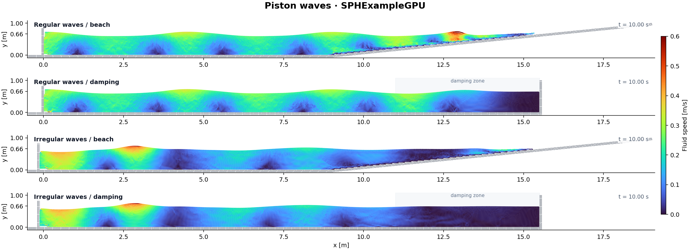

# SPHExampleGPU – CUDA version of SPHExample

`gpu_version/` is a copy of `src/` ported to NVIDIA GPUs with
[CUDA.jl](https://github.com/JuliaGPU/CUDA.jl). It is a self contained Julia
package (`SPHExampleGPU`) with the same public API as the CPU package: the
example scripts only differ in `using SPHExampleGPU` instead of
`using SPHExample`. All physics (Wendland/cubic kernels, artificial, laminar
and laminar+SPS viscosity, all density diffusion models, dynamic and mDBC
boundary conditions, particle shifting, prescribed motion of bodies) is
supported in 2D and 3D, in `Float64` or `Float32`.

## Requirements

* An NVIDIA GPU with a recent driver (CUDA 12 or newer). The CUDA toolkit is
  downloaded automatically by CUDA.jl, `nvcc` is not needed.
* Julia 1.12 or later in the 1.x series, matching `julia = "^1.12.0"` in
  [Project.toml](Project.toml).

## Getting started

Use a supported Julia installation for both dependency installation and example
runs. Check the selected version before instantiating the GPU package:

```bash
# from the repository root
julia --version # must report 1.12.x or later in the 1.x series
julia --project=gpu_version -e 'using Pkg; Pkg.instantiate()'
julia --project=gpu_version gpu_version/example/Dambreak2dMDBC.jl
```

The examples in `gpu_version/example/` mirror those in `example/`. Choose the
precision with `FloatType = Float32` or `Float64` at the top of a script.

### Variable-resolution dam break

Refinement is available through the normal solver:

```julia
refinement = VariableResolutionConfig(VariableResolutionBox((2.5,-0.2),(4.1,0.6));
    fine_geometry = fine_geometry, particle_reserve = 40000)
meta = SimulationMetaData{2,Float32,NoShifting,NoKernelOutput,SimpleMDBC,StoreLog}(
    SimulationName = "RefinedTank", SaveLocation = output_directory,
    SimulationTime = 1.0, OutputTimes = 0.0025,
    VariableResolution = refinement, GPUClipTimeStepToOutput = true)
```

Allocate particles with `AllocateDataStructures(coarse_geometry, meta)` and
call `RunSimulation` with the coarse constants/kernel, `ArtificialViscosity()`,
`FourtakasDensityDiffusion(full=true)` and `DualSPHysicsSymplectic()`. Fine
constants/kernel are derived from the ratio unless supplied in the config.
Normal file naming, output fields, scalar/vector schedules, logging and
`SimulationResult` apply; `SimDamping` acts on both domains. The case guide
contains a complete call and supported-option details.

[VResolutionDamBreak2d.jl](example/VResolutionDamBreak2d.jl) runs a native Julia/CUDA
adaptation of DualSPHysics 5.4 `vresolution/01_DamBreak2D`. A 0.01 m coarse domain
couples to a 0.005 m downstream patch through reconstructed buffers and accumulated
interface mass flux. It supports fixed mDBC walls and one stationary refinement
rectangle. This experimental implementation uses first-order MLS reconstruction;
see the [case guide](example/VResolutionDamBreak2d/README.md) for numerical
differences, output fields, customization and validation commands.

```bash
julia --project=gpu_version -t 2,0 gpu_version/example/VResolutionDamBreak2d.jl
```

Variable-resolution runs use GPU-resident timestep, transfer and grid control,
with dense active prefixes that exclude dormant reserves from routine work.
Normal runs use `GPUUseGraph` and `GPUMaxStepsPerSync` in metadata (default 32)
for graph execution and status checks. The host handles exceptional grid growth
and output downloads. The standalone validation driver also accepts
`execution=:host` for reference comparisons, `use_graphs=false` for direct
device launches and `batch_steps` for its status interval. The timestep rules,
Float64 positions/MLS and subdivision `R=1` are preserved.

Paired whole-solver timings and particle-state checks are available with:

```bash
julia --project=gpu_version -t 2,0 gpu_version/benchmark/variable_resolution.jl
```

### Dimension-aware physical constants

Pass the simulation dimension to set the default particle mass from density
and spacing:

```julia
constants_2d = SimulationConstants{Float32}(2; ρ₀ = 1000, dx = 0.02) # m₀ = ρ₀ * dx^2
constants_3d = SimulationConstants{Float32}(3; ρ₀ = 1000, dx = 0.02) # m₀ = ρ₀ * dx^3
```

The 2D convention assumes unit out-of-plane depth (one metre in SI units).
Only dimensions 2 and 3 are supported. An explicit `m₀` overrides the default;
all other keywords work as before. The existing keyword-only constructor,
`SimulationConstants{T}(; ...)`, retains its 2D mass default. The dimension-aware
constructor returns the same `SimulationConstants{T}` type and selects only
the default mass; use the same dimension for the geometry, kernel and metadata.

Run the constructor regressions without a GPU from the repository root:

```bash
julia --project=gpu_version gpu_version/test/simulation_constants.jl
```

For a linear, function-by-function explanation of the current StillWedge GPU
example, including CPU/GPU ownership, neighbor construction, both symplectic
interaction passes and asynchronous output, see the
[StillWedge GPU walkthrough](docs/StillWedgeGPUWalkthrough.md) and its
[top-to-bottom visual](docs/StillWedgeGPUFlow.svg). The companion
[complete package-function index](docs/StillWedgeGPUFunctionIndex.md) includes
local subfunctions, callbacks and inactive branches.

For literal source code under each stage, CPU line-hit evidence, and a
chronological recording of GPU kernel entries, open the standalone
[StillWedge execution-backed code visual](docs/StillWedgeGPUCodeTrace.html)
in a browser. It includes expandable helper implementations and the complete
function index. Recorded kernel entries are distinguished from accepted
physical steps and from unmeasured per-thread GPU branches.

### Periodic boundaries

For a self-contained **3D motor-driven floating paddle wheel**, see
[WheelPeriodic3d.jl](example/WheelPeriodic3d.jl) and its
[case guide](example/WheelPeriodic3d.md). It generates the trough and wheel,
applies a uniform initial velocity to every fluid particle, and combines a
prescribed floating-body hinge with physical longitudinal periodicity. The
video-inspired showcase inputs are explicitly illustrative and configurable.
Run from the repository root with an NVIDIA GPU:

```sh
julia --project=gpu_version -t 2,0 gpu_version/example/WheelPeriodic3d.jl
```

Output defaults to `gpu_version/output/wheel_periodic_3d`; use a new or empty
directory for each run. Geometry and host initialization can be checked without
CUDA using `gpu_version/test/wheel_periodic.jl`.

Set a physical periodic interval independently of the neighbor-grid cell size:

```julia
meta = SimulationMetaData{2, Float32}(
    SimulationName = "Periodic", SaveLocation = "output/periodic",
    Periodicity = PeriodicBoundary{2}(1; min = -0.011, max = 0.801, shift = (0, 0.3)),
    GPUFixedGrid = true, GPUGridExpansion = ((false, false), (true, true)),
)
```

This example wraps x into `[-0.011, 0.801)`: crossing the right edge raises
height by 0.3 m, and crossing the left edge lowers it. Omit `shift` for ordinary
periodicity. Axis indices follow the simulation coordinates (`x, y` in 2D;
`x, y, z` in 3D). Bounds are explicit physical faces, not grid-cell centers.
For a lattice with both end particles present, put the faces half a spacing
outside their extrema to avoid duplicate seam particles.

Pressure, continuity, viscosity, density diffusion, shifting and both mDBC
formulations use neighbors across the seam. No image particles or duplicate
output IDs are allocated. Positions are wrapped at accepted batch boundaries,
before fixed-grid freezing and output, and the cell list is rebuilt after a
crossing. The periodic axis cannot freeze particles. Other axes retain their
configured escape behavior; allow height expansion when using a height shift.
Both time-stepping schemes, CUDA graphs, buffer modes and position precisions
are supported. Periodic pair differences are formed in position precision and
then converted to the working precision (`:translated_absolute` in the
configuration report). `Periodicity = nothing` keeps the existing path.

Fixed boundaries stay stationary and must start inside the interval. Moving
walls keep their prescribed velocity; their owned ghosts translate with each
wrapped wall particle. Floating bodies wrap together when their center crosses
a face. All particle positions, full/half/previous centers and hinge anchors
receive the same translation, preserving rigid geometry, orientation, linear
and angular velocity, and torque arms. A straddling body is exported whole;
some of its particles can lie outside the primary interval until its center
crosses. Its periodic images still interact across the seam.

Currently one periodic axis is supported in 2D or 3D. Its length must exceed
twice the support radius `H`. A floating body's diameter plus `2H` must fit
inside the interval, and its initial center must be inside it. Existing mDBC
mode restrictions still apply (UpdatedMDBC does not support floating bodies).
This does not enable periodicity in the separate CPU package.

[Periodicity2d.jl](example/Periodicity2d.jl) generates the floor, step, baffle
and water columns from DualSPHysics 5.4 `examples/main/02_Periodicity`, mapping
its x/z plane to x/y. Defaults are `dx = 0.002`, 6 seconds and output every
0.06 seconds, with `XPeriodicIncZ = 0.3`, symplectic stepping, Wendland C2 and
artificial viscosity 0.2. It uses this solver's complex hydrostatic diffusion;
matching the geometry and periodic topology does not establish numerical
equivalence to DualSPHysics' integration, DDT and particle-exclusion policies.
The example needs no DualSPHysics files at runtime.

```bash
# From the repository root; optional arguments: output directory, spacing, duration
julia --project=gpu_version gpu_version/example/Periodicity2d.jl
julia --project=gpu_version -t 2,0 gpu_version/test/periodicity.jl
```

### Sinusoidal wave maker

[Wavemaker.jl](example/Wavemaker/Wavemaker.jl) adapts DualSPHysics example 06: a 3D tank,
sloping beach and sinusoidal piston, with periodicity across the tank width.
The editable geometry lives in [Geometry.jl](example/Wavemaker/Geometry.jl);
the [case guide](example/Wavemaker/README.md) describes the motion schedule, settings
and exported geometry. Defaults are `dx = 0.02`, 10 seconds and output every
0.1 seconds, using the reference's DBC particle layout, Fourtakas inner diffusion,
double positions and `DualSPHysicsSymplectic()` reference stepping. The generated
counts are 31,600 fixed, 30,000 moving and 401,600 fluid particles. The separate
reference scheme leaves the existing CPU-compatible integrators unchanged.
Running or including `Wavemaker.jl` starts the case. For customized calls to
`run_wavemaker(...)`, include `example/Wavemaker/WavemakerSetup.jl` instead.
Periodic DBC defaults to copies (`GPUPeriodicImages = true`), and
both runnable entry points enable `periodic_images = true`: dense,
GPU-generated periodic copies replace translated force queries while only
original particles are integrated and exported. The scheme default is
on. See the case guide for selecting the query backend and measuring the
implemented backend with whole-solver timings.

```sh
# From the repository root; optional arguments: output directory, spacing, duration
julia --project=gpu_version -t 2,0 gpu_version/example/Wavemaker/Wavemaker.jl
julia --project=gpu_version -t 2,0 gpu_version/example/Wavemaker/test_wavemaker.jl
```

### Wave maker driven by a measured signal

[WavemakerFile2d.jl](example/WavemakerFile2d.jl) adapts DualSPHysics example 07
(`07_WavemakerFile`) in a single file. In this 2D flume, a piston follows the
measured CIEMito paddle signal, and the waves shoal on a beach before running up
a vertical wall. The flume, piston and water are drawn as polygons in the file,
replacing the reference's STL structure. The beach has a 2 cm step at its toe
at x = 4 m and rises to z = 0.235 m at the wall (x = 6.045 m). The still water
depth is 0.31 m. The tank is sampled with `sampling = :conforming`, so the bed,
step, slope and wall have four smooth particle layers, without a lattice staircase.
The piston slides one spacing above the bed. At `dx = 0.005` the case has
4,448 wall, 770 piston and 50,713 fluid particles.

The example uses this package's defaults instead of the reference's
DualSPHysics-specific settings. These are Wendland C2 with `h = 2dx`,
`SymplecticTimeStepping()`, artificial viscosity `α = 0.01` and
`LinearDensityDiffusion()` with `δ = 0.1`. The sound speed is
`c₀ = 20√(g · 0.31)`. Boundaries retain the reference's DBC setting; positions
are stored in Float64. The piston signal is interpolated
linearly between its 0.025-second samples. The signal and CIEMito validation
data are bundled in
[example/data/wavemaker_file](example/data/wavemaker_file/README.md), with their
source notice and license. Water-column probes `WG1`–`WG3` at x = 1.38, 2.83 and
4.12 m are written to the output file. Subtract each probe's initial height to
compare with the experimental elevations.

```sh
julia --project=gpu_version -t 2,0 gpu_version/example/WavemakerFile2d.jl
```

The 10-second Float32 run took 161 s and 174,402 steps on an NVIDIA RTX A1000
Laptop GPU. Against the experiment from 1 to 10 s, sampled every 0.05 s, the
gauge RMSEs were 8.6, 8.7 and 9.1 mm, with correlations of 0.92, 0.91 and 0.87.
A DualSPHysics 5.4 GPU run of the distributed case gave 7.9, 8.3 and 8.9 mm, and
0.93, 0.92 and 0.87. The pressure integrals over the 54 wall-face particles,
including impact peaks of about 1 kN/m after the waves break, closely follow the
same DualSPHysics run. That run used the same pressure integral; the reference's
`ComputeForces` uses a different measure. No fluid particle crossed the bed or wall.

### Regular and irregular piston waves

[WavesPiston2d.jl](example/WavesPiston2d.jl) adapts all four variants of
DualSPHysics 5.4 example 09 (`09_WavesPiston`). A piston makes second-order
waves in 0.66 m of water. Select a 1:10 beach starting at x = 9 m and ending
at (19, 1) m, or a flat flume ending at x = 15.5 m with an absorbing zone
from x = 11 to 15.5 m. Reference x/z coordinates map to simulation x/y.
The default is the regular-wave beach case; running or including the file
starts its 30-second simulation.

```bash
julia --project=gpu_version -t 2,0 gpu_version/example/WavesPiston2d.jl beach regular
julia --project=gpu_version -t 2,0 gpu_version/example/WavesPiston2d.jl damping regular
julia --project=gpu_version -t 2,0 gpu_version/example/WavesPiston2d.jl beach irregular
julia --project=gpu_version -t 2,0 gpu_version/example/WavesPiston2d.jl damping irregular
```

Regular waves have height 0.15 m and period 2 s. The piston uses the same
second-order transfer function as `FloatingWavesPiston2d.jl`, with the
reference's smooth one-period ramp as in `Bathymetry2d.jl`. Irregular waves
use JONSWAP with significant height 0.15 m, peak period 2 s, peak enhancement
3.3, 1024 energy-stretched components and seed 1234, including second-order
interactions. The reference's fitted series start is 560.075 s and it has no
startup ramp. Its bundled 0.01 s motion history is interpolated linearly.
Runs are limited to the bundled motion/theory interval of 30 s. See the
[data provenance and regeneration instructions](example/data/waves_piston/README.md).
DualSPHysics is only needed to regenerate those tables.

The native polygons use four conforming wall layers and a piston whose wet
face is at x = 0, one particle spacing above the bed. At the default
`dx = 0.02`, the solver uses hydrostatic initial density, `h = 1.2√2 dx`,
Wendland C2 with `(0.1h)^2` regularization, artificial viscosity 0.01 with `boundary_factor = 0`, Fourtakas
inner density diffusion 0.1, no shifting, DBC and Float64 positions.
`DualSPHysicsSymplectic` selects the reference integrator and timestep rules;
its direct steps require `GPUUseGraph = false`, `GPUBoundaryForces = false`
and one lane per particle.

The damping variant passes a `DampingZone` as `SimDamping`. After each
completed step, it multiplies each fluid velocity component by
`max(0, 1 - dt * 10 * min((x - 11) / 4.5, 1)^2)` for 11 < x ≤ 16.5 m,
matching the reference's quadratic zone and 1 m overlimit. The general API
also supports oriented `DampingZone` planes, `DampingBox` side regions and
radial `DampingCylinder` regions, with per-component factors and multiple
zones. Box corners use the strongest active-side profile; box and cylinder
profiles follow the DualSPHysics squared ramp. All three shapes work with both
CPU-style integrators and CUDA graphs. Boundary, floating and frozen particles
retain their velocities.

When `SimDamping` is set, particle VTKHDF output also contains `DampingZones`
and `DampingProfiles` wireframe blocks. The zone block outlines the active
region. Plane extents are projected from the initial particle bounds because
planes are unbounded transversely; cylinder extents are similarly bounded only
for visualization along their infinite axes. Box zones use their configured
bounds. The profile block records reference values 0 and 1 and the spatial ramp
for each plane, active box side and cylinder. The per-step velocity multiplier
is `max(0, 1 - dt * rate * profile * factors[d])`. The zone wireframe uses the
same normalized weight for point coloring, with a fixed 0-1 ParaView color
scale. The generated ParaView state enables this array for coloring and labels
it as dimensionless. Both blocks are included in single-file and numbered
VTKHDF output and displayed as wireframes when damping is enabled.

Each variant writes to `output/waves_piston_<termination>_<waves>/`: particle
and grid VTKHDF series, the polygon geometry, gauges at x = 2, 6 and 10 m,
and a submerged velocity probe at (6, 0.4) m. `_Theory.csv` contains the
reference's first/second-order predictions at x = 6 m and 0.26 m below still
water. `_Comparison.csv` aligns them with the measured elevations (subtracting
each gauge's initial height) and velocity. Compare after the startup waves
have reached x = 6 m; the theory does not propagate the startup transient.
These tables support validation; they are not experimental data.

For customized runs, include the definitions instead of the entry point:

```julia
include("gpu_version/example/WavesPiston/WavesPistonSetup.jl")
result = run_waves_piston(termination = :damping, waves = :irregular,
    dx = 0.02, duration = 10, visualize = false)
```

Focused geometry, motion, damping, graph and four-variant CUDA regressions:

```bash
julia --project=gpu_version -t 2,0 gpu_version/test/waves_piston.jl
```

All four default-resolution cases were run for 30 s on an NVIDIA RTX 5080
with Julia 1.12.7. Each wrote 601 frames. No fluid particle crossed the bed,
piston or damping-case end wall in those frames, and no particle was frozen.
At x = 6 m, using outputs from 8–30 s without a phase adjustment:

| Termination | Waves | Total / fluid particles | Steps | Elevation RMSE vs second-order theory |
| --- | --- | ---: | ---: | ---: |
| Beach | Regular | 23,603 / 19,488 | 222,245 | 7.6 mm |
| Beach | Irregular | 23,603 / 19,488 | 221,418 | 10.6 mm |
| Damping | Regular | 28,384 / 24,768 | 219,821 | 7.2 mm |
| Damping | Irregular | 28,384 / 24,768 | 219,507 | 10.0 mm |

The fluid counts are close to the reference's; the four wall layers deliberately
add boundary particles. These results validate this resolution and setup;
they do not establish convergence or an exact match to the reference solver.



[Wave-gauge comparison with second-order theory](example/WavesPiston/theory_comparison.png).

### DualSPHysics 5.4 `20_Damping`

[Damping.jl](example/Damping.jl) builds the five physical configurations from
the installed v5.4 `20_Damping` XML files. `plane_mdbc` is the narrow flume
with its moving piston and damping enabled; `plane` is the same mDBC/piston case
with damping disabled as the control. `angle` releases the reference 3D water
block into a closed tank with an angled damping plane. `box` and `cylinder`
each reproduce the shallow pool plus falling fluid drop, with damped and
undamped tanks side by side. These use `DampingBox` and `DampingCylinder`,
respectively, not approximations made from intersecting planes.

```sh
julia --project=gpu_version -t 2,0 gpu_version/example/Damping.jl plane_mdbc
julia --project=gpu_version -t 2,0 gpu_version/example/Damping.jl plane
julia --project=gpu_version -t 2,0 gpu_version/example/Damping.jl angle
julia --project=gpu_version -t 2,0 gpu_version/example/Damping.jl box
julia --project=gpu_version -t 2,0 gpu_version/example/Damping.jl cylinder
```

The physical inputs follow the installed XML: `dp = 0.0125 m` for the narrow
flume (0.37 m width) and `dp = 0.005 m` for the other 3D cases; run durations
are 20, 3.5 and 2.5 s for the plane, angle and drop cases. The original
361-sample piston history is
bundled at [CaseDampingPlane_PistonMovement.dat](example/data/damping/CaseDampingPlane_PistonMovement.dat)
with its provenance. Both plane XML files use boundary method 2 (mDBC); the
`Not_mDBC` file disables damping for the control run. To keep runs practical,
pass a larger `dx` or shorter duration when testing:

```julia
include("gpu_version/example/Damping/DampingSetup.jl")
run_damping_case20(variant = :box, dx = 0.025, duration = 0.1,
    visualize = false, save_location = mktempdir())
```

The cases use this package's
`SymplecticTimeStepping()` and `LinearDensityDiffusion()` rather than importing
DualSPHysics' time-step or density-diffusion implementation; damping rates,
zones, fluid blocks, drops and paddle motion come from the reference inputs.

Focused damping-profile, physical-case construction, VTKHDF, CUDA-kernel and
short integration regressions:

```sh
julia --project=gpu_version gpu_version/test/damping.jl
```

### Floating box in a wave tank

[FloatingBox3d.jl](example/FloatingBox3d.jl) adapts DualSPHysics example 11
(`11_Floating`, `CaseFloating`) in a single file, following its
[video](https://youtu.be/hdgJJJ_5Mxo) and description: a 3D floating box in a
wave tank, periodic across the width, with a sinusoidal piston and δ-SPH. The
5.4 distribution's XML keeps the geometry but replaces the periodicity with side
walls. The tank is 16 m long, 6 m wide and 6 m high. The water fills it to 4 m;
its top particle layer lies at 3.9 m, as with GenCase's `fillbox`. The 0.3 m
piston stands at x = 0.7 m and moves as x = 0.5 sin(2π · 0.3 t), starting at
full speed into the tank. The 2 m box of 10 t starts half submerged, with its
centre at (11, 3, 4) m. The tank, piston, box and water are drawn as prisms and
sampled on one lattice. The bed and end wall have four particle layers, and the
piston slides one spacing above the bed. The periodic faces are at
y = −dx/2 and 6 − dx/2, so no particle row is duplicated at the seam. At
`dx = 0.1` the case has 53,760 wall, 12,000 piston, 9,261 box and 344,250 fluid
particles.

As in the previous example, the package's defaults replace the reference's
DualSPHysics-specific settings: `SymplecticTimeStepping()`, artificial
viscosity `α = 0.01` and `LinearDensityDiffusion()` (δ-SPH with `δ = 0.1`). The
kernel is Wendland C2 with `h = √3 dx`, the reference's `coefh = 1`. The sound
speed `c₀ = 20√(g · 3.8)` uses the sampled water column, as GenCase does.
Densities start hydrostatic. `RelativeWeight = 10000 / (m₀ N) ≈ 1.08` gives
the reference's `massbody`. Boundaries use DBC, and positions are stored in
Float64. `FloatingBox3D_Floating.csv` records the box's centre, velocity,
orientation and angular velocity. Water-column probes `WG1` and `WG2`, at
x = 6 m (between the piston and box) and x = 14 m (behind it), with y = 1 m,
are written to the output file.

```sh
julia --project=gpu_version -t 2,0 gpu_version/example/FloatingBox3d.jl
```

The 10-second Float32 run took 1,461 s and 35,304 steps on an NVIDIA RTX A1000
Laptop GPU. A DualSPHysics 5.4 GPU run gave the reference. It used the
distributed case's settings (Laminar+SPS, Fourtakas DDT 0.1), made periodic in
y with `YPeriodicIncZ = 0`. GenCase's BCC boundary lattice (`lattice
bound="2"`) offsets wall particles by ±dp/4, which cannot tile the periodic
seam. That run therefore used the cubic lattice and the four-layer walls drawn
here. Its water, piston and box particles coincide with this example's.

In both runs, the box first sinks from its 1 m draft. It then hangs fully
submerged, with its centre about 2.1 m above the bed, until the first wave crests
lift it towards the surface after 4 s. The comparison samples 0.1 to 10 s every
0.1 s. Surge, from −0.73 to 0.62 m, had an RMSE of 6.1 cm and a correlation of
0.993. Heave, down to −1.97 m, had an RMSE of 7.1 cm and a correlation of 0.990.
Pitch shows the same rocking of about ±10°, but its phase drifts after 6 s
(RMSE 4.3°, correlation 0.67). The largest pitch magnitude was 13.5° in the
reference and 11.7° here. Gauge elevations agree closely. `WG1` ranges from
−0.58 to 1.17 m, with an RMSE of 1.4 cm and a correlation of 0.9997. Behind the
box, `WG2` had an RMSE of 4.7 cm and a correlation of 0.996. No fluid particle
crossed the bed, end wall or piston.

### Floating boxes in flap and piston waves

DualSPHysics example 12 (`12_FloatingWaves`) checks a 2D floating box in waves
against two experiments, and each case is adapted here in a single file. As in
the previous examples, the flume, wave maker, box and water are drawn as
polygons. The tank is sampled with `sampling = :conforming`, so the bed and
beach have four smooth particle layers, without a lattice staircase. The wave
maker is four particles thick and starts one spacing above the bed. Its wet face
lies where the reference's does, so the box and water particles coincide with
GenCase's lattice. The top particle row of the water lies one spacing below the
0.4 m still water level, as with GenCase's `fillbox`. The data files are bundled
in [example/data/floating_waves](example/data/floating_waves/README.md), with
their source notice and license.

Both examples use the package's defaults: `SymplecticTimeStepping()`,
artificial viscosity `α = 0.01`, as in the 5.4 reference, and
`LinearDensityDiffusion()` (δ-SPH with `δ = 0.1`), where the reference uses
Fourtakas' diffusion term with the same coefficient. The kernel is Wendland C2
with `h = 1.2√2 dx`, the reference's `coefh = 1.2`. The sound speed uses the
reference's `coefsound` and the height of the sampled water column, as GenCase
does. Densities start hydrostatic. Boundaries retain the reference's DBC
setting, and positions are stored in Float64. The box's centre,
velocity, angle and angular velocity are written to
`<SimulationName>_Floating.csv`. Its angle is counterclockwise in the x-y plane,
so DualSPHysics' pitch and the roll of Ren et al. are its negative; the roll in
the Hadžić et al. data file has the angle's sign.
Water-column probes are written to the output file; subtract each probe's
initial height for the wave elevation.

#### Flap waves

[FloatingWavesFlap2d.jl](example/FloatingWavesFlap2d.jl) adapts
`CaseFloatingWavesVal` ([video](https://youtu.be/nwbS8QcDnm4)), validated
against Hadžić et al. (2005). A flap hinged on the bed at x = 0 follows the
bundled angle signal, within ±4.7°, for 10.9 s and then holds its last angle.
As in DualSPHysics, a positive angle turns the flap away from the water; at
1.5 s the flap particles coincide with the reference's to rounding.
The waves break on a 1:10 beach that starts at x = 4 m. The 10 × 5 cm box has
a relative density of 0.68 and starts with its bottom at 0.37 m, 3 cm below the
still water level. Probes `WG1` and `WG2` lie at the reference's elevation
points, x = 1.16 and 2.66 m. The video names Laminar+SPS viscosity, from version
4.4; the 5.4 case uses artificial viscosity. At `dx = 0.002` the case has
21,064 wall, 1,200 flap, 1,326 box and 595,041 fluid particles, against
GenCase's 594,842 fluid particles and the same box.

```sh
julia --project=gpu_version -t 2,0 gpu_version/example/FloatingWavesFlap2d.jl
```

The 15-second Float32 run took 4,791 s and 653,349 steps (84 million
particle-steps per second) on an NVIDIA RTX A1000 Laptop GPU. A DualSPHysics
5.4 GPU run of the distributed case, with 602,920 particles, took 10,652 s and
657,991 steps (37 million particle-steps per second). Sampled every 0.05 s, the
two runs nearly coincide. Heave, within ±4 cm, has an RMSE of 0.4 mm and a
correlation of 0.999. Roll, from −13° to 23°, has an RMSE of 0.18° and a
correlation of 0.999. The box drifts 15 cm here and 14 cm in the reference;
sway has an RMSE of 1.3 cm and a correlation of 0.982. `WG1` and `WG2` have
RMSEs of 0.6 mm and correlations of 0.999 and 0.998. Against the experiment,
the RMSEs here and in DualSPHysics are 2.5 and 2.4 mm at `WG1`, 5.0 and 5.5 mm
at `WG2`, 7.3 and 6.8 mm in heave, 4.3° and 4.4° in roll, and 10 and 7.5 mm in
sway, with correlations from 0.91 to 0.99 in both. No fluid particle crossed
the bed or flap.

#### Piston waves

[FloatingWavesPiston2d.jl](example/FloatingWavesPiston2d.jl) adapts
`CaseFloatingWavesVal2` ([video](https://youtu.be/VnBVXMVNV7s)), validated
against Ren et al. (2015). The piston's wet face starts at x = 0.205 m. It makes
regular waves 0.1 m high, with a 1.2 s period, by second-order wave maker theory
(Madsen, 1971): x = a₁ sin ωt + a₂ sin 2ωt, with a₁ = 4.03 cm and
a₂ = −0.31 mm. The file solves the linear dispersion relation for the stroke,
and the result matches the motion DualSPHysics writes for this case. The piston
starts at full speed, without a ramp, as in the reference. The beach rises
1.8 m over 7 m from x = 5 m. The walls end at 0.75 m, where the reference crops
its domain. The 30 × 20 cm box, of relative density 0.5, starts with its centre
at (2, 0.4) m. Probe `WG1` lies at x = 1 m, between the piston and the box. At
`dx = 0.005` the case has 6,415 wall, 600 piston, 2,501 box and 86,628 fluid
particles, against GenCase's 86,602 fluid particles and the same box.

```sh
julia --project=gpu_version -t 2,0 gpu_version/example/FloatingWavesPiston2d.jl
```

The 13.5-second Float32 run took 368 s and 311,257 steps (81 million
particle-steps per second) on an NVIDIA RTX A1000 Laptop GPU. A DualSPHysics
5.4 GPU run of the distributed case, with 91,115 particles, took 1,289 s and
319,143 steps (23 million particle-steps per second). Sampled every 0.05 s, the
two runs agree closely. The box drifts 0.94 m with the waves here and 0.92 m
in the reference; surge has an RMSE of 2.2 cm and a correlation of 1.000. Heave,
within ±5.5 cm, has an RMSE of 3.1 mm and a correlation of 0.995. Roll, from
−10° to 19°, has an RMSE of 1.0° and a correlation of 0.993. `WG1` has an RMSE
of 1.8 mm and a correlation of 0.998. Against the experiment, from 1.8 to
8.9 s, both runs miss the first wave's larger response before 2.5 s. After
that, heave and roll follow it, but the measured drift is faster: by 8.9 s the
box has moved 0.72 m in the experiment, 0.61 m here and 0.59 m in the
reference. Over the whole record, the RMSEs here and in DualSPHysics are 5.9
and 7.6 cm in surge, 19 and 18 mm in heave, and 3.2° and 3.6° in roll. No fluid
particle crossed the bed or piston.

### Waves over a bathymetry from XYZ points

[Bathymetry2d.jl](example/Bathymetry2d.jl) adapts DualSPHysics example 18
(`18_Bathymetry`, `CaseBathymetry2D`) in a single file. A piston makes regular
waves, 1.5 m high with a 4 s period, which cross a surveyed seabed and break on
its beach. The reference builds the bed with GenCase's `drawbathymetry`, and
the file follows the same steps with the bundled survey points. It moves them
to the reference's frame, scales their heights by 1.8 and keeps the 5,200
points of the selected area. Then it samples them on a 2 m grid over
200 ≤ x ≤ 260 m. As in the reference, the grid is extended upstream by flat
nodes 15 m high at x = 190 and 182 m and up to a 28 m beach crest at
x = 280 m, then moved by (−185, −30, −21) m. The 2D case is the grid row at
y = 32 m after the move, so the bed is straight between nodes 2 m apart. It
lies 6 m below the still water level at the piston and deepens to 8.6 m at
x = 43 m. From x = 51 m it rises steeply to a shelf 0.5 to 1.1 m deep between
x = 65 and 75 m, and then the beach climbs 7.5 m over 20 m.

GenCase does not document how it computes grid heights from scattered points.
Here they are interpolated linearly on a Delaunay triangulation of the points
(Meshes.jl's `DelaunayTesselation`, with a fixed seed). Along the section, these
heights differ from GenCase's by 19 cm RMS. The largest difference, 0.86 m, is
at x = 63 m, where the survey has no points within 2 m upstream of the node.
The survey file is bundled in
[example/data/bathymetry](example/data/bathymetry/README.md), with its source
notice and license.

The bed is sampled with `sampling = :conforming`, so it has four smooth
particle layers, without a lattice staircase. The piston's wet face stands at
x = 0.8 m, one spacing above the bed, and nothing closes the dry flume behind
it. The top particle row of the water lies one spacing below the still water
level, as with GenCase's `fillbox`. At `dx = 0.2` the case has 2,035 bed,
236 piston and 10,368 fluid particles, against GenCase's 236 piston and 10,308
fluid particles. The piston follows second-order wave maker theory for the
reference's nominal depth of 5.5 m. Its first harmonic is amplified by the
reference's `gainstroke` of 1.1, giving a 1.17 m stroke, and a ramp
r(s) = 6s² − 8s³ + 3s⁴, with s = t / 4 s, scales both harmonics over the first
period. The motion matches the one DualSPHysics writes for this case to 1 µm.

The example uses the package's defaults, as the previous examples do: Wendland
C2 with `h = 1.2√2 dx`, the reference's `coefh = 1.2`,
`SymplecticTimeStepping()`, artificial viscosity `α = 0.01` and
`LinearDensityDiffusion()` (δ-SPH with `δ = 0.1`). The reference uses
Fourtakas' diffusion term with the same coefficient. The sound speed is
`c₀ = 20√(g · 8.2)`, from the height of the sampled water column, as GenCase
computes it. Densities start hydrostatic. Boundaries retain the reference's DBC
setting, and positions are stored in Float64. The run
lasts 30 s and writes a frame every 0.1 s, as the reference does. Water-column
probes stand on the bed at x = 6 m, where DualSPHysics writes the theoretical
elevation, and every 5 m from x = 10 to 75 m. They give the water depth;
subtract each probe's initial depth for the wave elevation.

```sh
julia --project=gpu_version -t 2,0 gpu_version/example/Bathymetry2d.jl
```

### External forces

`SimExternalForces` adds prescribed acceleration histories to fluid groups,
following DualSPHysics 5.4 `examples/main/04_ExternalForces`. The implementation
lives in `src/ExternalForces.jl`; the interaction kernels are unchanged.

```julia
force = ExternalForce{3, Float32}(3;
    times = [0, 1, 3, 5],
    linear_acceleration = [(0, 0, 0), (0, 0, 15), (0, 0, 0), (0, 0, 0)],
    angular_acceleration = [(0, 0, 0), (0, 0, 0), (0, 2, 0), (0, 0, 0)],
    center = (0, 0, 0), global_gravity = true)
# Add SimExternalForces = force (or a tuple/vector of forces) to RunSimulation.
# Reference CSV files can also be read directly:
# force = ExternalForce{3, Float32}(3, "CaseForcesData_0.csv")
```

Markers use this package's `SPHGeometry.GroupMarker`, rather than the reference's
separate `mkfluid` numbering. Each selected marker must contain only fluid
particles, and can have one history. Fixed, moving and floating groups are
rejected. Other fluid groups retain their usual gravity. Forces use acceleration
units (m/s² and rad/s²), with seconds and metres for time and center.

Samples interpolate linearly and hold their first/last value outside the table.
`start_time` and `end_time` optionally restrict the inclusive active interval;
outside it the force and its gravity override are inactive. Set
`global_gravity = false` to cancel gravity for that group during the interval.
For 2D, linear vectors and centers have two components, and angular samples are
scalars, positive counterclockwise. Reference CSV columns are
`time;ax;ay;az;alpha_x;alpha_y;alpha_z`, with optional `#` comments. In 2D their
x/z coordinates map to x/y, and angular y changes sign; unused components must
be zero.

Angular terms reproduce the 5.4 source conventions: frame velocities start at
zero at the first table sample and accumulate each interval's **right-end**
acceleration, then interpolate linearly. Tangential, centripetal and Coriolis
terms run only when angular acceleration is nonzero. Coriolis follows the
reference's component-wise frame-velocity subtraction, including its asymmetry;
this is not the general `2ω × (v - v_frame)` expression. These details matter
when reproducing this case. Both time integrators, compact buffers, particle
sorting, Float32/Float64 physics, double positions and CUDA graph replay are
supported. Corrector forces use half-step positions, velocities and time; the
single-neighbor predictor carries the previous evaluated acceleration.

The driver samples each group's history once on the device at each evaluated
stage, then reuses the coefficients in its particle kernel. The existing
timestep kernel prepares the full- and half-stage samples together, avoiding
separate sampling launches during integration. The single-neighbor integrator
prepares only the half-stage sample; startup and rebuild derivative evaluations
sample their accepted state independently. Both integrators and CUDA graph
replay use this path. Low-level experiments can still use
`prepare_external_forces(...; sample_once = false)` for per-particle sampling.
Shared sampling does not change
endpoint holding, the inclusive active interval, gravity overrides or the
angular-acceleration gate.

Run the self-contained generated 3D example from the repository root:

```powershell
julia --project=gpu_version gpu_version/example/ExternalForces.jl
# Optional arguments: output directory, spacing, duration (defaults: 0.02 m, 5 s).
julia --project=gpu_version gpu_version/example/ExternalForces.jl output/forces 0.05 5
julia --project=gpu_version -t 4,0 gpu_version/test/external_forces.jl
```

The example generates a cubic container, central sphere and two water blocks in
Julia, then applies the reference's upward acceleration and angular oscillation
to the two fluid groups. It needs no DualSPHysics installation or input CSVs.
The container has three outer particle layers. This example demonstrates the
force contract; it is not a complete solver-to-solver trajectory equivalence
claim (boundary viscosity and other SPH operators can differ).

### Sloshing tank

`example/SloshingTank.jl` supports both variants of DualSPHysics 5.4
`examples/main/05_SloshingTank`. The lever near the top of the file is:

```julia
const SLOSHING_DRIVING_MODE = :rotation  # or :acceleration
```

`:rotation` is the default: the tank physically rotates about its bottom
midpoint `(0, 0)` following `CaseSloshingMotionData.dat`, with constant world
gravity and no external fluid acceleration. `:acceleration` keeps the tank
fixed and uses `CaseSloshingAccData.csv`. The same choice is available as
`run_sloshing_tank(; driving_mode = :rotation)`.

The example generates a closed 0.9 m
wide, 0.508 m high tank with a 0.093 m water layer directly from Julia polygons.
Reference x/z coordinates map to simulation x/y. Defaults are 0.002 m spacing,
8.35 seconds, 0.01-second output, symplectic stepping, Wendland C2,
`h = 0.91924√2 * dx`, artificial viscosity `α = 0.05`, and complex density
diffusion `δ = 0.1`. Automatic sound speed uses the sampled fluid depth, giving
`c₀ ≈ 28.1888 m/s` at the default spacing, as in the resolved reference case.
No solver source changes are needed.

```powershell
julia --project=gpu_version gpu_version/example/SloshingTank.jl
# Optional arguments: output directory, spacing, duration.
julia --project=gpu_version gpu_version/example/SloshingTank.jl output/sloshing 0.004 8.35
julia --project=gpu_version -t 4,0 gpu_version/test/sloshing_tank.jl
julia --project=gpu_version -t 4,0 gpu_version/test/prescribed_rotation.jl
julia --project=gpu_version -t 4,0 gpu_version/test/motion_stage_sampling.jl
```

Both original 167,001-sample histories are bundled under
`example/data/sloshing_tank/`, with its source notice and upstream license.
They are not resampled or replaced with synthetic sinusoids. The geometry needs
no input CSVs or DualSPHysics installation. In acceleration mode, linear input already contains
the changing gravity vector: `ExternalForce` disables global gravity for the
fluid group and applies the full linear/angular history. The tank stays fixed.
The acceleration-mode force center `(0.45, 0)` follows the reference XML; its explanatory
note instead describes the bottom midpoint. The example's `force_center`
keyword can select that alternative explicitly. Runs beyond the supplied
history are rejected.

The pressure probe at reference location `(-0.4461, 0.093)` rotates with the tank
in rotation mode. Its world positions are saved for every output frame. The
left/center/right vertical water-column probes are included in acceleration
mode. Pressure uses normalized SPH interpolation over fluid particles with the
simulation's kernel and smoothing length. The example uses three wall layers
at the default spacing and the solver's standard boundary viscosity; the
reference sets its separate boundary-viscosity multiplier to zero. Together
with other operator differences, this prevents a solver-to-solver or experimental
pressure-equivalence claim. Mode-specific default outputs are in
`output/sloshing_tank_rotation` and `output/sloshing_tank_acceleration`.

Physical rotation support lives in `src/PrescribedRotation.jl`. Low-level cases
can pass `SimRotation = RotationMotion(marker; times, angles, center)` to
`RunSimulation`, with `Moving` geometry and angles in radians, positive
counterclockwise. Absolute placement uses stable reference slots at the start,
half-step and accepted times; wall velocity is the derivative of the interpolated angle.
Endpoint angles are held with zero velocity beyond the table. This currently
supports nonperiodic 2D DBC cases; the rotating group cannot also use
`MotionDetails`. Motion tables retain Float64 precision with either physics
precision. Pressure and velocity probes accept a host `trajectory(time)`
keyword when their locations need to follow motion.

For translation, acceleration, sinusoidal/circular trajectories, file input
and hierarchical rigid motion, pass `SimMotion = PrescribedMotion(...)` or
`MotionSystem(...)`. This path supports nonperiodic 2D/3D DBC and both
integrators, plus translation-only `SimpleMDBC` cases, with analytical wall
velocities at the start, predictor and accepted times. `SimpleMDBC` motion
keeps its ghost-normal offset fixed; prescribed rotations remain DBC-only.
Periodic DBC cases additionally allow independent translations
that leave the periodic coordinate unchanged, as in the wave-maker example.
Periodic rotations and parent hierarchies remain unsupported.
The [nine runnable Motion examples](example/Motion/README.md)
now reproduce the distributed DualSPHysics 5.4 Motion01–09 geometry and commanded
motion, opening animated polygon surfaces by default. Their Julia implementation
uses independent trajectory and transform abstractions. Actual-case geometry
and motion fixtures from GenCase/BoundaryVTK validate the matching scenes,
timelines, simultaneous tracks, instantaneous resets and file transitions.
The [upstream motion-engine comparison](test/reference/README.md) validates
representative positions for all nine patterns; finite-increment wall rates,
general event semantics and fluid-solver equivalence are not claimed.

```powershell
julia --project=gpu_version -t 2,0 gpu_version/example/Motion/Motion01.jl
julia --project=gpu_version -t 2,0 gpu_version/test/prescribed_motion.jl
julia --project=gpu_version -t 2,0 gpu_version/test/motion_examples.jl
```

For `SimRotation`, the timestep kernel samples the rotation table and computes sine/cosine once
for each of the start, half and accepted stages. Compact wall-particle kernels
reuse these three samples without separate preparation launches.
Reference-owner indices follow the cell-sort permutation using idle cell-list
scratch, without per-particle ID searches, sparse ID-indexed buffers, or
additional full-particle persistent arrays. Low-level callers that sort must
pass their prepared `rotation` to `rebuild_cell_list!`.
Standalone motion launches prepare their own samples by default. Sampling
buffers contain three rotation coefficient vectors and two samples per force
history; no additional particle-sized persistent arrays are needed. Stopped
steps leave these buffers untouched, and a step resumed after sorting samples
the retained timestep before applying motion.

`SimMotion` uses the same stage/sort lifecycle, caching three rigid poses and
their first two derivatives per hierarchy node. Its compact reference positions,
owner indices and group markers cover only the selected moving particles.

#### Stage-sampling performance experiment

Run the paired benchmark from the repository root (the default comparison
is against the original per-particle implementation):

```powershell
julia --project=gpu_version -t 2,0 gpu_version\benchmark\motion_sampling.jl --rounds=9 --duration=0.1 --dx=0.002
```

By default the benchmark loads the original particle-sampling kernels and driver from
git commit `2067c583521dd06d317b56a33beb957f0889684b` without changing the
worktree. That git object must be available locally. It uses the complete,
unresampled 167,001-entry sloshing histories, two warmup pairs per mode, and
alternating paired **complete** `RunSimulation` calls including setup, graph
preparation, sorting, readbacks, downloads and output finalization. It checks
exact ID-ordered particle state and every exported dataset, as well as matching
accepted time, steps, rebuilds, readbacks, output frames and frozen counts.
`--single-neighbor`, `--no-graph`, `--float64`, `--double-position`,
`--modes=rotation` and `--output=path.csv` select additional comparisons.

For the first shared-stage implementation (`f06a58d`, which still used separate
sampling launches), measurements on an NVIDIA RTX A1000 Laptop GPU with Julia
1.12.7, Float32 physics/positions,
CUDA graphs, deterministic sorting, `R = 1`, 24,902 particles and 5,422 steps:

| Mode | Original median complete run | Shared-stage median | Median paired ratio (stage/original) | Faster pairs |
|---|---:|---:|---:|---:|
| Rotation | 1.7962 s | 1.6600 s | 0.9231 | 9/9 |
| External acceleration | 1.7689 s | 1.7896 s | 1.0113 | 0/9 |

Rotation's paired ratio IQR was 0.9218–0.9242 (about 7.7% lower elapsed time);
external acceleration's was 1.0102–1.0115 (about 1.1% higher elapsed time).
Raw pairs are in `benchmark/motion_sampling_results.csv`. All pairs had exact
state/output equality. This is short-duration, shared-laptop evidence, not a
general speedup or long-run stability claim. The current timestep-fused
implementation removes the separate sampling launches used in that experiment.
Set `SPH_MOTION_BASELINE_COMMIT` to compare against a later committed driver;
CSV variants are labelled `baseline` and `current`.

The timestep-fused sampler was compared with both `f06a58d` and the original
`2067c58` on an NVIDIA GeForce RTX 5080 (driver 616.92), Julia 1.12.7, using the
same Float32, graph, sorting, history, particle-count and duration settings
above. Each comparison used two warmup pairs and nine alternating measured pairs:

| Baseline | Mode | Baseline median complete run | Current median complete run | Median paired ratio (current/baseline) | Faster pairs |
|---|---|---:|---:|---:|---:|
| Separate stage launches (`f06a58d`) | Rotation | 0.4461 s | 0.4098 s | 0.9162 | 9/9 |
| Separate stage launches (`f06a58d`) | External acceleration | 0.4313 s | 0.4117 s | 0.9544 | 9/9 |
| Per-particle sampling (`2067c58`) | Rotation | 0.4869 s | 0.4126 s | 0.8482 | 9/9 |
| Per-particle sampling (`2067c58`) | External acceleration | 0.4230 s | 0.4149 s | 0.9796 | 9/9 |

This is about 8.4% and 4.6% lower elapsed time than the separate-stage version,
and 15.2% and 2.0% lower than the original version, respectively. The paired
ratio IQRs against `f06a58d` were 0.9154–0.9214 for rotation and 0.9537–0.9567
for external acceleration. Every pair had exact ID-ordered particle-state and
exported-dataset equality, with matching work counts. Raw pairs are in
`benchmark/motion_stage_fusion_results.csv` and
`benchmark/motion_stage_fusion_original_results.csv`. These are measurements of
this case and device, rather than a general performance guarantee.

Three alternating pairs at a longer 1.0 s physical duration also matched
exactly, including 54,267 steps and 123 rebuilds for rotation, and 54,265 steps
and 104 rebuilds for external acceleration. Median paired elapsed time was
8.1% lower for rotation and 4.9% lower for external acceleration than `f06a58d`;
all six pairs were faster. Raw pairs are in
`benchmark/motion_stage_fusion_long_results.csv`. This checks a longer segment
of the same case, rather than full-history stability or other devices.

To reproduce the comparison with the separate-stage version from the repository root:

```powershell
$env:SPH_MOTION_BASELINE_COMMIT = "f06a58d0a7cc03235a9e15ce7cdec39db776d3eb"
julia --project=gpu_version -t 2,0 gpu_version\benchmark\motion_sampling.jl --rounds=9 --duration=0.1 --dx=0.002 --output=gpu_version/benchmark/motion_stage_fusion_results.csv
Remove-Item Env:SPH_MOTION_BASELINE_COMMIT
```

### Choosing the mDBC formulation

The fifth `SimulationMetaData` type parameter selects the boundary formulation:

| Mode | Behavior |
| --- | --- |
| `NoMDBC` | Original dynamic boundary conditions (default). |
| `SimpleMDBC` | Existing mDBC density extrapolation and determinant/Shepard fallback, unchanged. |
| `UpdatedMDBC` | Aaron English's *Updates on modified Dynamic Boundary Conditions (mDBC)*, 7th DualSPHysics Workshop, 20 March 2024, slides 13–17. |

For example, select the updated formulation with:

```julia
SimMetaData = SimulationMetaData{2, Float32, NoShifting, NoKernelOutput, UpdatedMDBC, StoreLog}(
    SimulationName = "UpdatedMDBC", SaveLocation = "output/updated_mdbc",
    SimulationTime = 1.0, OutputTimes = 0.02,
)
```

Use `SimpleMDBC` in the same position to retain the original method. Existing
examples continue to select their original mode. Both mDBC modes accept
`ParticleNormalsPath`, or generated `GhostPoints` and `GhostNormals`. The updated
mode requires valid ghost data for every wall particle. As elsewhere in this
package, `GhostNormals` stores the displacement from boundary to ghost, not just
a unit direction. Translating walls reconstruct their ghosts from that displacement.

`UpdatedMDBC` provides:

* Divergence-of-position detection; an unsubmerged ghost switches off the wall's
  contributions to fluid interactions.
* Kernel support, determinant and condition-number checks, with Shepard fallback.
  The details omitted by the slides follow the
  [DualSPHysics mDBC2 implementation](https://github.com/DualSPHysics/DualSPHysics/blob/master/src/source/JSphCpu_mdbc.cpp):
  support threshold `0.1`, determinant threshold `0.001`, and scaled infinity-norm
  condition number `dx² ‖A‖∞ ‖A⁻¹‖∞ ≤ 50`. Very low support uses a reference-density
  floor on the Shepard estimate before cloning.
* Pressure cloning from ghost density and the normal component of gravity minus
  prescribed wall acceleration. Displacement is `xb - xg`, as in the reference
  implementation, so pressure increases towards a submerged bottom wall.
* Mirrored no-slip velocity `2U - ug` for continuity, with its tangential component
  used for viscosity. Physical wall velocity remains separate, including in output.
  Viscosity uses the usual coefficient (boundary factor one).
* Corrections before both interaction stages, including with CUDA graphs, both
  time-stepping schemes, 2D/3D, either precision, and double-position storage.
  Cloned boundary density is not advanced through continuity or clamped by the
  time-step kernels, preserving negative boundary pressure.

The boundary cloning law is the presentation's linear law
`P = c₀² (ρ - ρ₀)`; fluid pressure retains the solver's existing gamma-seven EOS.
Prescribed translation uses the existing piecewise-constant `MotionDetails` API;
wall acceleration at a velocity jump is a backward difference over the current
step. Velocity-only walls have zero geometric acceleration. Floating bodies are
rejected in this mode: their coupling is listed as future work in the presentation.
This implements the formulation; it does not reproduce the presentation's full
experimental validation campaign. To display negative pressures, pass a suitable
`ParaviewPressureRange`, for example `(-1000.0, 20000.0)`.

Focused analytical and CUDA regression tests (from the repository root):

```bash
julia --project=gpu_version gpu_version/test/updated_mdbc.jl
```

### Automatic ParaView visualization

With `VisualizeInParaview = true` and `ExportGridCells = true`, automatic ParaView
opening loads both the particles and cell grid in the same session and view.
The grid appears as a wireframe. This works with single-file VTKHDF output and
numbered VTKHDF file series; the generated state script can also be opened later.

Exported cells have edge length `H / GPUCellSubdivision` and include only cells
containing particles at each output frame, not empty cells or the neighbor-search
grid's stencil margin. Occupancy is computed from that frame's downloaded
positions, even between neighbor-list rebuilds. Adjacent occupied cells share
identical face coordinates in both single-file and numbered output; gaps appear
only where cells are empty. This visualization does not change neighbor-search
rebuilds or SPH results. The grid writer flushes early when its pending frames
reach the output memory budget.
The buffered grid writer reuses coordinate storage as cell counts change,
retaining capacity for later frames while exporting only the active coordinates.

Focused grid export tests (including ParaView reader checks when `pvpython` is
on PATH):

```bash
julia --project=gpu_version -t 2,0 gpu_version/test/grid_export.jl
```

Particles are colored by pressure when `Pressure` is exported, otherwise density.
`RunSimulation` fixes the pressure color range to `0` through `ρ₀ g h` Pa, where
`h` is the initial fluid height plus one particle spacing (`y` in 2D, `z` in 3D).
The fixed scale makes colors comparable across timesteps. For impact pressures
or a different scale, pass `ParaviewPressureRange = (0.0, 20000.0)` to
`RunSimulation`; negative lower limits are also supported. Values outside the
range use the endpoint colors. With zero gravity or no fluid, the state uses
the initial pressure data range, with a nonzero fallback for uniform data.
When generating a state directly, use
`AutoOpenParaview(metadata, constants, variables; pressure_range = (0.0, 20000.0))`.
The generated Python state's `pressure_range` can also be edited before opening.
The pressure legend is visible only when Pressure is selected for coloring.

### Using generated particles directly

`SPHGeometry` holds input particles in `geometry.Particles`, a `StructArray`.
Pass sampled positions directly without writing or reading CSV:

```julia
sampled = sample_particles(regions, constants.dx)
geometries = [SPHGeometry{2, Float32}(region.positions;
    Density = region.type == Fluid ?
        hydrostatic_density(region.positions, constants) : constants.ρ₀,
    GroupMarker = marker, Type = region.type)
    for (marker, region) in enumerate(sampled)]
particles = AllocateDataStructures(geometries, metadata)
```

Alternatively, use `Particles = StructArray((Position = positions,
Density = densities, ID = ids))`. IDs are one based and unique across groups;
when omitted they are assigned automatically after explicit IDs. Optional
`Velocity`, `GhostPoints`, and `GhostNormals` fields initialize the solver.
The group's `Type`, `GroupMarker`, `Motion`, and `Floating` settings still apply.
Allocation copies inputs and converts them to the simulation precision, so
geometries can be reused without being changed by a run.

Existing `CSVFile = path` calls remain supported: they load the `StructArray`
once when constructing the geometry, preserving CSV position precision and
converting zero based IDs. Allocation no longer reads files. The StillWedge
and other generated examples sample particles inside the same file that runs
the solver. Including or running that file starts the simulation. Their
previous `CSVFile` settings remain commented out.
The first-region ownership rule applies only when all regions are passed to
`sample_particles` together; CSV loading preserves every row, including
coincident positions. `write_particle_csv` writes coordinates and densities as
`Float64`, preserving `Float32` values when promoted for double-position runs.
Boundary normals can still be loaded separately with `ParticleNormalsPath`.
For `SimpleMDBC` or `UpdatedMDBC`, supplying `GhostPoints` and `GhostNormals` on every boundary
group also supports a run entirely from memory; cavity and 2D dam break use this.

### Generating a case from polygons (StillWedge 2D)

`example/StillWedgeMDBC.jl` generates the 2D still-wedge particles in memory and
runs the GPU solver. Including the file does the same thing. From the
repository root:

```bash
julia --project=gpu_version gpu_version/example/StillWedgeMDBC.jl
```

The tank is one polygon (floor and walls of 0.04 m carrying a hollow 45°
wedge with its tip at `(1.1, 0.26)` m; the inner V of the wedge shell continues
through the floor, so there is no boundary below the wedge), the water a
second polygon up to 0.5 m. The default run keeps those particles in memory.
`generate_still_wedge_2d_example` can still write them to an output directory:

* `StillWedge2D_Geometry.vtkhdf` – polygon cells with a `Region` cell array
  (`1` = tank, `2` = water); concave and holed faces are triangulated;
* `StillWedge2D_Dp<dx>_Bound.csv`, `..._Fluid.csv` – particles in the layout
  read by `SPHGeometry` (with `dx = 0.02` they reproduce `input/still_wedge/`
  exactly, densities included);
* `StillWedge2D_Dp<dx>_Particles.vtkhdf` – the same particles with `Density`,
  `Pressure`, `Type` and `GroupMarker` for ParaView.

Boundary particles start at `ρ₀`. Fluid particles start in hydrostatic
equilibrium: `hydrostatic_density` inverts the solver's equation of state
(`EquationOfStateGamma7`) for `P = ρ₀ g (water_level - y)`. By default the water
level is the highest fluid particle (the DualSPHysics convention); pass
`water_level` to override it, and the `SimConstants` of your simulation so that
`ρ₀`, `g` and `c₀` agree (the default matches `StillWedgeMDBC.jl`).

#### Optional Typst PDF summary

The shared `write_simulation_report` API can create an editable Typst source
file and PDF summary for any GPU `RunSimulation` result. Its implementation
and layout are in [SimulationReports.jl](src/SimulationReports.jl) and
[SimulationReportTemplate.typ](src/SimulationReportTemplate.typ). PDF
compilation uses `Typst_jll`, included in the GPU project; no separate Typst
installation is needed. Call it after `RunSimulation`, passing the same
configuration objects used for that run:

```julia
report_files = write_simulation_report(
    result,
    SimConstants;
    output_dir = SimMetaData.SaveLocation,
    simulation_time = SimMetaData.SimulationTime,
    metadata = SimMetaData,
    geometry = SimGeometry,
    kernel = SimKernel,
    viscosity = SimViscosity,
    density_diffusion = SimDensityDiffusion,
)
```

By default, the report name comes from `SimMetaData.SimulationName`. The
StillWedge example demonstrates the optional call; its `GeneratePDFReport`
switch near the top of `example/StillWedgeMDBC.jl` controls whether that
example generates the report. Run from the repository root:

```bash
julia --project=gpu_version gpu_version/example/StillWedgeMDBC.jl
```

`<SimulationName>_report.typ` and `<SimulationName>_report.pdf` are written to
the run's `SaveLocation` (for example, `StillWedge_report.typ` and
`StillWedge_report.pdf`). The report summarizes the run settings, performance
and solver diagnostics, plus minimum, mean and maximum final fluid density,
pressure and speed. Boundary particles are excluded from those statistics.
It reorganizes the logger's environment, model settings, effective GPU
configuration, memory accounting, output-frame progress and phase timings into
colored, labeled tables, with a guide explaining each component. It does not
paste the raw log into the PDF. The editable `.typ` source is kept alongside
the PDF.

The particles come from `ParticleRegion` and `sample_particles`
(`src/ParticleGenerator.jl`): one lattice of spacing `dx` is laid over all
regions with `RegularSampling` and each lattice point goes to the first region
that contains it. Walls are listed first and own their outline, the fluid only
takes the open interior of its polygon, so boundary and fluid particles never
overlap and the fluid stops one spacing short of the walls and the free
surface. Pass `offset` to a `ParticleRegion` to shrink it by that distance (for
example `ParticleRegion("Fluid", water, Fluid; offset = 0.5dx)` keeps the fluid
at least half a spacing away from every edge, including slanted ones); a
negative `offset` grows the region. A `Float32` spacing such as
`SimConstants.dx` is sampled as the decimal it represents (`0.02f0` → `0.02`):
widening it to `0.019999999552965164` would drift the lattice off the wall
outlines and drop wall particles. `SavePolygonVTKHDF` writes convex polygons
without holes as n-sided cells; concave or holed faces use constrained
Delaunay triangulation to preserve their actual area. The single file
`SaveVTKHDF(path, points, ...)`
lives in `src/ProduceHDFVTK.jl`. The geometry tests run without a GPU:
`julia --project=gpu_version gpu_version/test/still_wedge_geometry.jl`.

### Generating the middle-square still-wedge geometry

`example/StillWedgeMiddleSquareMDBC.jl` generates the tank, hollow wedge,
water and fixed central block in memory and runs the GPU solver. Including
the file does the same thing. It does not read input CSVs:

```bash
julia --project=gpu_version gpu_version/example/StillWedgeMiddleSquareMDBC.jl
```

The tank and wedge use the StillWedge dimensions above. The fixed block is
0.4 m wide and 0.5 m high, with its lower-left corner at `(0.9, 0.36)` m; the
water excludes it. At `dx = 0.02`, sampling reproduces the reference case's
1,126 boundary and 2,300 fluid positions without copying them.

Output defaults to `gpu_version/input/still_wedge_middle_square_generated/`:

* `StillWedge_MiddleSquare_Geometry.vtkhdf` – polygon cells with `Region`
  labels (`1` = tank/wedge, `2` = water, `3` = fixed block); concave and
  holed faces are triangulated;
* `StillWedge_MiddleSquare_Dp<dx>_Bound.csv`, `..._Fluid.csv` – sampled
  particles for `SPHGeometry`, with hydrostatic fluid densities;
* `StillWedge_MiddleSquare_Dp<dx>_Particles.vtkhdf` – sampled points with
  density, pressure, type and group marker (`1` = all fixed boundaries,
  `2` = fluid).

The default generated files are included with the example. Pass an output
directory and optionally `dx` to regenerate at another resolution. The
original MDBC simulation inputs and ghost-node data remain unchanged.
The geometry tests need no GPU:
`julia --project=gpu_version gpu_version/test/still_wedge_middle_square_geometry.jl`.

### StillWedge performance

The StillWedge example uses the original **symplectic** timestep scheme,
Float64 positions, Float32 force calculations, boundary forces, and its
0.01 s particle and grid output interval. Both neighbor evaluations are
retained. Despite the filename, this generated example selects `NoMDBC`
(the DBC path). Its
8 MB output queue avoids allocating the default 256 MB for this small case.
Including or running `example/StillWedgeMDBC.jl` defines `run_still_wedge` and
starts the symplectic case. Do not call `run_still_wedge()` again after
`include`; that starts a second run.

```julia
include("gpu_version/example/StillWedgeMDBC.jl")
```

The same-workload benchmark compares the original example, cleanup, interaction
kernels and driver at revision `2167212` with the current example. It includes
input preparation, cleanup, upload, stepping, logging, all particle/grid output
and closing. Julia/package loading, warmup, output verification and viewers are
excluded; unchanged geometry/physics helpers and installed dependencies are shared.
An identical-original control exposes timing noise. Final state and every exported
particle/grid dataset must match exactly, with 8,500 steps, 401 particle frames
and 400 nonempty grid frames.

Five paired runs on an RTX A1000 Laptop GPU measured about **1.004 s original
versus 0.808 s current**, a median paired **19.5% reduction**. This reflects the
retained cleanup improvement, not a faster interaction algorithm. The original
cleanup forces full garbage collection even for a fresh output folder; the current
cleanup only collects when a blocked deletion needs a retry. **The requested
50% runtime reduction was not achieved.** Experimental caches, cell tiling and
constant specialization did not justify a solver change.

Run from `gpu_version/`:

```bash
julia --project=. -t 4,0 benchmark/still_wedge_same_work.jl
# Fails unless current/original total runtime is at most 0.5:
julia --project=. -t 4,0 benchmark/still_wedge_same_work.jl --assert-half-runtime
```

Results are saved in `benchmark/still_wedge_same_work_results.csv`.
`run_still_wedge` also accepts `save_location`, `simulation_time`, `visualize`,
and `open_log_file` for noninteractive runs.

`SingleNeighborTimeStepping()` remains an explicitly selected alternative:
it changes integration and must not count as an equivalent-workload speedup.
The earlier scheme comparison measured about 1.52x throughput, but changed final
positions by up to 0.021 m and pressure by 521 Pa. To reproduce that separate
comparison, use `benchmark/still_wedge_speed.jl --compare-schemes`; its optional
`--assert-1.5x-throughput` flag checks throughput only, not a 50% runtime reduction.

With `GPUUseGraph = true`, the solver caches graphs of 1, 2, 4, 8, 16, and 32 steps
and composes each host batch from them. Each step still checks the device stop
flag, so output deadlines and cell-list rebuilds use the same decisions.
Before the first capture, the solver launches the exact step kernels with a
separate inactive device state. This finishes first-use compilation and
linking without advancing particles, body state, reductions or simulation
time. Preparation runs again after graph invalidation. In particular, this
keeps CUDA.jl's synchronous kernel-relocation copies outside capture, avoiding
the startup `ERROR_STREAM_CAPTURE_IMPLICIT` (906) fallback.
The [preparation benchmark](benchmark/graph_preparation.md) removed that
fallback in three fresh-process StillWedge runs; warm complete-run medians
were 0.328 s without preparation and 0.330 s with it, so this is a startup
reliability improvement with a small measured overhead in that case.
With double positions, the final step writes the cell-relative positions of
the next step; for DBC, prescribed motion refreshes those of the moved
particles in its preparation kernel. Reciprocal densities are computed on demand in
the interaction kernel. The package also precompiles this
StillWedge configuration to reduce compilation on the first run of a session.

For DBC, prescribed motion shares start-state position preparation in the
symplectic scheme and the half-step predictor in the single-neighbor scheme.
The order of the two motion increments is preserved. mDBC retains its separate
motion launch because boundary correction needs the moved geometry first.
With at most 256 particles, final integration and timestep metadata commit
share one block; its reduction barrier completes all particle writes before
committing. Larger grids retain a separate commit launch, and timestep
finalization remains separate because it consumes all blocks' reductions.
Floating bodies remain supported in both schemes: final rigid placement
finishes before the next timestep kernel runs.

Control-state readback queues the floating-point and integer downloads into
pinned host mirrors on the current CUDA stream, then waits once for both.
The mirrors and device buffers stay GC-rooted through completion; `readback!`
still returns a complete host state and preserves timestep/stop-flag decisions.
Pinning failures now propagate from `StepState` construction rather than
silently falling back to pageable storage.

Run the focused readback checks (both precisions, stream changes, graph replay,
50,000-step clock accumulation and rebuild/output stop transitions) from the repository root:

```bash
julia --project=gpu_version gpu_version/test/step_state.jl
```

Compare against the original two synchronized `copyto!` calls, changing only
readback in an otherwise identical driver:

```bash
julia --project=gpu_version -t 2,0 gpu_version/benchmark/step_state.jl --rounds=61 --duration=4
```

This benchmark warms both paths twice, alternates their order, and reports
idle readback latency separately from complete solver time (including setup,
uploads, graph construction, stepping, and particle/grid output and closing).
Geometry sampling, host particle allocation, logger creation/closing, and
output verification are outside the timed `RunSimulation` call.
Each pair must have identical accepted particle state, exported datasets,
accepted time, step/rebuild/readback counts. The solver readback timer also
includes pending device work, so it is not an isolated transfer-latency metric.
Results go to `benchmark/step_state_results.csv`; `--float64`,
`--single-neighbor`, and `--no-graph` select additional validation configurations.

On 2026-10-22, Julia 1.12.7 on an RTX A1000 Laptop GPU (driver 596.58)
measured the following over 61 warmed, alternating pairs:

| Metric | Two synchronized copies | Queued copies, one wait |
| --- | ---: | ---: |
| Median idle readback latency | 30.945 microseconds | 17.254 microseconds |
| Median complete solver time | 0.776225 s | 0.770100 s |

The median paired idle-latency reduction was **45.6%**; the median paired
complete-run reduction was **0.65%**, with the queued path faster in 46/61
pairs. The paired total-time ratio IQR was 0.9863-0.9999, with individual
ratios ranging from 0.9697 to 1.1171 (all samples retained). This is a small,
workload-specific end-to-end benefit, not a bandwidth or universal speedup
claim. Every run used 3,027 particles, Float32 physics, Float64 positions,
symplectic stepping, CUDA graphs, `R = 1`, and 4 s simulated with 0.01 s
output intervals. Both variants accepted exactly 8,500 steps, 3 rebuilds,
and **405 readbacks of 20 + 48 bytes**, with identical final particle fields
and every exported particle/grid dataset. Raw data:
[step_state_results.csv](benchmark/step_state_results.csv).

Reproduce the warm complete-loop benchmark, including rebuild checks and
host synchronization, with:

```bash
julia --project=. benchmark/orchestration.jl
```

It compares the original driver at `c47b34b` (or a revision supplied as the
first argument) with the current driver, using 128 and 1,024 particles,
prescribed motion, both schemes, and host batch limits of 8, 32, and 128.
Graph batches are capped at 32 steps to bound capture size; host batches can
compose several graphs. Output deadlines and estimated rebuild intervals
still bound the usable batch. A second measurement uses a short output
interval to show that requesting a larger batch does not override a deadline.

On an RTX 5080 with Float32 physics and Float64 positions, the warm medians
were as follows (microseconds per step). The baseline uses a host batch of
32 and the original eight-step graph cap.

| Particles | Scheme | Baseline | New, host batch 32 | New, host batch 128 |
| --- | --- | ---: | ---: | ---: |
| 128 | Symplectic | 22.00 | 19.61 | 18.57 |
| 128 | Single neighbor | 16.05 | 14.22 | 13.00 |
| 1,024 | Symplectic | 30.42 | 28.44 | 26.02 |
| 1,024 | Single neighbor | 19.52 | 18.97 | 17.20 |

These runs had identical particle states, step counts, and rebuild counts.
With the short 0.001 s deadline, the largest captured graph was only two
steps even when the host batch limit was 128. Results exclude compilation,
initial graph capture, and file output; larger graphs add startup work, and
benefits depend on the particle count and intervals. Full timings and actual
graph sizes are in `benchmark/orchestration_results.txt`.


Benchmark the generated case with its normal particle and grid outputs:

```bash
julia -t 8,0 --project=gpu_version gpu_version/benchmark/still_wedge_speed.jl
julia -t 8,0 --project=gpu_version gpu_version/test/gpu_execution.jl
```

Without `--compare-schemes`, the benchmark retains its symplectic tuning sweep.
It warms each setting before measuring three interleaved repeats
and reports particle-state differences from the automatic kernel settings.
Use warmed timings to compare stepping performance; launching Julia and
compiling a changed package are separate costs.

See [the StillWedge benchmark report](benchmark/still_wedge_performance.md) for
historical symplectic measurements and validation on an RTX 5080.

### Device-resident cell-list rebuilds

Cell-list bounding boxes and dynamic grid metadata are reduced and validated
on the GPU. Conditional preparation after a timestep batch returns its grid
header through the existing timestep readback. The simulation driver performs
no separate bounding-box or grid-status readback. Standalone
`update_cell_list!` calls still synchronize to read a small status/header.
Nonfinite positions, coordinate/cell-count overflow, and `GPUMaxCells`
violations stop before histogram/scatter/gather launches.

Reduction and scan storage is preallocated for normal rebuilds. Capacity
growth allocates replacement buffers on the host and invalidates cached step
graphs before continuing. Host launch allocations, timestep stop-state
readbacks, resume/output slot writes, and output transfers remain. Dynamic
origins/dimensions, rounding, stencil margins, deterministic sorting, and
asymmetric density-diffusion orientation retain the original semantics.

Step graphs support alternating particle buffers. Conditional preparation,
capacity handling, rebuilding, and ghost/floating index compaction remain
outside production step graph capture. Tests also cover capturing only the
prevalidated rebuild enqueue phase with fixed dimensions and stable pointers;
dimension/capacity changes require recapture.

On the measured RTX 5080, repeated rebuilds sharing the timestep readback were
23–31% faster, while complete moving-square runs improved by about 3% in paired
medians. A Float64 3D complete run was 0.4% slower, and the stationary control's
standalone rebuild was 3.3% slower. See the
[validation and performance report](benchmark/cell_list_rebuild_performance.md)
for configurations, raw results, synchronization evidence, allocation limits,
and untested comparisons. Run focused GPU checks with
`julia --project=. test/cell_list_rebuild.jl`, or reproduce interleaved baseline
comparisons with `julia --project=. benchmark/cell_list_rebuild.jl --profile`.

### Fixed grid and directional expansion

Set `GPUFixedGrid = true` in `SimulationMetaData` to keep the neighbour grid
defined by the initial particle geometry (including fluid, fixed, moving and
floating particles). The first rebuild runs before time integration and fixes
the initial cell bounds, with the usual stencil margin. The default remains
the dynamic grid, `GPUFixedGrid = false`.

```julia
# Keep all initial bounds fixed in 2D.
meta = SimulationMetaData{2, Float32}(
    SimulationName = "FixedTank", SaveLocation = "output",
    GPUFixedGrid = true,
)

# Alternatively, allow growth only in +y; keep -x, +x and -y locked.
meta.GPUGridExpansion = ((false, false), (false, true))
```

`GPUGridExpansion` contains one `(negative, positive)` Boolean pair per axis,
in `(x, y)` or `(x, y, z)` order. Its default locks every side. For example,
`((false, true), (false, false), (true, true))` allows only `+x` and both
`z` directions in 3D. Expansion requires `GPUFixedGrid = true` and is driven
by particle positions at rebuild time. Allowed sides grow as needed and never
shrink, so previously allocated domain cells remain part of the grid.

A particle crossing a locked side becomes permanently `Frozen` at the next
grid check between timestep batches, before further steps or output. Freezing
forces a rebuild even when the displacement threshold has not been reached.
Its detected position, density and pressure are retained. Velocity and
acceleration become zero, and it no longer contributes to SPH interactions,
motion or timestep limits. Frozen particles remain in output with `Type = 5`.
If any particle of a floating body crosses a locked limit, the entire body
freezes, preserving its rigid shape and stopping its body state.

Each event is written to `SimulationOutput.log`, including with `NoLog`: the
number of newly frozen particles, cumulative count, simulation time, step,
particle IDs, group markers, positions and crossed limits. Each particle is
reported once. Group members frozen along with an escaped floating particle
are identified as frozen because their body crossed a limit. Routine progress
logging remains controlled by the existing log mode.

Bounds use the existing rounded cell coordinates with edge
`H / GPUCellSubdivision`, rather than exact
position extrema. The stencil margin is reserved for neighbour traversal;
it is not extra space for particles to escape into. This option constrains
the search domain and does not add physical walls or remove frozen particles.

Active particles are still rebinned and sorted at rebuilds. Their cell rounding,
pair order and interaction arithmetic are unchanged. Grid output still includes only
cells occupied by the current output frame. `GPUMaxCells` also limits
directional growth, and capacity growth invalidates captured graphs as usual.
Nonfinite positions and coordinate overflow remain explicit errors rather than
freeze events.

Fixed bounds avoid repeatedly changing the grid shape; unchanged bounds also
skip dimension and cell-count calculations. The position bounding-box check
and dense-grid scans remain necessary. A retained grid can contain more empty
cells than a shrinking dynamic grid, so this option does not guarantee a speedup.

Low-level callers can use `CellListWorkspace{D, T}(n; fixed_grid = true,
expansion = ((false, false), (false, true)))` for the 2D example above. The
first successfully consumed preparation defines the bounds; keep the support
radius constant for that workspace's lifetime. Position-only cell-list calls
retain a clear locked-side error because they have no velocity/type state to
freeze. Use the simulation driver or `rebuild_cell_list!` with GPU particles
for automatic freezing.

Run focused regressions from the repository root:

```bash
julia --project=gpu_version -t 2,0 gpu_version/test/fixed_grid.jl
julia --project=gpu_version -t 2,0 gpu_version/test/frozen_grid.jl
julia --project=gpu_version -t 2,0 gpu_version/test/cell_list_rebuild.jl
```

Benchmark warmed solver intervals (setup and output excluded) with:

```bash
julia --project=gpu_version -t 2,0 gpu_version/benchmark/fixed_grid.jl
```

The benchmark alternates dynamic/fixed variant order and requires identical
particle states, steps, rebuilds and readback counts for each measured pair.
The [initial RTX 5080 measurement](benchmark/fixed_grid_results.md), recorded
before frozen-particle checks were added, found no clear elapsed speedup in
MovingSquare2D. Use the benchmark above to measure the current implementation.

### Generating the 2D DamBreak case

`example/Dambreak2dMDBC.jl` generates the 2D dam-break particles in memory and
runs the GPU solver. Including the file does the same thing. It uses the same
lattice sampling and hydrostatic initialization as the StillWedge example:

```bash
julia --project=gpu_version gpu_version/example/Dambreak2dMDBC.jl
```

The default geometry is a 4 m × 3 m tank with 0.06 m walls and a 1 m × 2 m
water column. Output defaults to `gpu_version/input/dam_break_2d_generated/`;
pass a simulation's `SimConstants` to
`generate_dam_break_2d_example` when a different `c₀`, `ρ₀`, or `g` is used.

### Generating the 2D MovingSquare case

`example/MovingSquare2d.jl` generates the closed tank, fluid and moving square
in memory and runs the GPU solver. Including the file does the same thing.
The tank is 10 m × 5 m with 0.04 m walls; the 1 m square starts at `(1, 2)` m:

```bash
julia --project=gpu_version gpu_version/example/MovingSquare2d.jl
```

The example samples particles at its configured `dx` and opens a motion preview
in ParaView when `paraview` is on `PATH`. `generate_moving_square_2d_example`
can still write CSV and VTKHDF files, but including the example starts the solver.

To preview a prescribed motion before running the simulation, write a temporal
VTKHDF `PolyData` file. `motions` maps region names to `MotionDetails`, and
`times` gives the frame times in seconds:

```julia
using SPHExampleGPU
using StaticArrays: SVector

tank = outline(rectangle((0.0, 0.0), 10.0, 5.0);
               thickness = 0.04, side = :outward)
square = rectangle((1.0, 2.0), 1.0, 1.0)
motion = MotionDetails{2, Float64}(
    Velocity = 2.8,
    StartTime = 0.0,
    Duration = 3.0,
    Direction = SVector{2, Float64}(1.0, 0.0),
)
SavePolygonMotionSequence(
    "MovingSquare2D_Motion.vtkhdf",
    (; tank, square);
    motions = (; square = motion),
    times = 0.0:0.1:3.0,
)
```

This writes a single temporal VTKHDF `PolyData` file with the polygon geometry
and time steps. Regions omitted from
`motions` remain fixed, as do regions whose `MotionDetails` has
`MoveParticles = false`. The preview follows the prescribed translation only;
it does not predict fluid interactions.

### 2D lid-driven cavity (Re = 100)

`example/LidDrivenCavity2d.jl` generates the cavity particles and ghost nodes
in memory and runs the GPU solver. Including the file does the same thing.
It sets up the square, fluid-filled cavity from the
Rocky 2025 R1 SPH verification manual. The cavity is 1 m × 1 m; the bottom
and side walls are stationary, while the top boundary moves at 1 m/s in `+x`
without changing its position. The lid spans the complete 1.1 m outside width
of the tank and overlaps both side walls. The sample spacing is 0.01 m, wall
thickness 0.05 m, and simulation duration 60 s.

The configuration specifies an initial density of 10 kg/m³, dynamic viscosity
0.1 Pa·s, and sound speed 10 m/s. The solver takes kinematic viscosity, so the
example sets `ν₀ = μ/ρ₀ = 0.01 m²/s`, which gives `Re = ρ₀ U L/μ = 100`.
It uses zero gravity, laminar (Morris) viscosity, `CFL = 0.2`, and a
Wendland C2 kernel with `h = 1.2√2 dx` (the manual does not specify a kernel
or smoothing length). The thermal model and the 3D periodic thickness are not
represented in this 2D solver case.

The lid uses `MotionDetails(...; MoveParticles = false)`: its boundary
particles retain their positions while carrying the prescribed velocity used
in the no-slip viscous interaction. This differs from a moving body, whose
particles translate with the prescribed velocity.

Three choices stabilize the cavity run:

* **mDBC walls.** The generator writes one ghost node per wall/lid particle in
  `LidDrivenCavity2D_Dp<dx>_GhostNodes.csv`, mirrored across the wetted face
  into the fluid; corner particles mirror across both faces. With plain DBC,
  the sliding lid and fixed side-wall particles have different prescribed
  velocities, so their wall-wall continuity terms grow corner densities
  exponentially, over-pressurize the corners, and push fluid out of the
  cavity. mDBC interpolates boundary density from fluid neighbours and avoids
  this DBC failure.
* **Zero-gravity linear density diffusion** (`δᵩ = 0.1`) suppresses density
  drift and prevents the fluid under the lid from rarefying and seeping into
  it.
* **Planar shifting**, the DualSPHysics setting for internal flows, keeps the
  fluid particles evenly distributed and improves the velocity profiles.

The GPU run disables `GPUBoundaryForces`, since the fixed/prescribed walls do
not respond to their reaction accelerations. Including those unused
accelerations in the global time-step constraint shrinks `dt` dramatically.
It also uses `GPUMaxStepsPerSync = 256` and writes frames every 0.5 s by
default. Set the `mdbc`, `density_diffusion`, or `shifting` keyword to `false`
in `run_lid_driven_cavity_2d` to disable each option for comparison.

At `dx = 0.01`, the full 60 s run takes about 54 s on an RTX A1000 laptop GPU
(176,758 steps). Fluid density stays within about 5% of `ρ₀`. At `t = 60 s`,
the centreline profiles agree with Ghia, Ghia & Shin (1982) to within
`0.016 U` for `u(y)` on `x = 0.5` and `0.017 U` for `v(x)` on `y = 0.5`.

```bash
julia --project=gpu_version gpu_version/example/LidDrivenCavity2d.jl
```

Including that file also starts the run. Optional arguments are
`[save_dir] [dx] [duration] [input_dir]`. Particles and ghost nodes are sampled
in `run_lid_driven_cavity_2d`. The simulation writes velocity, density and
pressure frames to `C:\TestSimulations\LidDrivenCavity2D_GPU` by default.

### Floating bodies: the 2D falling cylinder and 3D rigid bodies

Run a four-cylinder example with relative densities 0.7, 1.0, 1.2 and 1.5:

```powershell
julia --project=. -t 1,0 example/MultipleFloatingCylinders2d.jl
julia --project=. example/PreviewMultipleFloatingCylinders2d.jl <output_dir>
```

The first command runs two seconds of motion and prints its output directory
under `particles/`. The second requires `pvpython` on PATH and creates
`motion.gif`, `initial.png`, `final.png`, `displacement.png` and a colored
`PreviewState.py` for ParaView. Generated outputs are Git ignored.

A `Floating` particle group is a rigid body moved by gravity and the forces of
the surrounding particles (the DualSPHysics "floating" object, `RigidAlgorithm
= 1`). Give the group `Type = Floating` and its `FloatingDetails`:

```julia
Cylinder = SPHGeometry{2, FloatType}(CSVFile = "...", GroupMarker = 3, Type = Floating,
    Floating = FloatingDetails{FloatType}(RelativeWeight = 1.2, PauseTime = 1.0))
```

`RelativeWeight` is the body density relative to `ρ₀`. The body is held still
until `PauseTime` (DualSPHysics `FtPause`). Its particles join the neighbour
loops like boundary particles, but their momentum terms are always evaluated.
After each neighbour loop, their accelerations are summed into the force
`m₀ Σ aₖ` and the torque about the body centre. The body mass is
`RelativeWeight m₀ N`, and its moment of inertia comes from the particle
positions. The centre, velocity and angular velocity advance with the
symplectic predictor and corrector, and the particles are then moved rigidly.
The same `FloatingDetails` also works with `SPHGeometry{3, FloatType}`:
3D bodies use a full inertia tensor, vector angular velocity and quaternion
orientation. All of this runs on the device, so steps are still batched and
replayed as CUDA graphs (`src/GPUFloating.jl`). Floating bodies support both
`SymplecticTimeStepping()` and `SingleNeighborTimeStepping()`. The latter
reuses cached body linear and angular acceleration from the previous
corrector in its predictor, then evaluates fluid/body interactions once at
the half state. Startup and cell-list rebuilds evaluate fresh derivatives at
the accepted full state. In 3D the cached angular acceleration includes the
half-state orientation, inertia tensor, and gyroscopic term; torque is never
recomputed from old particle accelerations at new particle positions.
Carried fluid acceleration includes gravity exactly once: startup and
rebuild evaluations include it, and the next single-neighbor predictor reuses
that total acceleration. Each corrector replaces it with fresh interaction
acceleration before adding gravity.
Pause/release, rigid placement, and body output remain supported. Select this scheme with
`SimTimeStepping = SingleNeighborTimeStepping()` in `RunSimulation`. `<SimulationName>_Floating.csv` records the centre
and velocity at each output time; its 2D angle/omega columns remain unchanged,
while 3D output includes the scalar-first quaternion (`Orientation:0` through
`Orientation:3`) and the three angular-velocity components.
After the initial frame, body state is downloaded with its particle frame.
With `GPUAsyncOutput = true`, the output worker writes the CSV rows in frame
order from independent snapshots, so later body updates cannot change queued
rows. CSV times and column formats are the same in both output modes.

Constrain a body with `FloatingDetails(..., Constraints = FloatingConstraints{D,T}(...))`.
All options use fixed world coordinates. Translation tuples have `D` entries;
rotation tuples have one entry in 2D and three in 3D. For example:

```julia
# A 2D body that can heave vertically, with horizontal translation and spin locked.
heave = FloatingConstraints{2,FloatType}(
    TranslationLocks = (true, false), RotationLocks = (true,))

# Tow horizontally at 0.2 m/s while vertical translation responds to fluid forces.
tow = FloatingConstraints{2,FloatType}(
    PrescribedVelocity = (0.2, nothing), RotationLocks = (true,))

# A freely rotating 2D body pinned at an off-centre world-space pivot.
hinge = FloatingConstraints{2,FloatType}(HingePoint = (0.0, 0.5))

# A 3D hinge about a fixed axis, driven at 0.5 rad/s regardless of applied torque.
driven_hinge = FloatingConstraints{3,FloatType}(
    HingePoint = (0.0, 0.0, 0.5), HingeAxis = (0.0, 1.0, 0.0), HingeVelocity = 0.5)

body = FloatingDetails{FloatType}(RelativeWeight = 1.2, Constraints = heave)
```

`TranslationLocks` and `RotationLocks` default to `false`. A `true` entry
imposes zero velocity for that component. `PrescribedVelocity` (m/s) and
`PrescribedOmega` (rad/s) default to `nothing` entries, which remain force
responsive; numeric entries impose constant velocities. A degree of freedom
cannot be both locked and prescribed. These prescriptions support constant
rates; time-varying trajectories are not currently exposed. Rotation locks
constrain components of world angular velocity, rather than Euler angles.
In 3D, the angular equations are solved using the inertia tensor restricted
to the permitted axes, including the gyroscopic term and constraint reactions.

`HingePoint` fixes a pivot and replaces the component options. A 3D hinge
also needs a nonzero `HingeAxis`, normalized internally; a 2D hinge rotates
perpendicular to its plane. The centre follows a circular arc about the pivot,
and particle velocities follow that same rigid motion. Free hinges include
the parallel-axis inertia and the moment of fluid force and gravity about
the pivot. `HingeVelocity` optionally imposes a constant angular speed. Hinges
cannot be combined with component locks or prescriptions. Pivot coordinates
retain Float64 precision. Constraint dimension and physics type must match
the geometry; invalid or conflicting options fail before stepping.

Constraints apply to predictor placement, corrector placement and carried
derivatives in both stepping schemes, including CUDA graphs and cell sorting.
`PauseTime` holds all motion until release, including prescribed motion;
crossing a locked grid limit permanently freezes the body. Initial particle
and body velocities already include any active prescribed rates. No
constraint-reaction force or torque columns are currently exported.
Run the focused regressions with
`julia --project=. -t 1,0 test/floating_constraints.jl`.

Force reduction and rigid placement use a compact list of floating particles,
refreshed after cell sorting without changing its device address. Each warp
reduces only the bodies it contains. Rotation coefficients are computed once
per body and stage, including the promoted precision used for 3D double
positions. These changes preserve CUDA graph replay and the rigid-body scheme;
force summation order can differ slightly due to floating-point rounding.

Body-state predictor/corrector updates and startup/rebuild derivatives assign
one GPU thread to each body in both 2D and 3D. Constraints remain local to each
body, including hinges, prescribed rates, pause/release and frozen bodies.
This removes serial body loops for cases with tens or hundreds of bodies;
little benefit is expected for a single cylinder or paddle wheel.
Run the multi-body, multi-block and CUDA graph regression with
`julia --project=. -t 1,0 test/floating_body_updates.jl`.

On an RTX 5080, a warmed GPU benchmark with 250,000 particles (5,000 floating,
`Float32` physics and `Float64` positions) measured 1.5 times faster floating
stages for eight 2D bodies and 2.5 times faster 3D particle placement. These are
floating-kernel gains, not whole-simulation speedups: a single 2D cylinder's
complete timestep remained approximately unchanged because fluid interactions
dominate. Run `benchmark/floating_kernels.jl` for device timings or
`benchmark/floating_steps.jl` for the complete cylinder timestep, supplying a
saved baseline `GPUFloating.jl`; the latter also accepts its Git revision.
The focused physics checks run with `julia --project=. -t 1,0 test/run_floating.jl`
from `gpu_version/`. These include fluid-only analytical free fall in 2D/3D,
both precisions and stepping schemes, direct launches and graph replay, and
multiple cell-list rebuilds. Run just this regression with
`julia --project=. -t 1,0 test/fluid_free_fall.jl`.

`benchmark/floating_single_neighbor.jl` compares complete warmed timesteps for
both schemes, including rebuilds and excluding file output. On the RTX 5080,
with 232,715 particles (5,152 floating), Float32 physics and Float64 positions,
the median timestep fell from 0.290 ms to 0.165 ms, a 1.76 times speedup.
Both runs rebuilt 23 times; the final body centres differed by 0.000378 m
at 0.2 s simulated time. The physics and graph tests cover both schemes, including
pause/release, buoyancy, rigid placement, and 3D gyroscopic derivatives.

`example/FloatingCylinder2d.jl` generates the falling-cylinder particles in
memory and runs the GPU solver. Including the file does the same thing. It
reproduces DualSPHysics `examples/main/11_Floating/CaseFloatingSphereVal2D`.
A cylinder of radius 1 m and relative weight 1.2 starts half submerged in a
10 m wide, 14 m deep tank and sinks after a 1 s pause. The case uses
`dp = 0.025`, `coefh = 1.2`, laminar + SPS viscosity, density diffusion 0.1,
`CFL = 0.2` and `c₀ = 30 √(g · 0.8)`. Two things differ from DualSPHysics:
* The periodic sides are fixed walls.
* The cylinder is sampled as concentric rings (`sampling = :conforming`)
  rather than on the lattice.

```bash
julia --project=gpu_version gpu_version/example/FloatingCylinder2d.jl
```

The validation data of the DualSPHysics case (Fekken 2004; Moyo and Greenhow
2000) give the sinking distance and velocity against `t* = (t − 1 s) √(g/R)`
for `t* ≤ 8`. At `dx = 0.025` (about 233 000 particles, 84 000 steps, about
7 minutes on an RTX A1000 laptop GPU) the GPU run follows Fekken closely up to
`t* ≈ 3`. After that it lies between the two experiments, ending at a sink
depth of 3.9 R (Fekken 3.4 R, Moyo and Greenhow below 4 R). Over the window,
its velocity differs from Fekken's by 0.07 √(gR) on average. Past the window
(`t > 3.5 s`) the wake loses its symmetry, the cylinder drifts sideways, and
near the end it touches a side wall; this is where fixed walls differ from
the periodic sides of the original case.

### Drawing shapes for particle generation

`src/PolygonDrawing.jl` provides drawing helpers that return Meshes.jl
`PolyArea`s, which go straight into `ParticleRegion`, `Multi` and
`SavePolygonVTKHDF`. Points may be tuples, vectors, `SVector`s or `Point`s;
angles are in radians (use `deg2rad` for degrees). The outer ring of every result
runs counter-clockwise and its holes clockwise, whatever the input orientation.

| Helper | Draws |
| --- | --- |
| `polygon(vertices; holes)` | any simple polygon, optionally with holes (vertex lists or shapes) |
| `triangle(a, b, c)` | a filled triangle |
| `rectangle(corner, w, h; angle, centered)`, `square(corner, a; ...)` | rectangles, optionally rotated about the corner or centre |
| `regular_polygon(center, r, n; angle)`, `circle(center, r; segments = 128)` | regular polygons; a circle is one with its vertices on the circle |
| `arc(center, r, θ₀, θ₁; segments)` | points along an arc, to build paths or outlines |
| `line(a, b; thickness, side, offset)` | a straight wall |
| `polyline(points; thickness, side, offset, closed, miter_limit)` | a wall along a path |
| `outline(shape; thickness, side, offset, miter_limit)` | a wall around a shape (every ring, holes included) |
| `offset_polygon(shape, distance)` | the shape grown (or shrunk, `distance < 0`) along its normals |
| `translate`, `rotate(shape, θ; origin)`, `mirror(shape; origin, direction)` | moved copies |
| `prism(base, bottom, top)` | a 3D extrusion of a 2D shape along `z` (box, cylinder, wall…) |

Walls are placed relative to the drawn path with `side`. For paths, `:left`,
`:right` or `:center` are taken looking along the drawing direction. For
`outline`, `:outward` (default), `:inward` or `:center` are taken relative to
the shape. `offset` then moves the wall further along the normal: towards the
left for paths, away from the shape for outlines. It leaves a gap between the
drawn surface and the wall. Joints are mitred, so straight walls keep sharp
corners. Convex joints whose miter would exceed `miter_limit` (default 4) times
the offset are bevelled. A wall too thick for its path throws an
`ArgumentError` instead of returning an invalid polygon. This happens when an
inner offset reverses an edge or crosses itself.

```julia
dx = 0.02
domain = rectangle((0, 0), 2.0, 1.0)
tank   = outline(domain; thickness = 3dx)                      # closed tank, walls outside
open_tank = polyline([(0, 1), (0, 0), (2, 0), (2, 1)];         # wetted surface drawn,
                     thickness = 3dx, side = :right)           # walls grow outwards
pipe   = outline(circle((1.0, 0.5), 0.2); thickness = 2dx, side = :inward)
ramp   = line((1.2, 0.0), (2.0, 0.3); thickness = 3dx, side = :right)
water  = rectangle((0, 0), 2.0, 0.5)
regions = [ParticleRegion("Bound", Multi([tank, pipe, ramp]), Fixed),
           ParticleRegion("Fluid", water, Fluid)]
```

Shapes listed earlier claim the lattice points first, so obstacles inside the
water rarely need to be cut out as holes. In 3D, a `ParticleRegion` takes a
prism or a tuple of prisms, which is filled as their union. `sample_particles`
then fills a 3D lattice, and `SavePolygonVTKHDF` writes the prism surfaces:

```julia
interior = rectangle((0, 0), 1.0, 0.6)
tank  = (prism(outline(interior; thickness = 3dx), -3dx, 0.6),     # walls
         prism(offset_polygon(interior, 3dx), -3dx, 0.0))          # floor
water = prism(interior, 0.0, 0.3)
```

#### Sampling a shape along its own outline

On the lattice, a circle or a tilted wall becomes a staircase. For selected 2D
regions, pass `sampling = :conforming` to place the particles along the shape
instead. They lie on layers parallel to the outline, at depths `0, dx, 2dx, …`.
Each layer is split evenly into steps of about `dx`, and every sharp corner
gets a particle. A circle becomes concentric rings, and an arc wall becomes
arcs one spacing apart. All other regions stay on the common lattice:

```julia
regions = [ParticleRegion("Cylinder", circle((1.0, 0.3), 0.15), Fixed;
                          sampling = :conforming),                # rings to the centre
           ParticleRegion("Pipe", circle((0.4, 0.5), 0.2), Fixed;
                          sampling = :conforming, layers = 3),    # hollow: 3 rings
           ParticleRegion("Baffle", polyline(arc((1.6, 0.7), 0.3, π, 2π);
                                             thickness = 2dx), Fixed;
                          sampling = :conforming),                # 3 arcs
           ParticleRegion("Tank", open_tank, Fixed),              # lattice
           ParticleRegion("Fluid", water, Fluid)]                 # lattice
```

The first layer lies on the outline, or one spacing inside it with
`include_surface = false`; `offset` moves it further in. `layers` limits the
number of layers, and the core beyond them stays free for later regions (here
the pipe fills with water). A conforming region claims its particles plus
`dx / 2` on either side of its first and last layers. Later lattice regions
skip that band, so lattice particles stay at least half a spacing away from
conforming ones. Conforming particles in an earlier region, or within `dx / 2`
of an earlier particle, are dropped, so list conforming boundaries first.

`example/GenerateShapesShowcase.jl` draws a 2D tank with a cylinder, wedge,
ramp, arc baffle and tilted square, and a 3D tank of prisms. The cylinder,
baffle and square are sampled along their outlines. It writes both scenes as
VTKHDF and CSV files:

```bash
julia --project=gpu_version gpu_version/example/GenerateShapesShowcase.jl [output_dir] [dx]
```

The 2D water polygon excludes the portions occupied by the cylinder, wedge,
ramp, baffle and square, including cutouts where shapes cross the waterline.
Concave polygons are triangulated with constrained Delaunay so empty regions
such as the open tank interior are not filled in ParaView.

The DamBreak and MovingSquare generators above are drawn with `polyline`,
`outline`, `rectangle` and `polygon`. They reproduce their previous particles
exactly. The drawing tests need no GPU:
`julia --project=gpu_version gpu_version/test/polygon_drawing.jl`.

### Which precision?

All GPU steppers accumulate simulation time in `Float64`, including with
`FloatType = Float32`. `TotalTime`, `SimulationTime`, `OutputEach` and scalar
or vector `OutputTimes` retain Float64 precision through device execution,
motion sampling, metadata readback and output timestamps. The standard
steppers' adaptive timestep selection and particle integration retain the
working precision; clipping
keeps the remaining deadline interval in Float64 and converts it to the
working precision when integrating particles. Density, velocity and force
arithmetic retain their working precision. The five-entry floating
control vector uses 40 bytes on the device (20 bytes more for Float32 runs),
with the same two control-state downloads and one wait per readback.

For illustration, adding `dt = 0.0002f0` 50,000 times gives about
`9.999040604` seconds with a Float32 accumulator and `9.999999747` seconds
with a Float64 accumulator using the same timestep values. This isolates
clock arithmetic; it is not a measurement of WaveMaker drift. Float64 time
reduces accumulation error in motion phase, segment transitions, output
deadlines and termination. It does not make Float32 particle trajectories
identical to Float64 runs.

* With `GPUInteractionFastMath = false`, `Float64` reproduces the CPU results to round-off (the test suite checks
  that densities, positions and velocities agree to about `1e-14` relative
  after a few dozen steps).
* `Float32` is where consumer and laptop GPUs are fast. GeForce/RTX-A/Quadro
  cards execute double precision at 1/32 (Ampere, Ada) or 1/64 (Blackwell) of
  their single precision rate, so `Float64` on such a GPU is not faster than a
  modern multi core CPU. Datacenter GPUs (A100, H100) have fast `Float64`.
  `Float32` is the precision DualSPHysics uses by default as well; densities
  stay well within the ~1 % variation of weakly compressible SPH.
* `Float32` with `GPUDoublePosition = true` also keeps the positions in
  `Float64`, matching DualSPHysics 5.4's internal position storage. Its
  `SavePosDouble` option controls output precision. A `Float32` position
  is quantised to an ulp of its distance from the origin (1e-3 at 10 000 m,
  a tenth of a typical `dx`), and every step adds increments that are far
  smaller than that ulp; a `Float64` position is not. Nonperiodic force
  pairs use cell relative `Float32` coordinates (see "Double positions"
  below). Periodic force pairs default to position-precision subtraction;
  periodic DBC can select `GPUPeriodicCellCoordinates = true`. The wave-maker
  investigation measures the performance and rounding differences.

### Startup time and precompilation

The package ships a [PrecompileTools](https://github.com/JuliaLang/PrecompileTools.jl)
workload (`src/PrecompileWorkload.jl`). When the package is precompiled it
exercises the polygon/particle generation tools and runs tiny versions of the
example configurations (2D/3D, mDBC and DBC, radial and reference interactions,
moving and floating bodies, planar shifting, single-neighbor and symplectic
time stepping, and SPH measurements) for one short output interval. The host
code (polygon drawing, lattice and conforming sampling, CSV input, logging,
VTKHDF output, measurements, and the time loop) is then cached in the package
image. If a working GPU is present during precompilation, so are the CUDA
kernels (including both single-block and multi-block final-step variants) for
one and four lanes plus the automatic lane choice. On an RTX A1000 laptop GPU,
first-run compilation across the example and generator scripts drops from
10–25 s to under 1 s (about 0.08–0.67 s total compilation per script, with
`RunSimulation` compiling in 0.00–0.16 s). Loading the package
(`using SPHExampleGPU`, about 5–7 s, mostly CUDA.jl) stays the same, and no
sysimage is needed.

This has a cost and some limits:

* With dependencies already precompiled, the package takes about 170 s to
  precompile on the RTX A1000 above, and about 45 s without a working GPU. A
  clean setup also needs to precompile dependencies, which adds to this time.
  Package precompilation runs once per package or dependency change, not once
  per session.
* Kernels are cached only for the GPU architecture present during
  precompilation. Without a GPU (for example on an HPC login node) only the host
  code is cached, and kernels compile on the first run. Precompile on a GPU node
  to cache them as well.
* Only the precompiled types and lane counts are cached. Other types and
  explicit lane counts still work but compile on first use. By default that
  means `Float32`, the `WendlandC2` kernel, both `SymplecticTimeStepping` and
  `SingleNeighborTimeStepping`, the viscosity and density diffusion models of
  the examples, and one-lane, four-lane plus automatic gather kernels. Keep
  `FloatType`, the models and (for explicit tuning) `GPULanesPerParticle`
  consistent between runs to benefit.

The following preferences, stored in `LocalPreferences.toml`, change the
workload. Restart Julia after setting them; the package then precompiles again.

```julia
using Preferences, SPHExampleGPU
# also cache Float64 (the test suite and CPU parity runs use it)
set_preferences!(SPHExampleGPU, "precompile_float_types" => ["Float32", "Float64"])
# also cache every supported explicit gather lane count (default [1, 4], plus automatic)
set_preferences!(SPHExampleGPU, "precompile_gpu_lanes" => [1, 2, 4, 8, 16, 32])
# also cache the kernels of GPUDoublePosition = true for every case
set_preferences!(SPHExampleGPU, "precompile_double_position" => true)
# turn the workload off, e.g. while editing the package source
set_preferences!(SPHExampleGPU, "precompile_workload" => false; force = true)
```

## What the GPU does differently

The CPU code loops over cells, evaluates each particle pair once and scatters
the two halves into per thread arrays that are reduced afterwards. On the GPU
that would need atomics or large reductions, so the GPU version instead uses
the standard *gather* formulation:

* **One thread (or a few warp lanes) per particle.** The thread of particle
  `i` loops over the particles of the 9 (2D) or 27 (3D) surrounding cells and
  accumulates `dρ/dt`, the acceleration and the optional kernel and shifting
  sums in registers, then writes them once. No atomics, no per thread arrays,
  no reduction step, no zeroing of arrays. For small particle counts the
  neighbour loop is split over several lanes of a warp (each lane takes every
  `K`-th candidate) and the partial sums are merged with warp shuffles, so a
  3 000 particle 2D case still keeps the whole GPU busy.
* **CPU pair semantics.** The CPU's density diffusion uses `Dⱼ = -Dᵢ` as a
  short cut that is not symmetric in the particle roles. The gather kernel
  reconstructs which particle of a pair was the CPU's `i` (lower index inside
  a cell, higher index across cells) and calls the very same
  `compute_viscosity`/`compute_density_diffusion` functions with the same
  signature. Use `GPUInteractionFastMath = false` to retain strict arithmetic
  for CPU comparisons; fast math is enabled by default. As on the CPU, the models receive the densities of the state being
  evaluated (`ρᵢ, ρⱼ, ρᵢ⁻¹, ρⱼ⁻¹`) as arguments, so the corrector loop sees the
  predictor density and velocity, and the reciprocals are computed once per
  particle instead of once per pair.
  The separate GPU model `FourtakasDensityDiffusion()` instead evaluates the
  reference wave-maker's DDT2 inner operator from each target's viewpoint.
  It uses the neighbour's reciprocal density and a nonlinear hydrostatic
  correction, and suppresses the whole diffusion sum when a prescribed wall
  lies within the support radius. `FourtakasDensityDiffusion(full = true)`
  selects DDT3, retaining fluid-fluid diffusion near walls while excluding
  wall pairs. `ComplexDensityDiffusion()` retains its
  existing CPU pair orientation and fluid-fluid diffusion near walls.
* **Fluid gating of density diffusion by select, not early exit.** The
  `LinearDensityDiffusion` and `ComplexDensityDiffusion` terms act only between
  two fluid particles. The CPU code returns early when either particle is not
  fluid (about 6% faster there). On the GPU that `return` is a divergent branch
  inside the pair loop: it pays off for warps of boundary particles and costs
  in warps of fluid particles with boundary neighbours. Measured on an RTX
  A1000 (Float32, pair kernel time, 9 interleaved rounds, median ratio to the
  old MotionLimiter multiply): early exit 1.00 (DamBreak2D), 1.02
  (StillWedge2D), 1.01 (DamBreak3D), 0.99 (Duckling3D), a wash; a branch
  free select of the finished term 0.98, 0.99, 0.90, 0.96. The models
  therefore compute the term unconditionally and select it. A multiply by one
  is exact, so this is equivalent to the old form; the only differences seen
  in tests are ulp level and come from FMA contraction in `dot`, which can
  change with any recompile.
* **Dense uniform grid + counting sort.** Particles are binned into cells of
  edge `H` on a grid covering their bounding box (plus a one cell margin).
  A histogram (atomics), a prefix scan and a scatter reorder all particle
  arrays by cell in a single fused gather kernel; the three cells of one row
  form one contiguous index range so a 3D particle scans 9 ranges instead of
  27 cells. `GPUCellSubdivision = 2` bins at `H/2` with a 5x5(x5) stencil
  instead (25 row ranges in 3D), which scans 42 % less volume in 3D and 31 %
  in 2D; see the next point for what that buys. The reorder is followed by an in-cell insertion sort, which makes
  runs bitwise reproducible (`GPUDeterministicSort = false` skips it). The
  cell list is only rebuilt when the accumulated displacement exceeds `h`,
  exactly like the CPU version. Gravity and motion factors are derived from
  particle type instead of stored or reordered as separate arrays.
* **Half width cells (`GPUCellSubdivision = 2`).** Candidates per particle
  drop from 30.5 to 21.8 (DamBreak2D), 34.3 to 23.7 (MovingSquare2D), 520 to
  322 (DamBreak3D) and 262 to 159 (Duckling3D); the share of candidates
  inside the support rises from 20-31 % to 32-46 %. The pairs found are the
  same (tested with the density diffusion off, where every term is
  antisymmetric: both grids agree to 1e-14). The price is 25 instead of 9 row
  ranges per particle in 3D (iterated lazily; a 25-tuple would unroll the
  pair body 25 times), a grid with 4-8 times more cells, and an mDBC kernel
  that visits the fluid ranges of 125 instead of 27 cells. Measured on an RTX
  A1000 (Float32, device time per step, 9 interleaved rounds, median ratio to
  `GPUCellSubdivision = 1`): with one lane per particle the pair kernel takes
  0.84 (DamBreak2D mDBC), 0.73 (MovingSquare2D), 0.77 (DamBreak3D), 0.65
  (Duckling3D mDBC) and the whole step 0.94, 0.76, 0.77, 0.73. With the
  automatic lane split of the small cases (32, 4, 8, 4 lanes) the pair kernel
  takes 1.41, 0.85, 0.94, 0.81 and the step 1.33, 0.87, 0.93, 0.94: the lanes
  stride each of the 25 short row ranges separately, and the mDBC kernel
  time roughly doubles. The default therefore stays 1, the grid whose pair
  orientation reproduces the CPU results; use 2 for large cases that run with
  one lane per particle. A row-per-lane prototype did not improve the measured
  3D cases; shorter ranges alone do not justify changing scheduling. A full run of the 3D dam break at
  `dp = 0.0085` (1.6 s simulated, `GPUCellSubdivision = 2`,
  `GPULanesPerParticle = 1`) finished 40 s sooner than with the `H` grid.
* **Lanes per particle (`GPULanesPerParticle`).** With one lane, particle
  `i` gets thread `i`, and that thread visits every candidate itself. With
  `K` lanes, particle `i` gets `K` consecutive threads of a warp instead:
  lane `k` starts at candidate `k` of each row range and steps by `K`, so the
  `K` lanes together visit every candidate exactly once, each accumulating
  its own partial sums. At the end the partial sums are merged across the
  lanes with warp shuffles (`lanes_sum`) and lane 0 writes the result; the
  mDBC kernel does the same for its ghost node matrix. The option exists
  because a small case has too few particles to fill the GPU: an RTX A1000
  holds roughly 16 000 resident threads per pass, so a 3 000 particle 2D
  case with one lane leaves most of the chip idle. The automatic choice
  (`0`) is dimension-aware: it targets roughly one resident thread per
  particle-lane in 3D and one quarter of that target in 2D, where neighborhoods
  generally contain fewer candidates. This avoids assigning large lane groups
  solely because the particle count is low. Lanes
  interact badly with half width cells: they stride within one row range and
  only finish together when the range holds many candidates. With `H/2`
  cells there are 25 rows per particle, each about five times shorter, so
  lanes sit idle while the loop overhead is paid 25 times instead of 9 (the
  1.41 above). Even on the `H` grid, 32 lanes took 2.6 times the device time
  of 1 lane on the pair kernel of the 6 700 particle 2D dam break; many lanes
  only help when the GPU would otherwise be idle, and they cost real work in
  shuffles and duplicated loop control. The heuristic was tuned on wall time
  on Windows, where launch overhead dominates the small cases, so device
  time alone is not the whole picture, but a sweep with `benchmark/tune.jl`
  on the small cases is worth doing. Rule of thumb: large cases run with 1
  lane and `GPUCellSubdivision = 2`; small cases keep both defaults unless
  measured otherwise.
* **Finer cells need measurement, not a lower rejection rate alone.** The
  existing grid also supports `GPUCellSubdivision = 3, 4, ...`; cells have
  edge `H/R`, with `(2R+1)^(D-1)` contiguous row ranges. The traversal
  investigation below measures `R = 1, 2, 4`, including cell-list rebuilding,
  mDBC and host orchestration, without changing the defaults or equations.
* **Fused element-wise kernels.** Half step, density limiting, and prescribed
  motion are one kernel; the final step also computes the block wise reduction
  of the time step limits and the maximum displacement. Pressure is not stored
  as a particle property on the host or GPU: the interaction kernel evaluates
  it on demand in registers from the evaluated density, and output intervals
  compute it on the host from the downloaded density (and particle type for
  Updated mDBC) when writing VTKHDF files or sampling pressure probes. The
  corrector advances the position with the half step velocity times `dt`, the
  same symplectic scheme as the CPU `FullTimeStep`. A step therefore consists
  of 6 kernel launches (8 with mDBC and moving bodies), two of which are single
  block kernels that do the loop control.
* **Device resident time step.** The time step, the simulated time, the
  displacement bound that triggers a cell list rebuild and the loop flags
  live on the device. A single block kernel turns the block wise reduction
  of the previous step into `dt` and decides whether the step may run; the
  other kernels read `dt` from device memory and exit at once when it may
  not. The host enqueues a batch of steps (its size estimated from the last
  read back, at most `GPUMaxStepsPerSync`), reads the state back once, and
  only then rebuilds the cell list or writes an output. Because nothing in
  the launch sequence of a step changes from step to step, it is captured
  as graphs of up to 32 steps and replayed (`GPUUseGraph`), which removes most of
  the per launch overhead that bounds the small 2D cases on Windows.
* **mDBC on the GPU.** One thread (or `K` lanes) per boundary particle with
  a ghost node gathers the fluid neighbours of the node, assembles the
  `(D+1)×(D+1)` system in registers and solves it with StaticArrays inside
  the kernel. The launch covers only those particles: the reorder of every
  cell list rebuild also relists the ghost node owners in cell order
  (`GhostIndex`, mapping ghost slots to current particle indices), so the
  warps are dense instead of scattered over the fluid particles that are
  interleaved with the boundary in cell order and exit at once. The neighbour
  loop tests the distance before it loads the particle type, so only the
  candidates inside the support (roughly a third) pay for the second load.
* **Asynchronous output.** Output fields are downloaded asynchronously into
  two pinned staging buffers. In single-file mode (`ExportSingleVTKHDF = true`),
  the collector converts and writes completed particle downloads directly into
  the `PolyDataFrameWriter` slab slot, only materializing `SimParticles` fields
  during intermediate frames when required by `SimMeasurements` or
  `ExportGridCells` (and once at the end of the run so the final state remains
  in `SimParticles`). In multi-file mode, the collector copies completed
  downloads into a reusable host frame queue (`GPUOutputQueueBytes`, allocated
  on demand and reused) and immediately returns the staging buffers.
  Progress log lines are emitted and flushed at each output interval, independently
  of queued frame writes. A separate task writes queued frames to disk in order,
  so HDF5 writes do not
  prevent the collector from receiving subsequent frames. The collector runs
  in the simulation's thread pool; the writer prefers the other pool. Use
  `julia -t 2,1` to give collection and simulation enough CPU threads while
  disk writes run separately. With only one CPU thread, blocking writes can
  still interrupt simulation launches.
  No frames are dropped:
  sustained disk throughput below frame production eventually fills the queue
  and makes the simulation wait. GPU downloads still precede subsequent kernels
  on the simulation stream. File writes
  are batched: appending one frame to the transient `vtkhdf` file costs some
  35 tiny HDF5 operations (extend and write one element of every
  bookkeeping dataset, update the step count), about 20 µs each, which for a
  3 000 particle frame was three times the cost of the particle data. The
  writers (`PolyDataFrameWriter`, `GridFrameWriter`) keep the dataset
  handles open and collect frames in host memory, at most 16 or as many as
  fit into `GPUOutputBufferBytes`, then write them with one hyperslab write
  per dataset. Small batches occupy one chunk; large particle batches span
  chunks capped at 1 MiB per dataset. This avoids slow HDF5 writes caused by
  frame-sized chunks in cases with many particles, without changing output
  values, precision or timestamps. The particle buffer budget counts the
  actual Float64 positions written to the file; at least one frame is allocated
  even when it exceeds the budget. The cell grid frame is
  built in preallocated buffers instead of one array per cell. The
  measurements of the previous two-staging-buffer pipeline (Float32, RTX A1000,
  cell grid exported, default threads) show
  the run time has become nearly independent of the number of frames: the
  2D dam break (6 678 particles, 4 448 steps) takes 0.79 s with 2 frames,
  0.82 s with 51 and 0.90 s with 201 frames (1.04 s before batching, 1.63 s
  before the asynchronous download); the 2D still wedge (3 027 particles,
  8 499 steps) takes 0.86 s with 41 frames and 0.96 s with 401 frames
  (0.98 s and 1.49 s before batching, when the simulation thread waited
  0.34 s for the writer). What remains of the difference is the host
  synchronization of the step loop at every output time, the enqueueing of
  the copies and the file close, not the writing. `GPUAsyncOutput = false`
  writes the frame on the simulation thread instead (the download stays
  asynchronous). `benchmark/bench_output_interval.jl` measures the run time
  as a function of the output interval; its `--buffer-mib` option sets the
  frame buffer.
  `benchmark/bench_particle_chunks.jl` compares the previous batch-sized chunks
  with bounded chunks on MovingSquare2D using warmed, alternating runs and
  verifies matching solver counters, final states and saved particle fields.
  Pressing `Ctrl+C` during `RunSimulation` drains queued downloads, flushes and
  closes VTKHDF and log files, then opens the results written so far in
  ParaView. A Julia exit while the simulation is running triggers the same
  finalization.
* **Double positions (`GPUDoublePosition = true`).** DualSPHysics stores
  `posxy`/`posz` as doubles and everything else as floats, and hands the
  interaction kernels a `float4 poscell`: the position relative to the
  corner of the particle's cell plus the cell index, so that a pair distance
  is `(poscell₁ - poscell₂) + cellsize * (cell₁ - cell₂)` in single
  precision. The nonperiodic GPU force path uses this representation;
  periodic DBC can opt in with `GPUPeriodicCellCoordinates`. With the option on, `Position`,
  the half step position and the mDBC ghost node positions are `Float64`
  arrays on the device (and on the host when the particles are allocated
  with `AllocateDataStructures(SimGeometry, SimMetaData)`); velocities,
  densities, pressures, accelerations, the kernel sums and all constants
  stay `FloatType`. The element-wise kernels add the `Float32` increment to
  the `Float64` position (one promoted add per particle) and write the
  `PosCell` of the half step position. The final step kernel writes the
  `PosCell` of the start-of-step position of the next step, so no separate
  pass over the particles is needed; prescribed motion and the floating body
  placement refresh the particles they move, and a cell list rebuild
  rewrites every `PosCell` for the new order and cells. The
  interaction and mDBC kernels take a *pair source* argument, either the
  position array (plain mode, unchanged code path and bitwise unchanged
  results) or the `PosCell` array, and form every pair vector with
  `pair_vector`: `(relᵢ - relⱼ) + s * (cellᵢ - cellⱼ)` with `s = H / R` the
  cell edge and the cell difference `(rowcell - cellⱼ, -dy, -dz)` read off
  the stencil row being scanned. A `PosCell{3, Float32}` is 16 bytes, so the
  pair loop moves the same data as before instead of the 24 bytes of a
  `Float64` position and does no `Float64` arithmetic. A ghost node is
  referred to its own cell in the same way. With `FloatType = Float64` the
  option is a no-op. Measured on the 2D still wedge (DBC, `dp = 0.01`)
  translated by 10 000 m in both directions and run for 218 steps: plain
  `Float32` ends 1.1e-3 from the `Float64` reference with a 2e-3 density and
  8 % velocity error, `Float32` with double positions 1.7e-6, 1.2e-5 and
  2e-4, the same as the untranslated `Float32` run; the step time was
  identical.

Data stays on the GPU for the whole run; the host `StructArray` passed to
`RunSimulation` holds the state of the last written output (reordered by
cell, like the CPU version) when the function returns.

### Simulation result

`RunSimulation` returns a `SimulationResult` after output has drained and files
have closed. Existing calls can continue to ignore the return value.

```julia
result = RunSimulation(; SimGeometry, SimMetaData, SimConstants, SimKernel,
    SimLogger, SimParticles, SimViscosity, SimDensityDiffusion, SimTimeStepping)

result.final_state.particles       # same host array as SimParticles, in cell order
result.final_state.floating        # body-state host vectors, or nothing
result.final_state.time            # actual solver time; may overshoot SimulationTime
result.performance.steps          # steps taken during this call, including resumed runs
result.performance.wall_time_seconds
result.performance.mparticle_steps_per_second
result.diagnostics.cell_list_rebuilds
result.diagnostics.step_state_readbacks
result.configuration.effective    # resolved kernel, operators, precision and launch settings
result.configuration.fallbacks    # requested settings that could not be used, with reasons
result.configuration.execution    # actual graph/direct batch counts and capture failures
result.termination_reason          # :completed or :interrupted
```

`final_state` also snapshots `iteration` and `timestep`. Copy its `particles`
array to keep it independent of later changes to `SimParticles`. Only allocated
host columns are available; compact-buffer allocation rules still apply. The
result retains no solver device buffers.

Performance statistics include simulated time advanced, mean timestep,
milliseconds per step and output writer time. Wall time covers setup, final
downloads, output draining and finalization. Writer time may overlap GPU work;
it must not be added to wall time. Rates with no completed steps are `NaN`.
`performance.phase_timings` is an independent copy of `SimMetaData.HourGlass`,
including entries from before the call if that timer was reused. Unless
`performance.phase_timings_synchronized` is true (`GPUSyncTimers`), section
timings measure host enqueue/readback boundaries, not GPU kernel durations.
Diagnostics also include particle and written-frame counts (including the
initial frame), grid dimensions, frozen particles, grid-status and bounding-box
readbacks, capacity growths and captured graph count.

`configuration` is available with both `StoreLog` and `NoLog`. It snapshots
`requested` options, implementation `capabilities`, and the last `effective`
driver settings. These identify the SPH kernel and interaction specialization,
diffusion model/operator, viscosity model/arithmetic, precision, pair coordinates,
time stepping, boundary/shifting modes, cell subdivision, interaction-field cache,
lane count and graph eligibility. Radial linear diffusion is reported as
`:symmetric_reciprocal_density`; unsupported combinations report `:reference`
and a fallback reason. Scalar SPS support is resolved independently. Capability
support does not establish accuracy or CPU equivalence.

`configuration.execution.path` reports `:direct`, `:cuda_graph`, `:mixed` or
`:not_run` from submitted batches. Its `graph_batches`, `direct_batches` and
`graph_capture_failures` counts survive graph-cache invalidation. Batches may
contain steps gated off by device stop flags, so these are launch counts, not
accepted-step counts. A failed capture uses direct launches for that batch;
later batches may capture successfully. The first failure warning includes
the underlying CUDA exception when available and states that graphs remain
enabled. The corresponding `configuration.fallbacks` entry retains its
`detail` string after successful retries, so use `configuration.execution`
to distinguish an earlier failure from sustained direct execution.
`effective.use_graph` describes
eligibility, while `execution` records what happened. `GPUSyncTimers = true`
disables graphs and limits batches to one, with an explicit fallback reason if
graphs were requested. `StoreLog` writes resolved settings at startup, changes
at output-interval boundaries, and a final summary with observed execution.
The startup configuration appears before the progress table. Subsequent
configuration reports go only to `SimulationOutput.log`, so they do not
interrupt console progress or displace the final timing and results output.
Runtime warnings remain visible, and the complete final configuration is
also available in `result.configuration`.

To inspect settings before a run, use
`effective_configuration(meta, kernel, diffusion, viscosity; particle_count = n)`.
This preview does not execute kernels or attempt graph capture. Automatic lanes
query the CUDA device; explicit `GPULanesPerParticle` settings can be inspected
without a GPU. Run the reporting and capture-fallback regressions with:

```bash
julia --project=. -t 4,0 test/effective_configuration.jl
```

A caught interrupt returns `termination_reason = :interrupted` after cleanup
and a final device download. Since it can stop midway through a step,
`final_state.complete` is false; its time and iteration refer to the last
committed step, and its particle/body snapshot may contain partly evaluated
state. Normal completion sets `complete = true`. Other errors still propagate
after cleanup rather than returning a result.

### Measurements

Use `MeasurementConfig` to opt into pressure and velocity probes, water-column
heights, free-surface tracking, or any combination. Each probe uses the
simulation's coordinate dimension; in 2D the vertical axis defaults to 2 and
in 3D it defaults to 3.

```julia
measurements = MeasurementConfig(
    pressure_probes = [MeasurementProbe("gauge", (0.25, 0.5))],
    velocity_probes = [MeasurementProbe("outlet", (1.0, 0.1))],
    water_column_probes = [WaterColumnProbe("column", (0.25, 0.0))],
    free_surface = FreeSurfaceDomain((0.0, 0.0), (1.2, 0.0), 0.02),
    sample_every = 1,
)

RunSimulation(;
    SimGeometry, SimMetaData, SimConstants, SimKernel, SimLogger, SimParticles,
    SimViscosity, SimDensityDiffusion, SimTimeStepping,
    SimMeasurements = measurements,
)
```

The default combined output stores all selected series in the same
`<SimulationName>.vtkhdf` file as blocks under `/VTKHDF`, linked through
`/VTKHDF/Assembly/Measurements`; set
`ExportSingleVTKHDF = true` when constructing the metadata. Samples share the
particle output times, and `sample_every` can reduce their frequency without
changing the simulation step. The GPU computes and writes measurements on its
existing output worker, not in the timestep kernels. Pressure and velocity use
normalized SPH interpolation over fluid particles within `SimKernel.H`, using
the exact `SimKernel` instance (kernel family, smoothing length and dimension)
and the simulation's periodic boundaries, including transverse shifts. For a
particle field `A`, each probe records `sum(W * A / ρ) / sum(W / ρ)`; the common
particle mass cancels. This preserves constant fields near walls and free
surfaces. Only fluid particles contribute, and probes with no positive kernel
weight return `NaN`. Pressure is evaluated per particle before interpolation,
using the simulation's equation of state when no stored pressure is present.
The output records the kernel name, smoothing length, support radius and
weighting as probe-block attributes. Density is staged for both pressure and
velocity probes even when omitted from `OutputVariables`.
Water-column height is the nonnegative height above
the probe's vertical coordinate within its radius (the kernel support radius by
default; zero means the surface is below the probe and `NaN` means no particle
was found).
Free-surface values are the highest fluid-particle coordinate in each
horizontal bin; empty bins contain `NaN`. Each block stores its coordinates in
`Points`, series in `PointData`, and frame times in `Steps/Values`. Probe names
and surface-grid metadata are in `FieldData`.
Omitting `SimMeasurements` creates no measurement datasets or extra downloads.
Fields omitted from `OutputVariables` are added only to the existing GPU output
staging when the selected measurements need them.

### Modes are type parameters

As in the CPU package, the optional features of a run are type parameters of
`SimulationMetaData{Dimensions, FloatType, SMode, KMode, BMode, LMode}` rather
than boolean flags, so the fused kernels are specialised at compile time:

| Parameter | Types | Meaning |
|-----------|-------|---------|
| `SMode` | `NoShifting`, `PlanarShifting` | particle shifting |
| `KMode` | `NoKernelOutput`, `StoreKernelOutput` | store the kernel and kernel gradient sums for output |
| `BMode` | `NoMDBC`, `SimpleMDBC`, `UpdatedMDBC` | Boundary formulation (mDBC needs `ParticleNormalsPath` or generated ghost fields; see "Choosing the mDBC formulation") |
| `LMode` | `NoLog`, `StoreLog` | write the simulation log file |

Trailing parameters can be omitted, `SimulationMetaData{2, Float32}(...)`
selects all defaults. `RunSimulation` takes the time stepping scheme as
`SimTimeStepping`: `SymplecticTimeStepping()` evaluates two neighbour loops per
step and is the scheme validated against the CPU; `SingleNeighborTimeStepping()`
reuses the corrector derivative of the previous step as the next predictor and
evaluates one neighbour loop per step. Like the CPU scheme it applies the mDBC
correction (with `SimpleMDBC`) to the boundary densities before every half
step, and it evaluates the derivative at the accepted full state (mDBC,
pressure, neighbour loop) before the first step and after every cell list
rebuild. Unlike the CPU it does not re-evaluate the carried derivative every
20 steps. Because both packages share these types
and the `AllocateDataStructures(SimGeometry, SimMetaData)` form, the case
definitions in `benchmark/cases.jl` construct against either package.

The GPU-only `DualSPHysicsSymplectic()` path reproduces the reference DBC
predictor/corrector, Float64 clock, neighbour-relative timestep limits and
increment-averaged wall velocities. It currently requires direct execution,
one gather lane, double positions, Wendland C2, artificial viscosity and
Fourtakas inner diffusion, without floating bodies or external forces. See
the [wave-maker guide](example/Wavemaker/README.md) for the matched setup and
explicit reference exclusions. Existing integrators retain their arithmetic.
For periodic reference runs, `DualSPHysicsSymplectic(cache_periodic_queries = true)`
precomputes the same image search limits before each interaction stage. It retains
row and pair order while adding 48 bytes per particle in 2D or 72 in 3D to live
device support storage. The option defaults to `false`, including in WaveMaker;
its benefit depends on the interaction compiler settings and workload.
`GPUPeriodicImages = true` (the default) builds dense periodic sources for DBC
in 2D/3D with either standard integrator or the DualSPHysics-style scheme.
It preserves the selected diffusion and viscosity models. Dense original-owner
and cell metadata retain reference pair orientation for ordered diffusion and
SPS viscosity; neighbor summation order and rounding can still change.
Copies stay out of integration, timestep reductions and exports. Their grid
grows outside graph capture when needed, and source-build diagnostics count
active graph replays rather than queued or stopped work. The source grid is
derived from the original grid, or finite reference domain bounds when supplied.

`GPUPeriodicImages = false` retains the legacy translated-query backend.
The reference scheme also accepts `periodic_images = false`. mDBC and periods
no larger than twice the support radius retain queries automatically, with
the reason recorded in the resolved configuration. Nonperiodic cases allocate
no copy workspace.

The legacy query-backend selection will be deprecated in a future release once
copies support the remaining boundary modes and full-run validation is complete.
The opt-out remains supported today; no removal version is scheduled.

To benchmark the standard 2D case while preserving its symplectic integrator,
complex hydrostatic diffusion, fixed grid and CUDA graphs:

```sh
julia --project=. -t 2,0 benchmark/periodic_backend_defaults.jl 0.1 0.002 4
```
The reference driver also honors `GPUInteractionAlwaysInline` and
`GPUInteractionFastMath`, independently of the scheme's pressure/diffusion
`fast_math` option.

`SPHKernelInstance` accepts optional `η²` and `αD` keywords. Omitting them
retains the existing normalization and `(0.01h)^2` regularization. The
wave-maker explicitly selects DualSPHysics' `(0.1h)^2` regularization and its
normalization evaluated from the reference smoothing length.

`GPUPeriodicCellCoordinates = true` enables working-precision cell-relative
force coordinates for the periodic query backend with mixed position precision. It is
selected by the reference wave-maker. The default `false` retains periodic
absolute-coordinate arithmetic. This changes rounding and requires numerical
validation; it is not a bitwise-preserving performance option.

### GPU specific `SimulationMetaData` options

| Option | Default | Meaning |
|--------|---------|---------|
| `GPUSyncTimers` | `false` | Synchronize after every phase so the `TimerOutputs` table shows real per kernel times (costs a few percent). |
| `GPUDeterministicSort` | `true` | Sort particles inside each cell after the counting sort; results become bitwise reproducible between runs. |
| `GPUMaxCells` | `50_000_000` | Abort with a clear message if the neighbour grid would need more cells (a particle escaped). |
| `GPUPeriodicImages` | `true` | Dense periodic sources for supported DBC runs. `false` selects legacy translated queries. mDBC and short periods retain queries automatically; nonperiodic runs allocate no copies. The legacy selection is intended for future deprecation after compatibility and trajectory validation. |
| `GPUFixedGrid` | `false` | Retain the initial particle-grid bounds. Particles crossing locked sides freeze and are logged at rebuilds; allowed sides grow without shrinking. See "Fixed grid and directional expansion". |
| `GPUGridExpansion` | `((false, false), ...)` | One `(negative, positive)` Boolean pair per axis, selecting which sides of a fixed grid may expand. Requires `GPUFixedGrid = true`. |
| `GPUInteractionThreads` | `128` | Threads per block of the interaction and mDBC kernels. |
| `GPULanesPerParticle` | `0` (auto) | Warp lanes that share one particle's neighbour loop (1, 2, 4, ... 32). The automatic choice targets roughly one resident thread per particle-lane in 3D and one quarter of that in 2D, where neighborhoods generally contain fewer candidates; it caps lanes at 32 and combines them with warp shuffles. Explicit settings are unchanged. Use `1` for large cases and together with `GPUCellSubdivision = 2` (see "Lanes per particle" above). |
| `GPUInteractionAlwaysInline` | `true` | Force helper-function inlining in the interaction kernel without requesting relaxed floating-point semantics. Independent of fast math; set to `false` to disable. Benchmark the intended model and GPU. |
| `GPUInteractionFastMath` | `true` | CUDA fast math in the interaction kernel and its callees, including custom models. Allows approximate arithmetic, reassociation, Float32 subnormal flushing and NaN/Inf assumptions. Set to `false` for strict interaction arithmetic. Independent of forced inlining; other kernels retain their existing compilation options. See "Interaction compiler options" below. |
| `GPURadialInteractions` | `false` | **Experimental** scalar Wendland C2 contractions and symmetric linear diffusion using `(ρᵢ⁻¹ + ρⱼ⁻¹) / 2`. Supported with `ZeroDensityDiffusion`, `LinearDensityDiffusion` or `ZeroGravityLinearDensityDiffusion`, and `ZeroViscosity`, `ArtificialViscosity`, `Laminar` or `LaminarSPS`, in 2D/3D Float32/Float64. SPS retains its original ordered tensor calculation; the other supported viscosities use direct symmetric evaluation. Other combinations warn and use reference interactions. Changes the reference diffusion operator as well as rounding; see below before opting in. |
| `GPUScalarSPSViscosity` | `false` | **Experimental**, separately selectable rank-one SPS stress contraction with `LaminarSPS` in 2D/3D Float32/Float64. Preserves the closure and CPU pair ordering, but changes rounding. Does not require `GPURadialInteractions`. Other viscosities warn and use their existing path. |
| `GPUBoundaryForces` | `true` | Evaluate the momentum equation for boundary particles too, as the CPU does (their acceleration only enters the force based time step limit). `false` skips it and saves 10-20 % in cases with many boundary particles, at the price of a slightly different adaptive time step. |
| `GPUAsyncOutput` | `true` | Write output files on a task while the GPU continues (see "Asynchronous output"). |
| `GPUMaxStepsPerSync` | `32` | Upper bound on the steps enqueued between two host read backs of the device resident step state. The actual batch is the estimated number of steps until the next cell list rebuild or output. `1` reproduces a synchronization per step. |
| `GPUUseGraph` | `true` | Cache CUDA graphs of 1, 2, 4, 8, 16, and 32 steps and compose each host batch from them. Disabled automatically with `GPUSyncTimers`. |
| `GPUClipTimeStepToOutput` | `false` | Shorten adaptive timesteps to land exactly on output deadlines, including `SimulationTime`. Changes trajectories and potentially step counts; see "Exact output deadlines" below. |
| `GPUCellSubdivision` | `1` | Positive integer `R`: cells of edge `H/R`, a `(2R+1)^D` stencil, and `(2R+1)^(D-1)` contiguous row ranges. `1` reproduces the CPU grid, `2` uses half-width cells, and `4` uses quarter-width cells. Finer grids reduce candidates but increase dense-grid memory, row overhead and mDBC work. With reference interactions, only `1` reproduces the CPU's density-diffusion pair orientation. Radial symmetric diffusion removes that orientation dependence; accumulation and SPS rounding can still differ. Benchmark the intended precision, lane count and boundary mode before changing it. |
| `GPUDoublePosition` | `false` | Store and integrate the particle positions (and the mDBC ghost node positions) in `Float64` while everything else stays in `FloatType`; the pair loops use cell relative `FloatType` coordinates (see "Double positions" above). Use it for `Float32` runs of domains far from the origin or with many steps. No effect with `FloatType = Float64`. Allocate the particles with `AllocateDataStructures(SimGeometry, SimMetaData)` so that the input is read in `Float64`. |
| `GPUCacheInteractionFields` | `false` | Cache inverse density and pressure per particle for reuse in neighbor interactions. Adds two `FloatType` scalars per particle (8 bytes with `Float32`, 16 with `Float64`), independently of `GPUCompactBuffers`. Refreshed for each evaluated density state, including predictor and mDBC corrections. Trades memory for fewer neighbor-loop divisions and EOS evaluations; benchmark elapsed solver time for your case. |
| `GPUCompactBuffers` | `true` | Omit unused ghost, kernel-output and shifting buffers on the GPU, and omit inactive `Cells`, `Kernel`, `KernelGradient`, `GhostPoints` and `GhostNormals` columns on the host when allocated with `AllocateDataStructures(SimGeometry, SimMetaData)`; store enabled mDBC ghosts and Updated mDBC state only for ghost-owning boundaries, without ghost reorder scratch; share position/velocity predictors with existing reorder scratch; and remove acceleration sorting shadows. Acceleration is refreshed before post-rebuild readers. Fixed predictor writes are skipped; boundary density and requested force calculations are retained. Host and GPU IDs use `Int32` and group markers use `UInt8`, `UInt16` or `UInt32` only when every value fits; otherwise each field independently retains its original width. Precision and neighbor ranges are unchanged. `false` restores the previous full host and GPU allocation layout. |
| `GPUOutputQueueBytes` | `256 * 2^20` | Separate host memory budget for frames between the download collector and disk writer. Allocated on demand and reused; capacity for at least one frame. Used with `GPUAsyncOutput`. |
| `GPUOutputBufferBytes` | `256 * 2^20` | Host memory for output frames that are held before they are written to the single `vtkhdf` file (see "Asynchronous output"). The number of frames per flush uses the particle fields plus an initial grid-size estimate, at least 1 and at most 16. Dense grid frames are checked against the remaining byte budget and can flush sooner; a frame larger than the budget is written immediately. `0` writes every frame at once. |
| `GPUTimestepDiagnosticsEvery` | `0` | Record the timestep limiter every N output intervals in `<SimulationName>_Timestep.csv`; `0` disables diagnostics. Works with `NoLog`, either integrator, CUDA graphs and asynchronous output. |

`OutputTimes` also accepts `Float64` values or vectors when `FloatType = Float32`.
The positions of `Float32` runs are written as `Float64` to the output files
in either case (that is the point precision of the writer).

### Exact output deadlines

By default the solver takes full adaptive timesteps and saves the first state
strictly beyond each output deadline. The saved timestamp is the actual
integration time, so the final state can be up to one adaptive step beyond
`SimulationTime`. This preserves the existing stepping behavior used for CPU
reference comparisons.

Set `GPUClipTimeStepToOutput = true` in `SimulationMetaData` to use
`dt = min(adaptive_dt, next_output_time - current_time)`. For example:

```julia
meta = SimulationMetaData{2, Float32}(
    SimulationName = "ExactFrames", SaveLocation = "output",
    SimulationTime = 0.025, OutputTimes = 0.01,
    GPUClipTimeStepToOutput = true)
```

This saves the initial state and integrated states at `0.01`, `0.02`, and
`0.025`, represented in Float64. A vector such as
`OutputTimes = [0.01, 0.02]` gives the same deadlines; the simulation end is
included even when absent from the schedule. Clipping applies to both time
stepping schemes, prescribed motion and floating bodies, with direct launches
or batched CUDA graphs, and with single-file or numbered VTKHDF output.
Measurements share these frame times. No interpolation is used, and reaching
a deadline exactly does not take an extra step.

Shorter steps change the numerical trajectory, subsequent adaptive timesteps
and potentially cell-list rebuilds. Changing `OutputTimes` with clipping enabled
can therefore change the trajectory and iteration count. Frequent deadlines
can add solver steps; compare actual step counts when timing runs. For example,
with a constant adaptive step of `0.004` and an end time of `0.0131`, deadlines
at `0.0045` and `0.009` require six clipped steps instead of four full steps
(which end at `0.016`). Clipping only at the final time takes four steps.

Run the deadline, graph, rebuild and saved-state regressions from the repository root:

```bash
julia --project=gpu_version -t 2,0 gpu_version/test/output_deadlines.jl
```

### Reporting the timestep limiter

Set `GPUTimestepDiagnosticsEvery = 1` in `SimulationMetaData` to record the
last accepted timestep at every output interval, or use `2`, `10`, etc. to
sample every second, tenth, etc. interval. `OutputTimes` controls the output
schedule, including irregular schedules. The initial frame has no accepted
step and is not sampled. The default `0` allocates no diagnostic buffers and
creates no diagnostic file; positive values add an ID reduction each step.

`<SimulationName>_Timestep.csv` contains `OutputTime`, the accepted step's
`Iteration`, its start `Time`, actual `TimeStep`, `Criterion`, `ParticleID`,
`ForceTimeStep` and `AcousticViscousTimeStep`. Both candidate limits include
the CFL factor and follow the solver's existing formulas:

```julia
force_dt = CFL * minimum(sqrt(h / norm(a)) for a in acceleration)
visc = maximum(abs(h * dot(v, r) / (dot(r, r) + η²)) for (r, v) in zip(position, velocity))
acoustic_viscous_dt = CFL * (h / (c₀ + visc))
```

The criterion is `force` or `acoustic_viscous`; its particle ID identifies
the minimum force limit or maximum viscous term, respectively. These are
stable input IDs, preserved as integers through cell sorting and compact
buffer allocation. Equal particle limits choose the lowest ID; equal
criteria before applying CFL choose `force`. Frozen entries omitted by final integration have no
contribution. If no particles contributed, `ParticleID` is blank. A step
shortened below both physical limits is reported as `output`, also with a
blank ID. Candidate values and IDs come from the same state as the solver's
reduction, including when a selected step waits for a cell-list rebuild.

Records describe one sampled step per selected interval, not every step or
the most restrictive step in the interval. Diagnostics retain the original
timestep calculation and trajectories, with extra GPU reduction work while
enabled and a small result download at sampled outputs.

### Logging CUDA and particle memory

With the `StoreLog` mode, the simulation log includes CUDA runtime, driver and
library information, the active GPU name, compute capability, total VRAM and
CUDA.jl version. It also records dimensionality, physics/position precision and
particle counts by type, so fluid and boundary populations can be matched when
comparing with DualSPHysics.

The timing table appears at the bottom of the console output, after the final
diagnostics and completion message. With `StoreLog`, it also ends the saved log.

Progress `Run Time`, `Time/Sec`, estimated finish dates and the final
`Simulation took` message use elapsed wall time from a monotonic clock started
when `RunSimulation` begins. This includes setup, untimed work and output waits;
the final duration includes draining and closing output. For resumed runs, the
rate uses physical time advanced during the current run. The rate and finish
date are unavailable until physical time advances. The timing table continues
to report individual measured sections. Direct logging-helper calls use the
clock started when the logger was created.

Memory figures use exact bytes, MiB (`2^20` bytes) and average bytes per total
particle, using the actual element types and allocated field lengths:

* **CPU particle arrays**: host `SimParticles` array payload for the allocated
  host columns. With `AllocateDataStructures(SimGeometry, SimMetaData)` and
  `GPUCompactBuffers = true`, inactive `Cells`, `Kernel`, `KernelGradient`,
  `GhostPoints` and `GhostNormals` columns are omitted on the host as well.
  This excludes geometry inputs, output/staging buffers, array headers and
  spare capacity; it is not total process RAM.
* **GPU particle arrays (state + reorder)**: all live device particle fields,
  including compact boundary fields, metadata and reorder scratch.
* **GPU support arrays**, **GPU cell-list workspace** and **GPU auxiliary arrays**
  are separate breakdowns. Auxiliary arrays include prescribed motion,
  reductions, timestep state and floating bodies. Shared array objects, such as
  the Updated-mDBC boundary-slot map, are counted only once across the breakdown.
* **GPU accounted buffers total** sums those device categories. It excludes
  output/staging buffers, CUDA context/JIT/graph storage, allocator reservations
  and allocation overhead; it is not total or peak VRAM use.
* **CUDA pool**: active CUDA memory-pool usage (`CUDA.used_memory()`), reserved
  pool capacity (`CUDA.cached_memory()`) and current free device VRAM
  (`CUDA.free_memory()`) at the time of each snapshot.
* **Output staging & buffer capacity**: page-locked host download staging buffers,
  asynchronous host output-queue capacity (with its maximum frame count) and
  the HDF5 writer buffer budget (`PolyDataFrameWriter` / `GridFrameWriter` or
  multi-file component buffers).

The startup snapshot is taken after device allocation but **before the first
cell-list rebuild**. The final snapshot uses the current cell-list capacity,
including growth during the run; neither snapshot is a high-water measurement.
Do not compare these payload totals directly with a solver's process RAM or
allocator-reserved VRAM without matching the accounting scope. Low-level,
host-only `InitializeLogger` calls explicitly mark GPU memory as unreported
when no device buffers are supplied, and report unavailable CUDA when appropriate.

Focused logging regressions (host tests also run without a GPU):

```bash
julia --project=gpu_version -t 2,0 gpu_version/test/logging.jl
julia --project=. -t 2,0 test/logging.jl
```

### Cached interaction fields

Set `GPUCacheInteractionFields = true` in `SimulationMetaData` to reuse inverse
density and pressure from device memory instead of recomputing them for every
accepted neighbor. `example/FloatingCylinder2d.jl` enables this option. With mixed position
precision, cell-relative positions are already stored per particle; by default
(`GPUCacheInteractionFields = false`), both inverse density and pressure are
computed on demand from density.
The cache uses one dense vector for `InvDensity` and one for `Pressure` in
`GPUSupportArrays`, shared between the full and predictor states. Both are
refreshed after prediction and boundary corrections. For stationary non-mDBC
runs (no active prescribed motion or floating bodies), final integration
reads the predictor reciprocal before overwriting the caches with the accepted
density's reciprocal and pressure. Startup and every cell-list reorder explicitly
refresh them; steady steps need no separate cache-preparation launch.
Other paths still recompute caches before start-of-step interactions. Low-level
`launch_final_step!` callers retain predictor caches unless they supply
`next_inverse_density` and/or `next_pressure` destinations.
It adds no reorder scratch and works with
either compact or full buffers, both time stepping schemes, prescribed motion,
floating bodies, and CUDA graphs.

The stored reciprocals feed continuity, pressure forces, diffusion, shifting,
SPS stresses, ghost-node `m/ρ` weights, the final density update and cubic-spline
tensile correction. Existing `m * invρ` terms also reuse the cache. Pair-dependent
denominators such as `ρᵢ + ρⱼ` are evaluated from the pair densities.

The option preserves the interaction formulas and pair ordering. Separating
reciprocal calculation from interactions can still change floating-point
rounding. The extra reads and preparation work mean a speedup is case dependent;
compare warmed whole-solver runs with matching step and rebuild counts. No fixed
saving per physical second is guaranteed. Leave it `false` for minimum storage.
Select it before allocating support arrays; changing it during a run requires
reallocating those arrays and the step/graph state.

Validate accepted-state cache fusion and compare warmed, alternating complete
cached runs (including particle/grid output) against the pre-fusion revision:

```bash
julia --project=gpu_version -t 2,0 gpu_version/test/final_state_caches.jl
julia --project=gpu_version -t 2,0 gpu_version/benchmark/final_state_caches.jl --profile
```

The benchmark requires git revision `a2f57c4` locally, checks exact accepted
states and every exported HDF5 dataset, and matches step/rebuild/readback counts.
It writes paired unprofiled timings to `final_state_caches_results.csv`; optional
preparation-entry profiling runs separately and is not included in the timings.
Use `--rounds=N`, `--duration=seconds`, `--dx=spacing`, or `--output=path` to change
the run size and result destination.

On an NVIDIA RTX A1000 Laptop GPU with Julia 1.12.7, the default four-second
generated wedge (`dx = 0.02`, 3,027 particles, Float32 physics / Float64 positions,
symplectic, `R = 1`) retained exactly 8,500 accepted steps, three rebuilds and
405 state readbacks. Separate profiling counted 8,503 preparation entries before
fusion and three afterward; final-integration entries stayed at 8,503 (including
guarded no-ops). Accepted particle state and every particle/grid HDF5 dataset
matched exactly. Two independent sets of 21 alternating, unprofiled complete
runs, including output, measured median paired elapsed-time reductions of 1.27%
and 1.15%, with the fused driver faster in 19/21 and 18/21 pairs. Individual
ratios ranged from 0.736 to 1.062 and 0.725 to 1.038, respectively: this is a
small, noisy, hardware-specific improvement, not a kernel-count-based speedup.

### Compact GPU buffers

The default `GPUCompactBuffers = true` reduces device storage without changing
the simulation equations, particle order or implicit cell-range neighbor search:

* `NoMDBC` does not allocate ghost positions, normals, owner indices or their
  reorder buffers on the GPU, and omits `GhostPoints` and `GhostNormals` from
  host `SimParticles` when allocated with `AllocateDataStructures(SimGeometry, SimMetaData)`
  (unless an input geometry explicitly supplies ghost fields).
* Enabled mDBC stores ghost positions and displacements only for ghost owners,
  in stable boundary slots with no ghost sorting copies. Updated mDBC stores
  activation and mirrored/tangential interaction velocities in those slots too.
  A particle-to-slot `Int32` map and its sorting scratch cost 8 bytes per
  particle; the existing `GhostIndex` maps slots back to current particle indices.
  Rebuilds update these maps without sorting the boundary vectors or scanning
  ghost positions. Simple mDBC adds no map access to ordinary interactions.
  Updated mDBC reads a slot only for a wall within the cutoff, reusing it for
  activation and both velocities; fluid-fluid pairs do not read the map.
  Synchronous/asynchronous output expands compact ghosts back to full host
  fields, with zeros for fluid particles and the original host element types.
  Both output modes use the frame's own owner indices, so later rebuilds cannot
  corrupt an earlier frame.
* `NoKernelOutput` does not allocate kernel sums or kernel-gradient sums on the
  host or GPU.
* `ExportGridCells = false` omits the host `Cells` (`CartesianIndex{D}`) column
  when allocating with `SimMetaData`.
* `NoShifting` does not allocate the two shifting work arrays.
* Acceleration retains its ordinary device array but has no full-size sorting
  destination. (Pressure is not stored as a host or GPU particle property in
  either mode; it is evaluated on demand in the interaction kernel and computed
  only at output intervals.) Initial acceleration is reduced for the first
  timestep before sorting. The driver then overwrites every acceleration entry
  before the next reader: symplectic stepping does so in its first interaction,
  while single-neighbor stepping explicitly refreshes carried derivatives and
  floating-body acceleration caches after each rebuild. A pending step completes
  before output, so synchronous/asynchronous downloads retain valid acceleration.
* Position/velocity predictors share the existing reorder scratch, which is idle
  between cell-list rebuilds. Fixed entries are initialized once after sorting
  and left untouched by the predictor kernel; only fluid, moving (including
  velocity-only walls) and floating entries are rewritten each step.
  No separate predictor vectors or per-neighbor index map are needed. Density predictors,
  ordinary DBC wall-density evolution and requested boundary-force calculations
  remain unchanged. Double-position cell-relative data (`PosCells` and
  `PosCellsₙ⁺`) shares a single `PosCell` buffer across the start-of-step and
  half-step interaction stages, saving an additional **12 bytes per particle in 2D**
  or **16 bytes per particle in 3D** when `GPUDoublePosition = true`.
* Host and GPU IDs (`Int32`) and group markers (`UInt8`, `UInt16`, or `UInt32`),
  including their GPU reorder buffers, use the narrowest lossless integer type
  after checking every value. An out-of-range value keeps that entire field wide;
  there is no truncation. Single-argument `AllocateDataStructures(geometries)` and
  `GPUCompactBuffers = false` retain `Int` and `UInt`.

For `Float32` physics with double positions, no mDBC, no kernel output, no
shifting, no grid-cell export and metadata that fits `Int32`/`UInt8`, inactive
fields and narrow metadata remove **63 bytes per particle in 2D** (from 105 to 42 bytes, **60.00%**) or
**87 bytes per particle in 3D** (from 145 to 58 bytes, **60.00%**) from host
`SimParticles` storage, and **102 bytes per particle in 2D** or **138 bytes per particle in 3D** (including shared `PosCell` storage) from GPU particle/reorder/support storage.
Sharing position/velocity predictors additionally saves **24 bytes per particle
in 2D** or **36 bytes per particle in 3D**, including every fixed particle, in
this precision configuration.
Removing the acceleration sorting shadow additionally saves
**8 bytes per particle in 2D** or **12 bytes per particle in 3D** with
`Float32` physics, regardless of position precision (16 or 24 bytes with `Float64`
physics). This saving applies to all boundary, shifting and kernel-output modes.
Enabled modes keep their required buffers. Output, cell-grid, reduction and
floating-body storage still consume memory, so particle-capacity gains depend
on the case and available VRAM; this is not a universal speedup guarantee.
The existing `Int32` cell/particle-index limits are unchanged.

Measured host `SimParticles` and live GPU buffers on an RTX A1000 Laptop GPU (`Float32` physics,
`Float64` positions, default cell subdivision), including the rebuilt cell-grid
workspace on the GPU but excluding output, motion, reductions and allocator-pool reserves:

| Case | Particles | Host full (MiB) | Host compact (MiB) | Host saved | GPU full (MiB) | GPU compact (MiB) | GPU saved |
| --- | ---: | ---: | ---: | ---: | ---: | ---: | ---: |
| Generated StillWedge, `dx = 0.02` | 3,027 | 0.3031 | 0.1212 | 60.00% | 0.7185 | 0.3201 | 55.44% |
| Generated StillWedge, `dx = 0.005` | 47,790 | 4.7855 | 1.9142 | 60.00% | 11.2553 | 4.9658 | 55.88% |
| Synthetic uniform 3D cube, `64^3` | 262,144 | 36.2500 | 14.5000 | 60.00% | 82.5856 | 35.0856 | 57.52% |

Low-level `AllocateDataStructures(geometries)`, `upload_particles(particles)` and `GPUSupportArrays{D,T}(n)` retain
their previous full-buffer defaults. For mode-aware allocation, use
`AllocateDataStructures(geometries, metadata)`, `upload_particles(particles, metadata)` and
`GPUSupportArrays{D,T}(n, metadata)`. To also compact stationary predictors and
Updated mDBC boundary state, use
`GPUSupportArrays{D,T}(gpu, metadata)` and pass
`support = support_arrays` (and `floating = floating_arrays` when applicable)
to `SPHExampleGPU.SPHCellList.rebuild_cell_list!` to refresh fixed scratch entries.
Standalone rebuilds preserve acceleration by temporarily reordering it into
idle velocity scratch before initializing fixed predictors; immediate reductions,
floating-force calculations and downloads remain valid. Only the simulation
driver passes `discard_acceleration = true`, where a derivative overwrite is
guaranteed before any reader. Low-level
`upload_particles(...; reconstruct_fields = true)` opts into the same shadow
removal without changing other allocation options.
Low-level `upload_particles(...; boundary_only = true)` independently opts into
compact ghost storage. Pass `compact_ghosts = Val(true)` to direct mDBC kernel
launches and `boundary_slots = gpu.BoundarySlot` to a direct updated-mDBC final
step. `RunSimulation` wires these arguments automatically. Integer-count
support constructors cannot infer ghost owners and retain dense boundary state;
use the device-particle constructor for boundary-only Updated mDBC state.
`RunSimulation` handles this automatically. Omitted fields are empty device vectors and
are not reordered or downloaded by default. Explicitly requesting an omitted
field for download, or running a mode without its required buffers, throws an
error instead of returning incomplete data.

Reproduce allocation measurements and focused correctness/output tests from
the repository root:

```bash
julia --project=gpu_version gpu_version/benchmark/memory_buffers.jl
julia --project=gpu_version gpu_version/test/gpu_memory.jl
julia --project=gpu_version gpu_version/test/stationary_predictors.jl
julia --project=gpu_version -t 2,0 gpu_version/test/sorting_shadows.jl
julia --project=gpu_version -t 2,0 gpu_version/benchmark/sorting_shadows.jl
julia --project=gpu_version -t 2,0 gpu_version/benchmark/stationary_predictors.jl
```

#### Boundary-only mDBC memory and performance

Let `N` be all particles, `B` ghost-owning boundaries, `D` the dimension,
`T` the physics type and `TP` the position type. Define
`G = D * (sizeof(TP) + sizeof(T))` and
`U = sizeof(Bool) + 2 * D * sizeof(T)`.
Compared with dense ghost arrays and their sorting copies, boundary-only
storage saves exactly:

* Simple mDBC: `(2N - B) * G - 8N` bytes.
* Updated mDBC: `(2N - B) * G + (N - B) * U - 8N` bytes.

These formulas include both slot-map buffers; the unchanged `4B`-byte
`GhostIndex` cancels. They describe live device buffers, not CUDA allocator-pool
reserves. Host particle storage, cell grids, reductions, floating data and other
compact-buffer optimizations are separate.

For **3D Float32 physics / Float64 positions**, this is **64 bytes per fluid
particle plus 28 per boundary** with Simple mDBC, or **89 bytes per fluid
particle plus 28 per boundary** with Updated mDBC. Thus one million particles
with 10% ghost-owning boundaries save **57.60 MiB** or **79.06 MiB** respectively.
The mDBC auxiliary allocation itself falls from 69.05 to 11.44 MiB (83.4%) for
Simple mDBC, or from 92.89 to 13.83 MiB (85.1%) for Updated mDBC, including maps
and owner indices. These percentages are not whole-solver VRAM savings.

Reproduce a comparison that changes **only boundary storage**, keeping all
other compact-buffer choices identical:

```bash
julia --project=gpu_version -t 2,0 gpu_version/benchmark/boundary_storage.jl
```

The benchmark checks exact particle states and identical step/rebuild/readback
counts, warms both variants, alternates measurement order, and reports paired
solver-time ratios for both stepping schemes. Output writing is excluded;
interval-start rebuilds are forced to include the mapping maintenance cost.

Measured on an **RTX A1000 Laptop GPU**, Julia 1.12.7, Float32 physics /
Float64 positions, graph batches and 15 alternating rounds:

| Case | Particles / ghost owners | Dense live buffers (MiB) | Boundary-only (MiB) | Saved |
| --- | ---: | ---: | ---: | ---: |
| StillWedge2D, Simple mDBC | 3,027 / 580 | 0.5244 | 0.4222 | 19.49% |
| Synthetic 3D cube, Simple mDBC | 33,792 / 1,024 | 7.6932 | 5.6658 | 26.35% |
| Synthetic 3D cube, Updated mDBC | 33,792 / 1,024 | 8.4988 | 5.6902 | 33.05% |

Live buffers include particles, sorting scratch, support arrays and the rebuilt
cell-grid workspace; output, motion, reductions and allocator reserves are
excluded. These savings are incremental to the other compact-buffer options.

| Case | Symplectic paired time ratio | Single-neighbor paired time ratio |
| --- | ---: | ---: |
| StillWedge2D, Simple mDBC | 1.0568 | 0.9608 |
| Synthetic 3D cube, Simple mDBC | 1.0036 | 1.0046 |
| Synthetic 3D cube, Updated mDBC | 1.0085 | 1.0030 |

A ratio below 1 means faster. The 3D medians differed by only **0.3-0.9%**,
with individual paired ratios spanning approximately 0.97-1.04: treat speed as
effectively unchanged, not a demonstrated speedup. The small 2D case was
noisier (approximately 0.84-1.11 across pairs); its medians ranged from 3.9%
faster to 5.7% slower. A reasonable planning estimate is **near-neutral solver
performance**, with a few percent of case/hardware-dependent variation, while
the device-buffer savings are exact. The synthetic cube is a stationary
bottom-wall case, not a representative benchmark of every 3D flow.

The sorting-shadow benchmark isolates only these two destinations, keeping
predictor sharing and all other compact-buffer choices identical. It warms
CUDA graphs, forces an interval-start rebuild, alternates measurement order
over 11 paired rounds, and checks bitwise-identical particle state and matching
step/rebuild/readback counts. On the RTX A1000, the 47,790-particle 2D wedge
had median removed/full solver-time ratios of roughly `0.998`–`1.010` across
repeat runs of both time-stepping schemes; the 3,027-particle case was noisy. This is a confirmed memory saving,
not a demonstrated general speedup.

The stationary-predictor benchmark compares the pre-sharing solver at `7966a05`,
the current solver with full predictors, and scratch sharing in one process.
It warms kernels/graphs, alternates measurement order over 21 rounds, checks
identical particle states and measured step/rebuild/readback counts, and reports
paired-median solver time per step. Output and visualization are excluded.
Cases cover the generated 3,027-particle wedge at `R = 8` with radial
interactions (`user`), the same wedge at `R = 1` (`default`), and the
47,790-particle wedge at `R = 1` (`large`). Pass case names to select them;
set `SPH_PREDICTOR_BASELINE` to compare against a different compatible revision.
Isolated CUDA phases use graph batches targeting 20 ms (capped at 4,096
launches), rather than interpreting individual microsecond launches as a
performance result. Laptop/desktop outliers can still be substantial.

Keeping neighbor reads dense is important: a tested index-mapped predictor
layout saved memory but slowed solver time by roughly 9–19% on the RTX A1000,
with 25–41% slower corrector interactions. Reorder-scratch sharing removes that
per-neighbor indirection without extra accepted-state copies.
In a 21-round scratch-sharing comparison against `7966a05`, paired-median
solver-time ratios were `0.9978` (`user`), `0.9997` (`default`) and `1.0024`
(`large`): effectively baseline speed within measurement noise, rather than a
universal speedup claim. Particle states and measured work counts matched exactly.

### On-demand reciprocal density

The interaction kernel computes `inv(ρᵢ)` once per target particle and
`inv(ρⱼ)` for each accepted neighbor, reusing those scalar values for
continuity, pressure, density diffusion, viscosity and shifting. Reciprocals
always come from the density of the state being evaluated, including
predictor densities and densities corrected by Updated mDBC. There are no
start-state or predictor reciprocal-density vectors and no density-cache
refresh launches. Position/motion preparation remains fused where needed.
Precision, reciprocal arithmetic, pair ordering and physics are unchanged.

Removing the two vectors saves **8 bytes per particle with Float32 physics**
or **16 bytes with Float64 physics**, in both compact and full-buffer modes:
approximately **7.63 MiB** or **15.26 MiB** per million particles.

An RTX A1000 Laptop GPU investigation (Julia 1.12.7, CUDA.jl 6.4.2) found only
a modest benefit from caching. In the symplectic comparisons,
computing reciprocals on demand increased paired-median solver time by about
**0–3% for Float32** and **3–5% for Float64**. Isolated interactions typically
benefited more than the entire solver; preparation costs reduced or erased
that advantage in some cases. Desktop/laptop timing outliers were substantial,
especially for small cases, so these are indicative results, not a guaranteed
speedup or regression. The default favors lower memory use rather than
retaining two arrays for this small measured benefit.

The reproducible benchmark compares the current solver with a pinned
cached-density baseline and an experimental one-vector shared-cache variant.
It checks exact particle states and timestep/rebuild/readback counts, verifies
the exact allocation difference, and measures both isolated interactions
(with and without start-state preparation) and solver intervals. Nine paired,
alternating samples are taken after warmup; kernel samples replay CUDA graphs.
Solver timings include orchestration and rebuilds but not output-file writing.
CSV results are written to a unique temporary path printed by the script, or
to the path supplied with `--output=...`. The cached baseline requires its git
history to be available.

```bash
julia --project=gpu_version gpu_version/benchmark/inverse_density.jl
julia --project=gpu_version gpu_version/benchmark/inverse_density.jl GeneratedWedge DamBreak3D --float64
julia --project=gpu_version gpu_version/benchmark/inverse_density.jl GeneratedWedge DamBreak3D --native-positions
julia --project=gpu_version gpu_version/benchmark/inverse_density.jl StillWedge2D_MDBC MovingSquare --single-neighbor --subdivision=2
```

Low-level callers no longer pass reciprocal vectors to `launch_interactions!`
or `launch_half_step!`; `GPUSupportArrays` no longer contains `InvDensity` or
`InvDensityₙ⁺`. For fused DBC position/motion preparation, use
`launch_prepare_interactions!`. The high-level `RunSimulation` API is unchanged.

### Interaction compiler options

Forced inlining and fast math are independent compiler options, both enabled
by default. To restore the previous strict, unforced compilation, disable
both in the metadata constructor, or disable either one alone:

```julia
meta = SimulationMetaData{2,Float32}(
    SimulationName = "CompilerTuning", SaveLocation = save,
    GPUInteractionAlwaysInline = false,
    GPUInteractionFastMath = false,
)
```

Both default to `true`. The driver applies them to every evaluation of
`interaction_kernel!`, including predictor/corrector stages, startup and
post-rebuild derivatives, either time-stepping scheme, and direct or CUDA-graph
execution. They are reported as `interaction_always_inline` and
`interaction_fastmath` in `effective_configuration(...)`, simulation results
and configuration logs. Changing either setting between `SimulationLoop`
output intervals invalidates captured graphs and refreshes the carried
single-neighbor derivative before the next predictor.

Inlining does not request fast arithmetic, but performance and exact rounding
still need checking for each specialization. Fast math relaxes floating-point
semantics throughout the compiled interaction kernel and its callees, including
user-supplied viscosity/diffusion models. Depending on precision and compiler
version, it may use approximate division/square roots, reassociate expressions,
flush Float32 subnormals, and optimize away NaN/Inf checks. It is not a
CPU-equivalence or accuracy-preserving switch.

These settings do **not** enable fast math or forced inlining in mDBC
correction, time integration, timestep reduction, motion or floating-body
kernels. In particular, the mDBC finite-value checks and NaN fallbacks retain
their existing compilation semantics. Interaction pressure/reciprocal caches
are still prepared separately without these flags: cached and uncached fast-math
runs need not follow identical trajectories. Avoid global
`julia --math-mode=fast` when relying on strict arithmetic outside interactions.

Low-level callers use the same defaults and can opt out with
`launch_interactions!(...; always_inline = false, fastmath = false)`. No register
limit is imposed: forcing fewer registers can cause spills and reduce
performance. Check paired, warmed, unprofiled **whole-solver** timings with the
same configuration and work counts; isolated interaction improvements are not
solver speedups. Before using fast math in production, compare long-duration
positions, velocities, densities, pressures and adaptive timesteps against the
strict configuration (`GPUInteractionFastMath = false`) and validate the case's physical accuracy.

Focused regressions cover all four flag combinations, device/custom-model
semantics, boundary modes, position/physics precisions, both integrators,
graph/direct equivalence and option changes:

```bash
julia --project=gpu_version -t 2,0 -e 'include("gpu_version/test/effective_configuration.jl"); include("gpu_version/test/radial_interactions.jl")'
```

### Experimental radial interaction arithmetic

`GPURadialInteractions = true` enables an explicitly experimental interaction
specialization; the package default is `false`. With Wendland C2,
`grad(W) = factor * separation`, allowing continuity and linear diffusion
contractions to use scalar dot products and the already-computed squared
distance. Diffusion and viscosity share the reciprocal of `distance^2 + eta^2`.
Zero/artificial/laminar viscosity is evaluated directly from the target
particle's viewpoint instead of converting to and from the CPU pair orientation.
Linear diffusion uses the symmetric volume weight
`m₀ * (ρᵢ⁻¹ + ρⱼ⁻¹) / 2` instead of the reference pair owner's `m₀ * ρⱼ⁻¹`.
It is evaluated directly from the target particle's viewpoint: swapping both
particle roles and the separation reverses the diffusion contribution, so the
two assigned terms are equal and opposite without choosing a canonical owner.
This applies to both linear diffusion models; their existing fluid gating and
hydrostatic correction are unchanged. With SPS, continuity and diffusion use
the radial path while viscosity retains its original tensor arithmetic and pair
ordering. Nonlinear diffusion, custom models and other kernels retain reference
interactions.

**Symmetrizing this density weight changes the diffusion operator, not just its
floating-point evaluation.** It agrees with the old weight at equal densities
and averages the two possible oriented weights otherwise. Validate the modified
operator for the intended simulation; it is not a reference-equivalent speedup.
The default-off path retains the original oriented diffusion.

The option does not change precision, physics parameters, the timestep scheme,
neighbor selection, boundary forces, shifting or output fields. It introduces
no extra device arrays or per-step launches with a fixed interaction mode. The host selects a `Val`-specialized
kernel, so default-off runs retain reference arithmetic. Changing the option
between timestep intervals invalidates cached graphs and refreshes the carried
derivative when using single-neighbor stepping. mDBC interpolation is
unchanged, including Updated mDBC boundary activation and tangential velocity.
Direct kernel callers can use `launch_interactions!(...; radial = Val(true))`.

`GPUScalarSPSViscosity = true` is a separate second stage for `LaminarSPS`.
It contracts the existing stress tensors using the rank-one identities
`(u * g') * g = u * dot(g, g)` and
`sum(abs2, u * g') = dot(u, u) * dot(g, g)`. Shear and isotropic stress terms
remain present; the force is not assumed radial. The original laminar term,
SPS coefficients and CPU pair orientation are preserved. There is no direct
pair-order simplification or changed turbulence closure. This option has its
own graph-cache invalidation and introduces no extra device buffers or launches.

The stages are independently selectable:

```julia
# Stage one: radial continuity/diffusion, original SPS viscosity.
meta.GPURadialInteractions = true
meta.GPUScalarSPSViscosity = false

# Stage two only: original continuity/diffusion, rank-one SPS stress.
meta.GPURadialInteractions = false
meta.GPUScalarSPSViscosity = true
```

Both flags default to `false`; the existing solver remains the reference.
Direct kernel callers select the second stage with `scalar_sps = Val(true)`.
Both options warn explicitly and need case-specific accuracy/convergence
validation. Radial diffusion changes its density weighting; scalar SPS only
reassociates the existing closure. The default kernels and custom viscosity
models are unchanged.

#### SPS measurements

Measured on 2026-10-11, before radial DDT symmetrization, with Julia 1.12.7 and an RTX A1000 Laptop GPU. Five warmed
rounds alternated baseline, reference, radial-only, scalar-SPS-only and both
stages. Complete wall time includes input preparation, upload, graph construction,
simulation, logging, particle/grid output and file closing. Output verification
and Julia/package loading are excluded.

These are historical measurements of the earlier oriented radial DDT.
Radial-enabled rows do not measure the new symmetric diffusion operator.
Scalar-SPS-only/reference rows keep radial mode off and retain reference DDT.

| SPS workload | Reference total | Scalar SPS total | Median paired time reduction |
| --- | ---: | ---: | ---: |
| 171,496-particle 3D dam-break geometry, **SPS on both sides**, 0.03 s simulated | 18.222 s | 3.833 s | **79.0%** |
| 128,775-particle MovingSquare with its native SPS/shifting, 0.15 s simulated | 1.106 s | 1.073 s | 4.8% |

The 3D case is an explicitly labeled viscosity override, not a comparison of
SPS against artificial viscosity. Both variants took 339 steps with identical
settings. Scalar-SPS-only/reference ratios ranged from 0.208 to 0.222; the
unchanged baseline/reference ratio was 1.003. Radial continuity/diffusion alone
was about 1.1% slower in this SPS case, so the gain comes from the separate
stress contraction, not stage one. The native 2D timing was noisier; combining
both stages measured 7.5% less total time, but individual rounds regressed.
Do not infer a universal 79% speedup from these results.

**These are arithmetic performance measurements, not a claim of identical
long-run physics.** A single longer 0.3 s SPS 3D comparison retained 3,385 steps
on both sides and took 196.905 s reference versus 39.997 s scalar SPS, but final
positions differed by up to **0.0174 m** (2.05 spacings), RMS 0.0289 spacings.
Maximum velocity/density differences were 0.264 m/s and 6.03 kg/m^3. For the
moving/shifting case at 0.5 s, position differences reached **0.930 m**, velocity
6.36 m/s and density 87.6 kg/m^3. Thus the latter does **not** establish equivalent
trajectories. Use both experimental flags only after case-specific accuracy
and convergence checks. The baseline/default-off outputs remained bitwise equal,
and the small default-off StillWedge comparison was within timing noise.

Reproduce the separate-stage comparison:

```bash
# Same 3D geometry and SPS model for all variants; assert >=5% total gain:
julia --project=. -t 4,0 benchmark/radial_interactions.jl --time 0.03 --long-time 0.3 --viscosity laminar-sps --scalar-sps --assert-min-reduction 0.05 --output benchmark/sps_interactions_3d_results.csv DamBreak3D_dp0.0085
# Native SPS/shifting case:
julia --project=. -t 4,0 benchmark/radial_interactions.jl --time 0.15 --long-time 0.5 --scalar-sps --output benchmark/sps_interactions_moving_results.csv MovingSquare2D_dp0.02
```

With `--scalar-sps`, the speed assertion checks scalar SPS alone and the
long-run comparison uses that same option without radial continuity/diffusion.
`--assert-max-position-dx` independently rejects excessive position differences.
Raw results: [3D SPS](benchmark/sps_interactions_3d_results.csv),
[MovingSquare SPS](benchmark/sps_interactions_moving_results.csv) and
[small default control](benchmark/sps_small_default_results.csv).

#### Historical radial measurements (before symmetric DDT)

The following comparisons used the earlier oriented radial diffusion, which
only reassociated the reference formula. They do not establish the performance
or accuracy of the new symmetric density weighting.

**Mathematical equivalence is not validated trajectory equivalence.** The
reassociated products change rounding and FMA opportunities. Five warmed
171,496-particle 3D dam-break comparisons on an RTX A1000 Laptop GPU measured
about **12.4% less complete runtime** at 0.03 seconds simulated: median
reference 3.194 s versus radial 2.800 s. These timings include preparation,
upload, stepping, logging, particle/grid output and closing, excluding warmup
and result verification. The step loop decreased about 11.5%; startup noise
affects these short whole-run timings. A separate three-round threshold
recheck measured about 6.1% less total time, so the observed gain is not a
universal 12.4%. All runs took 339 steps with tiny
early position differences (about `1e-7 m`).

However, at 0.3 seconds the maximum position difference reached about **0.79
particle spacings**, and at the full 1.6 seconds it reached **1.83 m** for a few
particles, with RMS about **5.46 particle spacings**. Full-run maximum velocity
and density differences were about **5.94 m/s** and **6.24 kg/m^3**; exported
densities differed by up to **46.4 kg/m^3** during the run. Both versions remained
finite and took 18,056 steps, but this does **not** establish equivalent physical
results. **Do not treat this as a validated production speedup for that case.**
Opting in emits an explicit warning; accuracy and convergence need independent
case-specific validation. Small default-off StillWedge runs matched the baseline
bitwise, including output; paired default timings were within roughly 1% of
the baseline in the measured repeats.

From `gpu_version/`, reproduce the short performance measurement or examine a
longer trajectory:

```bash
julia --project=. -t 4,0 benchmark/radial_interactions.jl --time 0.03 --assert-min-reduction 0.05 DamBreak3D_dp0.0085
julia --project=. -t 4,0 benchmark/radial_interactions.jl --time 0.03 --long-time 1.6 DamBreak3D_dp0.0085
```

`--assert-max-position-dx <limit>` optionally enforces a maximum position
difference in units of particle spacing. A speed assertion alone is not an
accuracy check. For example, `--long-time 1.6 --assert-max-position-dx 0.1`
rejects the measured full-duration result rather than treating finite output
as success. Long-run verification reads particle frames and hashes grid datasets
in bounded chunks, rather than holding all output in RAM.

The baseline is `911a76c`, with unchanged physics/input helpers and dependencies
shared. Raw measurements are in
[radial_interactions_full_duration.csv](benchmark/radial_interactions_full_duration.csv)
and [radial_small_default_results.csv](benchmark/radial_small_default_results.csv).
Pair-level algebra, graph/fallback behavior and boundary tests run with:

```bash
julia --project=. -t 4,0 test/radial_interactions.jl
```

## Layout

```
gpu_version/
├── Project.toml          # package SPHExampleGPU (adds CUDA.jl)
├── src/
│   ├── SPHExampleGPU.jl              # module glue, same exports as SPHExample
│   ├── GPUReductions.jl              # fused SVector block reductions
│   ├── GPUCellGrid.jl                # dense grid, counting sort, reorder kernel, cell relative positions
│   ├── GPUKernels.jl                 # interaction, mDBC, half/final step kernels
│   ├── GPUFloating.jl                # floating rigid bodies: force sums, body update, rigid placement
│   ├── SPHCellList.jl                # device containers, time loop, RunSimulation
│   ├── SPHMeasurements.jl            # output-time pressure, velocity and surface samples
│   ├── PrecompileWorkload.jl         # tiny example runs cached at precompile time
│   └── ...                           # unchanged host side files from src/
├── example/              # GPU versions of the example scripts
├── benchmark/            # CPU/GPU benchmark harness (shared case list)
└── test/                 # unit tests and CPU vs GPU comparison
```

Files not listed under `src/` above are identical to the CPU version except
for small changes that make them precision generic (`Float32` literals), the
`Float32` variant of `Estimate7thRoot`, and the removal of the CPU only
`AllocateThreadedArrays`.

## Tests

```bash
julia --project=gpu_version gpu_version/test/runtests.jl
```

Run the measurement output and analytical interpolation checks without a GPU:

```bash
julia --project=gpu_version -e 'using Test, SPHExampleGPU; include("gpu_version/test/measurements.jl"); measurement_output_tests(SPHExampleGPU); measurement_interpolation_tests(SPHExampleGPU)'
```

`measurement_gpu_tests(SPHExampleGPU)` in the same test file additionally checks
velocity-only probes with synchronous/asynchronous output and both time steppers.

The time-step and final-step reductions use warp shuffles for Float32/Float64
`SVector` accumulators in whole-warp blocks, reducing block-wide barriers from
ten to three for the standard 256-thread launch. The max/min/max operator,
including infinite force limits, is unchanged; every thread receives the result,
and consecutive calls can safely reuse shared storage. Other accumulator types
and partial-warp blocks retain a shared-memory fallback. Neighbor traversal,
lanes per particle, and kernel launch counts are unchanged.

Run the focused checks for empty/partial/multiple blocks, both precisions,
infinities, all-thread broadcast, shared-storage reuse, and generic fallback:

```bash
julia --project=gpu_version gpu_version/test/reductions.jl
```

Compare warmed, alternating **complete solver runs** (including particle/grid
output) against the shared-memory tree, with only the reducer changed:

```bash
julia --project=gpu_version -t 2,0 gpu_version/benchmark/reductions.jl --rounds=15 --duration=20
```

This requires git revision `629e972` locally. The benchmark checks exact
accepted particle states and exported HDF5 datasets, and equal step, rebuild,
readback and accepted-time counts for every pair. It writes unprofiled timings
to `reductions_results.csv`. Use `--float64`, `--single-neighbor`, `--no-graph`,
`--dx=spacing`, or `--output=path` to select other validation paths. A smaller
isolated reduction time alone does not establish a solver speedup.

On an NVIDIA RTX A1000 Laptop GPU with Julia 1.12.7, a 20-second generated
wedge (3,027 particles, Float32 physics / Float64 positions, symplectic,
CUDA graphs, `R = 1`) was **1.20% faster by median paired complete-run time**
across 15 alternating pairs (warp/tree ratio 0.9880; faster in 13/15 pairs).
Every pair retained exactly 42,470 accepted steps, six rebuilds, 1,407 state
readbacks, and identical accepted states and exported datasets. Individual
ratios ranged from 0.9550 to 1.0238: this is a modest, hardware/workload-specific
gain, not a guaranteed speedup for every run.
The corresponding four-second Float64 graph workload remained bitwise
equivalent, but its median complete-run time was 0.38% slower across seven
pairs (ratio 1.0038); no Float64 speedup was established on this GPU.
A short 0.2-second Float64 single-neighbor/direct-launch check also matched
exactly, but was 1.66% slower by median across three pairs; it is too short to
establish a reliable performance difference.

The suite checks the grid helpers and reductions, bitwise reproducibility,
`Float32` sanity, the cell relative pair vectors and the double position
mode (including a case translated by 10 000 m), and runs four cases (2D
mDBC wedge, 2D moving square with shifting and SPS turbulence, 3D dam break,
3D duckling with mDBC) with the CPU package in a separate process and
compares the final state. `test/geometry_particles.jl` checks direct and CSV-backed particle holders,
precision conversion and reusable allocations. `test/generated_examples.jl`
checks that all six main examples with generators prepare particles in memory.
`test/floating_bodies.jl` checks that a floating
body falls freely and stays rigid in air, without numerical error. It also
checks that in water a neutrally buoyant body stays put while a heavier one
sinks. `test/lid_driven_cavity.jl` checks the extended lid geometry, generated
mDBC ghost nodes, bounded wall/fluid densities in a short cavity run, and the
wall-wall continuity regression on a fixed wall next to a sliding wall.

`test/output_queue.jl` checks lazy frame allocation, reuse, bounded backpressure,
frame ordering and writer-failure propagation. `test/floating_output.jl` compares
queued and synchronous floating-body CSV and particle output in 2D/3D and both
precisions. Run the focused output checks with:

```bash
julia -t 4,0 --project=gpu_version -L gpu_version/test/output_queue.jl gpu_version/test/floating_output.jl
```

`test/cell_subdivision_benchmark.jl` checks candidate accounting against the
device, self exclusion versus coincident particles, inclusive support cutoffs,
retained cell assignments after motion, and exact frozen-state neighbor IDs
for subdivisions 1, 2, 3 and 4 in 2D/3D and native/mixed precision, including
positions translated by 10 000 m. Short Float64 trajectories with zero
density diffusion also agree across subdivisions 1, 2 and 4. These checks
do not promise bitwise trajectory equality with asymmetric reference
diffusion or at floating-point cutoff ties.

```bash
julia --project=gpu_version -L gpu_version/test/cell_subdivision_benchmark.jl gpu_version/test/cell_list_rebuild.jl
```

## Benchmarks

```bash
# CPU (use -t N,0 on Julia 1.12: `-t auto` adds an interactive thread which the
# CPU code does not account for and crashes)
julia -t 24,0 --project=. gpu_version/benchmark/benchmark_cpu.jl
# GPU
julia --project=gpu_version gpu_version/benchmark/benchmark_gpu.jl --float32
julia --project=gpu_version gpu_version/benchmark/benchmark_gpu.jl --float32 --double-position  # Float64 positions
julia --project=gpu_version gpu_version/benchmark/benchmark_gpu.jl            # Float64
# kernel level profile of one case
julia --project=gpu_version gpu_version/benchmark/profile_steps.jl --float32 DamBreak3D_dp0.0085
# run time as a function of the output interval (frames written)
julia --project=gpu_version gpu_version/benchmark/bench_output_interval.jl --float32 --time 0.5 --intervals 0.0025,0.01,0.05,0.5 --grid DamBreak2D_MDBC
```

### Neighbor traversal investigation

The large 3D dam-break snapshot reproduces the reported search overhead:
about **767 candidates per particle, 137 inside the support**, so roughly
**82% fail the distance check**. A cubic stencil encloses far more volume
than the spherical support; this is not evidence that the GPU has saturated
memory bandwidth. Establishing that would require hardware traffic,
throughput and stall measurements, not just candidate counts.

Use the subdivision benchmark to compare the existing search strategies:

```bash
julia --project=gpu_version gpu_version/benchmark/bench_cell_subdivision.jl --rounds 9 --subdiv 1,2,4 --lanes 1 --double-position --output gpu_version/benchmark/neighbor_traversal_results.csv StillWedge2D_MDBC_dp0.02 DamBreak3D_dp0.0085 Duckling3D_MDBC_dp0.01
# Match an opt-in simulation's arithmetic instead of benchmarking a different path:
julia --project=gpu_version gpu_version/benchmark/bench_cell_subdivision.jl --rounds 9 --subdiv 1,2,4 --lanes 1 --double-position --radial DamBreak3D_dp0.0085
```

`--float64`, `--scalar-sps` and `--lanes 0` select Float64 physics, the
opt-in scalar SPS contraction and automatic lanes respectively. All variants
start from the same inputs and warm up for three output intervals. Measured
rounds rotate which variant starts first. Every sample contains an
unprofiled wall-time interval and a separate profiled interval, with their
actual adaptive step counts. Wall time includes rebuilds and orchestration
but excludes output writing; device time is the sum of kernel durations,
not elapsed solver time. Ratios are paired by round; the wall-ratio IQR helps
expose timing variability. `--output` persists every raw round as CSV.

Candidate counts are a **post-warmup snapshot**, not a full-run average.
They exclude self, retain coincident particles, include the support boundary,
and test distance only, before boundary activation or model-specific gating.
Mixed-precision snapshots reconstruct current `PosCell`s using the retained
cell assignments, rather than reading stale predictor/start-state buffers.
The report also includes the 95th-percentile and maximum candidates and
empty-row fraction. Evolved states can differ between grid variants;
similar accepted counts alone do not prove neighbor-set or trajectory parity.

Measured on 2026-10-14 with Julia 1.12.7 and an RTX A1000 Laptop GPU, Float32
physics/Float64 positions, reference interactions, one lane per particle,
symplectic stepping and nine rotating rounds. The recorded solver was
revision `d4ae12b` with cached reciprocal densities; later reciprocal-density
changes require a fresh timing run. Raw rounds are in
[neighbor_traversal_results.csv](benchmark/neighbor_traversal_results.csv).

| Large DamBreak3D, 171,496 particles | `R=1` | `R=2` | `R=4` |
| --- | ---: | ---: | ---: |
| Candidates per particle | 766.7 | 464.0 | 345.7 |
| Accepted per particle | 136.9 | 136.9 | 136.9 |
| Rejected by distance | 82.1% | 70.5% | 60.4% |
| Row ranges per particle | 9 | 25 | 81 |
| Dense-grid cells | 26,676 | 209,304 | 1,582,000 |
| Median unprofiled loop ms/step | 12.862 | 9.658 | 8.943 |
| Paired-median wall ratio to `R=1` | 1.000 | 0.747 | 0.694 |
| Wall-ratio interquartile range | 1.000-1.000 | 0.742-0.756 | 0.693-0.700 |

Quarter-width cells remove about **55% of candidates** and reduce measured
loop time by about **31%** here, without a new traversal algorithm. The
logical histogram/prefix storage grows from about 0.20 MiB to 1.60 MiB and
12.07 MiB; allocated capacity, scan scratch and exported-grid storage can be
larger. The 3D duckling with mDBC instead has wall ratios **0.706 / 0.706**
for `R=2 / 4`: more pruning brings almost no additional whole-loop benefit,
and mDBC device time grows from about 0.179 to 0.250 ms/step.

**Reflection and recommendation:** tune the existing subdivision first,
keeping `R=1` when reproducing reference CPU pair orientation matters.
`R=2` is a lower-memory alternative; consider `R=4` for large measured cases
without assuming it helps mDBC, other GPUs, later states or output-heavy runs.
Reference density diffusion can change with grid-dependent pair orientation.
Radial diffusion removes that dependence but changes the reference operator,
so it is not an accuracy-preserving shortcut. Validate long-run numerical
behavior for the intended case before adopting a different grid.

The rejected prototypes explain why fewer candidates are not sufficient:
fresh 8/16/32-particle bounding boxes reduced the large-case candidates to
about 332/386/448, but preparation and traversal made isolated interactions
**27-29% slower**. Global cell-relative-envelope row clipping was also slower
despite pruning; row-per-lane traversal regressed the measured 3D cases,
and merging self/distance guards had no robust gain. None were installed.
Static cell-box pruning was avoided because particles move between rebuilds.
No solver defaults, physics or CPU code changed in this investigation.

### CPU/GPU timing baseline

Each case runs the same physics as the corresponding example script for a
few hundred steps after a warm up run that compiles everything. Results
measured on an Intel i7-12850HX (16 cores, 24 threads) and an NVIDIA RTX
A1000 Laptop GPU (16 SMs, 4 GB, 1/32 rate `Float64`) are listed in the table
below (time per step of the time loop, output excluded).

| Case | Dim | Particles | CPU 24 threads, Float64 [ms/step] | GPU Float32 [ms/step] | Speedup Float32 | GPU Float64 [ms/step] | Speedup Float64 |
|------|-----|----------:|------------:|------------:|--------:|------------:|--------:|
| StillWedge2D_MDBC_dp0.02 | 2D | 3,027 | 1.27 | 0.217 | **5.8x** | 3.16 | 0.4x |
| DamBreak2D_MDBC_dp0.01 | 2D | 6,678 | 1.21 | 0.245 | **4.9x** | 4.16 | 0.3x |
| StillWedge2D_DBC_dp0.01 | 2D | 11,246 | 1.83 | 0.302 | **6.1x** | 8.55 | 0.2x |
| MovingSquare2D_dp0.04 | 2D | 33,020 | 7.48 | 0.710 | **10.5x** | 14.24 | 0.5x |
| MovingSquare2D_dp0.02 | 2D | 128,775 | 29.20 | 1.598 | **18.3x** | 41.63 | 0.7x |
| DamBreak3D_dp0.02 | 3D | 17,446 | 8.23 | 1.367 | **6.0x** | 33.52 | 0.2x |
| Duckling3D_MDBC_dp0.01 | 3D | 54,817 | 20.45 | 2.747 | **7.4x** | 72.35 | 0.3x |
| DamBreak3D_dp0.0085 | 3D | 171,496 | 99.78 | 15.425 | **6.5x** | 478.41 | 0.2x |
| Duckling3D_MDBC_dp0.005 | 3D | 365,656 | 161.08 | 15.746 | **10.2x** | 476.85 | 0.3x |

Notes on reading the table:

* Times are the best of 2-3 runs of the whole time stepping loop (a few
  hundred adaptive steps each), file output excluded; measured 2026-09-25.
* The RTX A1000 Laptop GPU is a small 16 SM GPU whose `Float64` throughput is
  1/32 of `Float32` — that is why `Float64` loses to 24 CPU cores here. On a
  datacenter GPU (A100/H100, 1/2 rate) `Float64` scales like `Float32` does.
* The `Float32` speedup grows with the particle count (18x at 129k particles
  in 2D, 10x at 366k in 3D) because large launches amortize the fixed
  per-kernel overhead (~16 µs on Windows/WDDM); a desktop GPU with more SMs
  will extend this trend to even larger cases.
