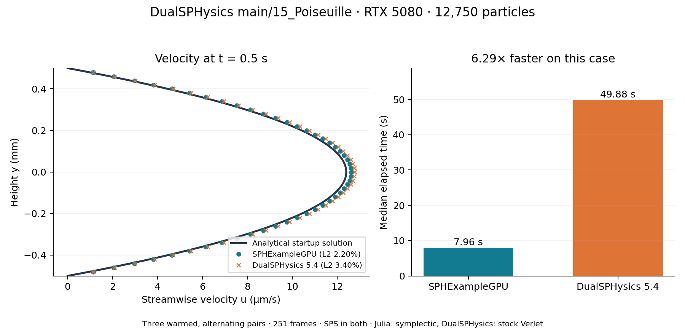
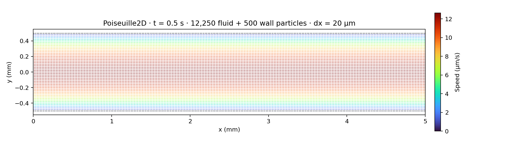

# DualSPHysics main/15_Poiseuille: accuracy and performance

SPHExampleGPU was **6.29× faster** than the unchanged DualSPHysics 5.4
`examples/main/15_Poiseuille` case on an RTX 5080, with a smaller analytical
velocity error. Measurements were collected on 5 November 2026. This is a
comparison of the two solvers' supported configurations on this case:
**Julia uses symplectic stepping; the stock reference uses Verlet.**



| Median of three measured runs | SPHExampleGPU | DualSPHysics 5.4 |
|---|---:|---:|
| Elapsed wall time | 7.959 s | 49.884 s |
| Solver-reported time | 7.874 s | 49.583 s |
| Relative L2 velocity error | 2.205% | 3.400% |
| Maximum velocity error | 0.2272 µm/s | 0.3783 µm/s |
| Maximum transverse speed | 1.18 × 10⁻¹⁴ m/s | 1.25 × 10⁻¹³ m/s |
| Minimum / maximum fluid density | 1000 / 1000 kg/m³ | 1000 / 1000 kg/m³ |
| Steps | 88,391 | 88,389 |
| Output frames, including initial state | 251 | 251 |
| Fluid particles retained | 12,250 / 12,250 | 12,250 / 12,250 |

| Pair | Run order | Julia | DualSPHysics | Wall-time ratio |
|---|---|---:|---:|---:|
| 1 | Julia, DualSPHysics | 7.899906 s | 49.693176 s | 6.290× |
| 2 | DualSPHysics, Julia | 7.958603 s | 50.369293 s | 6.329× |
| 3 | Julia, DualSPHysics | 7.975784 s | 49.883856 s | 6.254× |

The headline is the median of the three paired ratios; dividing the two
median wall times gives 6.27×. Raw measurements are in
[`poiseuille_results_rtx5080.csv`](poiseuille_results_rtx5080.csv).
Repeated runs of each solver produced identical final fluid states. The
CSV's `repeat_state_max_difference` compares the ID-sorted `(x, y, u, v,
density)` matrix against the first run of that solver; its entries have
mixed units and it is used only as a repeatability check.

## Matching the reference geometry

The source is
`W:\DualSPHysics_v5.4\examples\main\15_Poiseuille\CasePoiseuille_Def.xml`.
The benchmark copies it unchanged and runs GenCase followed by the main
5.4 GPU executable. Its particle layout is:

| Quantity | Both solvers |
|---|---:|
| Channel length × plate separation | 5 mm × 1 mm |
| Particle spacing | 20 µm |
| Fluid lattice | 250 columns × 49 rows = 12,250 particles |
| Fixed plates | 2 rows × 250 columns = 500 particles |
| Total particles | **12,750** |
| First / last x-column | 0.01 / 4.99 mm |
| Fluid y-range | -0.48 to +0.48 mm |
| Fixed plate positions | y = ±0.5 mm |
| Periodic x-limits | 0 to 5 mm |

GenCase's `pointref` shifts x by half a spacing. The Julia generator
preserves that offset, the single particle row at each plate, the complete
fluid lattice and the absence of end caps. Every generated lattice node
and particle type was checked against a PartVTK export of the reference's
initial state. The periodic option is `XPeriodicIncZ = 0`, enabling
streamwise wrapping without a transverse shift.



Both solvers start from rest and use density 1000 kg/m³, kinematic viscosity
10⁻⁶ m²/s, streamwise acceleration 10⁻⁴ m/s², sound speed 1 m/s, gamma 7,
Wendland C2 with `h = √2 dx`, CFL 0.2, stationary DBC walls, laminar + SPS
viscosity, no shifting and no density diffusion. Duration is 0.5 s, with
output every 0.002 s. Julia supplies horizontal acceleration through
`ExternalForce`, with its vertical scalar gravity set to zero.

The reference retains its stock Verlet integrator and 40-step Euler
interval. Julia uses its supported symplectic predictor/corrector. The
physical case, particle layout and viscosity model match; trajectories and
step counts are not assumed identical. The benchmark does not establish
the contribution of an individual optimization or time integrator.

## Analytical validation

With plate separation `H`, acceleration `a`, viscosity `ν` and distance
`d = y + H/2` above the bottom plate, the startup solution is:

```text
u(y,t) = a*d*(H-d)/(2ν)
         - 4*a*H²/(ν*π³) * Σ[sin(n*π*d/H)/n³ * exp(-ν*(n*π/H)²*t)]
                                      n = 1, 3, 5, ...
```

The implementation sums 128 odd modes and evaluates the actual final time:
approximately 0.500003513 s for Julia and 0.500003 s in the extracted
reference output. Relative L2 is
`sqrt(sum((u-u_exact)²) / sum(u_exact²))` over every fluid particle at its
current y-coordinate. Maximum error also includes every fluid particle;
the figure uses column means for readability. The steady maximum is
12.5 µm/s; the startup transient remains small but nonzero at 0.5 s.
The [MFiX verification documentation](https://mfix.netl.doe.gov/doc/vvuq-manual/main/html/fluid/fld-01.html)
gives the equivalent steady pressure-gradient formulation.

## Timing scope and reproduction

Hardware/software: NVIDIA GeForce RTX 5080, WDDM, driver 616.92, Julia
1.12.7 with two compute threads and no interactive thread, CUDA.jl 6.4.2,
GenCase 5.4.354.01 and DualSPHysics 5.4.355. Julia uses CUDA graphs, a fixed
grid, periodic images, cell subdivision 1, Float32 fields and Float64
positions. DualSPHysics uses its stock full-cell GPU backend and Float64
internal positions. Radial/SPS arithmetic overrides are disabled in Julia.

Both solvers run the complete case once to warm kernels and the exercised
graph paths. Three measured pairs then alternate execution order. Julia
wall time surrounds the setup and `run_poiseuille_2d` call in the warmed
Julia process. DualSPHysics wall time surrounds its executable, including
process startup. Integration, required state transfers and final output
completion are included. Initial Julia loading/compilation, GenCase,
PartVTK extraction and analytical evaluation are excluded. Timers are
unprofiled and unsynchronized per phase; kernel-duration sums are not used
to establish the speedup.

Julia writes one VTKHDF file; DualSPHysics writes native BI4 files. Both
export 251 particle frames, with different formats and byte counts. Julia
records one particle-cell build, 176,783 periodic force-source builds and
3,001 step readbacks per measured run. Corresponding DualSPHysics counters
are not exposed in `Run.csv` and are left empty. The reported speedup is
specific to this case and device.

Run from `gpu_version/`:

```powershell
julia --project=. -t 2,0 benchmark/poiseuille.jl W:\DualSPHysics_v5.4 3
julia --project=. -t 2,0 test/poiseuille.jl
```

The benchmark creates a timestamped directory under `output/`, retaining
the unchanged reference definition, per-run logs, native outputs, extracted
profiles, environment information and `results.csv`. An optional third
argument selects a new output directory. The recorded measurements remain
locally at `output/poiseuille_main15_comparison/`.

The example follows `Bathymetry2d.jl`: a single `let` block displays the
settings, particle groups, constants, metadata, models and solver call.
Including it starts the simulation and writes `Poiseuille2D_Profile.csv`.
Analytical helpers are in `example/data/poiseuille/validation.jl`; the
test/benchmark harness reads the example's actual setup. Validation covers
the analytical solution, reference lattice and periodic seam, startup and
developed profiles, direct stepping, CUDA graphs, particle retention,
profile export and execution of the complete example when included:
**124 focused assertions passed**, plus two independent checks comparing
the full initial lattice with the GenCase export.
Dependency files and CPU-package source are unchanged; the full CUDA/CPU
reference suite was not run for this example addition.
