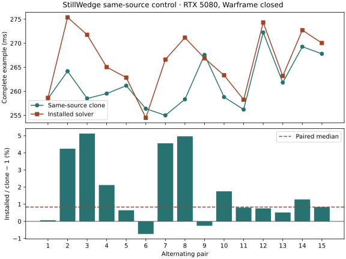
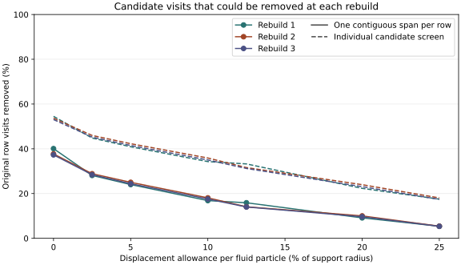
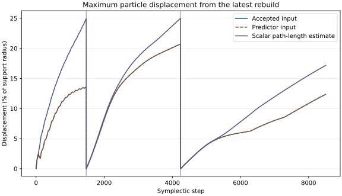
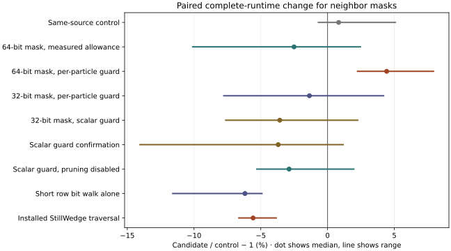
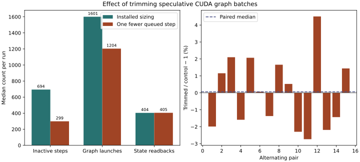
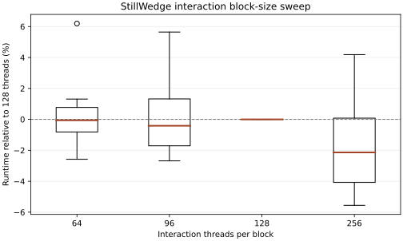

# StillWedge baseline and neighbor-range investigation

Measured on 2026-11-27 with Warframe closed, Julia 1.12.7, four compute threads and an RTX 5080 on Windows driver 616.92. The target is the generated [StillWedge example](../example/StillWedgeMDBC.jl) with 3,027 particles, four seconds of physical time, the symplectic integrator, `NoMDBC`, Float64 positions, Float32 physics, radial interactions, cached interaction fields, `R = 1` and `Rx = 4`. Both particle and occupied-cell VTKHDF outputs remain enabled at 0.01 s intervals. The PDF report and external viewers are disabled.

## Short-row traversal

The isolated prototype changed only how a lane enumerates candidates in a row of at most 32 indices. With the wedge's 16 lanes per particle, it sets a bit at the lane's first index and at the index 16 places after it. It visits the lowest set bit and clears it until the next index falls beyond the row. That produces the same ascending sequence as stepping by 16. The kernel still checks the live pair distance and uses the ordinary stride for long rows.

The prototype lowered the paired median complete runtime by **6.2%**, from medians of 247.24 ms and 231.80 ms. It was faster in all 21 pairs, with ratios of 0.8835–0.9514. Both gathers visited every original candidate in the same lane order. All accepted particle fields and saved particle/grid datasets matched exactly.

The installed option `GPUShortRowBitWalk` defaults to `false` in shared metadata and is enabled explicitly by the StillWedge example. `run_still_wedge(short_row_bit_walk = false)` selects the original traversal. The production path uses no neighbor mask buffers or displacement guard.

In a separate 21-pair run through the installed example, the paired median ratio was **0.9442**, or **5.6% less warm elapsed time**. The original and new traversal medians were **244.52 ms and 231.03 ms**. The new traversal was faster in every pair, with ratios of 0.9330–0.9621. Each pair matched all 50 exported datasets, accepted time, final particle state, 8,502 steps, three rebuilds and 404 readbacks. The warm measurements exclude first-use compilation.

[Raw isolated-prototype timings](still_wedge_row_walk_results.csv) · [Installed comparison](still_wedge_row_walk_installed_results.csv)

## Controls with the option disabled

Three cases compared the installed solver against the kernel and driver at revision `517dda05`. Each ran for 0.2 s of physical time, with one warmup per variant and 15 alternating paired measurements. Timings include `RunSimulation` and all output. Geometry setup, explicit GC and output verification are outside the timed interval. All pairs matched work counts, final particle fields and output fingerprints exactly.

| Case | Particles | Paired installed/previous ratio, median (range) |
|---|---:|---:|
| StillWedge with Simple mDBC | 3,027 | 1.0100 (0.9810–1.1470) |
| 2D moving square | 33,020 | 1.0007 (0.9578–1.0249) |
| 3D dam break | 17,446 | 0.9974 (0.9736–1.0231) |

The medians were within 1.0% of the previous solver, and individual pairs went in both directions for all three cases.

[Raw disabled-path controls](still_wedge_row_walk_controls_results.csv)

## Same-source timing control

The installed solver and a same-source clone each ran a full warmup before 15 alternating pairs. The timed interval includes the example's geometry, setup, stepping and file output. Explicit collection, fingerprinting and benchmark-directory cleanup are outside that interval.

| Measurement | Result |
|---|---:|
| Clone median | 259.527 ms |
| Installed median | 266.611 ms |
| Median paired installed/clone ratio | 1.0083 |
| Observed paired ratio range | 0.9926–1.0513 |
| Pairs with shorter installed time | 2 / 15 |

Each pair had identical final accepted time, particle fields and particle/grid dataset fingerprints. Both paths took 8,502 steps, three cell-list rebuilds and 404 state readbacks. The earlier installed median was 797 ms in a separate session with Warframe running. The new result describes this machine's timing with Warframe closed. The two sessions were observational and do not isolate the game's effect from other session conditions.



[Raw timing pairs](still_wedge_baseline_warframe_closed.csv)

## Rebuild snapshots

The instrumented driver downloads the sorted positions, particle types, cell IDs and cell starts immediately after each real rebuild. A host analysis walks the original 2D stencil rows. The instrumented run matches the installed run exactly in final state, work counts and all 50 exported datasets. Instrumentation timings are excluded from the comparison.

For each rebuild, the analysis sweeps a hypothetical displacement allowance per fluid particle. The geometric screen keeps a candidate if its rebuild distance is at most the support radius plus the two particles' allowances. Fixed particles have zero allowance. The **individual screen** counts every candidate that passes. The **contiguous span** retains the first through last passing index in each row, including holes between them. Counts include self visits because the original loop visits the index before skipping the self pair.

| Rebuild | Physical time | Accepted step | Original visits per gather | Empty rows | Removed by one span at 2.5% allowance | Removed by one span at 25% allowance | Removed by individual screen at 25% allowance |
|---|---:|---:|---:|---:|---:|---:|---:|
| 1 | 0.000 s | 0 | 273,191 | 4.5% | 28.1% | 5.4% | 17.5% |
| 2 | 0.693 s | 1,473 | 280,399 | 3.4% | 28.9% | 5.4% | 18.0% |
| 3 | 1.994 s | 4,239 | 277,607 | 3.4% | 28.4% | 5.3% | 17.4% |



[Raw candidate counts](still_wedge_candidate_ranges_results.csv)

## Interpretation

- A single span per row removes 37–40% of visits at zero allowance, falling to about 5% at a quarter of the support radius. A loose allowance leaves many rejected indices inside each span. An extra metadata fetch per target and row could erase that gain before charging for construction.
- Individual screening still removes 17–18% at the largest allowance in this sweep. A compact mask or a small number of spans could recover some of that gap. Earlier buffered per-lane neighbor lists were 4.5–6% slower on the laptop, so candidate count alone is a poor performance predictor. [Earlier prototypes](still_wedge_performance.md#fair-same-workload-attempt-2026-10-11)
- Only 3.4–4.5% of original rows were empty at these rebuilds. Standalone empty-row metadata has low priority for this wedge.
- The allowances are sweep inputs. This experiment does not establish that any particular allowance covers an entire rebuild interval or the predictor excursion. A GPU implementation needs a conservative guard for both gathers, a margin for mixed-precision pair-vector rounding, and either a fallback or safe refresh when the guard fails. It also needs to anchor each retained index to its original lane assignment and preserve within-lane accumulation order.

## Displacement across both gathers

Two separate trace kernels record the maximum distance from the last rebuild immediately before each gather, one for the accepted input and one for the predictor. Each active step writes its own trace row. The script checks that every accepted step wrote both values and that stopped graph launches left the trace untouched. Tracing preserved the accepted state and all 50 exported datasets exactly. The trace kernels add work, so this run serves as a displacement measurement.

| Rebuild | Steps | Peak accepted displacement / H | Peak predictor displacement / H | Steps within 2.5% of H | Steps within 10% of H |
|---|---:|---:|---:|---:|---:|
| 1 | 1,473 | 13.618% | 13.619% | 144 | 640 |
| 2 | 2,766 | 20.727% | 20.728% | 178 | 643 |
| 3 | 4,263 | 12.370% | 12.372% | 455 | 3,492 |

The tightest useful allowance in the initial screen, 2.5% of the support radius, covered both gathers on only 777 of 8,502 steps (9.1%). A 10% allowance covered 4,775 steps (56.2%). Reusing a 2.5% cache over entire intervals would therefore require additional refreshes or a fallback on most steps. This motivates testing compact masks that can skip holes without assuming a tight allowance.

The trace also estimates a scalar bound without a per-particle reference load in each gather. It adds the maximum predictor excursion per step (`dt/2` times the maximum accepted speed in this stationary case) to the accumulated maximum predictor-to-final gap already tracked by the solver. The sum covered the observed predictor displacement throughout the run, peaking at 25.003% of the support radius when rounded up to three decimals. A 25.5% allowance covers all three intervals even with a small rounding margin.



[Raw per-step displacement trace](still_wedge_displacement_results.csv)

## GPU bitmask prototypes

The experimental gather packs the original row indices into a bitmask. Each lane keeps only the bits for its original stride, then visits those indices from low to high. Both gathers still apply their live distance cutoff. Fixed-wall interactions, the time integrator and the output schedule are the same as in the baseline. Timings include constructing and uploading the masks at all three rebuilds.

The first 64-bit prototype uses allowances obtained from the displacement trace. A guarded 64-bit version instead checks live positions in the fused predictor and final integration. Each phase has its own flag. A position outside the configured radius sets that phase's flag, and the next gather using that phase's positions traverses the original row until the next rebuild. The 32-bit variant also falls back to the original stride for rows wider than 32 indices. Its narrow-row path uses the same bit walk with either the cached mask or all lane bits.

| Prototype | Baseline median | Candidate median | Paired ratio, median (range) | Faster pairs |
|---|---:|---:|---:|---:|
| 64-bit, allowances from trace | 259.09 ms | 250.73 ms | 0.9749 (0.8985–1.0251) | 12/15 |
| 64-bit, live guard at 25% of H | 254.79 ms | 267.70 ms | 1.0443 (1.0219–1.0799) | 0/15 |
| 64-bit, forced fallback at 2.5% of H | 255.66 ms | 271.29 ms | 1.0476 (1.0300–1.0611) | 0/3 |
| 32-bit, live guard at 22.5% of H | 255.73 ms | 255.22 ms | 0.9864 (0.9218–1.0425) | 10/15 |
| 32-bit, live guard confirmation | 255.99 ms | 254.81 ms | 0.9937 (0.9393–1.0702) | 12/21 |
| 32-bit, scalar guard at 25.5% of H | 257.83 ms | 249.56 ms | 0.9642 (0.9232–1.0231) | 14/15 |
| 32-bit, scalar guard confirmation | 259.69 ms | 249.27 ms | 0.9630 (0.8590–1.0122) | 20/21 |
| 32-bit, scalar guard with pruning disabled | 257.71 ms | 249.40 ms | 0.9712 (0.9465–1.0202) | 13/15 |

All pairs matched accepted particle state, accepted time, step/rebuild/readback counts and every exported dataset. The 2.5% per-particle run activated both guard flags in every rebuild interval. The 25% and 22.5% per-particle runs kept both flags clear. The 32-bit per-particle timing improvement shrank to 0.6% in its confirmation run.

The scalar alternative updates the path-length estimate during timestep selection using the maximum accepted speed and accumulated predictor-to-final gap already available there. Both gathers use the resulting flag. The scalar prototype kept that flag clear for all three intervals at 25.5% and reduced paired median elapsed time by **3.6% and 3.7%** in two separate timing runs, faster in 34 of 36 pairs. The 2.5% scalar run activated the fallback in all three intervals and also passed all exact comparisons. Its three timing pairs serve as a fallback smoke test. The scalar guard uses a rounding allowance for the measured four-second stationary, mixed-precision workload. Production integration would need a conservative rounding bound over its supported run lengths, as well as separate gates for motion, shifting and configurations whose timestep reduction does not report maximum speed.

A zero scalar allowance forces the fallback from the first active step. This control retained every candidate in the original stencil and still improved the median by **2.9%**. It used the 32-bit walk on short rows and kept the scalar bookkeeping. Most of the measured difference can therefore be reproduced with all candidates present. Attributing the entire gain to pruning would overstate the evidence.



[Trace-driven timings](still_wedge_candidate_masks_results.csv) · [64-bit guarded timings](still_wedge_candidate_masks_guarded_results.csv) · [Forced-fallback timings](still_wedge_candidate_masks_fallback_results.csv) · [32-bit guarded timings](still_wedge_candidate_masks_32bit_results.csv) · [32-bit confirmation](still_wedge_candidate_masks_32bit_confirmation.csv)

[Scalar-guard timings](still_wedge_candidate_masks_scalar_results.csv) · [Scalar-guard confirmation](still_wedge_candidate_masks_scalar_confirmation.csv) · [Scalar-guard fallback](still_wedge_candidate_masks_scalar_fallback.csv) · [Pruning disabled](still_wedge_candidate_masks_scalar_disabled.csv)

## CUDA graph batch tails

A separate clone counts the step slots submitted in each batch. The candidate removes one step of margin from the speculative output-deadline estimate and leaves the device-side stop conditions in place. The control uses the same counter and matches the installed solver exactly. All 15 measured pairs match accepted time, particle fields and all particle/grid datasets.

| Per four-second run | Current sizing | One fewer queued step |
|---|---:|---:|
| Submitted step slots | 9,196 | 8,801 |
| Accepted steps | 8,502 | 8,502 |
| Inactive step slots | 694 | 299 |
| Graph launches | 1,601 | 1,204 |
| State readbacks | 404 | 405 |
| Median complete elapsed time | 256.97 ms | 256.00 ms |

The paired ratio was **1.0006** at the median (range 0.9726–1.0451), with the candidate faster in seven of 15 pairs. The experiment removed 57% of inactive step slots and 25% of graph launches. It did not produce a measurable complete-runtime gain.



[Raw graph-tail timings and counts](still_wedge_batch_tail_results.csv)

## Interaction block size

The launch-shape sweep kept 16 lanes per particle and changed only the interaction threads per block. Each round ran all four shapes with a rotating and periodically reversed order. All runs retained exact states and datasets. This isolates launch tuning from a change in reduction order.

| Threads per block | Median elapsed | Paired ratio to 128 threads, median (range) | Faster rounds |
|---|---:|---:|---:|
| 128 | 255.71 ms | — | — |
| 64 | 255.63 ms | 0.9994 (0.9742–1.0620) | 9/16 |
| 96 | 257.00 ms | 0.9959 (0.9732–1.0564) | 10/16 |
| 256 | 250.76 ms | 0.9786 (0.9444–1.0418) | 12/16 |

The 256-thread variant was the best in this sweep. Its 2.1% median paired gain sits inside the measured range of same-source noise, with no independent confirmation across GPUs.



[Raw block-size measurements](still_wedge_blocks_results.csv)

## Reproduce

From `gpu_version/`, run the timing and instrumentation separately to avoid GPU contention. Matplotlib generates the two SVG figures.

```powershell
julia --project=. -t 4,0 benchmark/still_wedge_instructions.jl --clone-optimized --rounds=15 --duration=4 --timing-only
julia --project=. -t 4,0 benchmark/still_wedge_candidate_ranges.jl benchmark/still_wedge_candidate_ranges_results.csv benchmark/still_wedge_displacement_results.csv
julia --project=. -t 4,0 benchmark/still_wedge_candidate_masks.jl benchmark/still_wedge_displacement_results.csv benchmark/still_wedge_candidate_masks_results.csv 15
julia --project=. -t 4,0 benchmark/still_wedge_candidate_masks.jl benchmark/still_wedge_displacement_results.csv benchmark/still_wedge_candidate_masks_guarded_results.csv 15 0.25
julia --project=. -t 4,0 benchmark/still_wedge_candidate_masks.jl benchmark/still_wedge_displacement_results.csv benchmark/still_wedge_candidate_masks_fallback_results.csv 3 0.025
julia --project=. -t 4,0 benchmark/still_wedge_candidate_masks.jl benchmark/still_wedge_displacement_results.csv benchmark/still_wedge_candidate_masks_32bit_results.csv 15 0.225 32
julia --project=. -t 4,0 benchmark/still_wedge_candidate_masks.jl benchmark/still_wedge_displacement_results.csv benchmark/still_wedge_candidate_masks_32bit_confirmation.csv 21 0.225 32
julia --project=. -t 4,0 benchmark/still_wedge_candidate_masks.jl benchmark/still_wedge_displacement_results.csv benchmark/still_wedge_candidate_masks_scalar_results.csv 15 0.255 32 scalar
julia --project=. -t 4,0 benchmark/still_wedge_candidate_masks.jl benchmark/still_wedge_displacement_results.csv benchmark/still_wedge_candidate_masks_scalar_confirmation.csv 21 0.255 32 scalar
julia --project=. -t 4,0 benchmark/still_wedge_candidate_masks.jl benchmark/still_wedge_displacement_results.csv benchmark/still_wedge_candidate_masks_scalar_fallback.csv 3 0.025 32 scalar
julia --project=. -t 4,0 benchmark/still_wedge_candidate_masks.jl benchmark/still_wedge_displacement_results.csv benchmark/still_wedge_candidate_masks_scalar_disabled.csv 15 0 32 scalar
julia --project=. -t 4,0 benchmark/still_wedge_batch_tail.jl benchmark/still_wedge_batch_tail_results.csv 15
julia --project=. -t 4,0 benchmark/still_wedge_blocks.jl benchmark/still_wedge_blocks_results.csv 16
julia --project=. -t 4,0 benchmark/still_wedge_row_walk.jl benchmark/still_wedge_row_walk_results.csv 21 --prototype
julia --project=. -t 4,0 benchmark/still_wedge_row_walk.jl benchmark/still_wedge_row_walk_installed_results.csv 21
julia --project=. -t 4,0 benchmark/still_wedge_row_walk_controls.jl benchmark/still_wedge_row_walk_controls_results.csv 15
julia --project=. -t 4,0 -e 'for f in ARGS; include(f); end' -- test/effective_configuration.jl test/gpu_execution.jl test/radial_bounds.jl
python benchmark/plot_still_wedge_candidate_ranges.py
```
