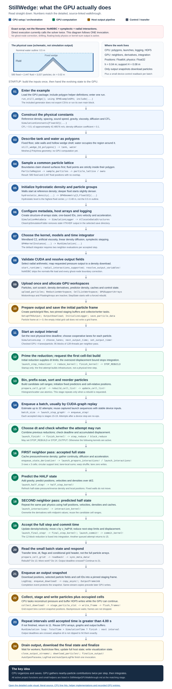

# StillWedge on the GPU: one linear walkthrough

This guide follows the default call to [`run_still_wedge`](../example/StillWedgeMDBC.jl#L13) in the current GPU example. Read steps **01 through 24 in order**. The repeated part of the calculation is explicitly marked.

**Visual:** [open the top-to-bottom diagram](StillWedgeGPUFlow.svg).

**Every package subfunction:** the [complete source-definition index](StillWedgeGPUFunctionIndex.md) includes all GPU package source files, local functions, explicit anonymous callbacks, method overloads, macros and type/constructor declarations, including features this example does not activate. The numbered explanation below recursively covers the selected execution path; the index is not a claim that every package feature runs in StillWedge.



## What is being explained

The CPU prepares particles and launches work. The GPU keeps the evolving particle state, calculates interactions, integrates the particles and decides when to pause. CPU tasks collect selected results and write files.

Here, "every function" means the **repository-defined functions, constructors, named local functions and relevant method overloads on this example's active solver path**, including its small helpers, logging and output. They are named at the step where they matter. Standard-library and dependency operations are grouped at the end; their internal implementations, Julia's compiler, CUDA's driver and ParaView's internals are not recursively expanded. A host `launch_...!` function is distinguished from the device `..._kernel!` it launches. Inlined helpers are functions, but are not separate GPU launches.

The diagram is a source-based execution explanation, **not a measured GPU timeline or a plot of simulated results**. Counts and launch sizes below were checked with the current geometry and an NVIDIA RTX A1000 Laptop GPU. The automatic lane count can differ on another GPU.

### Validation of this explanation

* The existing StillWedge geometry/hydrostatic-density tests passed **94 assertions**.
* An isolated short GPU run of the same 3,027-particle configuration passed **33 assertions**, using a temporary output directory, no external application launches, a 0.002 s end-time target and 0.0005 s output deadlines.
* That short run accepted five symplectic steps, rebuilt the cell list once into a `32 x 13` grid, cached two step graphs, and wrote five particle frames and four grid frames. Fixed positions/velocities, density floors, IDs, finite state, output variables/times, finalization and the ignored missing normals path were checked.
* This is **not** a full four-second numerical-validation or performance campaign. The normal example output folder was not used and no simulation implementation was changed.

### Important details of this exact script

* **The filename is not the boundary configuration.** [`StillWedgeMDBC.jl`](../example/StillWedgeMDBC.jl#L54) selects `NoMDBC`. It runs ordinary dynamic boundary conditions (DBC), not ghost-node mDBC. The normals-file argument is consequently ignored.
* **The default time integrator is symplectic:** two neighbor evaluations per accepted step. Although the metadata constructor has a single-neighbor default, the example passes `SymplecticTimeStepping()` and the driver replaces that metadata field.
* **Direct execution currently runs the case twice.** The guarded call at the bottom is followed by an unconditional [`run_still_wedge()`](../example/StillWedgeMDBC.jl). Running the script directly executes both; including it executes the unconditional call. The second run reopens the same log and cleans/recreates the VTKHDF outputs. This guide explains one invocation; it does not change the script.
* **Radial interactions are enabled.** For linear density diffusion, this changes the reference diffusion operator to symmetric reciprocal-density weighting, not just the rounding or speed.
* **A deadline is crossed, not landed on exactly.** The device tests `time > output_deadline`; it does not shorten `dt` to land on an output time or on the final time.

### The concrete case

| Setting | Value on this path |
| --- | --- |
| Geometry | 2D tank, interior width 2.2 m, wall height 0.7 m, water polygon height 0.5 m |
| Wedge | Hollow fixed shell, outer apex `(1.1, 0.26)` m, 45-degree slopes |
| Initial spacing | `dx = 0.02` m |
| Particles | **580 fixed + 2,447 fluid = 3,027** |
| Fluid particle heights | 0.02 through 0.48 m |
| Initial fluid density | Approximately 1000 through 1002.48145 kg/m^3 before conversion to `Float32` |
| Reference density; sound speed | 1000 kg/m^3; approximately 42.48576 m/s |
| Gravity; artificial viscosity coefficient | 9.81 m/s^2; 0.01 |
| Density diffusion coefficient; CFL | 0.1; 0.5 |
| SPH smoothing length; support radius | `h = 0.04` m; `H = 0.08` m |
| Neighbor-grid subdivision | `R = 1`, cell edge `H/R = 0.08` m |
| Position storage / working arithmetic | `Float64` / `Float32` |
| End-time target; output interval | 4.00 s; 0.01 s of **physical** time |
| Active modes | `NoShifting`, `NoKernelOutput`, `NoMDBC`, `StoreLog` |
| GPU options | Compact buffers, cached pressure/reciprocal density, radial interactions, CUDA graphs, asynchronous output |
| Default particle output | Position, Velocity, Density, Pressure, ID, Type, GroupMarker |

The fixed wedge does not move or float. "Still" describes an initially resting fluid and fixed geometry; it is not a command to skip the solver or enforce exact hydrostatic equilibrium.

## 01. Enter the example [CPU, once]

[`SPHExampleGPU`](../src/SPHExampleGPU.jl#L1) is loaded. Its module-level `foreach(include, submodules)` loads the implementation modules, and the example includes the geometry-generator script.

[`run_still_wedge`](../example/StillWedgeMDBC.jl#L13) supplies the default symplectic integrator, end time, save location and visualization/log-opening switches. The generator file defines its functions, but its own direct-execution guard is false when included by this example.

**Functions / constructors encountered:** [`run_still_wedge`, `SymplecticTimeStepping`](../example/StillWedgeMDBC.jl#L13). Loading uses Julia's `using`, `include`, `foreach`, `joinpath` and the `abspath` guard.

The generator's [`generate_still_wedge_2d_example`](../example/GenerateStillWedgeMDBC.jl#L100) and [`still_wedge_2d_geometry`](../example/GenerateStillWedgeMDBC.jl#L181) are **not called** by this script. No intermediate particle CSVs or polygon-preview files are generated here.

## 02. Construct physical constants [CPU, once]

[`SimulationConstants{Float32}`](../src/SimulationConstantsConfiguration.jl#L46) converts its fields to working precision and fills in defaults.

The explicitly selected values are `dx`, sound speed, density-diffusion strength and CFL. Defaults supply reference density, gravity and viscosity coefficient, among other fields. In this 2D case the nominal particle mass is `rho0 * dx^2`, approximately 0.4 in the solver's 2D mass convention.

**Function / constructor:** [`SimulationConstants`](../src/SimulationConstantsConfiguration.jl#L46).

No GPU is doing physics yet.

## 03. Describe the tank and water as polygons [CPU, once]

[`still_wedge_2d_polygons`](../example/GenerateStillWedgeMDBC.jl#L33) returns two Meshes.jl `PolyArea`s:

1. `tank`: side walls, floor and hollow wedge shell, represented by one outline.
2. `water`: the water region above the floor and around, not inside, the wedge.

The nominal free-surface outline is at 0.5 m. Sampling below that outline produces a highest fluid-particle center at 0.48 m.

**Function:** [`still_wedge_2d_polygons`](../example/GenerateStillWedgeMDBC.jl#L33). **Library constructor:** `PolyArea`.

## 04. Turn the polygons into particles [CPU, once]

[`ParticleRegion`](../src/ParticleGenerator.jl#L69) is constructed first for the fixed boundary, then for the fluid. Region order matters: the first region owns a shared point.

[`sample_particles`](../src/ParticleGenerator.jl#L110) lays down one common lattice. Boundary points may lie on their outline; fluid points must be strictly inside theirs. This avoids overlapping fluid and wall particles.

The full active helper chain is:

| Functions | Work |
| --- | --- |
| [`ParticleRegion`](../src/ParticleGenerator.jl#L69) | Validate sampling mode and record surface/offset rules; both regions use lattice sampling. |
| [`sample_particles`, `lattice_spacing`](../src/ParticleGenerator.jl#L110) | Normalize `0.02f0` to decimal `0.02` in `Float64`; coordinate the shared lattice and claimed flags. |
| [`particle_lattice`](../src/ParticleGenerator.jl#L254) | Find a common bounding box, widen it to the spacing, sample it regularly and snap its coordinates. |
| [`geometry_dim`, `geometry_bounds`](../src/ParticleGenerator.jl#L322) | Determine 2D dimensionality and each polygon's bounds. |
| [`plain_coordinates`, `snap_to_lattice`](../src/ParticleGenerator.jl#L274) | Strip geometry units, form static vectors and remove sampling roundoff. |
| [`PointHash`, `Base.push!(::PointHash)`, `bucket`](../src/ParticleGenerator.jl#L226) | Construct and populate the CPU spatial hash of already placed points. The lattice path populates it, but does not need its conforming-sampling proximity query. |
| [`lattice_positions!`, `candidate_indices`](../src/ParticleGenerator.jl#L145) | Visit still-unclaimed lattice points near a region's bounding box. |
| [`owns`, `geometry_signed_distance`, `outline_segments`](../src/ParticleGenerator.jl#L285) | Measure distance to polygon edges and apply interior/surface rules; mark accepted points as claimed. |

The `map`, generator and `foreach` closures inside these functions are the per-region, per-point and per-edge operations just described; they are not additional named solver functions.

**Result:** two ordinary host vectors: 580 boundary positions and 2,447 fluid positions.

## 05. Assign initial densities and particle groups [CPU, once]

The boundary starts at reference density. [`hydrostatic_density`](../src/ParticleGenerator.jl#L369) initializes the fluid so that the equation of state approximately represents hydrostatic pressure:

```text
level = highest fluid-particle center = 0.48 m
depth = max(level - y, 0)
P     = rho0 * g * depth
rho   = rho0 * (1 + 7*P/(c0^2*rho0))^(1/7)
```

It uses the ordinary fractional power, **not** the approximate seventh-root helper used by other diffusion models.

[`SPHGeometry{2,Float32}`](../src/SimulationGeometry.jl#L149) wraps each group in a `StructArray`, copies positions and converts densities to `Float32`. Its keyword constructor validates the supplied particle columns and dimensionality. Positions retain their input precision at this stage.

**Functions / constructors:** [`hydrostatic_density`](../src/ParticleGenerator.jl#L369); both the positions and keyword overloads of [`SPHGeometry`](../src/SimulationGeometry.jl#L110).

Boundary group marker is 1; fluid group marker is 2. Neither has prescribed motion or floating-body parameters.

## 06. Configure the run and allocate the host state [CPU, once]

[`SimulationMetaData`](../src/SimulationMetaDataConfiguration.jl#L246) stores the modes and GPU switches. [`_output_times`](../src/SimulationMetaDataConfiguration.jl#L243) converts the output interval to `Float32`.

In actual script order:

1. Create metadata.
2. Create the output directory with `mkpath`.
3. Construct [`SimulationLogger`](../src/SimulationLoggerConfiguration.jl#L57), opening the log.
4. Call [`AllocateDataStructures`](../src/PreProcess.jl#L46).
5. Call [`CleanUpSimulationFolder`](../src/AuxiliaryFunctions.jl#L79) to remove stale `.vtkhdf` files from the selected output directory.

Allocation merges the two geometry groups, assigns unique one-based IDs, creates zero initial velocities and accelerations, and sorts by ID. This is a **structure of arrays**: position, density, velocity and so on are separate contiguous columns, not one large object per particle.

| Functions / constructors | Work |
| --- | --- |
| [`SimulationMetaData`, `_output_times`](../src/SimulationMetaDataConfiguration.jl#L243) | Validate options, set run state and convert output times. Its default `SingleNeighborTimeStepping()` field is later overwritten by the example's explicit integrator. |
| [`SimulationLogger`, `RuntimeClock`, `generate_format_string`](../src/SimulationLoggerConfiguration.jl#L26) | Open the log, establish its clock and format its progress columns. The `FormatLogger` callback prints each message to console and file. |
| Both [`AllocateDataStructures`](../src/PreProcess.jl#L46) overloads | Select mode-aware columns, concatenate groups, initialize state and sort IDs. |
| [`position_float_type`](../src/SimulationMetaDataConfiguration.jl#L177) | Select `Float64` host positions because double-position mode is enabled. |
| [`metadata_storage_type`, `group_marker_storage_type`](../src/PreProcess.jl#L13) | Use lossless `Int32` IDs and `UInt8` group markers for this case. |
| [`CleanUpSimulationFolder`](../src/AuxiliaryFunctions.jl#L79) | Remove old VTKHDF output; retry access/busy failures after garbage collection and warn if cleanup fails. |

Compact allocation omits inactive ghost fields and kernel diagnostic fields. Host `Cells` is present because grid export is enabled. Host pressure is not a persistent particle column.

## 07. Choose the smoothing kernel and physical models [CPU, once]

[`SPHKernelInstance{2,Float32}`](../src/SPHKernels.jl#L41) wraps `WendlandC2()` and precomputes its constants. In this implementation, the default `k = 2` gives:

```text
h = k*dx = 0.04 m
H = k*h  = 0.08 m
support test: squared pair distance <= H^2
eta^2 = (0.01*h)^2
```

Do not substitute the stale smoothing-length formula from the constants' descriptive docstring; the kernel constructor supplies the values used by this run.

[`_alphaD` (source spelling `_αD`)](../src/SPHKernels.jl#L22) selects the 2D Wendland normalization `7/(4*pi*h^2)`.

Finally the example calls [`RunSimulation`](../src/SPHCellList.jl#L1420) with:

* [`ArtificialViscosity()`](../src/SPHViscosityModels.jl) to damp approaching particle pairs.
* [`LinearDensityDiffusion()`](../src/SPHDensityDiffusionModels.jl#L122) to smooth fluid density deviations with a linear hydrostatic correction.
* [`SymplecticTimeStepping()`](../src/SimulationMetaDataConfiguration.jl#L34) by default.

**Functions / constructors:** [`WendlandC2`, `SPHKernelInstance`, `_αD`](../src/SPHKernels.jl#L12); [`ArtificialViscosity`](../src/SPHViscosityModels.jl); [`LinearDensityDiffusion`](../src/SPHDensityDiffusionModels.jl#L122); [`RunSimulation`](../src/SPHCellList.jl#L1420).

## 08. Validate the GPU run and resolve output fields [CPU, once]

Inside [`RunSimulation`](../src/SPHCellList.jl#L1420):

1. `CUDA.functional()` must succeed; otherwise the driver errors.
2. [`start_runtime!`](../src/SimulationLoggerConfiguration.jl#L82) resets the wall clock.
3. [`radial_interactions_supported`](../src/GPUKernels.jl#L86) accepts this Wendland/linear-diffusion/artificial-viscosity combination. The driver warns about its changed diffusion arithmetic.
4. The metadata time-stepping field is set to the passed symplectic mode.
5. [`hydrostatic_pressure_range`](../src/OpenExternalPrograms.jl#L16) computes a fixed ParaView pressure scale from the initial fluid extent plus one spacing: approximately `0 .. 4708.8 Pa`.
6. [`resolve_output_variables!`](../src/SimulationMetaDataConfiguration.jl#L219) validates the requested fields.
7. The local [`device_fields_for`](../src/SPHCellList.jl#L1465) maps output pressure to a density download, avoiding a separate pressure transfer.

**Functions:** [`RunSimulation`](../src/SPHCellList.jl#L1420), [`start_runtime!`](../src/SimulationLoggerConfiguration.jl#L82), [`radial_interactions_supported`](../src/GPUKernels.jl#L86), [`position_float_type`](../src/SimulationMetaDataConfiguration.jl#L177), [`hydrostatic_pressure_range`](../src/OpenExternalPrograms.jl#L16), [`resolve_output_variables!`](../src/SimulationMetaDataConfiguration.jl#L219), local [`device_fields_for`](../src/SPHCellList.jl#L1465).

There are no measurements. The entire `BMode !== NoMDBC` block is skipped: no boundary-normal file is read, even though the example supplies its path.

## 09. Upload particles and allocate device workspaces [CPU -> GPU, once]

[`upload_particles`](../src/SPHCellList.jl#L149) uploads the persistent columns. Thereafter the GPU, not the host particle array, owns the current simulation state.

| Functions / constructors | Allocation or initialization |
| --- | --- |
| Both [`upload_particles`](../src/SPHCellList.jl#L219) overloads; [`_upload`, `GPUParticles`](../src/SPHCellList.jl#L91) | Select compact options, convert/upload columns, allocate reorder destinations and build the device particle container. |
| [`metadata_storage_type`, `group_marker_storage_type`](../src/PreProcess.jl#L13) | Recheck lossless metadata widths during upload. |
| [`ReductionWorkspace`](../src/GPUReductions.jl#L37) | Allocate one three-value partial reduction per block, plus a host mirror. For 3,027 particles, `ceil(3027/256) = 12` blocks. |
| [`CellListWorkspace`, `BoundingBoxWorkspace`, `CellGrid`, `GridBuildState`, `IntScanWorkspace`](../src/GPUCellGrid.jl#L478) | Allocate particle permutation, histogram, prefix-scan storage, bounding-box workspace and device grid header. Initial histogram capacity is 1,024 cells. |
| Both active [`GPUSupportArrays`](../src/SPHCellList.jl#L610) constructors; [`position_type`](../src/SPHCellList.jl#L109) | Allocate density derivatives, predicted density, reciprocal-density/pressure caches and cell-relative positions; validate position precision. |
| [`MotionArrays`](../src/SPHCellList.jl#L694) | Upload motion descriptors; `active = false` in this case. |
| [`FloatingArrays`, `floating_inertia_type`, local `zv`](../src/GPUFloating.jl#L52) | Construct an inactive floating descriptor, including small placeholder device arrays; no floating-body kernels run. |
| [`StepState`](../src/GPUStepState.jl#L87) | Allocate five working-precision floating slots and twelve `Int32` control/header slots, pinned host mirrors and an empty CUDA-graph cache. |
| [`Base.length(::GPUParticles)`](../src/SPHCellList.jl#L100) | Supply particle count to workspace sizing and later launches. |

### What lives where

```text
HOST                         DEVICE
geometry inputs              current Position (Float64)
host particle snapshot  --->  Velocity, Density, Acceleration (Float32)
metadata / logger            ID, Type, GroupMarker
output staging buffers       cell list + sort scratch
HDF5 frame buffers           predicted density + derivatives
                             cached inverse density + pressure
                             shared cell-relative position buffer
                             time / dt / stop flags / graph inputs
```

Compact mode borrows idle position/velocity reorder scratch for dense predictor arrays. It does **not** add a neighbor-by-neighbor predictor lookup. The full and half cell-relative position arrays also alias one buffer because their readers do not overlap. No ghost, shifting or kernel-output payload is needed here.

The initial displacement bound is deliberately larger than `h`; that forces a cell-list build before the first accepted step.

## 10. Prepare files, logs, output buffers and the initial frame [CPU, once]

[`SetupVTKOutput`](../src/ProduceHDFVTK.jl#L1307) prepares two transient HDF5/VTKHDF files:

* Particle file: `StillWedge.vtkhdf`.
* Occupied-grid file: `StillWedge_GridCells.vtkhdf`.

The path prefix is the selected save location. They are not one file per integration step.

| Functions / constructors | Work |
| --- | --- |
| [`SetupVTKOutput`, `_metadata_float_type`, `_metadata_boundary_mode`](../src/ProduceHDFVTK.jl#L1307) | Select single-file mode, output precision and boundary interpretation. |
| Local [`field_descriptor`, `field_source`](../src/ProduceHDFVTK.jl#L1347); [`ncomponents`, `component_type`, `npoints`](../src/ProduceHDFVTK.jl#L137) | Describe each output dataset's scalar type, point count and component count. |
| [`grid_frame_bytes`, `buffered_frames`](../src/ProduceHDFVTK.jl#L770) | Estimate frame memory and choose a power-of-two flush capacity, capped at 16 frames. This is distinct from the 8 MiB queue setting. |
| [`GenerateGeometryStructure`, `GenerateStepStructure`, `write_ascii_attribute`](../src/ProduceHDFVTK.jl#L574) | Create VTKHDF datasets, time/offset metadata and type attributes for particles and grid. |
| [`PolyDataFrameWriter`, `GridFrameWriter`, `GridGeometryBuffers`](../src/ProduceHDFVTK.jl#L866) | Open dataset handles and allocate reusable CPU frame buffers. |
| [`OutputDownload`, local `pinned`, `require_particle_field`](../src/SPHCellList.jl#L339) | Validate fields and allocate **two** page-locked download staging frames, with completion events. |
| [`InitializeLogger`, `LogSimulationDetails`](../src/SimulationLoggerConfiguration.jl#L243) | Print configuration, source/count/precision information and GPU details. |
| [`host_particle_bytes`, `memory_usage_line`, `log_gpu_memory`, `gpu_memory_bytes`, `device_buffer_bytes`, `cuda_pool_memory_line`, `output_pipeline_memory_line`](../src/SimulationLoggerConfiguration.jl#L90) | Report host payload, alias-aware live GPU buffers, allocator information and output memory separately. |
| [`Base.show` methods and `_val_repr`](../src/CustomPrettyPrinting.jl#L11) | Format constants, metadata and kernel objects used by initialization logging. |
| [`LogStep`, `step_log_line`, `log_line`, `elapsed_wall_time`](../src/SimulationLoggerConfiguration.jl#L289) | Emit progress using host metadata and a monotonic wall clock. |

The initial counter is 1. [`save_particle_data`](../src/ProduceHDFVTK.jl#L1516), returned as `output.save_particles`, buffers the host initial state at `t = 0`. With pressure selected but no host pressure column, it uses [`next_columns`, `fill_field!`, `fill_pressure!`](../src/ProduceHDFVTK.jl#L784), [`components!`](../src/AuxiliaryFunctions.jl#L39) and [`EquationOfStateGamma7`](../src/SimulationEquations.jl#L10).

The initial [`save_cell_grid`](../src/ProduceHDFVTK.jl#L1589) call receives an empty cell list and returns. **There is no initial grid frame at `t = 0` on this path.**

The driver then creates channels and starts [`spawn_collector`, `spawn_writer`](../src/SPHCellList.jl#L528). [`OutputFramePool`](../src/SPHCellList.jl#L436) manages reusable ordinary host frames. In this asynchronous single-file path, the collector stages particle fields directly into the HDF5 writer's slab buffer, so the auxiliary host-frame pool has capacity **one**; `GPUOutputQueueBytes = 8 MiB` is not an eight-frame queue and does not determine the slab capacity here.

Named output closures [`write_frame`, `log_floating`, `stop_output_workers!`, `close_output_streams!`, `finalize_output!`](../src/SPHCellList.jl#L1656) are defined for later use. `log_floating` returns immediately in this case. A registered `atexit` callback allows partial-output finalization if Julia exits early.

## 11. Start an output interval [CPU -> GPU, repeated]

[`SimulationLoop`](../src/SPHCellList.jl#L1234) advances until the next output deadline, not just one integration step.

It selects compile-time flags for no shifting, no kernel sums, no mDBC, boundary-force calculation and radial arithmetic. [`NoMDBC()`](../src/SimulationMetaDataConfiguration.jl#L26) supplies the boundary-mode value.

[`choose_lanes`](../src/GPUKernels.jl#L131) queries the GPU and selects how many consecutive warp lanes cooperate on each particle. The dimension-aware overload calls the general overload with a lower occupancy target for 2D.

On the checked RTX A1000:

```text
K = 4 lanes/particle
neighbor launch = ceil(3027 * 4 / 128) = 95 blocks of 128 threads
ordinary per-particle launch = ceil(3027 / 256) = 12 blocks
```

The particle count is fixed, but automatic `K` is device-dependent. These block counts do not imply that all blocks execute simultaneously.

[`next_output_time`](../src/SPHCellList.jl#L880) calls its scalar-interval overload and calculates `min(0.01 * output_counter, 4.0)`. [`set_output_time!`](../src/GPUStepState.jl#L168), through [`set_slot!`](../src/GPUStepState.jl#L155), writes that deadline to the device and clears its stop flag.

**Functions:** [`SimulationLoop`, `next_output_time`](../src/SPHCellList.jl#L1234); both [`choose_lanes`](../src/GPUKernels.jl#L116) overloads; [`radial_interactions_supported`](../src/GPUKernels.jl#L86); [`invalidate_graphs!`](../src/GPUStepState.jl#L180) when interaction mode first changes or graph inputs later become invalid; [`set_output_time!`, `set_slot!`](../src/GPUStepState.jl#L146).

The `GPUScalarSPSViscosity` flag is false, so `scalar_sps_supported` is short-circuited on this selected path.

## 12. Prime the time-step reduction and request the first rebuild [GPU, startup]

Before any final-step kernel has run, [`launch_step_reduction!`](../src/GPUKernels.jl#L1021) supplies valid reduction data for the initial state.

Its chain is:

```text
launch_step_reduction!
  -> launch_reduce!
    -> reduce_kernel!
      -> step_map -> step_values
      -> step_reduce
      -> block_reduce_store! -> block_reduce
```

[`step_values`](../src/GPUKernels.jl#L903) returns three quantities per particle: a viscous/acoustic time-step contribution, a force-based limit, and displacement between accepted and half-step positions. The initial compact path uses the accepted position itself as the half-position input, so the initial displacement contribution is zero.

[`step_reduce`](../src/GPUKernels.jl#L912) combines them as maximum, minimum and maximum. [`block_reduce`](../src/GPUReductions.jl#L55) uses shared memory and block barriers.

The first attempted step's [`launch_finish! -> finish_kernel!`](../src/GPUKernels.jl#L1040) computes `dt` but sees the deliberately oversized accumulated displacement bound and sets `STOP_REBUILD`. All later integration kernels in that attempt return without advancing particles.

The CPU reads the request through the batch handling in step 20, performs step 13, then resumes with the already calculated `dt`. **This first attempted step is not an accepted physical step.**

**Additional functions:** [`launch_reduce!`, `reduce_kernel!`, `block_reduce_store!`, `block_reduce`](../src/GPUReductions.jl#L55); [`step_map`, `step_values`, `step_reduce`](../src/GPUKernels.jl#L893); device [`step_active`](../src/GPUStepState.jl#L125).

The standalone host [`finish_reduction`](../src/GPUReductions.jl#L119) and CPU [`Delta-t` (`Δt`)](../src/TimeStepping.jl#L25) are not used to decide each step here.

## 13. Build or rebuild the neighbor cell list [CPU launches -> GPU]

This happens before the first accepted step and whenever the device later requests a rebuild.

First [`prepare_cell_grid!`](../src/GPUCellGrid.jl#L1147) prepares a grid header on the device:

1. [`bin_scale`](../src/GPUCellGrid.jl#L131) chooses the coordinate-to-cell scale `R/H`.
2. [`bbox_reduce_scalar_kernel!`](../src/GPUCellGrid.jl#L713) calculates blockwise extrema from `Float64` positions.
3. [`finish_grid_metadata_kernel!`](../src/GPUCellGrid.jl#L819) combines extrema and calls [`write_grid_result!`](../src/GPUCellGrid.jl#L562).
4. Helpers [`grid_build_needed`, `live_particle`, `frozen_count`, `bbox_finite`, `rounded_coordinate_valid`, `map_floor`, `load_grid`](../src/GPUCellGrid.jl#L524) implement gating, validity checks, coordinate binning and device-header access.
5. [`store_grid_state! -> publish_grid_state!`](../src/GPUCellGrid.jl#L542) publishes status, origin and dimensions into the existing device step-state integers.

`map_floor` is historically named: it bins by nearest integer with ties away from zero, **not ordinary mathematical floor**. The grid has a one-cell stencil margin around the occupied bounding box.

After the normal state readback, both [`consume_cell_grid!`](../src/GPUCellGrid.jl#L1199) overloads validate and accept the header. [`ensure_capacity!`](../src/GPUCellGrid.jl#L1096) and [`ensure_scan_capacity!`](../src/GPUCellGrid.jl#L180) grow storage only if required. Capacity changes invalidate cached graphs. [`grid_build_error`](../src/GPUCellGrid.jl#L1117) is the explicit failure path for invalid positions, oversized grids or index overflows; it is not a successful-run computation.

Then [`rebuild_cell_list!`](../src/SPHCellList.jl#L788) calls [`update_cell_list!`](../src/GPUCellGrid.jl#L1253):

| Function sequence | Meaning |
| --- | --- |
| [`cellid_hist_kernel! -> cell_coords -> map_floor -> linear_cell`](../src/GPUCellGrid.jl#L1000) | Assign each particle to a cell and atomically count occupants. `live_particle` is a true-returning no-op here. |
| [`scan_int32! -> ensure_scan_capacity! -> scan_level! -> scan_block_kernel!`](../src/GPUCellGrid.jl#L932) | Prefix-scan the counts into `CellStart`, with a leading zero. |
| Recursive [`scan_level!`, `scan_add_offsets_kernel!`](../src/GPUCellGrid.jl#L968) | Scan block totals and propagate offsets when more than one scan block is needed. |
| [`scatter_kernel!`](../src/GPUCellGrid.jl#L1015) | Atomically claim slots and build the permutation into cell order. |
| [`cell_sort_kernel!`](../src/GPUCellGrid.jl#L1030) | Insertion-sort old indices within each cell for deterministic ordering; enabled here. |
| [`gather_kernel! -> gather_fields!`](../src/GPUCellGrid.jl#L1052) | Copy persistent columns through that permutation into reorder scratch. |

**Important distinction:** the cell-list histogram/scatter **do use atomics**. The later SPH gather interaction kernel does not need force/density atomics.

`rebuild_cell_list!` swaps persistent arrays with their reorder destinations. The simulation driver can leave old acceleration unsorted because the next full-state neighbor evaluation overwrites every entry before it is read.

Remaining active rebuild helpers:

* [`uses_pos_cells`](../src/SPHCellList.jl#L687): true because positions have higher precision than physics.
* [`update_floating_indices!`](../src/GPUFloating.jl#L162): called, but returns immediately because floating is inactive.
* [`initialize_fixed_predictors! -> predictor_arrays -> fixed_predictors_kernel!`](../src/SPHCellList.jl#L654): initialize fixed positions/velocities in the borrowed predictor scratch after reordering.
* [`launch_pos_cells! -> pos_cells_kernel! -> store_pos_cell!`](../src/GPUKernels.jl#L309): refresh cell-relative position records for the reordered particles, using a fixed active [`HostStep`](../src/GPUStepState.jl#L120).
* [`pos_cell -> global_coords -> local_coords`, `cell_anchor`, `cell_size`](../src/GPUCellGrid.jl#L368): subtract the cell anchor in position precision, then store the local part in working precision.
* [`resume_after_rebuild! -> set_slot!`](../src/GPUStepState.jl#L171): reset the accumulated displacement bound and clear `STOP_REBUILD`, preserving `dt`.

There is no explicit stored list of every accepted particle pair. The grid supplies contiguous candidate ranges for each later gather.

## 14. Enqueue a batch, usually as a CUDA graph [CPU -> GPU, repeated]

[`batch_size`](../src/SPHCellList.jl#L1190) estimates how many steps can run before a rebuild or output is likely, plus one guarded attempt. The batch is capped at 32.

[`launch_step_graph!`](../src/SPHCellList.jl#L1156) breaks the requested work into reusable power-of-two batch sizes, captures calls to [`enqueue_step!`](../src/SPHCellList.jl#L1030), instantiates a CUDA graph, caches it and replays it.

More precisely, the power-of-two splitting is done by `SimulationLoop`; `launch_step_graph!` captures/replays each requested size. Graph keys include the position-array pointer, cell-workspace allocation generation and number of steps. Reordering alternates persistent-array pointers, so more than one cached graph can be needed.

If capture cannot yet succeed, for example because a kernel still needs compilation, this function falls back to directly enqueuing that batch.

**Functions / macro:** [`batch_size`, `launch_step_graph!`, `enqueue_step!`, `@phase`](../src/SPHCellList.jl#L907); [`predictor_arrays`](../src/SPHCellList.jl#L654); CUDA's `capture`, `instantiate`, `launch`.

`GPUSyncTimers = false` means `@phase` simply enqueues work without a synchronization after each phase. Host timing totals are therefore not a per-kernel GPU profile.

**The accepted-step sequence is now steps 15 -> 16 -> 17 -> 18 -> 19.**

## 15. Decide whether the step may run, and choose `dt` [GPU, every attempt]

[`launch_finish!`](../src/GPUKernels.jl#L1089) launches a single 256-thread block executing [`finish_kernel!`](../src/GPUKernels.jl#L1040).

It first honors an existing stop flag. If a completed step has crossed the output deadline, it sets `STOP_OUTPUT`. If a rebuild already calculated `dt`, it preserves that value.

Otherwise it combines the previous per-block reductions with [`step_reduce`, `block_reduce`](../src/GPUKernels.jl#L912):

```text
visc_i = abs(h * dot(v_i, r_i) / (dot(r_i, r_i) + eta^2))
force_i = sqrt(h / norm(a_i))

dt = CFL * min(min_i(force_i), h / (c0 + max_i(visc_i)))
accumulated_displacement_bound += 4 * max_i(norm(x_half_i - x_final_i))
```

This is the implementation's actual viscous/acoustic expression, using particle position `r_i`, not a hypothetical pairwise CFL formula.

If the accumulated displacement bound is at least `h`, it sets `STOP_REBUILD` **before integrating the pending step**. The existing sorted candidate cells remain usable between rebuilds under this conservative displacement criterion.

**Functions:** [`launch_finish!`, `finish_kernel!`, `step_reduce`](../src/GPUKernels.jl#L1040), [`block_reduce`](../src/GPUReductions.jl#L55).

Every subsequent step kernel checks [`step_active`](../src/GPUStepState.jl#L125). Already-queued attempts after a stop are no-ops; they do not secretly advance time.

## 16. Prepare the accepted state and evaluate neighbors the first time [GPU]

[`enqueue_state_derivative!`](../src/SPHCellList.jl#L973) schedules this stage from `enqueue_step!`.

### 16a. Prepare cached pressure and reciprocal density

[`launch_prepare_interactions! -> prepare_interactions_kernel!`](../src/GPUKernels.jl#L243) fills the current state's:

```text
inverse_density[i] = 1 / density[i]
pressure[i] = (c0^2 * rho0 / 7) * ((density[i]/rho0)^7 - 1)
```

Helpers [`store_inverse_density!`, `store_pressure!`](../src/GPUKernels.jl#L225), [`particle_pressure`, `EquationOfStateGamma7`](../src/SimulationEquations.jl#L10) perform those operations. Cell-relative positions were already refreshed by the preceding final step or rebuild. There is no active prescribed-motion pass.

### 16b. Launch a gather calculation

[`launch_interactions!`](../src/GPUKernels.jl#L560) chooses the cell-relative pair source, checks the cache lengths and launches [`interaction_kernel!`](../src/GPUKernels.jl#L353).

For one target particle `i`, its `K` lanes do the following, in order:

1. Read the target state, type and cell.
2. Visit three neighboring rows, each spanning three contiguous cells: nine candidate cells in 2D.
3. Split each row's candidate indices across lanes: lane `l` visits `jlo+l`, then increments by `K`.
4. Reject self-pairs and candidates outside the circular support `distance^2 <= H^2`.
5. For accepted pairs, accumulate continuity, density diffusion, pressure acceleration and artificial viscosity into registers.
6. Reduce lane-local totals with warp shuffles.
7. Lane zero writes the one final density rate and acceleration for `i`.

This happens for **every target**, including fixed boundary particles. `GPUBoundaryForces = true` keeps their computed accelerations for the force-based time-step criterion, although fixed particles do not move.

| Active device helpers | Specific role |
| --- | --- |
| [`step_active`, `thread_index`, `load_grid`](../src/GPUKernels.jl#L353) | Gate stopped attempts, calculate lane/particle indices and read the latest grid header. |
| [`boundary_slot`, `boundary_enabled`, `boundary_velocity`, `boundary_viscous_velocity`](../src/UpdatedMDBC.jl#L13) | Their `nothing` overloads return a zero slot, true enable flag and ordinary stored velocities. These helpers are called even though mDBC itself is inactive. |
| [`MotionLimiterValue`, `is_wall`](../src/SimulationGeometry.jl#L25) | Distinguish fluid motion and prescribed walls. |
| [`interaction_inverse_density`, `interaction_pressure`](../src/GPUKernels.jl#L237) | Read the evaluated state's caches, not stale host pressure. |
| [`cell_size`, `interaction_rows`, `CellRows`, its `Base.iterate`, `CellRow`, `row_range`](../src/GPUKernels.jl#L72) | Traverse three contiguous row ranges. The active loop uses the counter iterator even at `R = 1`; it does not call the old tuple-valued `cell_rows` specialization. |
| [`pair_vector -> cell_shift`](../src/GPUCellGrid.jl#L397) | Reconstruct the pair vector from local `Float32` offsets and the small integer cell difference. |
| [`radial_gradient_factor`](../src/SPHKernels.jl#L90) | Evaluate the scalar Wendland gradient factor; multiply by the pair vector to obtain its gradient. |
| [`radial_density_diffusion -> linear_density_difference`](../src/SPHDensityDiffusionModels.jl#L185) | Apply the gravity-corrected linear diffusion term, with symmetric average reciprocal density; enabled only for fluid-fluid pairs. |
| [`radial_viscosity(::ArtificialViscosity)`](../src/SPHViscosityModels.jl#L94) | Add dissipation only for approaching pairs (`dot(v_i-v_j, x_i-x_j) < 0`). |
| Both applicable [`tensile_correction`](../src/SPHKernels.jl#L156) overloads | Cached-argument forwarding reaches the Wendland implementation, which returns zero. |
| Scalar and vector [`lanes_sum`](../src/GPUKernels.jl#L140) | Combine lane partials through `CUDA.shfl_down_sync` when `K > 1`. |

### What the equations are doing

Let `xij = xi-xj`, `vij = vi-vj`, `gradW = radial_factor*xij` and `m = m0`.

```text
continuity contribution:
    d(rho_i)/dt += rho_i * m/rho_j * dot(vij, gradW)
    (not added for wall-wall pairs)

pressure contribution:
    a_i += -m * (P_i + P_j)/(rho_i*rho_j) * gradW

artificial viscosity:
    approaching pairs only; controlled by alpha, c0 and h

linear diffusion:
    smooth the hydrostatically corrected density difference
    using 0.5*(1/rho_i + 1/rho_j) on this radial path
```

Gravity is **not** added in the pair loop; the integration kernels add it later.

The two target particles gather the same physical pair separately. Unlike a CPU pair-update loop, this avoids concurrent writes to another particle's acceleration/density rate. Lane reduction is still required, but no global atomic force accumulation is used.

The generic [`compute_viscosity`](../src/SPHViscosityModels.jl#L65), [`compute_density_diffusion`](../src/SPHDensityDiffusionModels.jl#L132), [`Wij` (`Wᵢⱼ`), `gradient Wij` (`∇Wᵢⱼ`)](../src/SPHKernels.jl#L81) are not the selected neighbor-physics calls here: radial specializations are active and kernel-sum output is disabled.

## 17. Build the half-step predictor [GPU]

[`launch_half_step! -> half_step_kernel!`](../src/GPUKernels.jl#L794) reads the accepted full state and the first derivative.

For fluid particles:

```text
a_start = a_from_first_neighbors + (0, -g)
x_half  = x_start + v_start * dt/2
v_half  = v_start + a_start * dt/2
rho_half = rho_start + density_rate_start * dt/2
```

For fixed particles, the motion limiter is zero: positions and velocities stay fixed, but density is predicted. Boundary density is floored at reference density.

Active helpers:

* [`step_active`, `step_dt`, `step_time`](../src/GPUStepState.jl#L125): obtain device control data.
* [`thread_index`](../src/GPUCellGrid.jl#L56): select the particle.
* [`MotionLimiterValue`, `GravityFactorValue`](../src/SimulationGeometry.jl#L22): fluid motion factor 1, fixed factor 0; fluid gravity factor -1.
* [`ConstructGravitySVector`](../src/SimulationEquations.jl#L48): put gravity in the last coordinate, `y` in 2D.
* [`limit_density`](../src/GPUKernels.jl#L178): enforce the fixed-wall density floor.
* [`store_inverse_density!`, `store_pressure!`, `EquationOfStateGamma7`](../src/GPUKernels.jl#L225): replace the shared interaction caches with **half-state** values.
* [`store_pos_cell! -> pos_cell`, `global_coords`, `local_coords`, `cell_anchor`, `cell_size`, `load_grid`](../src/GPUKernels.jl#L309): replace the shared cell-relative buffer with **half-state** positions.
* [`apply_motion!`](../src/GPUKernels.jl#L163): called at the end of the kernel, but does nothing for this case's `Fixed`/`Fluid` types.

[`predictor_arrays`](../src/SPHCellList.jl#L654) directs writes to borrowed reorder scratch. Fixed entries were initialized in step 13 and are deliberately not rewritten each step. Predicted density is still dense for all particles.

## 18. Evaluate neighbors at the half state [GPU]

The second [`launch_interactions! -> interaction_kernel!`](../src/GPUKernels.jl#L560) uses:

```text
half-step positions
half-step velocities
half-step densities
half-step pressure and reciprocal-density caches
half-step cell-relative positions
the same sorted candidate cell ranges as stage 16
```

**All pair helpers and physics in step 16b run again.** The new results overwrite the density-rate and acceleration arrays. The time integrator therefore uses midpoint information, not merely the first derivative twice.

There is no separate mDBC correction between predictor and corrector in this run. The `UpdatedMDBC` branch and floating-body force/corrector branches are inactive.

## 19. Accept the full step, reduce the next limits and commit [GPU]

[`launch_final_step! -> final_step_kernel!`](../src/GPUKernels.jl#L915) completes the symplectic update:

```text
eps = -(density_rate_half / rho_half) * dt
rho_new = rho_old * (2 - eps)/(2 + eps)
rho_new = max(rho_new, rho0) for fixed boundaries only

a_half_with_gravity = a_from_second_neighbors + (0, -g)
v_new = v_old + a_half_with_gravity * dt       [fluid only]
x_new = x_old + v_half * dt                   [fluid only]
```

Note the position formula: it uses the **half-step velocity**, not the just-written final velocity. No shifting correction is added.

In the same kernel, new accepted positions refresh the shared cell-relative buffer, and [`step_values -> step_reduce -> block_reduce_store! -> block_reduce`](../src/GPUKernels.jl#L903) builds the reduction used by the next attempt's `finish_kernel!`.

**Other active helpers:** [`step_active`, `step_dt`](../src/GPUStepState.jl#L125), [`thread_index`](../src/GPUCellGrid.jl#L56), [`MotionLimiterValue`, `GravityFactorValue`](../src/SimulationGeometry.jl#L22), [`ConstructGravitySVector`](../src/SimulationEquations.jl#L48), [`divide_by_density -> interaction_inverse_density`, `limit_density`, `store_pos_cell!`](../src/GPUKernels.jl#L178), and the cell-relative helpers listed in step 17.

The reciprocal-density cache still represents the evaluated half state while final density is calculated. Final **pressure is not stored by this kernel**; the next accepted-state preparation refreshes it from the new density.

For this case there are twelve reduction blocks, so a separate [`launch_commit! -> commit_kernel!`](../src/GPUKernels.jl#L1098) advances device time and iteration and marks the next attempt as needing `dt`. The one-reduction-block fused-commit optimization exists but is not used for 3,027 particles.

**One physical step is now complete.** Continue with 15 for another queued attempt, unless a device stop flag makes subsequent attempts no-ops.

## 20. Read the small batch state and act on it [GPU -> CPU]

At the end of each batch, [`prepare_cell_grid!`](../src/GPUCellGrid.jl#L1147) enqueues the conditional header preparation described in step 13. Its heavy bounding-box work only runs when a rebuild is requested; otherwise the finish kernel publishes `GRID_NOT_NEEDED`.

[`readback!`](../src/GPUStepState.jl#L144) copies the small floating/integer control arrays and waits for prior queued work. [`sync_meta_data!`](../src/SPHCellList.jl#L1206) mirrors accepted iteration, time and current `dt` into CPU metadata.

Then `SimulationLoop` handles one of three outcomes:

1. **`STOP_REBUILD`:** consume the prepared header, invalidate graphs if device buffers grew, perform step 13 and continue.
2. **`STOP_OUTPUT` or accepted time beyond the deadline:** return to `RunSimulation`.
3. **Neither:** enqueue another batch via step 14.

**Functions:** [`prepare_cell_grid!`, `consume_cell_grid!`](../src/GPUCellGrid.jl#L1147), [`readback!`](../src/GPUStepState.jl#L138), [`sync_meta_data!`](../src/SPHCellList.jl#L1206), [`invalidate_graphs!`, `resume_after_rebuild!`](../src/GPUStepState.jl#L171), [`batch_size`](../src/SPHCellList.jl#L1190).

Only control state is routinely downloaded per batch. Full particle arrays are not copied to the CPU at every physical time step.

## 21. Enqueue one output snapshot [GPU -> pinned host memory]

After `SimulationLoop` returns:

1. [`LogStep -> step_log_line -> elapsed_wall_time -> log_line`](../src/SimulationLoggerConfiguration.jl#L289) publishes progress independently of disk output.
2. The driver increments the output-frame counter and snapshots accepted physical time and the grid header.
3. It takes a free staging frame.
4. [`enqueue_download! -> copy_async!`](../src/SPHCellList.jl#L367) queues device-to-host copies and records a completion event.
5. [`OutputFrameJob`](../src/SPHCellList.jl#L518) carries that snapshot to the collector.

Downloaded fields on this configuration are:

```text
Position, Velocity, Density, ID, Type, GroupMarker, CellID
```

Pressure is reconstructed from density on the CPU. Acceleration is calculated on the GPU but is not in the default output field list.

Copies are placed on the simulation stream before later kernels that can overwrite those device arrays. This preserves snapshot correctness; it does **not** imply that the same stream's copies and next-step kernels execute concurrently. CPU collection and disk writing can overlap subsequent GPU work.

If both staging buffers or downstream capacity are occupied, channel backpressure makes the producer wait rather than dropping frames.

## 22. Collect the frame, reconstruct pressure, write particles and grid [CPU tasks]

There are two CPU roles, with ordered handoff:

### Collector

[`spawn_collector`](../src/SPHCellList.jl#L528)'s callback:

1. Calls [`acquire_output_frame!`](../src/SPHCellList.jl#L444); the first acquisition uses [`host_output_frame`](../src/SPHCellList.jl#L406).
2. Calls [`collect_download!`](../src/SPHCellList.jl#L454), waiting for the event before copying required auxiliary data to ordinary host memory.
3. Calls `output.stage_particles`, the local [`stage_particle_slot`](../src/ProduceHDFVTK.jl#L1486).
4. Returns the pinned staging frame to the simulation and hands the collected job to the writer.

Particle staging uses [`download_field_index`, `next_columns`, `fill_field!`, `components!`, `fill_pressure!`, `EquationOfStateGamma7`](../src/ProduceHDFVTK.jl#L1481). `fill_field!` also converts `Type` to the output's `Int8` representation and converts vector fields to three component rows; 2D output has a zero third component.

### Writer

[`spawn_writer`](../src/SPHCellList.jl#L540)'s callback calls local [`write_frame`](../src/SPHCellList.jl#L1656):

1. [`apply_download! -> store_cells! -> local_coords -> unique_cells_host`](../src/SPHCellList.jl#L476) updates cell bookkeeping using the snapshot's cell IDs and grid. With no measurements, particle field copying back into `SimParticles` is skipped here.
2. Local [`log_floating`](../src/SPHCellList.jl#L1553) returns immediately because there are no floating bodies.
3. [`save_particle_data`](../src/ProduceHDFVTK.jl#L1516), exposed as `output.save_particles`, commits the already staged slab slot and its snapshot time.
4. [`occupied_cells_host -> cell_coords -> map_floor`](../src/GPUCellGrid.jl#L1357) bins the downloaded **current frame's positions**, independently of the older neighbor-list occupancy.
5. [`save_cell_grid -> grid_cell_edge -> append_grid_frame!`](../src/ProduceHDFVTK.jl#L1589) creates the frame's occupied-grid geometry at edge `H/R`.

Grid preparation uses [`grid_frame_bytes`, `fill_grid_geometry!`, `GridGeometryBuffers`](../src/ProduceHDFVTK.jl#L962). Each occupied 2D cell is a VTK quad; neighboring cells compute identical shared face coordinates. Genuinely empty cells stay empty. The exported grid is not a pressure grid and is not a second physics solver.

When buffers are full, or a grid frame reaches its byte budget:

```text
flush_frames!(PolyDataFrameWriter or GridFrameWriter)
  -> append_columns! -> extend_columns!
  -> append_slice!   -> extend!
  -> set_nsteps!
```

These are the active buffered [`flush_frames!`](../src/ProduceHDFVTK.jl#L914) methods, the helpers in [`HDF5Append`](../src/HDF5Append.jl#L6), and [`set_nsteps!`](../src/ProduceHDFVTK.jl#L777). They extend HDF5 datasets, append slabs/counts/offsets/times and update the number of frames.

The initial host frame and later downloaded frames use the same output variables and EOS. Up to sixteen frames are buffered per normal flush; final partial buffers are not discarded.

## 23. Repeat intervals until the final time has been crossed [CPU + GPU]

`RunSimulation` checks **after queuing the output frame** whether `TotalTime > SimulationTime`.

* If false, go back to step 11 for the next deadline and keep executing 14-22.
* Whenever a rebuild is required, step 20 returns to step 13.
* If true, proceed to step 24.

This produces the initial particle frame plus snapshots after crossing scheduled deadlines. Output spacing is nominally 0.01 s, not exactly equal in every written timestamp. The last accepted time is a little beyond 4.00 s because the solver does not clip its adaptive `dt`.

The graph cache, device particles, scratch buffers and output writers are reused throughout an invocation. They are not recreated for every physical step.

## 24. Drain output, download the final state and finish [CPU + GPU, once]

On normal completion, [`close_output_streams!`](../src/SPHCellList.jl#L1738) calls [`stop_output_workers!`](../src/SPHCellList.jl#L1716), which closes the producer channel, waits for collector/writer completion, synchronizes CUDA and calls [`free!`](../src/SPHCellList.jl#L496) on the two pinned staging frames.

The output closure [`close_files`](../src/ProduceHDFVTK.jl#L1601) flushes both frame writers and closes the HDF5 files.

Before returning, [`download_particles!`](../src/SPHCellList.jl#L251) downloads the **complete allocated final particle state**, not merely selected output columns:

```text
allocated_download_fields
  -> require_particle_field
  -> _download! for positions and each allocated downloadable field
  -> store_cells! -> local_coords -> unique_cells_host
```

Both [`allocated_download_fields`](../src/SPHCellList.jl#L122) overloads filter out absent columns. Pressure is still derived rather than a returned persistent particle column. No ghost expansion is needed on this path.

The `finally` block calls local [`finalize_output!`](../src/SPHCellList.jl#L1752):

1. Idempotently close output streams, also covering interruption/failure paths.
2. Call [`AutoOpenParaview`](../src/OpenExternalPrograms.jl#L106). It writes a generated state script using the template and local [`ExtractDimensionalityMetaData`](../src/OpenExternalPrograms.jl#L133), then tries to start ParaView if requested and available.
3. Report rebuild/readback/graph counts, elapsed time, solver throughput and alias-aware memory through [`elapsed_wall_time`, `log_gpu_memory`](../src/SimulationLoggerConfiguration.jl#L88).
4. Call [`LogFinal`](../src/SimulationLoggerConfiguration.jl#L349), close the log, and call [`AutoOpenLogFile -> _default_open_command`](../src/OpenExternalPrograms.jl#L32); the Windows default is Notepad.
5. Print the timer table through [`_format_timer_table`](../src/SPHCellList.jl#L900).

The registered exit callback becomes a no-op after successful finalization. `RunSimulation` returns `nothing`; the supplied host `SimParticles` object has been updated in place to the final, cell-reordered state.

### What ParaView subsequently does

This is a separate process, not GPU SPH computation. The generated [`AutoParaviewTemplate.py`](../src/AutoParaviewTemplate.py#L1) contains no repository-defined Python functions, but invokes these dependency functions/methods on the default path:

* File discovery: `re.escape`, `re.fullmatch`, `os.listdir`, `os.path.join`, `sorted`.
* View setup: `_DisableFirstRenderCameraReset`, `GetMaterialLibrary`, `CreateView`, `SetActiveView`, `CreateLayout`, `AssignView`.
* Data display: `VTKHDFReader`, `Show`, `SetRepresentationType`, `UpdatePipeline`, `GetDataInformation`, `GetDataSetTypeAsString`.
* Coloring: `ColorBy`, `RescaleTransferFunctionToDataRange`, `GetColorTransferFunction`, `GetOpacityTransferFunction`, `RescaleTransferFunction`, `GetScalarBar`, `SetScalarBarVisibility`.
* Time/camera: `GetAnimationScene`, `UpdateAnimationUsingDataTimeSteps`, `SetActiveSource`, `ResetCamera`, `Update`.

The current `AutoOpenParaview` default supplies **Density** for initial coloring. Pressure is exported and has a fixed scale available; grid cells are loaded as wireframe. The template's automatic pressure-range fallback is not needed because this driver supplies an initial hydrostatic range.

## Functions deliberately not on this path

These exclusions prevent a misleading walkthrough of features that the filename or shared driver might suggest:

| Inactive feature | Examples of functions not executed for its computation |
| --- | --- |
| CSV particle generation/loading | [`generate_still_wedge_2d_example`, `still_wedge_2d_geometry`](../example/GenerateStillWedgeMDBC.jl#L100), [`write_particle_csv`](../src/ParticleGenerator.jl#L390), CSV branch of [`SPHGeometry`](../src/SimulationGeometry.jl#L110), [`particle_struct_array`](../src/SimulationGeometry.jl#L102). |
| Conforming/3D geometry sampling | [`conforming_positions!`, `conforming_layers`, `conforming_polygons`, `isnear`](../src/ParticleGenerator.jl#L178) and 3D geometry overloads. |
| Ghost-node mDBC | [`LoadBoundaryNormals`](../src/PreProcess.jl#L161), [`enqueue_boundary_correction!`](../src/SPHCellList.jl#L922), [`launch_mdbc!`, `mdbc_kernel!`](../src/GPUKernels.jl#L697), [`launch_updated_mdbc!`, `updated_mdbc_kernel!`](../src/UpdatedMDBC.jl#L84) and their interpolation/cloning helpers. The `nothing` boundary accessors in step 16 are the exception. |
| Moving walls | [`launch_motion!`, `motion_kernel!`, `store_moved_pos_cell!`](../src/GPUKernels.jl#L188). The half-step kernel's `apply_motion!` call returns without movement. |
| Floating-body physics | [`launch_floating_forces!`, `launch_floating_update!`, `launch_floating_particles!`, `floating_state`](../src/GPUFloating.jl); only inactive setup, the no-op membership refresh and no-op logging described above are encountered. |
| Shifting, kernel diagnostics, SPS | Shifting branches, kernel-sum [`Wᵢⱼ`](../src/SPHKernels.jl#L81), [`scalar_sps_viscosity`](../src/SPHViscosityModels.jl#L146). |
| Generic/reference pair operators | [`compute_density_diffusion`](../src/SPHDensityDiffusionModels.jl#L132), [`compute_viscosity`](../src/SPHViscosityModels.jl#L65), generic [`∇Wᵢⱼ`](../src/SPHKernels.jl#L99); this run selects radial functions. |
| CPU-style standalone updates | [`Δt`](../src/TimeStepping.jl#L25), [`Pressure!`, `DensityEpsi!`, `LimitDensityAtBoundary!`, `InverseHydrostaticEquationOfState`, `Estimate7thRoot`](../src/SimulationEquations.jl#L22), [`AllocateSupportDataStructures`](../src/PreProcess.jl#L139), [`UpdateMetaData!`, `maybe_sync`](../src/SPHCellList.jl#L873). Their roles are fused into the selected GPU kernels. |
| Standalone rebuild/compaction paths | [`sync_cell_grid!`, `compact_nonzero!`, `nonzero_flag_kernel!`, `compact_kernel!`](../src/GPUCellGrid.jl). No ghost-owner compaction or `boundary_indices_kernel!` is required without ghosts. |
| Fixed-grid escape handling | [`grid_freeze_state`, `log_frozen_particles!`](../src/SPHCellList.jl#L728) and freeze kernels. `GPUFixedGrid = false`. |
| Old/unbuffered, multi-file and measurement output | [`SaveVTKHDF`, `AppendVTKHDFData`, `AppendVTKHDFGridData`, `SaveCellGridVTKHDF`, `append_frame!`, `output_field`, `output_position`, `component_buffer`, `particle_filename`, `grid_filename`, `fill_boundary_field!`](../src/ProduceHDFVTK.jl); measurement writers and multiblock helpers; [`finish_download!`, `expand_boundary_field!`](../src/SPHCellList.jl). The initial pressure branch and staged single-file branches are used instead. |
| Unused driver/display helpers | Local [`generate_showvalues`](../src/SPHCellList.jl#L1569) is defined but not invoked. [`to_3d`, `to_3d!`, `CloseHDFVTKManually`](../src/AuxiliaryFunctions.jl), [`OpenParaviewFile`](../src/OpenExternalPrograms.jl#L48) are not needed on this invocation. |

## Library boundary: what the named functions rely on

These are operations, not extra SPH phases:

| Library | Operations used in the explained path |
| --- | --- |
| Julia / Base / LinearAlgebra | Arrays, tuples, dictionaries, sets, `SVector` arithmetic, `length`, `getproperty`, `getfield`, `fieldnames`, `hasproperty`, indexing/views, constructors/conversions, `map`/`map!`, `foreach`, `filter`, `findall`, `all`/`any`, `sort!`, generators, `minimum`/`maximum`/`extrema`, `sum`, `min`/`max`, `clamp`, rounding, `inv`, powers, square roots, `dot`, `norm`, `muladd`, pointer operations, `copyto!`, `fill!`, `similar`, `resize!`, `reinterpret`, `reshape`, concatenation and collection mutation. |
| Meshes.jl | `PolyArea`, `Point`, `Box`, `RegularSampling`, `sample`, `boundingbox`, `embeddim`, `rings`, `segments`, polygon membership, `to`, `ustrip`, `Euclidean`, `evaluate`. |
| StructArrays.jl | `StructArray`, its column/property access, sorting and `components` for memory accounting. |
| CUDA.jl / Adapt.jl | `functional`, device/name/attribute queries, `CuArray`, `CuVector`, zeros/allocation, pinning, host memory wrapping/freeing, `@cuda`, `blockIdx`/`blockDim`/`threadIdx`/`gridDim`, `CuStaticSharedArray`, `sync_threads`, `atomic_add!` for cell construction, warp shuffles for gathers, event record/wait, asynchronous `unsafe_copyto!`, graph capture/instantiate/launch, pointer access and memory statistics. Repository [`Adapt.adapt_structure`](../src/GPUStepState.jl#L114) overloads turn `StepState` into a `DeviceStep`; `step_active`, `step_dt`, `step_time` then read it on-device. |
| Julia tasks / files / logging | `Channel`, `put!`, `take!`, `bind`, `wait`, `close`, task spawning and thread-pool queries; `mkpath`, `readdir`, `rm`, `open`, `read`, `write`, `flush`, `run`, `atexit`, `exit_on_sigint`, exception propagation; `FormatLogger`, `with_logger`, `@info`/`@warn`; Printf, Dates, TimerOutputs and version reporting. |
| HDF5.jl | `h5open`, groups, extensible chunked datasets, attributes, datatypes/dataspaces, ASCII attribute API, dataset extent changes, hyperslab writes and handle closing. |

Additional named **method overloads defined by this repository**, rather than hidden dependency internals, are accounted for above: [`Base.push!(::PointHash)`](../src/ParticleGenerator.jl#L235), [`Base.length(::GPUParticles)`](../src/SPHCellList.jl#L100), [`Base.iterate(::CellRows)`](../src/GPUCellGrid.jl#L304), [`Base.show`](../src/CustomPrettyPrinting.jl#L16) and [`Adapt.adapt_structure`](../src/GPUStepState.jl#L114). Plain data constructors such as `PosCell`, `CellRow`, `DeviceStep`, `HostStep`, `OutputFrameJob` and `RuntimeClock` package the state described at their corresponding steps; they do not launch extra physical calculations.

## The whole story in one sentence

**CPU polygons -> CPU particles and hydrostatic density -> upload once -> GPU sorted candidate cells -> GPU adaptive `dt` -> first gather -> half-step prediction -> second gather -> full-step acceptance -> small batch-state readback -> occasional particle snapshot -> CPU buffered VTKHDF output -> repeat -> final download and visualization.**

For mathematical intuition, the GPU repeatedly asks: **"For each particle, what are the contributions of nearby particles at the current and predicted states, and how far may I safely advance?"** The CPU organizes when that work is launched and when its results are saved; it does not evaluate the default run's SPH pair forces.
