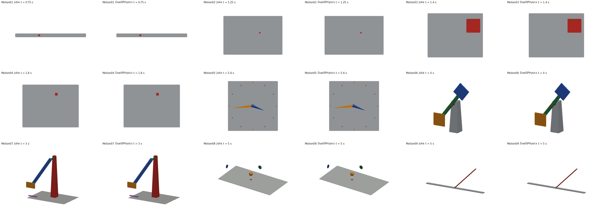

# DualSPHysics Motion01-09 cases

These Julia examples reproduce the geometry and commanded motion of the
**DualSPHysics 5.4.3 distribution** (`examples/motion/Motion01.xml` through
`Motion09.xml`). They use our trajectory types and polygon writer; there is
no dependency on GenCase or BoundaryVTK to run them.

The original motion examples are kinematic geometry animations, without a
fluid simulation. Our default now follows that workflow: it writes animated
polygon surfaces, including the stationary scenery, and opens the polygon
file in ParaView. The former generic particle-block demonstrations have been
replaced by the actual cases.

From the repository root:

```powershell
julia --project=gpu_version -t 2,0 gpu_version/example/Motion/Motion01.jl
```

Each script accepts optional `[output_dir] [duration_seconds] [dimensions]`.
The reference cases are **3D**, so `dimensions` defaults to 3 and other values
fail explicitly. The general prescribed-motion API continues to support 2D.
Omitting duration uses the complete reference duration, with the original
output interval:

| Script | Reference scene and motion | Duration | Interval |
| --- | --- | ---: | ---: |
| [Motion01.jl](Motion01.jl) | Slider on a narrow base; three moves and pauses, instantaneous return, repeat | 6 s | 0.01 s |
| [Motion02.jl](Motion02.jl) | Slider with simultaneous repeating X/Y translations and a delayed Y start | 10 s | 0.02 s |
| [Motion03.jl](Motion03.jl) | Moving platform and a child slider tracing a square in its parent frame | 10 s | 0.02 s |
| [Motion04.jl](Motion04.jl) | Accelerated X motion followed by the prescribed accelerated XY segment | 2.5 s | 0.01 s |
| [Motion05.jl](Motion05.jl) | Clock face, hour marks, spindle and hands rotating at 20/240 degrees per second | 17 s | 0.05 s |
| [Motion06.jl](Motion06.jl) | Tapered tower, shaft/blade, rotating block and circularly translating block | 35 s | 0.05 s |
| [Motion07.jl](Motion07.jl) | Tower/blade, orbiting block and translating shadow; alternating sinusoidal histories | 20 s | 0.02 s |
| [Motion08.jl](Motion08.jl) | Sphere and three projected shadows following the original position file | 10 s | 0.02 s |
| [Motion09.jl](Motion09.jl) | Hinged paddle; degree file followed at 9 s by the radian file about the reversed axis | 18 s | 0.02 s |

Julia (left) and the released BoundaryVTK geometry/motion (right), rendered at
matching saved times for each case:



Outputs go to `gpu_version/output/Motion/MotionXX/`:

- `MotionXX.vtkhdf`: **animated polygons**, the primary visualization.
- `MotionXX_Geometry.vtkhdf`: stationary reference geometry.
- Optional `MotionXX_Particles.vtkhdf`: an additional GPU integration exercise.

In ParaView use **Surface** and colour by the cell array **Mk** (or
`MkBound`/`Region`) to distinguish the reference bodies. The primary file has
polygon cells, not point glyphs. Use the animation controls to play the full
case; the clock and tower examples have longer timelines than the old demos.

```julia
include("gpu_version/example/Motion/MotionExamples.jl")
using .MotionExamples

preview = run_motion_example(5; visualize = false)
println(preview.motion_path)
case = motion_example(9)
```

`run_motion_example` returns `motion_path`, `geometry_path`, `times`, `case`
and `simulation`. Set `simulate_particles = true` to additionally run the GPU
solver; its result is in `simulation`. That optional exercise uses surface
vertices as a compact boundary-particle set, **not the GenCase particle
lattice**, and keeps the polygon animation as the primary view. `dx`,
`use_graph`, `time_stepping`, `FloatType` and `open_log_file` configure this
optional run. The default polygon workflow needs no functional CUDA device.

## Matching the reference

[MotionCaseGeometry.jl](MotionCaseGeometry.jl) constructs the actual boxes,
clock hands, tapered towers, sphere and cylinders as Julia polygon surfaces.
[MotionCaseTrajectories.jl](MotionCaseTrajectories.jl) expresses their motion
using shared trajectories. The real Motion08/09 data files are in [data](data).
The original input file names, units, projected components and 9-second
rotation-file transition are preserved.

The upstream XML reader rounds start/duration attributes through Float32.
The case definitions retain those input times while evaluating in Float64,
which matters at the Motion01 resets and delayed starts. Motion01's return
is instantaneous, not a high-speed segment. The Motion08 XY shadow stops at
8 s and shifts down by 0.02 m strictly after that time. Motion09 reverses the
axis for its second file. All placements use immutable reference vertices.

The [independent reference fixtures](../../test/reference/motion_cases/README.md)
come from the actual released GenCase and BoundaryVTK tools, with source hashes.
Every default output time was compared against their affine motion matrices;
the largest coefficient difference observed was below `9e-13`. Automated tests
also compare complete geometry vertex sets, cell counts and animated frames.
GenCase writes Float32 geometry, so native Float64 vertices are compared with
an explicit geometric tolerance instead of copying its rounding artifacts.

This establishes geometry and commanded-motion agreement for these cases.
It does not assert identical SPH particle lattices, fluid results or boundary
velocities: our wall velocities remain analytical derivatives. General motion
support is still limited to nonperiodic 2D/3D DBC (`NoMDBC`), with both supported
integrators and CUDA graphs. Legacy `MotionDetails` polygon previews remain
supported by the same `SavePolygonMotionSequence` writer.
