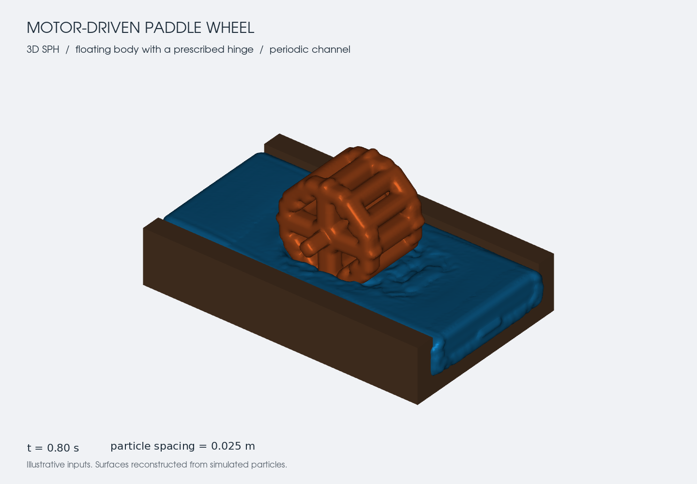

# Motor-driven floating wheel in a periodic 3D trough

[WheelPeriodic3d.jl](WheelPeriodic3d.jl) generates and runs a self-contained CUDA
SPH case. No CSV input, FreeCAD installation, downloaded mesh, or video file is
needed at runtime. It uses the same physical `PeriodicBoundary` implementation
as [Periodicity2d.jl](Periodicity2d.jl), extended here to a 3D case through its
existing API. No solver changes or new Julia dependencies are required.



The reference was `WheelFreecad_anim0001-0151.mp4`: all 151 frames of its
6.29-second playback were inspected. It shows a finite-width paddle wheel with
two side rims, spokes, a transverse axle, a shallow fluid region, a floor and
long side walls. Splashing varies across the wheel width, so this example stays
3D. Neither physical dimensions nor simulation time, speeds or fluid properties
can be read from the clip. The periodic direction is inferred along the long
trough, perpendicular to the axle; the clip does not explicitly label a seam.
The example connects the two open longitudinal ends with zero transverse shift.
It represents a repeating trough containing one wheel per period.

The user authorized assumed values for a visual showcase. The defaults below
are **illustrative**, not a reconstruction or calibrated prediction of the
video. Rim, paddle and spoke geometry is an adjustable approximation. The video
does not establish exact counts or cross sections.

From the repository root, with an NVIDIA GPU and a working CUDA installation:

```sh
julia --project=gpu_version -t 2,0 gpu_version/example/WheelPeriodic3d.jl
```

From `gpu_version`, use `--project=.` and `example/WheelPeriodic3d.jl`. By default,
output goes to `gpu_version/output/wheel_periodic_3d`, independent of the current
directory. Optional positional arguments are `[output_dir] [dx] [duration]`:

```sh
julia --project=gpu_version -t 2,0 gpu_version/example/WheelPeriodic3d.jl gpu_version/output/wheel_try1 0.025 0.4
```

The destination must be new or empty. Nothing is cleaned or overwritten; use a
new directory for each run. Including the example defines a module without
starting a simulation. All inputs are grouped in `WheelPeriodicConfig`:

```julia
include("gpu_version/example/WheelPeriodic3d.jl")
using .PeriodicWheelCase
using StaticArrays: SVector

config = WheelPeriodicConfig(
    initial_fluid_velocity = SVector(0.4, 0.0, 0.0), # entire fluid, m/s
    wheel_angular_speed = -2.0,                     # independent motor, rad/s
    simulation_time = 3.2,
    output_interval = 0.08,
)
result = run_wheel_periodic_3d(config;
    save_location = "gpu_version/output/wheel_custom")
```

`prepare_wheel_periodic_3d(config)` returns `case`, `particles`, and `meta` without
allocating device buffers or creating files. Use it to inspect the geometry and
initial conditions on a machine without CUDA. `FloatType = Float32` is the run
default; positions retain Float64 precision. Set `use_graph = false` for direct
kernel launches or `visualize = true` to open the solver's ParaView workflow.

| Input | Showcase default | Meaning |
| --- | --- | --- |
| Coordinates | `(x, y, z)` | Longitudinal, transverse, upward |
| `particle_spacing` | `0.025 m` | 12 spacings per wheel radius; coarse demonstration |
| `domain_min`, `domain_max` | `(-0.9,-0.45,0)`, `(0.9,0.45,0.24) m` | Interior floor, width, open ends and side-wall tops; no lid |
| `wall_thickness` | `4dx = 0.1 m` | Floor and side walls cover the kernel support |
| `fluid_level` | `0.18 m` | Initial free surface; hydrostatic density |
| `periodic_axis/min/max/shift` | `1`, `-0.9`, `0.9`, `(0,0,0)` | Physical interval `[-0.9,0.9)` in x |
| `initial_fluid_velocity` | `(0.4,0,0) m/s` | Applied to **every** fluid particle at t = 0 |
| `wheel_center`, `wheel_axis` | `(0,0,0.375) m`, `(0,1,0)` | Fixed hinge point and transverse axle |
| `wheel_radius`, `wheel_width` | `0.3 m`, `0.42 m` | Outer envelope and axial width |
| `wheel_angular_speed` | `-2 rad/s` | Right-hand rule about y; bottom paddles initially move in +x |
| `rim_width`, `rim_thickness` | `0.06 m`, `0.06 m` | Axial and radial dimensions |
| `paddle_count/depth/thickness` | `12`, `0.09 m`, `0.06 m` | Radial rectangular paddles inside the circular envelope |
| `spoke_count/thickness` | `4`, `0.06 m` | Spokes on each side |
| `hub_radius`, `shaft_radius/length` | `0.075 m`, `0.03 m`, `0.72 m` | Rotating hub and axle |
| `reference_density`, `gravity` | `1000 kg/m³`, `9.81 m/s²` | Repository water/gravity defaults |
| `sound_speed` | `20 m/s` | Numerical WCSPH sound speed; validated against initial/tip/gravity-wave speeds |
| `artificial_viscosity`, `density_diffusion`, `cfl` | `0.01`, `0.1`, `0.2` | Repository defaults; artificial viscosity is not a measured material viscosity |
| `simulation_time`, `output_interval` | `3.2 s`, `0.08 s` | About one revolution; clipped output deadlines |

Confirm the real geometry, immersion, rotation direction/rate, fluid velocity,
density, gravity and appropriate viscosity model before treating the output as
a physical experiment. Reduce the spacing and check convergence for quantitative
work. If increasing speeds, raise `sound_speed` as required. Zero fluid velocity
and zero angular speed are both valid independent settings. Initial current is
an initial condition, not an inlet or a continuously imposed body force; it
evolves under SPH interactions, wall drag and wheel forcing.

The wheel uses `Type = Floating`, `FloatingDetails`, and an existing
`FloatingConstraints(HingePoint, HingeAxis, HingeVelocity)` constraint. Its axis
cannot translate or drift, and the prescribed motor speed is independent of
fluid forces. This showcases a motion-driven object in the floating-body
machinery; it is not a freely buoyant or torque-driven rotor. `RelativeWeight = 1`
is bookkeeping for the fully prescribed motion, not an inferred wheel density.
This supported route avoids the nonperiodic restriction on `SimMotion` and
`SimRotation`. Fluid-wall interactions use DBC, symplectic stepping, Wendland C2,
artificial viscosity and complex hydrostatic density diffusion, without shifting.

Fluid `Velocity` is set in its `particle_struct_array` before
`AllocateDataStructures`. Allocation and upload preserve it. GPU startup then
assigns rigid velocities only to the floating wheel, using `omega × (x-pivot)`;
fixed walls retain zero velocity. The initial output frame is saved after this
startup and before stepping. No distance-to-wheel mask is used for the fluid.

The generator shares one lattice between boundaries, wheel and fluid. Boundary
regions own overlapping nodes. Water includes the longitudinal seam plane and
the upper periodic endpoint is removed to avoid duplicate nodes. Periodic length
must be an integer multiple of `particle_spacing`, features must be resolved,
and the body diameter plus twice the support radius must fit within one period.
Configuration rejects another periodic axis or a transverse shift because this
straight trough would no longer match at the seam. The wheel axis parameter
must remain parallel to y, matching the generated shaft. A wheel centered near
the seam can straddle it: the solver keeps the rigid body whole, including its
hinge and torque arms, while neighbor search uses periodic images. Fluid
particles wrap physically; no duplicate particles implement periodicity.

The output directory contains `WheelPeriodic3D.vtkhdf` (including t = 0),
`WheelPeriodic3D_Floating.csv` (center, quaternion and angular velocity),
`WheelPeriodic3D_config.txt` (all configured inputs), solver logs, and the usual
ParaView helper. The open top can expand upward; transverse grid limits can grow
if water overtops a side wall. Escaped water remains part of the simulation.

For a presentation preview, [RenderWheelPeriodic.py](RenderWheelPeriodic.py)
uses ParaView's bundled VTK Python to reconstruct cosmetic surfaces from the
actual particles. It adds no Julia dependencies. From the repository root:

```sh
pvpython --dr gpu_version/example/RenderWheelPeriodic.py gpu_version/output/wheel_periodic_3d/WheelPeriodic3D.vtkhdf gpu_version/output/wheel_preview.png --spacing 0.025 --step 10
```

Use the full path to `pvpython` if it is not on `PATH`. `--dr` disables loading
and saving personal ParaView settings. The `--spacing` argument
must match the simulation. Omit `--step` for the last saved frame. To render an
animation, replace the PNG destination with a new directory and add
`--all-frames`. Optional FFmpeg encoding at ten frames per second:

```sh
ffmpeg -framerate 10 -i wheel_frames/wheel-%04d.png -c:v libx264 -pix_fmt yuv420p wheel.mp4
```

This is playback speed, not an inferred video-to-simulation time conversion.
The renderer refuses to overwrite existing images or nonempty frame directories.

Focused regressions run with or without CUDA; device checks are explicitly
skipped when CUDA is unavailable:

```sh
julia --project=gpu_version -t 2,0 gpu_version/test/wheel_periodic.jl
```

They check geometry, seam occupancy, invalid configurations, all-fluid initial
velocities in both precisions, preservation of existing output, device startup,
sorting, a seam-straddling rotating hinge, direct/graph equivalence, and the
actual initial VTKHDF velocities for fluid, fixed walls and the wheel.

Validated on Julia 1.12.7 / CUDA 12.9 / RTX 5080: the focused wheel regressions
and existing `test/floating_constraints.jl` pass. The complete default 3.2-second
run retains 43,016 particles with finite positions, velocities and positive
densities, no frozen particles, and 8,759 detected fluid seam crossings between
output frames. The wheel center stays at its prescribed hinge and its angular
velocity stays at `(0,-2,0) rad/s`. These are execution/contract checks, not a
physical validation or convergence study.
