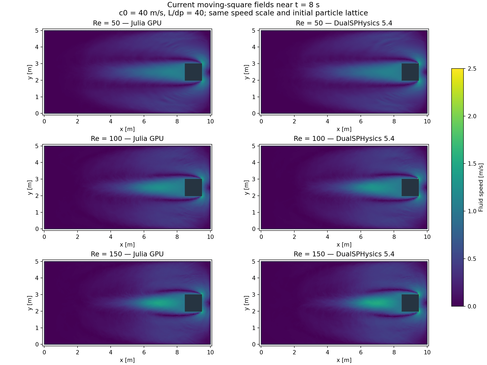
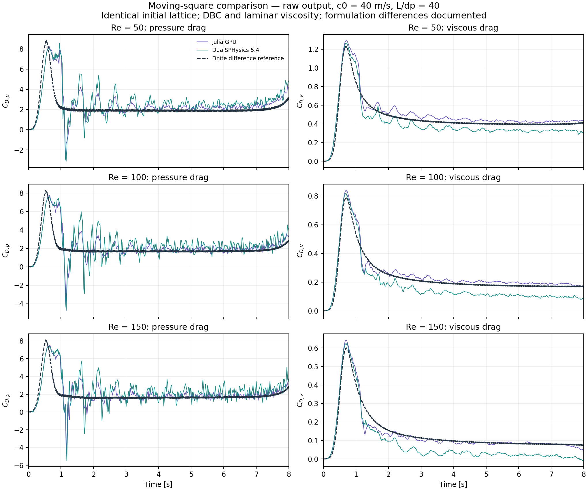
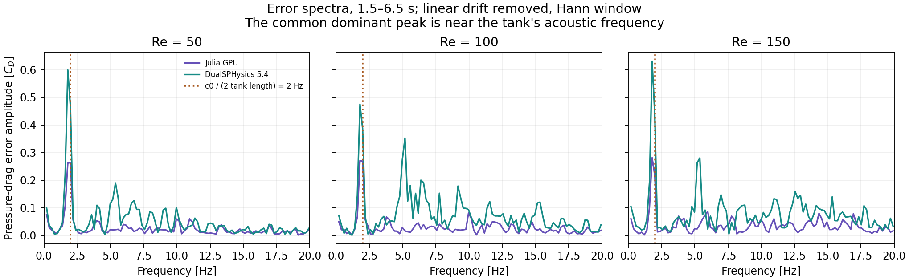
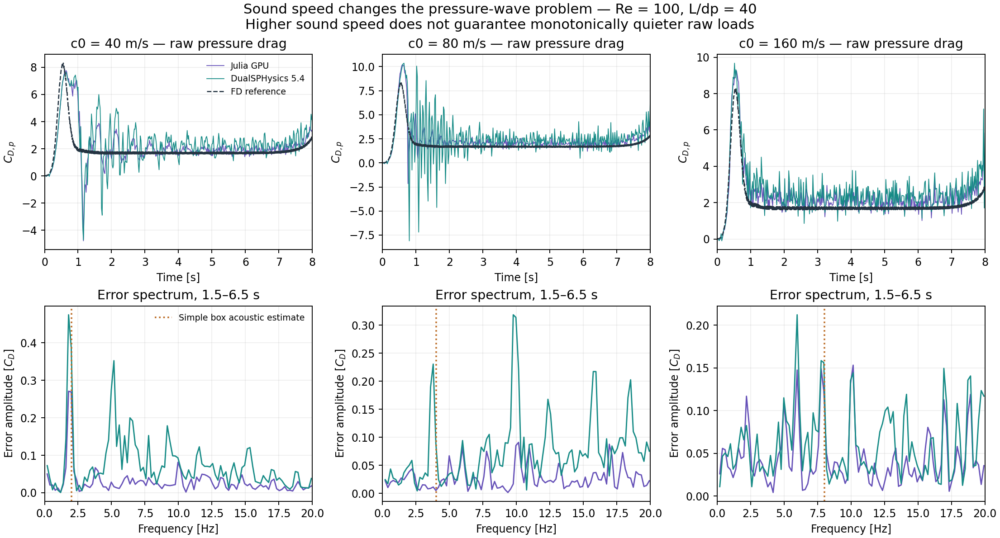
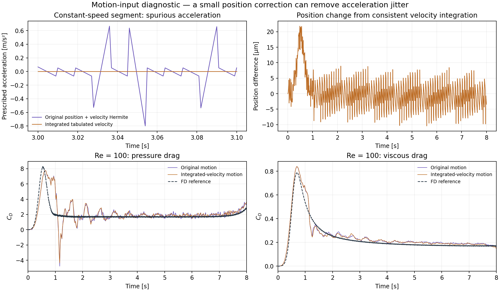
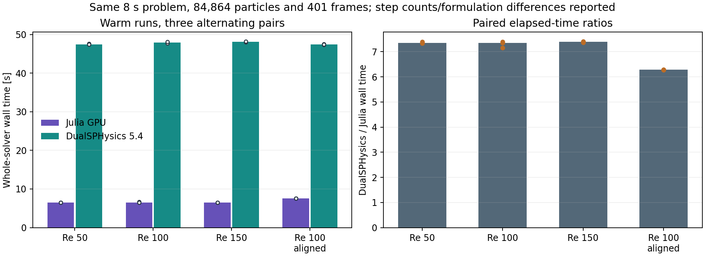

# Moving-square noise, accuracy and speed investigation

Measured on 2026-11-14, with the installed DualSPHysics 5.4.355 and Julia GPU solver on an RTX 5080. **Both tested DBC configurations fail the incompressible SPHERIC drag comparison.** Numerical stability and successful completion do not establish pressure accuracy.

## Why sound speed affects the result

The Tait equation is `p = rho0*c0^2/7 * ((rho/rho0)^7 - 1)`. Near rho0, `delta_p ≈ c0^2*delta_rho`. Relative to the dynamic pressure `q = rho0*U^2/2`, this is `delta_p/q ≈ 2*(c0/U)^2*(delta_rho/rho0)`. At U = 1 and c0 = 40, a 0.1% density perturbation corresponds to 3.2 dynamic-pressure units. A small density error can therefore produce a large load fluctuation. Increasing c0 also changes the computed density perturbations; pressure noise need not increase or decrease monotonically.

The solver advances pressure waves rather than solving an instantaneous incompressible pressure constraint. Across this 10 m closed tank, acoustic transit times are 0.25, 0.125 and 0.0625 s for c0 = 40, 80 and 160 m/s. The simple box fundamental `c0/(2*10)` is 2, 4 and 8 Hz. The square and its motion perturb these modes. At c0 = 40, both solvers show a dominant drag-error peak near 1.8–2.0 Hz across all three Reynolds numbers, consistent with tank-scale acoustic ringing. This is an inference from the formulation, spectra and controls, rather than a claim that every fluctuation is a single acoustic mode.

A stable time integrator can preserve a bounded oscillation for a long time. It does not guarantee small oscillation amplitude, strong acoustic damping, accurate incompressible pressure, or correct wall traction. The usual Mach/density criterion also does not establish that the tank's acoustic transit time is short compared with the imposed acceleration transient.

The density-diffusion coefficient in the discrete model scales with `delta*h*c0`, and the acoustic timestep scales approximately as `CFL*h/c0`. Changing sound speed therefore changes stiffness, wave times, damping and computational work together. See the [official formulation](https://github.com/DualSPHysics/DualSPHysics/wiki/3.-SPH-formulation) for the EOS, acoustic timestep and density-diffusion background.

## Current images and all-Re comparison





Same initial lattice: 78,400 fluid, 1,600 square and 4,864 fixed particles, dp = 0.025 m, h = sqrt(2) dp, unit transverse depth. Re = 50/100/150 uses nu = 0.02/0.01/(1/150) m²/s. Both use DBC, laminar viscosity, no shifting, no SPS, zero gravity, c0 = 40, CFL = 0.2, Float32 physics and double positions, through 8 s with 401 saved frames. GenCase coordinates and type counts are checked against Julia's lattice. These are prescribed settings for this study; the distributed DualSPHysics moving-square example has different motion, viscosity and shifting.

The initial native reference density diffusion acts on wall pairs and retains its pair orientation; Dual's Molteni DDT is suppressed for fluid targets whose support contains a DBC wall. Native regularization is `(0.01h)^2`, versus `(0.1h)^2` in Dual. These formulation differences are isolated below. The additional operator-aligned Re = 100 control uses the latter regularization and native Fourtakas-inner DDT, which reduces to the same target-oriented, wall-suppressed Molteni expression at zero gravity. Timestepping details and neighbor rebuild policies still differ.

| Re | Solver | Binned pressure NRMSE | Raw pressure NRMSE | Binned viscous NRMSE | Pressure noise RMS [Cd] | Viscous noise RMS [Cd] |
|---:|---|---:|---:|---:|---:|---:|
| 50 | native | 44.18% | 45.86% | 12.28% | 0.4574 | 0.0176 |
| 50 | dual | 52.52% | 56.18% | 15.45% | 0.7995 | 0.0227 |
| 100 | native | 45.41% | 47.68% | 11.96% | 0.4698 | 0.0090 |
| 100 | dual | 56.21% | 62.74% | 25.21% | 1.0052 | 0.0114 |
| 150 | native | 44.07% | 47.02% | 14.51% | 0.4978 | 0.0061 |
| 150 | dual | 55.08% | 61.66% | 34.76% | 0.9201 | 0.0087 |

NRMSE uses the original report's 79 identical 0.1 s bins over 0.1–8 s. The noise proxy is the RMS of `(SPH - FD) - centered_0.5s_mean(SPH - FD)` over 1.5–6.5 s, sampled every 0.02 s. It measures rapidly varying error relative to the same reference, not all physical unsteadiness. The plotted curves remain raw; the filter is used only for the declared metric. No fitted scale or time shift is applied.

Raw NRMSE instead integrates squared error exactly for the two piecewise-linear saved histories on their combined time grid over 0.1–8 s. This matters in the sound-speed study: a fixed 0.1 s averaging bin attenuates an 8 Hz oscillation more strongly than a 2 Hz oscillation. A reduction in binned error alone therefore cannot demonstrate that the unfiltered pressure became quieter. Both metrics and the raw curves are retained.



Spectra remove a linear trend and use a Hann window over 1.5–6.5 s. Their resolution is about 0.20 Hz; output Nyquist frequency is 25 Hz. Higher-frequency content can alias, so no physical identification of unresolved frequencies is claimed.



## What the isolated controls establish

| Re = 100 control | Solver | Binned pressure NRMSE | Raw pressure NRMSE | Pressure noise RMS [Cd] | Binned viscous NRMSE |
|---|---|---:|---:|---:|---:|
| c0 = 40, original | native | 45.41% | 47.68% | 0.4698 | 11.96% |
| c0 = 40, original | dual | 56.21% | 62.74% | 1.0052 | 25.21% |
| c0 = 80 | native | 26.41% | 32.67% | 0.2818 | 16.77% |
| c0 = 80 | dual | 36.80% | 69.74% | 1.1371 | 15.83% |
| c0 = 160 | native | 22.16% | 24.94% | 0.3804 | 17.02% |
| c0 = 160 | dual | 34.84% | 39.27% | 0.5344 | 15.73% |
| Consistent integrated-velocity motion | native | 44.91% | 47.19% | 0.4639 | 12.02% |
| Consistent integrated-velocity motion | dual | 54.93% | 60.51% | 0.9465 | 22.05% |
| Density diffusion disabled | native | 48.96% | 55.98% | 0.8570 | 17.55% |
| Density diffusion disabled | dual | 50.99% | 57.90% | 0.8393 | 26.76% |
| Dual regularization only | native | 45.54% | 48.00% | 0.4988 | 11.42% |
| Dual-aligned diffusion and regularization | native | 51.58% | 58.92% | 0.9769 | 18.58% |
| Float64 physics | native | 46.35% | 49.09% | 0.4766 | 12.78% |

The sound-speed cost is visible in step counts: native uses 45,600 / 90,800 / 181,200 steps at c0 = 40 / 80 / 160; Dual uses 46,342 / 91,506 / 181,892. Approximately four times the steps are needed when c0 increases fourfold. The repeated timing study below is at c0 = 40; exploratory sound-speed wall times in `summary.csv` are single runs, not paired performance estimates.


The original Hermite motion matches rounded positions and supplied velocities simultaneously, creating 0.211 m/s² RMS and 0.801 m/s² maximum acceleration during 2–7 s, where the reference acceleration is essentially zero. Integrating the supplied velocity table gives internally consistent position/velocity/acceleration, changes position by at most 21.82 micrometres, and reduces that acceleration RMS to 8.29e-12 m/s².

This motion correction reduces native pressure-noise RMS by only 1.25% at c0 = 40. It fixes an input defect but leaves the dominant acoustic ringing. Turning diffusion off raises native pressure-noise RMS from 0.4698 to 0.8570, while Dual changes from 1.0052 to 0.8393; the two then become very similar. With diffusion and regularization aligned, native RMS is 0.9769 versus Dual 1.0052. These controls support diffusion treatment as a major cause of the original inter-solver noise difference.

Float64 retains the large ringing, so Float32 roundoff is not its main explanation in this test. Changing regularization alone has a much smaller effect than changing diffusion. The vendor force tool is also independently reproduced on two snapshots with the same pair equations: pressure and viscous drag agree within 0.003%. The large oscillations are present in the particle state rather than being introduced by a stale acceleration buffer or an incorrect force selection.



## Warm whole-solver timings

Full-duration warmups precede three unprofiled pairs per Reynolds number, alternating native/Dual order. The operator-aligned Re = 100 timing is a separate three-pair run. Every measured run has 84,864 particles, 401 output frames and 8 s duration. Particle generation and offline force/plot processing are excluded. Stepping, solver setup, particle output and finalization are included; Dual also includes process startup. Julia host-particle allocation occurs before its timed solver call. Output formats differ (VTKHDF versus BI4). These compare practical solver configurations on this 2D case; they do not establish equal trajectories, equal neighbor-search work or a general kernel-throughput advantage.

| Configuration | Julia median wall [s] | Dual median wall [s] | Median paired ratio (Dual/Julia) | Pair range | Steps Julia / Dual |
|---|---:|---:|---:|---:|---:|
| Re 50, original | 6.465 | 47.473 | 7.34x | 7.33–7.39x | 45600 / 45877 |
| Re 100, original | 6.500 | 47.887 | 7.35x | 7.16–7.40x | 45600 / 46342 |
| Re 150, original | 6.507 | 48.086 | 7.40x | 7.37–7.41x | 45600 / 46663 |
| Re 100, operators aligned | 7.548 | 47.452 | 6.29x | 6.27–6.29x | 45600 / 46342 |

Across repeats, maximum within-solver differences at exported precision are 0.000e+00 m in position, 0.000e+00 m/s in velocity and 0.000e+00 kg/m³ in density after sorting by particle ID. Counts and final states are checked outside the timed interval. Native rebuild/readback counts are recorded in the timing CSVs; corresponding Dual counters are not exposed here. Native CUDA graphs and infrequent neighbor rebuilds differ from Dual's execution policy. No claim of matched rebuild/readback work or memory-bandwidth saturation is made.



## Assessment and proposed solution

1. **Use consistent prescribed motion.** The integrated-velocity control is implemented and tested. It preserves the supplied velocity and removes acceleration introduced by rounded position knots. The original benchmark results are retained as provenance.
2. **Improve and validate the moving-wall treatment.** Add translation/acceleration support for the existing Updated mDBC path, including mirrored no-slip velocity, pressure cloning and permitted negative wall pressure. Recheck both pressure and viscous reactions. The current DBC viscous error becomes particularly concerning at Re = 150; increased sound speed alone does not repair this. This boundary change remains a proposal, not a demonstrated fix.
3. **Choose pressure treatment for incompressible internal flow.** Test pressure/divergence cleaning or an incompressible projection mode if direct transient loads are the priority. If retaining WCSPH, choose c0 by convergence of the force history and by acoustic versus acceleration time scales, with adequately resolved output. A higher c0 is expensive and did not validate this case by itself.
4. **Validate the solution across Re = 50, 100, 150.** Preserve the physical viscosities, resolve the wall/shear layers, compare both drag components over the full transient, repeat spatial and temporal refinement, and retain raw histories. Filtering plots cannot substitute for a converged solution.

A relevant next method is the acoustic-wave damping formulation in [Fourtakas, Vacondio and Rogers, divergence cleaning for WCSPH](https://arxiv.org/abs/2410.06038). It is published research implemented in a DualSPHysics research formulation; availability in the installed stock executable is not assumed. It needs a separate implementation and validation study here.

These tests identify important contributors and rule out several simple explanations. They do not yet validate a replacement boundary/pressure method or the vorticity field. The velocity images are qualitative.

## Reproduce and provenance

From `gpu_version`, with the existing Julia environment and installed DualSPHysics tools (`DUALSPHYSICS_ROOT` overrides the local installation path):

```sh
julia --project=. -t 2,0 "validation cases/spheric_test_06/comparison_tests.jl"
julia --project=. -t 2,0 "validation cases/spheric_test_06/dual_compare.jl"
julia --project=. -t 2,0 "validation cases/spheric_test_06/dual_compare.jl" timing
julia --project=. -t 2,0 "validation cases/spheric_test_06/dual_compare.jl" timing_aligned
julia --project=. -t 2,0 "validation cases/spheric_test_06/motion_diagnostics.jl"
julia --project=. -t 2,0 "validation cases/spheric_test_06/export_comparison.jl"
python "validation cases/spheric_test_06/plot_comparison.py"
julia --project=. -t 2,0 "validation cases/spheric_test_06/comparison_report.jl"
```

`results/comparison/environment.toml` records software, hardware, the executable checksum and common settings. Small coefficient histories, spectra, checks and timing records are tracked; large particle histories, generated definitions and vendor exports remain under ignored `runs/`. No vendor binaries or source are redistributed. The final focused regression run passed all 220 assertions: 25 motion/spectral checks and the original 195 geometry, force and GPU/output checks. The full repository CUDA suite was not run. Official reference provenance remains in [reference/README.md](reference/README.md).
