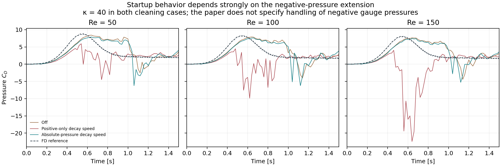
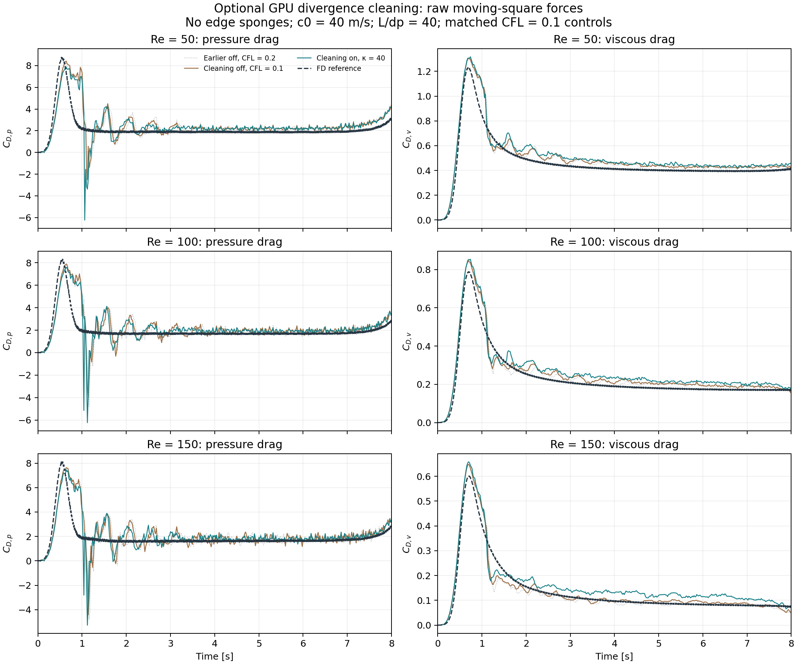
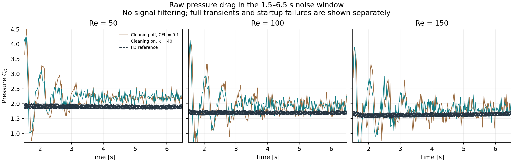
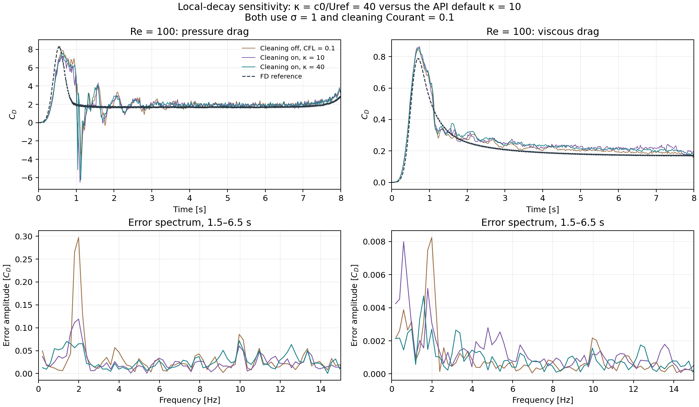
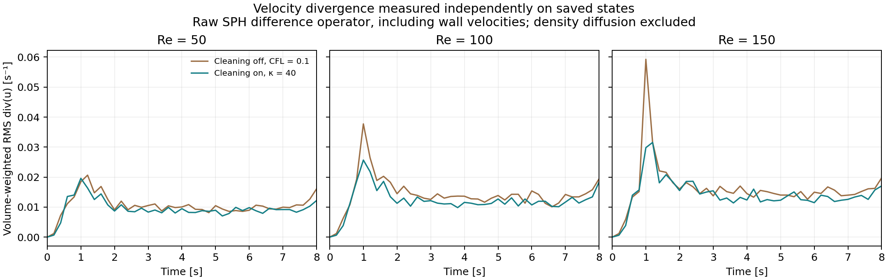
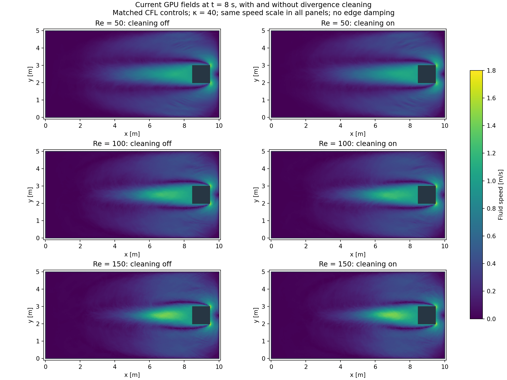

# Optional GPU velocity-divergence cleaning

Implemented as `RunSimulation(SimDivergenceCleaning = DivergenceCleaning(...))` in the Julia CUDA package. It is experimental and off by default. The implementation follows the ψ-based hyperbolic/parabolic procedure of [Fourtakas, Vacondio and Rogers (2025)](https://doi.org/10.1016/j.compfluid.2025.106638), using the published paper supplied by the user. Eleven complete moving-square controls were run, including two extensions for negative gauge pressure, plus warm alternating timing pairs. **The default extension gives modest noise reduction and does not validate this DBC benchmark. The alternative zero-decay treatment in rarefactions produced large startup errors.**

## Equations and explicit implementation choices

```text
D u_i / Dt = original SPH acceleration + Σ_j (ψ_i − ψ_j) ∇W_ij (m_j/ρ_j)
D ψ_i / Dt = c0² Σ_j (u_i − u_j) · ∇W_ij (m_j/ρ_j) − ψ_i/τ_i
1/τ_i = σ κ sqrt(abs(p_i)/ρ_i) / h
dt ≤ C_clean h / max(c0, max_i(κ sqrt(abs(p_i)/ρ_i)))
```

The summation for ψ is the raw velocity difference divergence. It excludes every density-diffusion term. Both ψ and its derivative are evaluated at the same current or predictor state as the pressure/viscosity terms. ψ starts at zero and is advanced with the existing two-stage integrator: ψ_half = ψ_n + dt/2 RHS_n, then ψ_(n+1) = ψ_n + dt RHS_half. Fluid particles evolve ψ; fixed, prescribed and frozen particles have ψ = 0, following the paper's wall Dirichlet condition.

The published Eq. 3.4 has a positive ψ/τ term on the RHS. This contradicts Eq. 3.2, the damped wave equation and the stated exponential decay. The implementation uses the negative, dissipative sign. A source-free decay regression checks this sign and the second-order scalar update.

The paper's sqrt(p/ρ) is not real for negative gauge pressure. Here `pressure_mode=:absolute` (default) uses pressure magnitude only in the local decay speed. The alternative `:positive` uses max(p,0), leaving negative-pressure particles with hyperbolic transport but zero local decay. Neither clips actual pressure or density. Both are documented extensions; the paper does not specify this negative-pressure treatment. The default retains decay in rarefactions and avoided the large startup excursions seen with the alternative. The gradient is the paper's nonconservative difference operator, so exact momentum conservation or a pressure projection is not claimed.

## Why negative-pressure handling is explicit

The central noise window excludes the initial acceleration. With max(p,0), that window can look much quieter while the full transient becomes inaccurate. These are complete runs at the same Re, resolution and physical/cleaning CFL; only the decay-speed extension differs:

| Re | Extension | Noise reduction, 1.5–6.5 s | Raw pressure NRMSE, 0.1–8 s | Max density departure |
|---:|---|---:|---:|---:|
| 50 | positive | 68.5% | 47.06% | 1.60% |
| 50 | absolute | 9.2% | 45.91% | 1.74% |
| 100 | positive | 64.5% | 86.14% | 4.47% |
| 100 | absolute | 12.0% | 46.66% | 0.95% |
| 150 | positive | 61.4% | 155.16% | 10.05% |
| 150 | absolute | 9.0% | 44.35% | 1.10% |

At Re = 150 the positive-only treatment produces a pressure Cd of about −22.43 at t = 0.64 s and about 10.05% peak density deviation. Those startup excursions are outside the noise window. The default absolute-pressure result has about 1.10% peak density deviation and remains an imperfect DBC solution. Both histories and the κ = 10 controls are retained; the failed extension is not discarded from the evidence.



## GPU execution and allocation

With a nonzero `SimConstants.BackgroundPressure`, both the local ψ decay and
its device timestep bound now use pressure including that offset. The
historical runs below all used zero offset and are unchanged. See the separate
[pressure controls](README.md#optional-acoustic-controls) for the atmospheric
offset, initial hold and thin-sponge experiments.

The ψ gradient and velocity divergence are fused into the existing neighbor traversals, with gather lanes and no atomics. The predictor and corrector scalar updates are fused into particle integration, including eligible fused stationary predictors. A signal-speed reduction is fused into accepted-state integration and consumed by the existing device timestep selector; only initialization/rebuild refreshes need an extra elementwise reduction. There is no extra neighbor search or per-step host readback for cleaning. The physical acceleration and existing acoustic restrictions still apply.

Three N-element working-precision device scalars hold ψ, ψ_half and its derivative. The predictor supplies idle permutation scratch at rebuilds, then ψ is copied back before that scratch is used for prediction. The scalar therefore follows stable particle IDs without persistent-ID indirection in interactions. The signal workspace adds one scalar per reduction block; its small host partial buffer is separate. At N = 84,864 in Float32 this adds 1,019,696 allocated device-buffer bytes (about 0.9725 MiB), excluding allocator reservations, program state and register spills. The final result downloads one N-scalar host ψ array in particle order. Disabled mode allocates none of these buffers and removes the cleaning branches through specialization.

The initial public implementation supports standard symplectic stepping in 2D/3D, Float32/Float64, DBC/mDBC, prescribed motion and translated periodic queries. Unsupported configurations fail explicitly: single-neighbor/reference schemes, dense periodic images, variable resolution, open boundaries, floating reactions, timestep-provenance diagnostics and nonzero-clock restarts. A restart needs persistent ψ as well as particle state. See the GPU README and `DivergenceCleaning` docstring for usage and limitations.

## Moving-square controls

All runs retain the original 10 × 5 m closed tank, moving unit square, original Hermite motion, Re = 50/100/150 physical viscosities, c0 = 40 m/s, dp = 0.025 m, h = √2 dp, DBC, no SPS, no shifting and zero-gravity linear density diffusion δ = 0.1. They use Float64 positions/clock, Float32 physics, strict reference interaction arithmetic and R = Rx = 1. All have 84,864 particles and 401 frames over 8 s. **There are no edge sponges.**

Both off and on runs use physical CFL = 0.1. On additionally uses C_clean = 0.1, σ = 1 and κ = c0/Uref = 40 for the nominal Uref = 1 m/s. The original CFL = 0.2 histories are shown separately in the raw-force figure, so a smaller timestep is not conflated with cleaning. A Re = 100 sensitivity run uses the API default κ = 10, corresponding to the usual nominal Mach 0.1 convention in the paper. No strength is selected by optimizing these reference errors.

Noise is RMS of the drag error after subtracting a centered 0.5 s moving average, sampled over 1.5–6.5 s. Raw NRMSE integrates squared piecewise-linear error against the official FD reference over 0.1–8 s. Binned NRMSE compares common 0.1 s averages. Force histories are unfiltered. Mean-load changes below use time integrals over 2–6.5 s relative to the same-Re off/CFL-0.1 control.

| Re | Mode | Pressure noise RMS [Cd] | Noise reduction | Mean pressure change | Raw pressure NRMSE | Binned pressure NRMSE | Raw viscous NRMSE |
|---:|---|---:|---:|---:|---:|---:|---:|
| 50 | off | 0.4266 | 0.0% | +0.0% | 43.93% | 42.28% | 12.32% |
| 50 | on | 0.3873 | 9.2% | +0.7% | 45.91% | 40.39% | 14.32% |
| 100 | off | 0.4859 | 0.0% | +0.0% | 46.30% | 43.95% | 13.09% |
| 100 | on | 0.4275 | 12.0% | +1.2% | 46.66% | 42.49% | 17.30% |
| 100 | k10 | 0.4427 | 8.9% | +1.3% | 47.97% | 43.83% | 17.32% |
| 150 | off | 0.4890 | 0.0% | +0.0% | 45.46% | 42.65% | 14.32% |
| 150 | on | 0.4452 | 9.0% | +0.4% | 44.35% | 41.10% | 20.05% |







## Measured velocity divergence

An offline Float64 GPU evaluation applies the raw volume-weighted velocity-difference operator directly to saved positions, velocities and densities, including wall velocities. Density diffusion is disabled for this diagnostic. It does not infer div(u) from the solver's total density derivative. Snapshots are evaluated every 0.2 s. The aggregate below is RMS of snapshot volume-weighted RMS values over the selected 1.6–6.4 s samples. This includes near-wall regions and does not establish convergence of the divergence operator.

| Re | Off div(u) RMS [s⁻¹] | On div(u) RMS [s⁻¹] | Reduction |
|---:|---:|---:|---:|
| 50 | 0.01031 | 0.00920 | 10.8% |
| 100 | 0.01412 | 0.01203 | 14.8% |
| 150 | 0.01562 | 0.01447 | 7.4% |





## Cost and repeatability

Re = 100 uses full-duration warmups of both modes in one process, followed by three unprofiled alternating off/on pairs. Median whole-solver wall time is 12.600 s off and 27.825 s on; median paired cost ratio is 2.209x (range 2.200–2.227x). This includes stepping, setup, 401 output frames and final downloads, while excluding particle generation and offline force/plot analysis. It is a configuration cost comparison, not an isolated kernel-overhead estimate.

| Mode | Steps | Rebuilds | Step-state readbacks | Median wall [s] |
|---|---:|---:|---:|---:|
| off | 90800 | 601 | 3424 | 12.600 |
| on | 177449 | 610 | 6111 | 27.825 |

The local cleaning speed can require extra accepted steps, and physical trajectories change. Rebuild/readback counts are reported rather than assumed equal. Timing repeats verify identical position, velocity and density within each mode at exported precision; every recorded maximum repeat-state difference is zero. Exploratory study wall times overlapped independent regressions and are not used for performance claims; the timing pairs run separately after those jobs finish. No hardware-bandwidth claim or whole-solver VRAM percentage is inferred from these timings.

## Assessment

At Re = 50, cleaning changes pressure-noise RMS by -9.2%, central mean pressure drag by +0.7%, and raw pressure NRMSE from 43.93% to 45.91%. Raw viscous NRMSE changes from 12.32% to 14.32%.

At Re = 100, cleaning changes pressure-noise RMS by -12.0%, central mean pressure drag by +1.2%, and raw pressure NRMSE from 46.30% to 46.66%. Raw viscous NRMSE changes from 13.09% to 17.30%.

At Re = 150, cleaning changes pressure-noise RMS by -9.0%, central mean pressure drag by +0.4%, and raw pressure NRMSE from 45.46% to 44.35%. Raw viscous NRMSE changes from 14.32% to 20.05%.

The method acts on compressible velocity error throughout the domain, unlike a velocity sponge confined to the tank edges. Its numerical behavior must still be judged by force bias, physical viscosity, resolution and boundary errors. A quieter history by itself is insufficient. The current DBC treatment and rounded-motion interpolation are retained controls; translating/accelerating no-slip wall improvements and internally consistent motion remain relevant next steps. Neither an exact incompressible projection nor validated wall shear is claimed.

| Re | Mode | Max density departure | Max Mach | Minimum solid clearance [m] | Steps |
|---:|---|---:|---:|---:|---:|
| 50 | off | 0.5972% | 0.0574 | -0.00498 | 90800 |
| 100 | off | 0.8106% | 0.0585 | -0.00404 | 90800 |
| 150 | off | 0.8173% | 0.0621 | -0.00306 | 90800 |
| 50 | positive | 1.5963% | 0.0975 | -0.00497 | 179240 |
| 100 | positive | 4.4651% | 0.1750 | -0.00220 | 191552 |
| 150 | positive | 10.0453% | 0.2021 | -0.00201 | 213851 |
| 50 | on | 1.7371% | 0.0617 | -0.00343 | 181695 |
| 100 | on | 0.9488% | 0.0749 | -0.00310 | 177449 |
| 150 | on | 1.1007% | 0.0819 | -0.00210 | 180760 |
| 100 | positive_k10 | 3.3596% | 0.1340 | -0.00306 | 91795 |
| 100 | k10 | 1.4189% | 0.0915 | -0.00395 | 91174 |

Negative clearance means fluid-particle centers enter a nominal solid. Such a case fails the original impermeability criterion even if it completes and its forces become quieter. All saved states were finite, retained their particle counts and completed the prescribed motion; the maximum center/velocity checks remain in each `native_state.csv`. Spatial refinement and further wall/flow validation remain necessary.

## Reproduce

Environment: NVIDIA GeForce RTX 5080, Julia 1.12.7, CUDA.jl 6.4.2. The baseline repository commit before adding cleaning was `31e16b5fc5256edae830ff5e8d59ddf58af3b7ba`. The supplied published PDF SHA-256 is `e648ba052dfd1024f933f94787175b9ee4add567944ffe64b32cdb340bb2ce14`. No PDF copy or new Julia dependency is added to the repository.

Run from `gpu_version/`:

```sh
julia --project=. -t 2,0 test/divergence_cleaning.jl
julia --project=. -t 2,0 test/runtests.jl
julia --project=. -t 2,0 "validation cases/spheric_test_06/divergence_cleaning.jl"
julia --project=. -t 2,0 "validation cases/spheric_test_06/divergence_cleaning.jl" timing
julia --project=. -t 2,0 "validation cases/spheric_test_06/cleaning_diagnostics.jl"
python "validation cases/spheric_test_06/plot_divergence_cleaning.py"
julia --project=. "validation cases/spheric_test_06/cleaning_report.jl"
```

The study resumes completed variants and refuses to overwrite existing histories. Large VTKHDF histories, local logs and temporary paper extracts stay in ignored `runs/`. The focused tests cover independent dense operators in both dimensions/precisions, density-diffusion separation, sorting, scalar decay, wall protection, cleaning CFL, predictor fusion, graph/direct agreement, translated periodic crossings and stationary mDBC. See [implementation checks](IMPLEMENTATION_VALIDATION.md) for the reproduced broad-suite failure, [160 m/s controls](SOUND_SPEED_160.md) for the high-c0 startup limitations, and [the timestep/pause audit](TIMESTEP_AUDIT.md) for the subsequent investigation.
