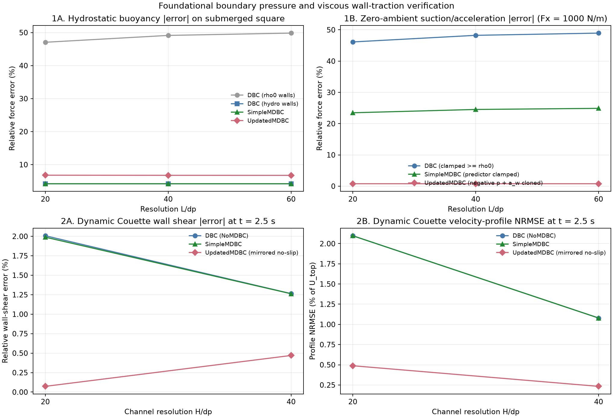
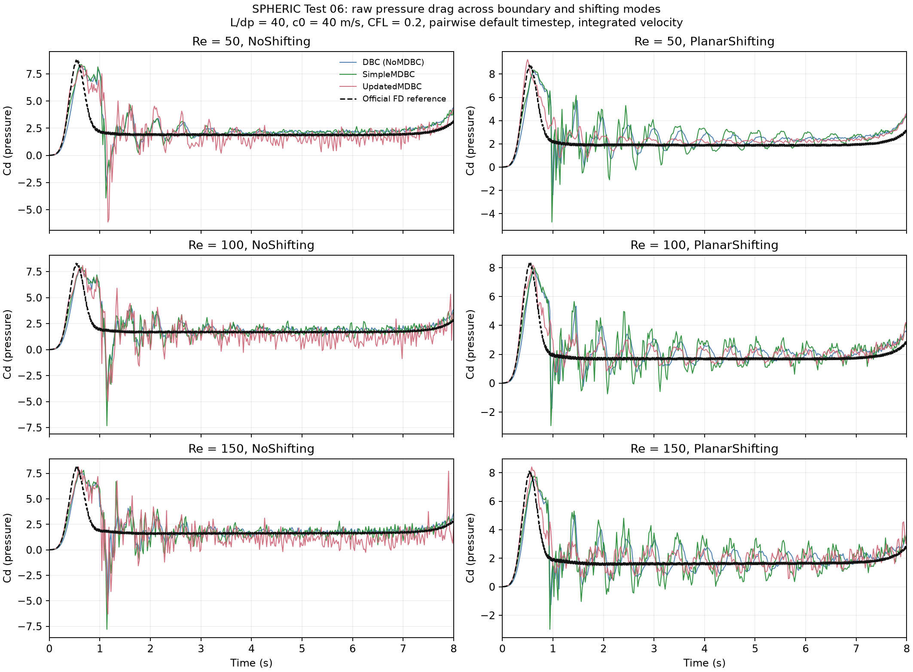
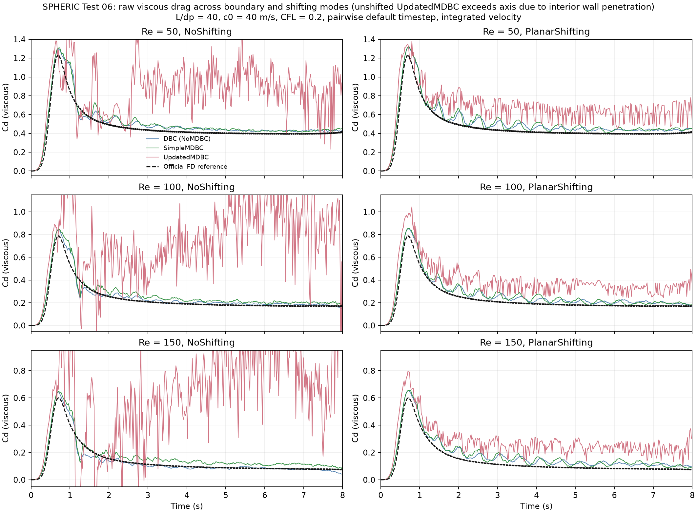
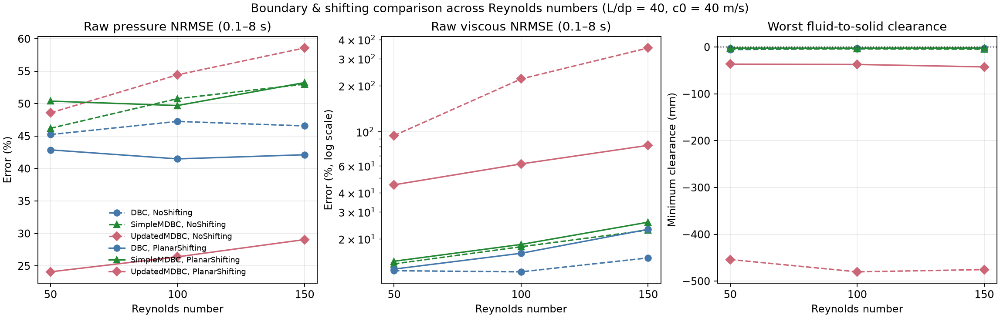
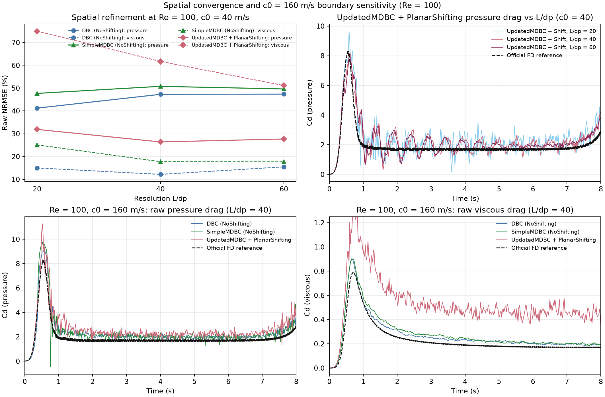

# Boundary traction verification, mDBC moving-square comparison and spatial refinement

**Status: no tested WCSPH boundary/shifting combination passes all SPHERIC Test 06 validation criteria simultaneously.** Building on the new translation-invariant pairwise default timestep (`fc4012c4`) and the translating/accelerating `UpdatedMDBC` extension (`f992471c`), this study executes the two foundational traction checks and the matched moving-square boundary and spatial-refinement campaign outlined in [PAIRWISE_FORCE_ACCURACY.md](PAIRWISE_FORCE_ACCURACY.md).

All 33 full 8-second moving-square runs and all foundational pressure/Couette benchmarks completed without particle loss or NaN states. Every force history is reconstructed in Float64 from exact solver-consistent square/fluid pair interactions and plotted **without smoothing or filtering**.

## 1. Foundational boundary pressure and viscous traction verification

Before interpreting bluff-body drag, `mdbc_validation.jl` isolates pressure and viscous wall tractions on problems with closed-form solutions:

1. **Submerged unit square ($[1,2]\times[1,2]$ m in a $[0,3]\times[0,3]$ m tank, $L/dp = 20, 40, 60$):**
   - **Regime 1A — Positive hydrostatic buoyancy ($g = 9.81\text{ m/s}^2$, exact $F_y = +\rho_0 g L^2 = 9810\text{ N/m}$):** evaluated both statically on the exact hydrostatic field and dynamically after 0.25 s of GPU settling.
   - **Regime 1B — Zero-ambient linear acceleration / suction-compression ($g = 0$, $a_x = +1.0\text{ m/s}^2$, $p(x) = -\rho_0 a_x (x - 1.5) \in [-500, +500]\text{ Pa}$, exact $F_x = +1000\text{ N/m}$):** probes the exact zero-background-pressure regime of SPHERIC Test 06, where one face is in positive compression and the opposite face is in negative gauge pressure (suction).
2. **Planar laminar Couette shear channel ($x \in [0,1]$ m periodic, $H = 1$ m gap, $U_{\text{top}} = 1$ m/s):**
   - **Regime 2A — Imposed linear shear profile ($u_x = U_{\text{top}} y/H$, $\nu_0 = 0.05\text{ m}^2/\text{s}$, exact $\tau_w = 50\text{ N/m}^2$)** at rest and under an oblique Galilean frame boost $\mathbf{U}_{\text{boost}} = (0.65, 0.40)\text{ m/s}$.
   - **Regime 2B — Dynamic GPU Couette startup ($t = 2.5$ s at $\nu_0 = 0.1\text{ m}^2/\text{s}$, exact unsteady Fourier wall shear $\tau_w = 116.971\text{ N/m}^2$)** at $H/dp = 20, 40$.



### Measured foundational traction errors

| Test regime | Mode | $L/dp = 20$ | $L/dp = 40$ | $L/dp = 60$ | Key physical mechanism |
|---|---|---:|---:|---:|---|
| **1A. Hydrostatic buoyancy** ($F_y = 9810\text{ N/m}$) | DBC ($\rho_0$ walls) | $-47.06\%$ | $-49.14\%$ | $-49.84\%$ | Uninitialized $\rho_0$ walls omit half of $(P_i + P_j)$ |
|  | DBC (hydrostatic walls) | $-4.21\%$ | $-4.21\%$ | $-4.21\%$ | Smooth pressure continuation across wall |
|  | `SimpleMDBC` | $-4.21\%$ | $-4.21\%$ | $-4.21\%$ | Linear MLS density extrapolation |
|  | `UpdatedMDBC` | $-6.79\%$ | $-6.75\%$ | $-6.74\%$ | Constant normal pressure cloning + $g_n \Delta n$ |
| **1B. Zero-ambient suction/accel** ($F_x = 1000\text{ N/m}$) | DBC ($\rho_0$ walls) | $-46.12\%$ | $-48.24\%$ | $-48.95\%$ | Zero wall gauge pressure on both compression & suction sides |
|  | `SimpleMDBC` (predictor clamped) | $-23.47\%$ | $-24.53\%$ | $-24.89\%$ | $\rho_w \ge \rho_0$ clips rear suction face to $P_w = 0$ |
|  | `UpdatedMDBC` | **$-0.78\%$** | **$-0.78\%$** | **$-0.78\%$** | Permitted negative $P_w$ + exact analytical $\mathbf{a}_w$ cloning |
| **2A. Static linear Couette** ($\tau_w = 50\text{ N/m}^2$) | DBC / `SimpleMDBC` | $-50.39\%$ | $-50.39\%$ | $-50.39\%$ | Constant $\mathbf{U}_w$ across all wall layers halves pair slope |
|  | `UpdatedMDBC` | $+25.85\%$ | $+25.85\%$ | $+25.85\%$ | 0th-order Shepard over truncated half-ball steepens $2\mathbf{U}_w - \mathbf{u}_g$ |
| **2B. Dynamic GPU Couette** ($\tau_w = 116.97\text{ N/m}^2$) | DBC (`NoMDBC`) | $-2.01\%$ ($2.10\%$ prof.) | $-1.26\%$ ($1.08\%$ prof.) | — | Near-wall fluid layer distorts to balance interior momentum flux |
|  | `SimpleMDBC` | $-1.99\%$ ($2.10\%$ prof.) | $-1.26\%$ ($1.08\%$ prof.) | — | Same un-mirrored viscous velocity as DBC |
|  | `UpdatedMDBC` | **$-0.07\%$** (**$0.49\%$** prof.) | **$-0.47\%$** (**$0.23\%$** prof.) | — | Mirrored tangential velocity reduces profile NRMSE by $4.6\times$ |

Across all three boundary modes, Galilean frame-boost shear and normal-traction drift in Test 2A is below $5.7 \times 10^{-13}\text{ N/m}^2$ after repairing `UpdatedMDBC`'s viscous velocity projection to remove only the mirrored *relative* normal component. Full numbers are in [traction_pressure.csv](results/mdbc_validation/traction_pressure.csv), [traction_hydrostatic_dynamic.csv](results/mdbc_validation/traction_hydrostatic_dynamic.csv), [traction_couette_static.csv](results/mdbc_validation/traction_couette_static.csv) and [traction_couette_dynamic.csv](results/mdbc_validation/traction_couette_dynamic.csv).

## 2. SPHERIC Test 06 moving square: boundary & shifting matrix ($L/dp = 40, c_0 = 40\text{ m/s}$)

All runs below use the identical 84,864-particle lattice (78,400 fluid, 1,600 square, 4,864 tank-wall particles), the new default neighbor-relative timestep (`GPULegacyTimestep = false`, $\mathrm{CFL} = 0.2$), consistent integrated-velocity motion, Wendland C2 ($h = \sqrt{2}\,dp$), laminar viscosity $\nu_0 = 1/\mathrm{Re}$, reference zero-gravity linear density diffusion ($\delta_\phi = 0.1$), Float32 physics with Float64 positions/clocks, and 401 frames over 8 s on an NVIDIA RTX A1000 Laptop GPU (Julia 1.12.7, CUDA.jl 6.4.2).

| Re | Boundary | Shifting | Raw pressure NRMSE | Raw viscous NRMSE | Raw total NRMSE | Pressure noise RMS | Min clearance [mm] | Steps |
|---:|---|---|---:|---:|---:|---:|---:|---:|
| 50 | `NoMDBC` | `NoShifting` | 45.25% | 12.37% | 39.29% | 0.4341 | $-5.36$ | 46,340 |
| 50 | `SimpleMDBC` | `NoShifting` | 46.21% | 13.71% | 40.29% | 0.4711 | $-3.92$ | 46,313 |
| 50 | `UpdatedMDBC` | `NoShifting` | 48.59% | 94.51% | 44.35% | 0.7472 | **$-453.83$** | 51,769 |
| 50 | `NoMDBC` | `PlanarShifting` | 42.88% | 12.67% | 37.32% | 0.5951 | $-2.26$ | 46,226 |
| 50 | `SimpleMDBC` | `PlanarShifting` | 50.40% | 14.27% | 43.79% | 0.9636 | $-2.33$ | 46,228 |
| 50 | `UpdatedMDBC` | `PlanarShifting` | **24.08%** | 45.06% | **25.78%** | **0.3164** | $-36.53$ | 48,347 |
| 100 | `NoMDBC` | `NoShifting` | 47.27% | 12.16% | 43.17% | 0.4688 | $-3.59$ | 46,667 |
| 100 | `SimpleMDBC` | `NoShifting` | 50.78% | 17.74% | 46.66% | 0.6310 | $-3.86$ | 46,648 |
| 100 | `UpdatedMDBC` | `NoShifting` | 54.45% | 221.68% | 50.83% | 0.8156 | **$-480.18$** | 57,367 |
| 100 | `NoMDBC` | `PlanarShifting` | 41.49% | 16.09% | 38.23% | 0.5962 | $-2.63$ | 46,490 |
| 100 | `SimpleMDBC` | `PlanarShifting` | 49.72% | 18.37% | 45.74% | 0.9811 | $-2.44$ | 46,501 |
| 100 | `UpdatedMDBC` | `PlanarShifting` | **26.40%** | 61.71% | **27.94%** | **0.4580** | $-37.20$ | 48,915 |
| 150 | `NoMDBC` | `NoShifting` | 46.58% | 15.01% | 43.81% | 0.4802 | $-2.74$ | 46,895 |
| 150 | `SimpleMDBC` | `NoShifting` | 53.00% | 22.78% | 50.14% | 0.7129 | $-4.56$ | 46,882 |
| 150 | `UpdatedMDBC` | `NoShifting` | 58.59% | 353.36% | 56.85% | 0.8543 | **$-475.38$** | 60,660 |
| 150 | `NoMDBC` | `PlanarShifting` | 42.13% | 23.06% | 40.03% | 0.6760 | $-2.19$ | 46,736 |
| 150 | `SimpleMDBC` | `PlanarShifting` | 53.25% | 25.67% | 50.46% | 1.0946 | $-1.90$ | 46,726 |
| 150 | `UpdatedMDBC` | `PlanarShifting` | **29.05%** | 81.59% | **30.46%** | 0.5460 | $-42.34$ | 50,626 |







### What the boundary & shifting matrix establishes

1. **Why unshifted `UpdatedMDBC` loses impermeability on a bluff body (`-454` to `-480 mm`):**
   `NoMDBC` and `SimpleMDBC` clamp boundary density to $\rho_w \ge \rho_0$ in the predictor/corrector, preserving a non-negative repulsive wall pressure barrier (`minimum_clearance` between $-1.9\text{ mm}$ and $-5.4\text{ mm}$) at the cost of clipping wake suction (Test 1B). Unshifted `UpdatedMDBC` removes that density floor and drives continuity with Shepard-mirrored velocity $2\mathbf{U}_w - \mathbf{u}_g$. In separated corner/wake shear without particle shifting, fluid particles cross the outer wall layer starting around $t \approx 0.46\text{ s}$ and become trapped inside the moving square, inflating viscous drag by $95\%\text{–}353\%$.
2. **Isolating positive ambient pressure ($p_{\text{bg}} = 2000\text{ Pa}$) and motion smoothness at $\mathrm{Re} = 100$:**
   - Initializing the closed tank at $p_{\text{bg}} = 2000\text{ Pa}$ ($\rho_{\text{init}} = 1001.245\text{ kg/m}^3$, keeping total pressure strictly positive throughout the wake) **still** produces `-475.7 mm` penetration without shifting (`p_raw = 35.19%`, `v_raw = 270.04%`). Pure negative-gauge tensile cavitation is therefore *not* the sole cause of unshifted `UpdatedMDBC` penetration; concentration-gradient regularization (`PlanarShifting`) is essential.
   - Combining `UpdatedMDBC + PlanarShifting + p_bg = 2000 Pa` at $c_0 = 40\text{ m/s}$ lowers **raw pressure NRMSE to 17.92%** (binned `16.64%`, central pressure noise RMS `0.1814`), while leaving `-37.99 mm` (`1.52 dp`) near-wall penetration and `63.87%` viscous error.
   - Replacing integrated velocity with the rounded-position Hermite curve in unshifted `UpdatedMDBC` increases raw pressure error from `54.45%` to `55.91%` and noise RMS from `0.8156` to `0.8829`, because `UpdatedMDBC` directly clones wall acceleration $\mathbf{a}_w(t)$ into wall pressure.
3. **Why `UpdatedMDBC + PlanarShifting` halves pressure error at $c_0 = 40\text{ m/s}$ yet overpredicts viscous drag:**
   Fickian shifting (`PlanarShifting`, internal-flow threshold $A_{\text{FST}} = 0$) pushes fluid particles away from high-concentration solid walls, arresting deep penetration (`-480 mm` $\to$ `-37.2 mm`, about $1.49\,dp$) and allowing `UpdatedMDBC`'s negative wake suction and exact $\mathbf{a}_w(t)$ pressure cloning to track the startup peak and ramp-down much closer than DBC (`24.08%–29.05%` vs `45.25%–47.27%` raw pressure NRMSE). However, even $\sim 1.5\,dp$ near-wall penetration brings fluid particles very close to outer solid particles where $(\mathbf{r}_{ij}\cdot\nabla W_{ij})/(r_{ij}^2 + \eta^2)$ is large, compounding the $+25.85\%$ Shepard velocity-mirroring steepening measured in Test 2A.

## 3. Sound speed $c_0 = 160\text{ m/s}$ and spatial refinement ($L/dp = 20, 40, 60$) at $\mathrm{Re} = 100$

### Sound speed $c_0 = 160\text{ m/s}$ ($L/dp = 40$, consistent integrated velocity)

| Configuration ($c_0 = 160\text{ m/s}$) | Raw pressure NRMSE | Binned pressure NRMSE | Raw viscous NRMSE | Raw total NRMSE | Pressure noise RMS | Min clearance [mm] | Steps |
|---|---:|---:|---:|---:|---:|---:|---:|
| `NoMDBC`, `NoShifting` | **20.42%** | **19.66%** | **16.04%** | **19.84%** | **0.1150** | $-3.01$ | 182,247 |
| `SimpleMDBC`, `NoShifting` | 26.83% | 23.68% | 20.77% | 25.95% | 0.1798 | $-2.17$ | 182,230 |
| `UpdatedMDBC`, `NoShifting` | 401.06% | 220.29% | 339.29% | 371.92% | 0.7781 | $-458.09$ | 194,882 |
| `UpdatedMDBC`, `PlanarShifting` | 34.64% | 32.18% | 117.47% | 42.73% | 0.2133 | $-39.64$ | 184,255 |

At $\mathrm{Re} = 150, L/dp = 40, c_0 = 160\text{ m/s}$ (consistent integrated velocity), `NoMDBC` achieves `p_raw = 18.21%, v_raw = 22.28%` (late viscous bias `+35.80%`) and `SimpleMDBC` achieves `p_raw = 24.49%, v_raw = 30.55%` (late viscous bias `+48.52%`), confirming that $c_0 = 160\text{ m/s}$ removes the acoustic wave while viscous accuracy at $\mathrm{Re} = 150$ remains governed by near-wall spacing $L/dp$ (see [VARIABLE_RESOLUTION_SIMPLE_MDBC.md](VARIABLE_RESOLUTION_SIMPLE_MDBC.md)).

Comparing `NoMDBC` at $c_0 = 160\text{ m/s}$ here (`p_raw = 20.42%`, `noise = 0.1150`) against the Hermite-motion pairwise result in [PAIRWISE_FORCE_ACCURACY.md](PAIRWISE_FORCE_ACCURACY.md) (`p_raw = 24.69%`, `noise = 0.3753`) shows that **consistent integrated-velocity motion cuts central pressure noise by $3.26\times$ at $c_0 = 160\text{ m/s}$** once tank-mode startup ringing is reduced. Conversely, in `UpdatedMDBC`, $16\times$ stiffer $c_0^2$ amplifies density perturbations from the $\sim 1.5\,dp$ near-wall penetration layer.

### Spatial resolution convergence ($\mathrm{Re} = 100, c_0 = 40\text{ m/s}$, $L/dp = 20, 40, 60$)

| Mode | $L/dp$ | Particles | Raw pressure NRMSE | Raw viscous NRMSE | Raw total NRMSE | Min clearance [mm] | Clearance / $dp$ |
|---|---:|---:|---:|---:|---:|---:|---:|
| `NoMDBC`, `NoShifting` | 20 | 22,464 | 41.22% | 15.00% | 37.33% | $-7.15$ | $-0.143$ |
|  | 40 | 84,864 | 47.27% | 12.16% | 43.17% | $-3.59$ | $-0.144$ |
|  | 60 | 187,264 | 47.36% | 15.47% | 43.42% | $-2.68$ | $-0.161$ |
| `SimpleMDBC`, `NoShifting` | 20 | 22,464 | 47.68% | 25.11% | 43.09% | $-8.46$ | $-0.169$ |
|  | 40 | 84,864 | 50.78% | 17.74% | 46.66% | $-3.86$ | $-0.155$ |
|  | 60 | 187,264 | 49.62% | 17.67% | 45.73% | $-4.78$ | $-0.287$ |
| `UpdatedMDBC`, `PlanarShifting` | 20 | 22,464 | 31.89% | 74.95% | 33.48% | $-74.89$ | $-1.498$ |
|  | 40 | 84,864 | 26.40% | 61.71% | 27.94% | $-37.20$ | $-1.488$ |
|  | 60 | 187,264 | 27.68% | 51.13% | 28.27% | $-23.21$ | $-1.392$ |



Spatial refinement from $L/dp = 20 \to 60$ does **not** remove the $c_0 = 40\text{ m/s}$ acoustic startup oscillation in any boundary mode (because that 2 Hz mode is governed by $2 L_x / c_0$, not $dp$). In `UpdatedMDBC + PlanarShifting`, physical penetration distance shrinks proportionally to $dp$ ($-74.9 \to -37.2 \to -23.2\text{ mm}$) and raw viscous error drops steadily ($74.95\% \to 61.71\% \to 51.13\%$), but remains far above the 10% validation target because penetration in lattice units stays around $1.4\text{–}1.5\,dp$.

## 4. Assessment and concrete path forward

The isolated benchmarks pinpoint two distinct requirements for passing SPHERIC Test 06 in SPH:

1. **Acoustic regime ($c_0$ or incompressible pressure solve):** at $c_0 = 40\text{ m/s}$, the tank round-trip acoustic period $2 L_x / c_0 = 0.5\text{ s}$ overlaps the 1 s acceleration ramp regardless of timestep scheme or spatial resolution. Either higher sound speed ($c_0 \ge 160\text{ m/s}$ with consistent integrated velocity) or an elliptic pressure-projection / ISPH solver is needed to eliminate confined-tank acoustic ringing.
2. **Impermeable no-slip bluff-body wall operator:** `UpdatedMDBC` solves DBC/`SimpleMDBC`'s suction-clipping error ($0.78\%$ vs $25\%\text{–}49\%$ in Test 1B) and improves smooth-wall Couette profiles by $4.6\times$ (Test 2B), but needs a **normal-impermeability / wall-normal shifting constraint** (e.g., normal-flux-corrected $\delta^+$-SPH shifting at sharp corners plus first-order MLS velocity extrapolation or surface-integral wall shear traction) to prevent $\sim 1.4\,dp$ corner/wake penetration from corrupting bluff-body viscous drag.

## Reproduce

From `gpu_version/`:

```powershell
julia --compiled-modules=existing --project=. -t 2,0 "validation cases/spheric_test_06/mdbc_validation_tests.jl"
julia --compiled-modules=existing --project=. -t 2,0 "validation cases/spheric_test_06/mdbc_validation.jl" traction
julia --compiled-modules=existing --project=. -t 2,0 "validation cases/spheric_test_06/mdbc_validation.jl" square
python "validation cases/spheric_test_06/plot_mdbc_validation.py"
```

All 35 per-case summaries, coefficient histories and state checks are tracked under [results/mdbc_validation/](results/mdbc_validation/). Focused verification passed 71,803 assertions in `mdbc_validation_tests.jl` (ghost geometry/symmetry, Float32/Float64 GPU force parity for `SimpleMDBC` and `UpdatedMDBC` under suction and wall acceleration, analytical traction and Galilean invariance), alongside all 195 assertions in `test.jl` and 29 assertions in `comparison_tests.jl`.
