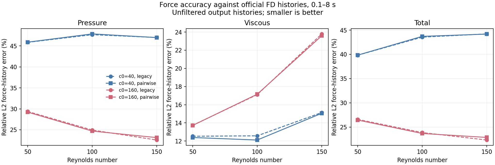
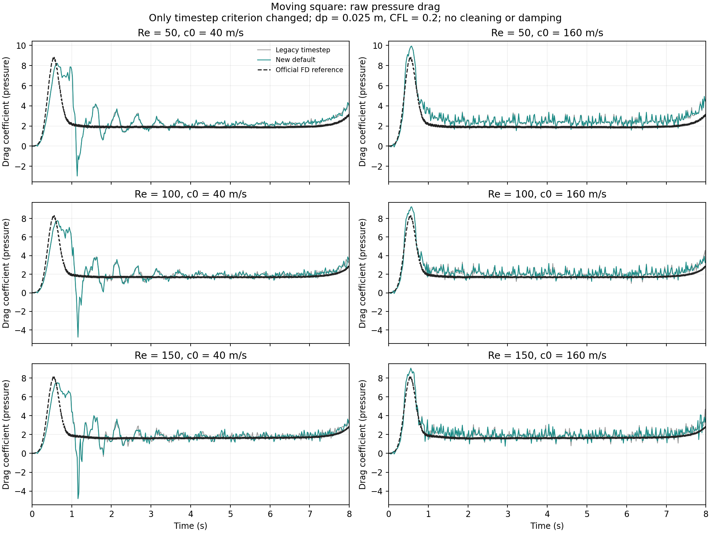
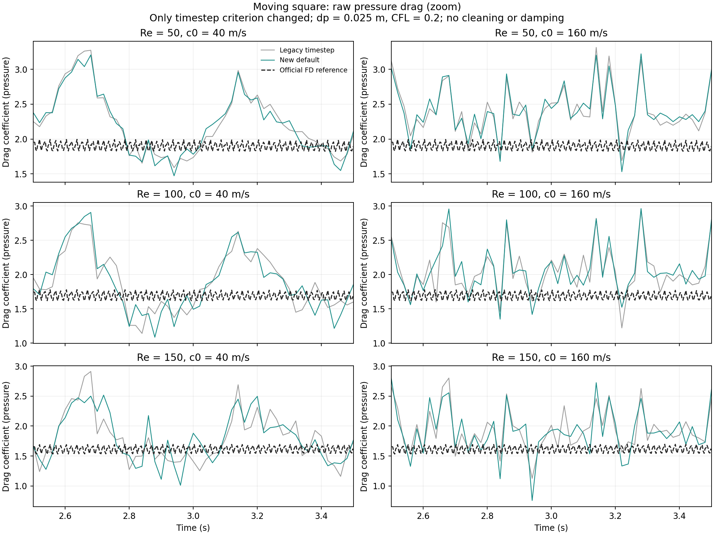
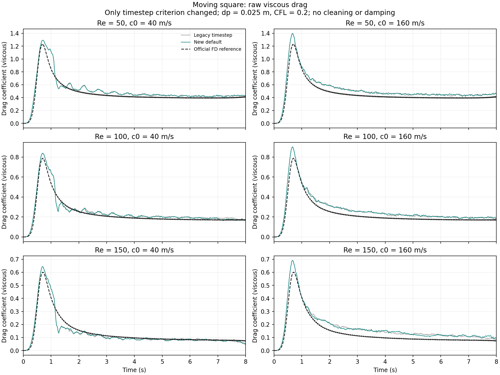
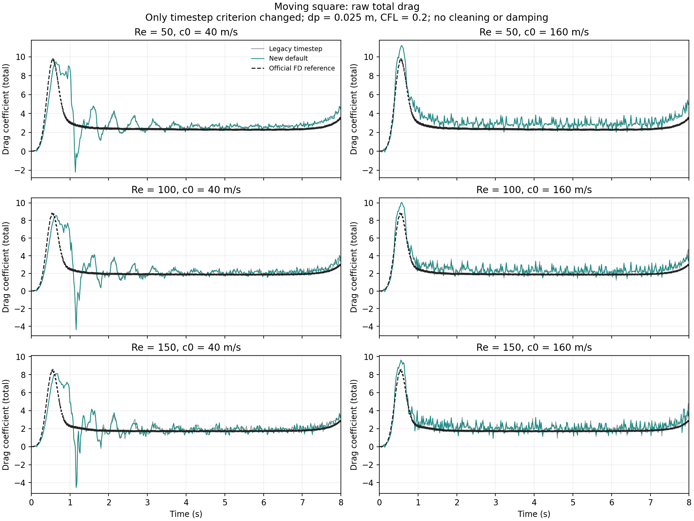

# Moving-square force accuracy with the new default timestep

The neighbor-based timestep removes a real coordinate-origin defect, but it
does not resolve the moving square's force error. This study changes only the
ordinary timestep criterion and compares fresh legacy and new-default runs
against the [official SPHERIC Test 06 finite-difference force histories](https://www.spheric-sph.org/tests/test-06).
The pressure, viscous and total drag histories remain inaccurate enough that
this DBC setup should not be described as validated.

## Matched experiment

Twelve full 8 s runs cover Re = 50, 100 and 150, c0 = 40 and 160 m/s, and both
ordinary timestep criteria. Every pair uses the same original Hermite prescribed
motion, dp = 0.025 m, h = sqrt(2) dp, CFL = 0.2, Wendland C2, laminar viscosity
nu = 1/Re, reference zero-gravity linear density diffusion (delta = 0.1), DBC,
zero gravity, no shifting, no edge damping and no divergence cleaning. The
ordinary symplectic integrator is retained. All runs use Float32 physics,
Float64 positions/clocks, cell subdivision 1 on both axes, CUDA graphs and the
same 84,864 particles: 78,400 fluid, 1,600 square and 4,864 tank-wall particles.
Each writes 401 accepted output states at 0.02 s intervals.

The historical case builder explicitly selects the legacy criterion for
reproducibility. This experiment overrides it with
`legacy_timestep=false` through `Test06DualComparison.native_case`; each run
checks the actual resolved solver criterion. The source solver is `fc4012c4`.
Hardware is an RTX 5080 with Julia 1.12.7 (`-t 2,0`), CUDA.jl 6.4.2 and driver
13.4.0. Single-run times include compilation for the first variants and are
not a performance comparison.

## Accuracy measures

Forces are independently reconstructed from square/fluid pairs in Float64
using accepted saved positions, velocities and densities. Tank and internal
solid forces are excluded. The original coefficient definition, sign, unit
depth and official reference data are retained; checksums are verified.

Raw error is the relative time-integrated L2 error over 0.1–8 s. Squared error
and reference energy are integrated exactly for the piecewise-linear saved
histories on their union of time knots. It is a history-wide error, not a
pointwise percentage error. Pressure and viscous coefficients are summed
**before** computing total-drag error. The companion binned error uses identical
0.1 s bin averages. Neither scaling nor a time shift is fitted.

The separate noise proxy is the RMS of force error after subtracting its
centered 0.5 s moving average over 1.5–6.5 s. This excludes startup and cannot
replace the full-history error. All plotted histories remain unfiltered.
The output Nyquist frequency is 25 Hz; higher-frequency force noise is not
resolved by this comparison. The official reference itself contains small
numerical oscillations, as its documentation notes.

## Measured force accuracy

Full numerical data are in [summary.csv](results/pairwise_timestep/summary.csv).

All entries below are **legacy → new default**, expressed as percentages of
reference history L2 norm. Smaller is better.

| Re | c0 [m/s] | Pressure error | Viscous error | Total drag error |
|---:|---:|---:|---:|---:|
| 50 | 40 | 45.86 → 45.90% | 12.53 → 12.39% | 39.82 → 39.83% |
| 100 | 40 | 47.68 → 47.87% | 12.57 → 12.11% | 43.55 → 43.71% |
| 150 | 40 | 47.02 → 46.99% | 15.14 → 15.06% | 44.22 → 44.18% |
| 50 | 160 | 29.37 → 29.22% | 13.73 → 13.71% | 26.59 → 26.45% |
| 100 | 160 | 24.94 → 24.69% | 17.11 → 17.16% | 23.86 → 23.68% |
| 150 | 160 | 22.56 → 23.14% | 23.80 → 23.60% | 22.32 → 22.86% |

The largest absolute pressure-error change is 0.575 percentage points. There
is no consistent force-accuracy improvement. At c0 = 40, the new pressure-noise
RMS is 0.4591 / 0.4750 / 0.5014 for Re = 50 / 100 / 150, versus legacy
0.4574 / 0.4698 / 0.4978. At c0 = 160, it is 0.3526 / 0.3753 / 0.3985,
versus 0.3604 / 0.3804 / 0.3885. These are coefficient units. Thus the
measured noise changes are small and mixed too; higher c0 remains more
influential here than replacing the timestep estimator.

The legacy cases take 45,600 steps at c0 = 40 and 181,200 at c0 = 160. The new
cases take 46,327 / 46,648 / 46,893 and 181,972 / 182,251 / 182,387 respectively.
Additional steps do not produce a material force-accuracy gain in these runs.











## Assessment and next accuracy work

The new criterion is the appropriate default because absolute position should
not enter the neighbor-compression estimate. That correctness repair does not
change the underlying WCSPH pressure or DBC traction discretization, and these
measurements do not support presenting it as a force-accuracy fix. More steps
alone have not removed the large reference discrepancy or visible ringing.

The earlier [sound-speed and reduced-timestep controls](SOUND_SPEED_160.md)
already showed substantial error after reducing the nominal timestep fourfold.
Together, those controls and this experiment make a small timestep-estimator
defect an insufficient explanation of the main force error. They do not prove
formal stability of every predictor or identify a unique remaining cause.

All 4,812 saved states pass the existing finite-state and fluid/square-count
checks; no run freezes particles. The new runs' maximum fluid density departure
is 0.904% at c0 = 40 and 0.0466% at c0 = 160. Their maximum Mach numbers are
0.0623 and 0.0111. These small compressibility indicators coexist with the large
force errors. Prescribed center-position error stays below 4.11e-12 m and
velocity error below 5.00e-8 m/s, so motion tracking is faithful to the chosen
interpolant; this does not remove the interpolant's previously documented
rounded-position acceleration jitter.

The saved-state clearance diagnostic still finds fluid particle centers inside
the ideal tank/square surfaces: the worst new-case clearance is -5.29 mm
(0.211 dp), versus -6.42 mm in the legacy runs. These are distances to the
ideal geometry, not overlap with a solid particle's center. This supports
examining the boundary treatment, but does not establish how much of the force
error it causes. See [state_summary.csv](results/pairwise_timestep/state_summary.csv).

The next useful numerical comparison is to hold this timestep criterion and
the force measurement fixed while testing boundary pressure/no-slip traction
consistency and spatial convergence. First establish a stationary/hydrostatic
boundary pressure test and a viscous wall-traction test, then compare a supported
mDBC treatment with the present DBC on the moving square. A finer resolution
study should accompany that comparison; a moving refinement zone is useful
only after its transfer/interface errors are controlled. If acoustic pressure
error remains dominant, a pressure-projection or incompressible formulation is
a stronger candidate for accurate incompressible loads. Those are proposed
follow-up tests, not solutions validated by the measurements here. Neither
extra damping nor smoothing the displayed force curve establishes correct
benchmark loads.

## Reproduction and checks

From `gpu_version`:

```powershell
julia --compiled-modules=existing --project=. -t 2,0 "validation cases/spheric_test_06/pairwise_force_accuracy.jl"
python "validation cases/spheric_test_06/plot_pairwise_force_accuracy.py"
julia --compiled-modules=existing --project=. -t 2,0 "validation cases/spheric_test_06/comparison_tests.jl"
```

Per-case `native.csv`, `native_state.csv` and `native.toml` retain the force
history, accepted-state diagnostics and step counts. Large HDF histories remain
in ignored workspace `runs/pairwise_timestep/` folders. Runs refuse to overwrite
an existing history. Completed per-case records allow resuming the study.
The existing DualSPHysics archives are unchanged; this is a matched Julia
timestep experiment, not a new two-solver formulation comparison.

All six fresh legacy force histories and their time nodes match the prior
published CSV values exactly, as recorded in
[legacy_archive_comparison.json](results/pairwise_timestep/legacy_archive_comparison.json).
The 29 comparison assertions pass, covering explicit criterion selection,
unchanged geometry/constants, motion integration and the shared error/noise
metrics. `git diff --check` passes. The full solver suite was not rerun for
this analysis-only follow-up.
