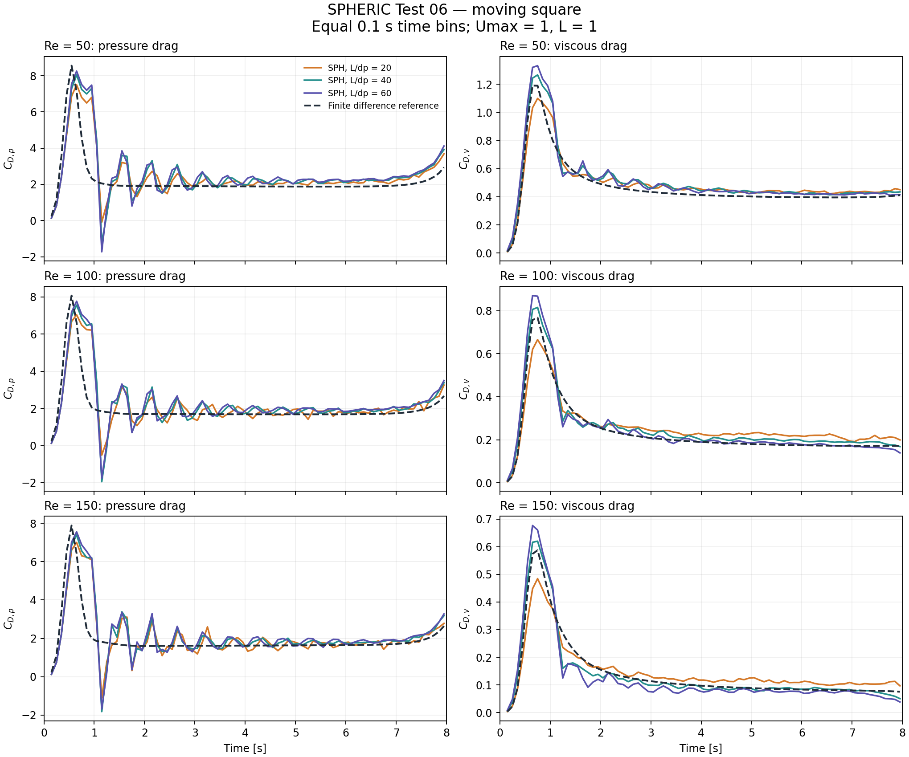
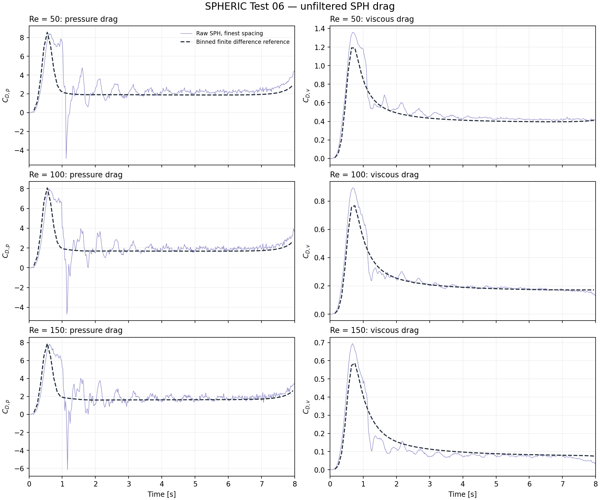
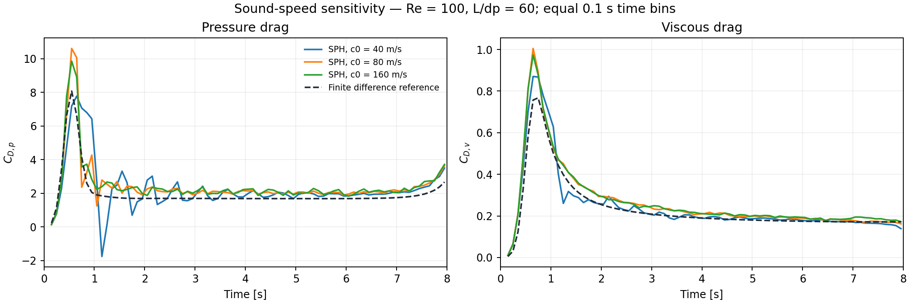
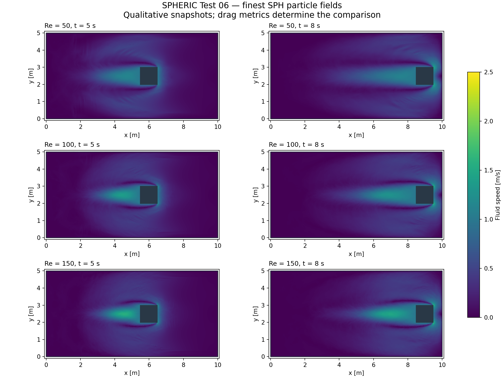

# SPHERIC Test 06 validation report

Result: **FAIL — the tested DBC configuration is not validated**.

Run date: 2026-11-14. All nine combinations of Re = 50, 100, 150 and L/dp = 20, 40, 60 completed the full 8 s with 401 frames each and no lost or frozen particles. The pressure and viscous drag errors fail the chosen criteria at the finest spacing.

## Drag comparison

Both SPH and the official finite difference histories are integrated over identical 0.1 s bins from 0.1 through 8.0 s (79 bins). The first 0.1 s is excluded because the reference starts at 0.003 s; no t = 0 reference is invented. Each bin uses piecewise-linear interpolation and the trapezoidal integral, including every original sample in the bin.

Normalized RMS error = `norm(SPH_bin_means - FD_bin_means) / norm(FD_bin_means)`. Late bias is `mean(SPH) / mean(FD) - 1` over 4–8 s. No fitted scale, time shift, or reference extrapolation is applied. The raw histories remain in the three-column `.dat` files and CSV files.

| Re | L/dp | Pressure NRMSE | Viscous NRMSE | Pressure late bias | Viscous late bias |
|---:|---:|---:|---:|---:|---:|
| 50 | 20 | 37.06% | 9.83% | +13.51% | +9.37% |
| 50 | 40 | 44.18% | 12.28% | +19.19% | +7.61% |
| 50 | 60 | 46.11% | 14.07% | +22.15% | +6.30% |
| 100 | 20 | 39.09% | 15.94% | +7.67% | +23.29% |
| 100 | 40 | 45.41% | 11.96% | +13.49% | +10.23% |
| 100 | 60 | 45.33% | 14.96% | +16.66% | +0.66% |
| 150 | 20 | 41.11% | 18.04% | +3.76% | +30.04% |
| 150 | 40 | 44.07% | 14.51% | +10.10% | -3.01% |
| 150 | 60 | 45.48% | 22.77% | +12.29% | -14.05% |

The SPH pressure histories contain strong startup oscillations absent from the incompressible reference. Refining particles alone does not remove this discrepancy. Viscous late-time means can be closer while the full transient error still fails; a late-time average alone would overstate agreement.

## Resolution sensitivity

Change between L/dp = 40 and 60, measured as the RMS difference divided by the RMS finite difference reference over the same bins:

| Re | Pressure change | Viscous change |
|---:|---:|---:|
| 50 | 7.17% | 4.53% |
| 100 | 8.14% | 8.40% |
| 150 | 7.30% | 10.71% |

These three spacings do not establish convergence. In particular, the two finest pressure curves differ by more than the chosen 5% resolution criterion at all Reynolds numbers.

## Physical and numerical checks

| Re | L/dp | Fluid / square / fixed | Steps | Max density deviation | Max Mach | Min solid clearance [m] |
|---:|---:|---:|---:|---:|---:|---:|
| 50 | 20 | 19600 / 400 / 2464 | 22800 | 0.551% | 0.0489 | -0.009159 |
| 50 | 40 | 78400 / 1600 / 4864 | 45600 | 0.584% | 0.0568 | -0.006416 |
| 50 | 60 | 176400 / 3600 / 7264 | 68000 | 0.800% | 0.0630 | -0.003934 |
| 100 | 20 | 19600 / 400 / 2464 | 22800 | 0.633% | 0.0494 | -0.006859 |
| 100 | 40 | 78400 / 1600 / 4864 | 45600 | 0.829% | 0.0581 | -0.003375 |
| 100 | 60 | 176400 / 3600 / 7264 | 68000 | 0.735% | 0.0665 | -0.002545 |
| 150 | 20 | 19600 / 400 / 2464 | 22800 | 0.618% | 0.0521 | -0.008538 |
| 150 | 40 | 78400 / 1600 / 4864 | 45600 | 0.899% | 0.0620 | -0.002283 |
| 150 | 60 | 176400 / 3600 / 7264 | 68000 | 1.095% | 0.0691 | -0.001665 |

Maximum prescribed center-position error is 4.094e-12 m; maximum wall-velocity error is 4.991e-08 m/s. Checks are performed on every saved frame. Negative clearance denotes a fluid particle center inside the nominal tank wall or moving square. These small penetrations are reported explicitly and fail the strict zero-penetration check.

## Sound-speed sensitivity

After the baseline runs showed a pressure discrepancy, two additional full runs varied only sound speed at Re = 100, L/dp = 60. They retain the same geometry, physical viscosity, output interval and comparison method. These are diagnostic runs, not a replacement for the baseline resolution study.

| Sound speed [m/s] | Pressure NRMSE | Viscous NRMSE | Max density deviation | Max Mach |
|---:|---:|---:|---:|---:|
| 40 | 45.33% | 14.96% | 0.735% | 0.0665 |
| 80 | 32.28% | 18.92% | 0.197% | 0.0243 |
| 160 | 26.77% | 18.59% | 0.044% | 0.0114 |

The source benchmark assumes incompressibility. Low particle-density variation by itself does not demonstrate that a weakly compressible pressure transient agrees with it. A dedicated boundary/pressure investigation and further independent convergence evidence are needed before claiming validation.

## Qualitative particle fields

Speed snapshots at 5 and 8 s are qualitative. No quantitative vorticity or field-norm validation is claimed.

## Provenance and verification

Official input and reference provenance: [reference/README.md](reference/README.md). Solver source commit: `843257098a8ede34c523b096453868dc68594558`. Simulation code is unchanged. Julia 1.12.7, CUDA.jl 6.4.2, CUDA driver 13.4.0, NVIDIA GeForce RTX 5080; Windows. Each run's `.toml` records its settings and diagnostics. Reported wall times include startup/JIT/output and are not matched performance benchmarks.

The focused tests passed 195 assertions covering fixture integrity, geometry and viscosity, absolute motion, force sign and action/reaction, GPU force parity in Float32/Float64, time integration, an end-to-end HDF run, and rejection of incomplete validation. The full repository CUDA suite was not run. Reproduction commands and the project-specific acceptance criteria are in [README.md](README.md).
