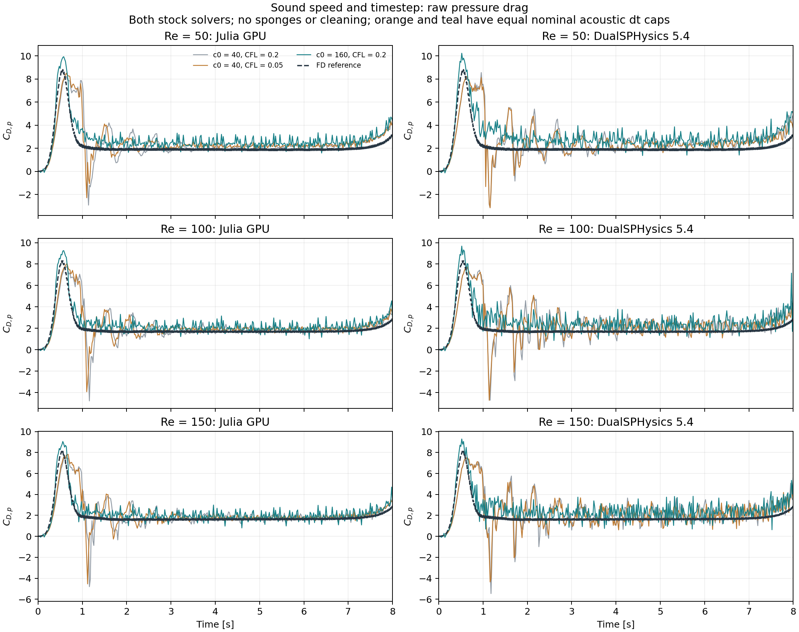
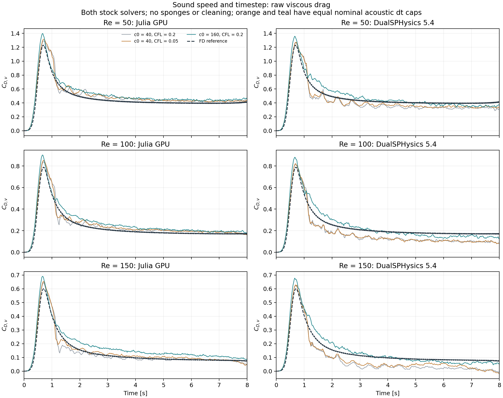
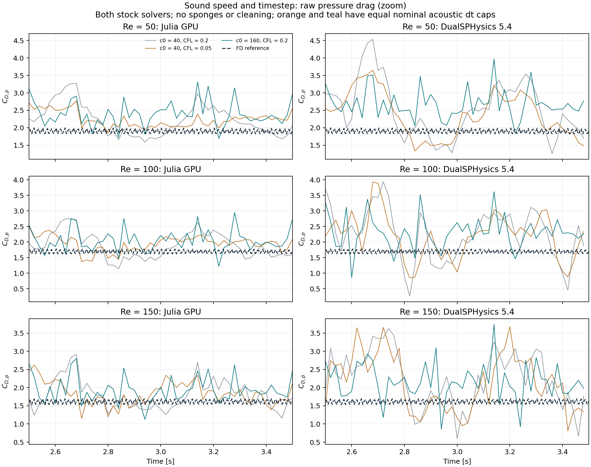
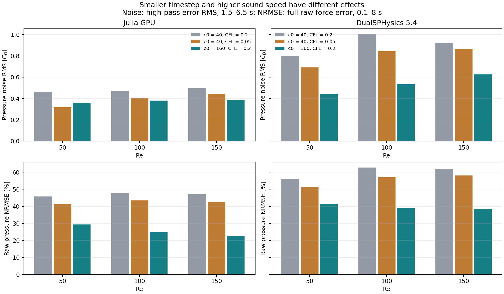
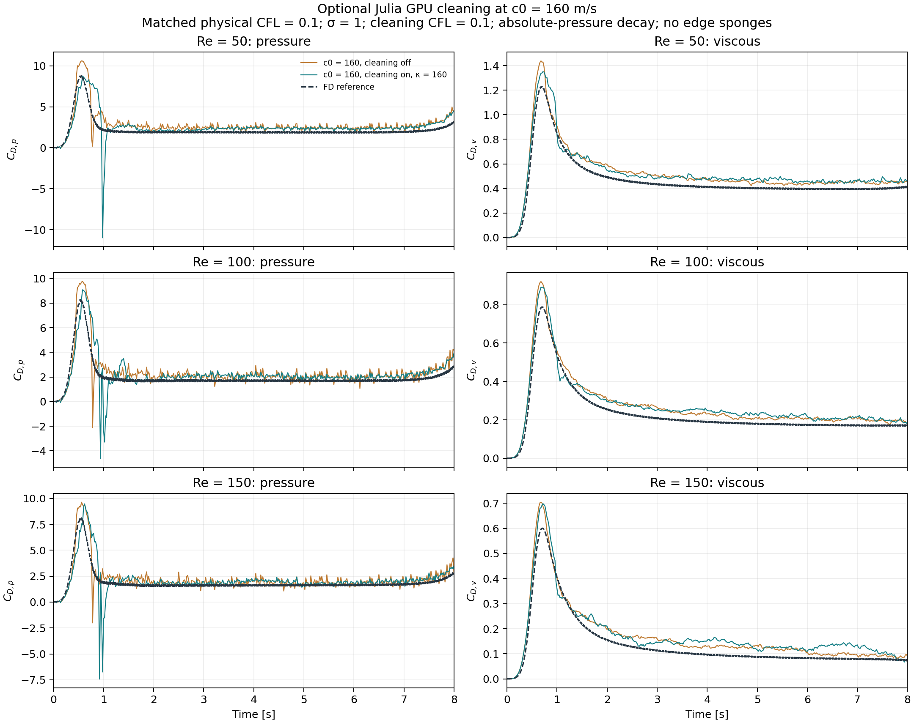
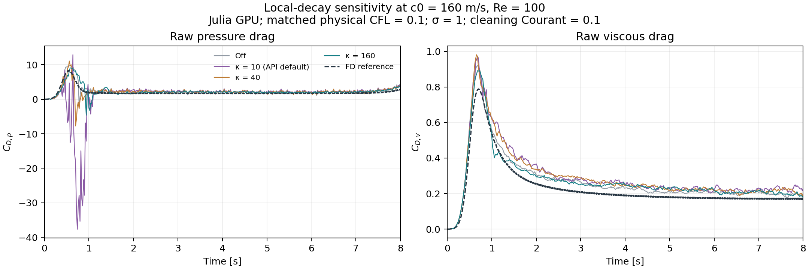
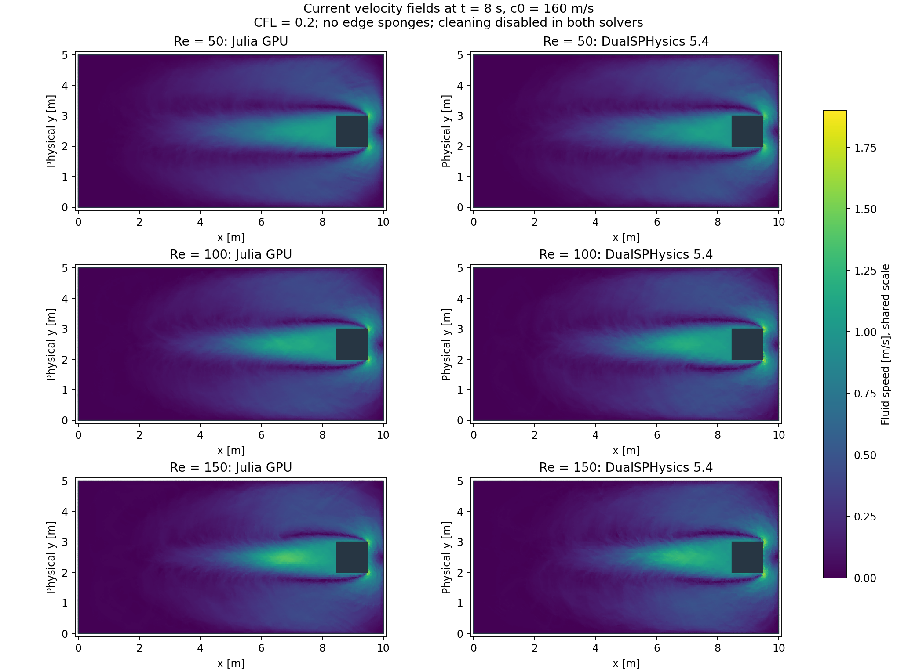

# Sound speed 160 m/s and timestep controls in both solvers

**Increasing c0 to 160 m/s reduces the measured pressure noise and raw pressure error relative to 40 m/s in both tested solvers at Re = 50, 100 and 150. It does not validate either DBC setup.** Smaller timesteps also change the result, and the controls below separate that effect from changing c0. All histories are unfiltered.

## Why c0 and timestep both matter

Near the reference density, the Tait equation gives Δp ≈ c0² Δρ, while the acoustic limit is approximately dt ≤ CFL h/c0. Going from 40 to 160 m/s makes the pressure response to a fixed density error 16 times stiffer and reduces the nominal acoustic timestep by four. It also changes acoustic travel times and the density-diffusion coefficient δ h c0. The fluid does not retain the same density error when c0 changes, so pressure noise need not vary monotonically with c0. This follows the [official DualSPHysics formulation](https://github.com/DualSPHysics/DualSPHysics/wiki/3.-SPH-formulation) and the equations implemented in this package.

For a 10 m tank, the simple box-mode estimate c0/(2Lx) changes from 2 to 8 Hz. The moving square changes the actual modes; measured peaks are reported rather than assigned to an exact box eigenmode. Stable explicit stepping can retain bounded acoustic ringing. Stability therefore does not imply accurate incompressible wall forces.

## Common setup and provenance

The original closed 10 × 5 m tank and moving unit square are retained through 8 s: dp = 0.025 m, h = √2 dp, Uref = 1 m/s, ρ0 = 1000 kg/m³, zero gravity, Re = 50/100/150, laminar viscosity ν = 1/Re, Wendland C2, DBC, δ = 0.1, no shifting and no SPS. There are **no edge damping zones**. Both solvers have 78,400 fluid, 1,600 square and 4,864 fixed particles (84,864 total), Float32 physics and double positions, with 401 frames at 0.02 s intervals. Stock DualSPHysics 5.4.355 uses its x/z plane for Julia's physical x/y plane. GenCase lattices and particle types are verified against the common geometry.

The original Hermite motion is retained. It includes acceleration associated with rounded position data; this experiment does not also change the forcing. The Julia reference density diffusion and regularization differ from stock Dual's wall-gated DDT and regularization, as detailed in [COMPARISON.md](COMPARISON.md). Equal settings do not make the two discrete operators identical.

c0 = 40/CFL = 0.2 baselines and the Re = 100/c0 = 160/CFL = 0.2 pair reuse the previously published `9302adb` archive. All other controls are new. `summary.csv` identifies the source and relative data path of every row. Large source histories remain in ignored `runs/`; a fresh checkout must rerun the original comparison to recreate archive field images.

## c0 = 40 versus 160 in both solvers

Noise is the RMS of force error after subtracting its centered 0.5 s moving average, over 1.5–6.5 s. Raw NRMSE integrates squared piecewise-linear error against the official FD reference over 0.1–8 s. Both use the existing, tested `noise_metrics.jl`; no fitted scale or time shift is applied. The central noise window excludes startup, so full-transient raw errors and state diagnostics are retained.

| Re | Solver | c0 [m/s] | Pressure noise RMS [Cd] | Raw pressure NRMSE | Binned pressure NRMSE | Raw viscous NRMSE | Steps |
|---:|---|---:|---:|---:|---:|---:|---:|
| 50 | native | 40 | 0.4574 | 45.86% | 44.18% | 12.53% | 45600 |
| 50 | native | 160 | 0.3604 | 29.37% | 27.72% | 13.73% | 181200 |
| 50 | dual | 40 | 0.7995 | 56.18% | 52.52% | 15.70% | 45877 |
| 50 | dual | 160 | 0.4435 | 41.64% | 39.61% | 12.52% | 181562 |
| 100 | native | 40 | 0.4698 | 47.68% | 45.41% | 12.57% | 45600 |
| 100 | native | 160 | 0.3804 | 24.94% | 22.16% | 17.11% | 181200 |
| 100 | dual | 40 | 1.0052 | 62.74% | 56.21% | 25.47% | 46342 |
| 100 | dual | 160 | 0.5344 | 39.27% | 34.84% | 15.89% | 181892 |
| 150 | native | 40 | 0.4978 | 47.02% | 44.07% | 15.14% | 45600 |
| 150 | native | 160 | 0.3885 | 22.56% | 18.76% | 23.80% | 181200 |
| 150 | dual | 40 | 0.9201 | 61.66% | 55.08% | 34.87% | 46663 |
| 150 | dual | 160 | 0.6259 | 38.48% | 33.29% | 18.78% | 182195 |







## Equal nominal acoustic timestep controls

Both solvers also run c0 = 40 with CFL = 0.05. This matches the nominal acoustic cap of c0 = 160/CFL = 0.2: `0.05 h/40 = 0.2 h/160 ≈ 44.19 μs`. This is an adaptive-step control, not a shared imposed timestep sequence: force/viscous restrictions, output clipping and trajectories can differ. The measured step counts and 8 s/steps averages are reported. Keeping c0 fixed while lowering CFL probes timestep sensitivity; comparing the orange and teal curves then probes c0 at a similar acoustic cap.

| Re | Solver | Control | Steps | Mean dt [μs] | Pressure noise RMS [Cd] | Raw pressure NRMSE |
|---:|---|---|---:|---:|---:|---:|
| 50 | native | 40 m/s, CFL 0.05 | 181200 | 44.150 | 0.3172 | 41.31% |
| 50 | native | 160 m/s, CFL 0.2 | 181200 | 44.150 | 0.3604 | 29.37% |
| 50 | dual | 40 m/s, CFL 0.05 | 183444 | 43.610 | 0.6916 | 51.36% |
| 50 | dual | 160 m/s, CFL 0.2 | 181562 | 44.062 | 0.4435 | 41.64% |
| 100 | native | 40 m/s, CFL 0.05 | 181201 | 44.150 | 0.4045 | 43.54% |
| 100 | native | 160 m/s, CFL 0.2 | 181200 | 44.150 | 0.3804 | 24.94% |
| 100 | dual | 40 m/s, CFL 0.05 | 185329 | 43.166 | 0.8433 | 57.05% |
| 100 | dual | 160 m/s, CFL 0.2 | 181892 | 43.982 | 0.5344 | 39.27% |
| 150 | native | 40 m/s, CFL 0.05 | 181203 | 44.149 | 0.4426 | 42.86% |
| 150 | native | 160 m/s, CFL 0.2 | 181200 | 44.150 | 0.3885 | 22.56% |
| 150 | dual | 40 m/s, CFL 0.05 | 186501 | 42.895 | 0.8673 | 58.14% |
| 150 | dual | 160 m/s, CFL 0.2 | 182195 | 43.909 | 0.6259 | 38.48% |



At Re = 50 in native, reducing the timestep at c0 = 40 changes pressure noise by -30.6% and raw pressure NRMSE from 45.86% to 41.31%. At c0 = 160 with a similar cap, raw pressure NRMSE is 29.37% and noise RMS is 0.3604.

At Re = 100 in native, reducing the timestep at c0 = 40 changes pressure noise by -13.9% and raw pressure NRMSE from 47.68% to 43.54%. At c0 = 160 with a similar cap, raw pressure NRMSE is 24.94% and noise RMS is 0.3804.

At Re = 150 in native, reducing the timestep at c0 = 40 changes pressure noise by -11.1% and raw pressure NRMSE from 47.02% to 42.86%. At c0 = 160 with a similar cap, raw pressure NRMSE is 22.56% and noise RMS is 0.3885.

At Re = 50 in dual, reducing the timestep at c0 = 40 changes pressure noise by -13.5% and raw pressure NRMSE from 56.18% to 51.36%. At c0 = 160 with a similar cap, raw pressure NRMSE is 41.64% and noise RMS is 0.4435.

At Re = 100 in dual, reducing the timestep at c0 = 40 changes pressure noise by -16.1% and raw pressure NRMSE from 62.74% to 57.05%. At c0 = 160 with a similar cap, raw pressure NRMSE is 39.27% and noise RMS is 0.5344.

At Re = 150 in dual, reducing the timestep at c0 = 40 changes pressure noise by -5.7% and raw pressure NRMSE from 61.66% to 58.14%. At c0 = 160 with a similar cap, raw pressure NRMSE is 38.48% and noise RMS is 0.6259.

The two changes are not equivalent. A smaller timestep alone does not reproduce the higher-c0 pressure history. These are timestep-sensitivity controls, not a formal convergence study; further dt and spatial refinement are still required. At Re = 100, the earlier Julia c0 = 80 noise RMS was 0.2818 versus 0.3804 at 160, so increasing c0 is not a monotonic noise-removal knob.

## Optional Julia GPU cleaning at 160 m/s

This pair uses the new optional cleaning procedure with κ = c0/Uref = 160, σ = 1, cleaning Courant = 0.1, and the documented `pressure_mode=:absolute` extension. Both on and off use physical CFL = 0.1, so the smaller physical CFL is controlled. Cleaning's accepted-state decay-speed restriction can still require extra steps. The stock DualSPHysics binary is unchanged and has no cleaning result in this study.

| Re | Mode | Pressure noise RMS [Cd] | Raw pressure NRMSE | Raw viscous NRMSE | Max density departure | Steps |
|---:|---|---:|---:|---:|---:|---:|
| 50 | off | 0.2679 | 34.30% | 14.08% | 0.050% | 362400 |
| 50 | on | 0.1390 | 45.80% | 14.62% | 0.065% | 887453 |
| 100 | off | 0.2850 | 30.13% | 16.93% | 0.045% | 362400 |
| 100 | on | 0.1677 | 36.59% | 17.57% | 0.087% | 961174 |
| 150 | off | 0.3079 | 27.77% | 20.45% | 0.049% | 362400 |
| 150 | on | 0.1664 | 42.11% | 24.22% | 0.107% | 1006614 |



The κ = 160 control reduces central-window noise but worsens full-transient pressure error at every Re, including a large negative startup excursion. It is not recommended as a validation fix. Re = 100 also checks the API default κ = 10 and an intermediate κ = 40 at the same physical and cleaning CFL:

| Re = 100 mode | Pressure noise RMS [Cd] | Raw pressure NRMSE | Raw viscous NRMSE | Max density departure | Steps |
|---|---:|---:|---:|---:|---:|
| off | 0.2850 | 30.13% | 16.93% | 0.045% | 362400 |
| κ = 10 | 0.2625 | 256.29% | 26.39% | 1.459% | 362957 |
| κ = 40 | 0.2729 | 50.52% | 24.73% | 0.203% | 367091 |
| κ = 160 | 0.1677 | 36.59% | 17.57% | 0.087% | 961174 |



At Re = 100, κ = 10 gives a startup Cd,p minimum near −37.66 at t = 0.74 s and raw pressure NRMSE of about 256.3%, despite only modest central-window noise change. κ = 40 and 160 also worsen total pressure error relative to the same-CFL off control. None of these settings is a validated remedy. The scalar-gradient term changes the transient dynamics; a formal timestep-convergence and moving-wall study is still needed to separate integration, operator and boundary effects. For this benchmark at 160 m/s, leave cleaning off pending that work.

The [cleaning implementation report](DIVERGENCE_CLEANING.md) contains equations, sign conventions, GPU allocation, supported configurations and the c0 = 40 controls. Its negative-pressure experiment also shows why a quiet central window alone is insufficient evidence of accuracy.

## Current fields and state checks



| Re | Julia mode | Max density departure | Max Mach | Minimum solid clearance [m] | Max motion error [m] |
|---:|---|---:|---:|---:|---:|
| 50 | standard160 | 0.045% | 0.0094 | -0.00396 | 4.71e-13 |
| 50 | step_control40 | 0.588% | 0.0552 | -0.00485 | 4.71e-13 |
| 50 | cleaning_control160 | 0.050% | 0.0095 | -0.00331 | 5.16e-14 |
| 50 | cleaning160 | 0.065% | 0.0146 | -0.00384 | 4.60e-13 |
| 100 | standard160 | 0.044% | 0.0109 | -0.00178 | 4.71e-13 |
| 100 | step_control40 | 0.848% | 0.0612 | -0.00378 | 4.71e-13 |
| 100 | cleaning_control160 | 0.045% | 0.0111 | -0.00187 | 5.16e-14 |
| 100 | cleaning160 | 0.087% | 0.0163 | -0.00130 | 4.59e-13 |
| 150 | standard160 | 0.042% | 0.0111 | -0.00150 | 4.71e-13 |
| 150 | step_control40 | 0.694% | 0.0567 | -0.00238 | 4.71e-13 |
| 150 | cleaning_control160 | 0.049% | 0.0115 | -0.00098 | 5.16e-14 |
| 150 | cleaning160 | 0.107% | 0.0199 | -0.00067 | 4.49e-13 |

All new Julia frames were checked for finite state, particle counts, prescribed motion and no frozen particles. Dual runs rejected any excluded particles and completed all 401 frames with 84,864 particles. The full Julia diagnostics are in each `native_state.csv`; the same full-history state diagnostics were not exported for Dual. Negative clearance means fluid centers enter the nominal solid and fails the original impermeability criterion. Successful completion is not a validation pass.

At the 0.02 s output cadence, Nyquist is 25 Hz. The 8 Hz box estimate has only 6.25 output samples per cycle; higher modes may alias. This limits spectral interpretation and means the saved-force noise metric does not measure every high-frequency fluctuation. A higher-cadence force diagnostic is needed before assigning unresolved spectral peaks.

## Isolated whole-solver timing at Re = 100

On NVIDIA GeForce RTX 5080, c0 = 160/CFL = 0.2 uses full-duration warmups of each solver followed by three alternating, unprofiled pairs with no other validation job using the GPU. The median paired Dual/Julia wall-time ratio is 7.50x (range 7.36–7.64x). These are whole configuration costs including setup, stepping and output, not matched-operator kernel timings.

| Solver | Median wall [s] | Median reported solver [s] | Steps | Frames | Julia rebuilds | Julia step readbacks |
|---|---:|---:|---:|---:|---:|---:|
| native | 25.061 | 25.061 | 181200 | 401 | 580 | 6179 |
| dual | 187.746 | 187.418 | 181892 | 401 | n/a | n/a |

Timings exclude GenCase/Julia particle generation and offline force/plot analysis. Repeats compare final position, velocity and density by stable ID; all differences are retained in `timings.csv`. The exploratory per-case wall times in `summary.csv` overlapped regressions and are not used as performance evidence. No whole-solver VRAM percentage or memory-bandwidth claim is inferred.

| Solver | Max repeat position difference [m] | Max repeat velocity difference [m/s] | Max repeat density difference [kg/m³] |
|---|---:|---:|---:|
| native | 0.000e+00 | 0.000e+00 | 0.000e+00 |
| dual | 0.000e+00 | 0.000e+00 | 0.000e+00 |

These comparisons use exported precision, including stock Dual's CSV formatting. Matching final state does not establish that every intermediate floating-point operation is identical.

## Assessment and next step

c0 = 160 is a useful stiffness/transit-time control, but it is not a cure for wall-traction error. The comparison should retain raw pressure and viscous loads, central noise, startup transients and impermeability checks together. The current evidence supports keeping cleaning optional and testing consistent integrated-velocity motion and translating/accelerating no-slip wall treatments next, followed by spatial and timestep refinement. A lower noise RMS without better reference loads is not a successful validation.

## Reproduce

Julia 1.12.7, CUDA.jl 6.4.2, CUDA driver 13.4.0; GPU NVIDIA GeForce RTX 5080. No new dependency or modified DualSPHysics binary is required.

Run from `gpu_version/`; first run `dual_compare.jl` to recreate missing archived baselines. Run timing studies alone after the simulation/regression jobs finish:

```sh
julia --project=. -t 2,0 "validation cases/spheric_test_06/sound_speed_160.jl"
julia --project=. -t 2,0 "validation cases/spheric_test_06/sound_speed_160.jl" fields
julia --project=. -t 2,0 "validation cases/spheric_test_06/sound_speed_160.jl" timing
python "validation cases/spheric_test_06/plot_sound_speed_160.py"
julia --project=. "validation cases/spheric_test_06/sound_speed_160_report.jl"
```

The script resumes saved `.toml` results and refuses to overwrite existing run histories. `native` and `dual` arguments select an individual solver. Run those modes sequentially if they may write the same case or summary file.
