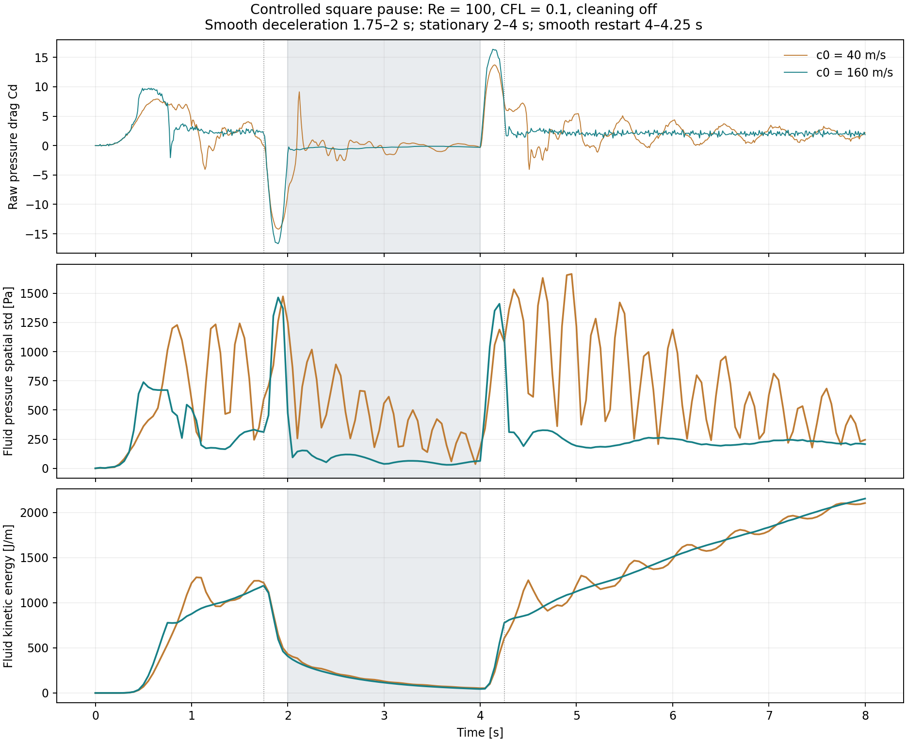
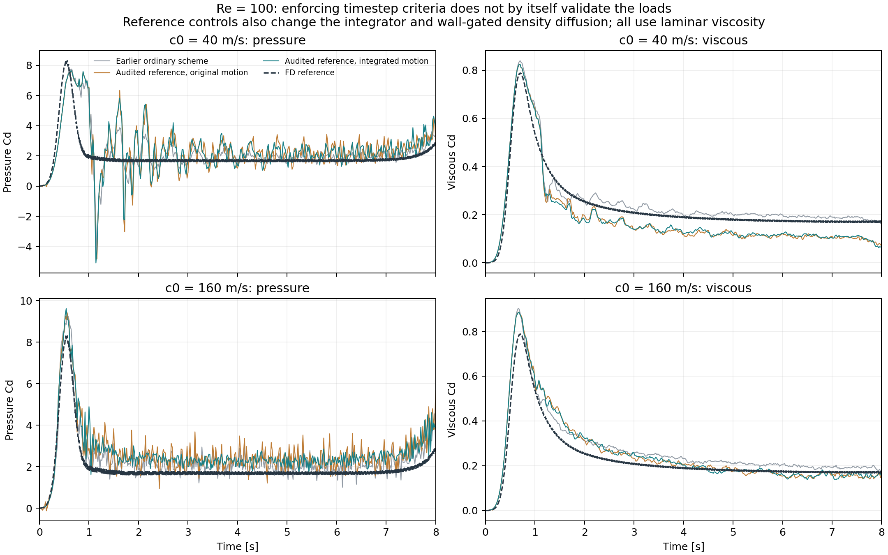

# Timestep audit and controlled square pause

The current audit finds a real defect in the Julia reference timestep estimate:
its compression-like term depends on absolute position. It does **not** establish
that an unstable timestep caused the observed force errors. A saved-state audit
and a controlled pause separate those questions.

## Why smoothing can coexist with jagged forces

The kernel smooths discrete interpolation over a finite support. Differentiating
that interpolation, changing neighbor configurations and integrating wall traction
do not eliminate particle or density errors. WCSPH converts density to pressure;
near the reference density, `delta_p = c0^2 delta_rho`. The closed tank can retain
acoustic waves. Bounded particle motion therefore does not establish accurate
incompressible pressure or smooth integrated loads. See the
[official formulation](https://github.com/DualSPHysics/DualSPHysics/wiki/3.-SPH-formulation).

## Source audit

`GPUKernels.step_values` currently uses
`abs(h dot(v,x)/(dot(x,x)+eta^2))`, with absolute `x` and `v`.
A translation changes this quantity even though relative particle separations
and the instantaneous physical problem are unchanged. It is not the usual
neighbor compression maximum. The analytic example in
`results/timestep_audit/origin_and_viscosity.csv` documents this dependence;
it is a constructed example, not a measured instability in the tank.

The installed DualSPHysics source (`JSphGpu::DtVariable`) instead uses
`CFL min(sqrt(h/amax), h/(max(c0,10 vmax)+h max_pair_rate))`, with additional
restrictions for enabled models. It also has a minimum-step clamp. A full audit
must check whether that clamp activates; a lower bound can override an upper
stability bound. Julia's new cleaning procedure separately caps its decay speed.

The Julia reference-scheme implementation also had a fixed minimum-step floor.
The new optional `DualSPHysicsSymplectic(respect_stability_limits=true)` returns
the computed upper bound directly instead of raising it to that floor. The
uniform driver applies the current accepted-state limit before predicting and
retries an oversized corrector trial before committing particle state. It
records proposed/accepted limit ratios and retry counts. Strict variable
resolution is rejected until its stage retries are implemented. The original
default remains available for reference reproduction. This repairs the optional reference-scheme safeguard;
it does not repair the ordinary scheme's origin-dependent expression or prove
that either minimum-step floor activated in the moving-square baselines.

The reference path now supports physical laminar viscosity, with an additional
`h^2/(8 nu)` cap. Its neighbor-rate buffer previously implied the artificial
viscosity force branch; that branch is now selected only for the artificial
viscosity model. A GPU regression verifies unchanged, nonzero laminar forces
when rate collection is enabled. Invalid exploratory trials from before this
correction remain archived in ignored `runs/`, not in the reported Re results.

At dp = 0.025 m, nominal acoustic caps for CFL = 0.2 are about 176.78 and
44.19 microseconds at c0 = 40 and 160. The rough viscous scale `h^2/(8 nu)`
is 7.81–23.44 milliseconds across Re = 50–150, much larger. This scale estimate
does not replace a bound for the actual discrete viscous operator or its boundary
conditions.

## Saved-state measurement

`timestep_audit.jl` recomputes neighbor compression at snapshots every 0.2 s
through 8 s in all six Julia baseline cases, in Float64. It uses the existing
neighbor kernel's pair-rate calculation and discards its force output. No state
is advanced. The results are in `results/timestep_audit/snapshot_limits.csv`.

| c0 | Re 50: largest legacy/pair cap | Re 100 | Re 150 |
|---:|---:|---:|---:|
| 40 m/s | 1.0294 | 1.0378 | 1.0423 |
| 160 m/s | 1.0072 | 1.0085 | 1.0094 |

Thus the legacy acoustic estimate can be about 4.2% more permissive than the
neighbor estimate in these saved states. These are **candidate timestep caps**,
not measured accepted-step violation counts. Acceleration and output clipping
may impose a smaller step; neither every predictor nor every accepted state was
sampled. The data do not justify calling the entire simulation timestep-stable,
or blaming the large force error on this discrepancy alone. A production repair
needs origin-invariant neighbor limits, explicit diffusion/viscosity accounting,
predictor/accepted-state checks and logged limiter provenance.

The existing c0 = 40/CFL = 0.05 controls in both solvers reduce the nominal step
by four. They still have substantial force error. This argues against explaining
all ringing as a small underestimate of the neighbor compression term. It is not
a formal timestep-convergence proof; see [the complete controls](SOUND_SPEED_160.md).

## Freeze the square and let the field relax

The new Julia diagnostic runs Re = 100 at c0 = 40 and 160, CFL = 0.1, cleaning
and edge damping off. It smoothly decelerates during 1.75–2 s, holds the square
fixed during 2–4 s, and smoothly restarts during 4–4.25 s. The original trajectory
is evaluated through a smooth time mapping. The run ends at 8 s, before completing
the original path. This is a changed-motion diagnostic, not the official force
validation, and the hold duration is fixed rather than selected by a threshold.



| c0 | Mean fluid pressure spatial std, 2–2.5 s | 3.5–4 s | Mean kinetic energy, 2–2.5 s | 3.5–4 s |
|---:|---:|---:|---:|---:|
| 40 m/s | 738.3 Pa | 235.0 Pa | 309.4 J/m | 65.5 J/m |
| 160 m/s | 138.8 Pa | 44.4 Pa | 286.0 J/m | 56.0 J/m |

The pressure spatial variation decreases by about 68% between those windows.
Stopping and restarting themselves generate strong load transients; ringing
returns after restart, especially at 40 m/s. Pressure spatial variation contains
physical gradients as well as numerical error, and kinetic energy includes real
recirculation. Their decay is evidence of relaxation, not a measurement of purely
spurious energy. Freezing at t = 0 would not help this initialization: the fluid
already starts at rest at uniform reference density and zero pressure.

## Audited stepping and consistent-motion controls

Four complete Re = 100 Julia runs use the audited reference path with physical
laminar viscosity, CFL = 0.2, strict arithmetic, one lane and direct execution.
They retain dp = 0.025 m, 84,864 particles and 401 frames. They use Fourtakas
inner diffusion, which suppresses density diffusion near DBC walls at zero
gravity. The ordinary baseline uses its original wall-pair diffusion. Thus this
is a combined integration/diffusion control, not an isolated timestep change.

| c0 | Motion | Pressure noise RMS [Cd] | Raw pressure NRMSE | Raw viscous NRMSE | Max accepted dt/limit |
|---:|---|---:|---:|---:|---:|
| 40 | Original Hermite | 0.9955 | 62.17% | 23.88% | 1.0 |
| 40 | Integrated velocity | 0.9297 | 61.38% | 23.52% | 1.0 |
| 160 | Original Hermite | 0.4618 | 38.54% | 17.38% | 1.0 |
| 160 | Integrated velocity | 0.2085 | 35.48% | 16.97% | 1.0 |



The original reference path starts with h/c0 and uses newly evaluated limits
for a subsequent step. The new option checks them before accepting the current
step. In all four controls, the maximum pre-check proposal/current limit ratio
is about 5.0, due to the initial proposal. Every accepted step's Float64 clock
ratio is at most 1.0. Particle arithmetic remains Float32. The accepted-state
ratios, retry counts and actual readback counts are retained in `native.toml`.
The ordinary baselines use a different driver: this initial reference-path
overshoot must not be attributed to them or to the stock Dual executable.

Consistent integrated-velocity motion reduces the 160 m/s reference control's
central noise by about 55%. It avoids acceleration generated by differentiating
rounded displacement records. It still leaves about 35% full-transient pressure
error. These results do not validate the DBC force model or establish that all
remaining fluctuations are spurious. They show that satisfying these timestep
criteria alone is insufficient. These control wall times are not used as a
paired performance comparison.

The neighbor-rate audit follows the installed reference's **nonnegative maximum
of a signed pair dot product**. It is not a measured maximum of the absolute
pair strain in both approach and separation. This convention, local EOS sound
speed, diffusion stability and unresolved high-frequency forcing remain part
of a complete stability analysis.

Run `timestep_scheme_control.jl` and then `plot_timestep_scheme_control.py` to
reproduce these controls. The invalid pre-correction trials are excluded.

## Refinement and assessment

Body-following refinement already exists via `VariableResolutionConfig(...;
follow=3)`. It can improve the near-square gradients and corner resolution,
but introduces transfer/interface errors and a smaller fine-grid timestep.
It does not remove the WCSPH pressure equation. The cleaning implementation
currently rejects variable resolution, so those controls must remain separate.
No moving-refinement result for this benchmark is claimed here.

The evidence supports repairing and instrumenting the timestep estimator,
then repeating temporal refinement with the same motion and wall treatment.
Consistent integrated-velocity motion and moving no-slip boundary treatment
should be tested independently. Refinement and divergence cleaning must be
judged by raw transient forces and impermeability as well as noise. In particular,
the tested cleaning settings at 160 m/s worsen startup error and should remain off
for this benchmark pending further validation. The pause is useful for diagnosis;
silently changing the benchmark's prescribed motion would not solve validation.

Reproduce from `gpu_version/`:

```sh
julia --project=. -t 2,0 "validation cases/spheric_test_06/timestep_audit.jl"
julia --project=. -t 2,0 "validation cases/spheric_test_06/pause_diagnostic.jl"
julia --project=. "validation cases/spheric_test_06/pause_diagnostics.jl"
python "validation cases/spheric_test_06/plot_pause_diagnostic.py"
```
