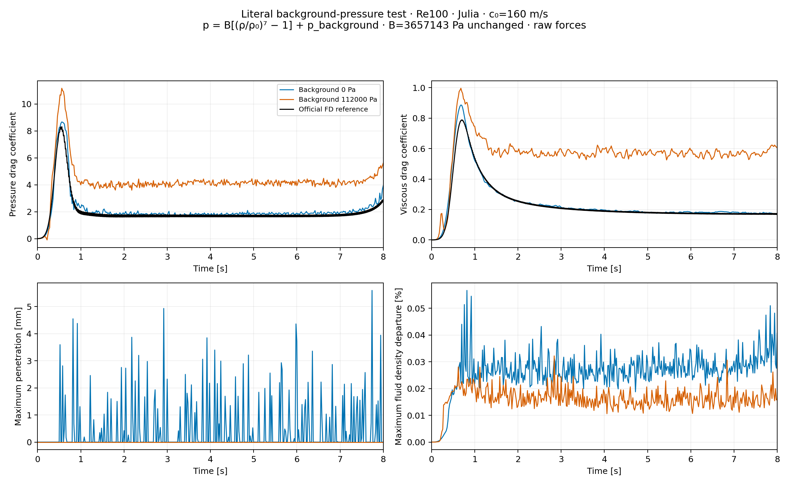
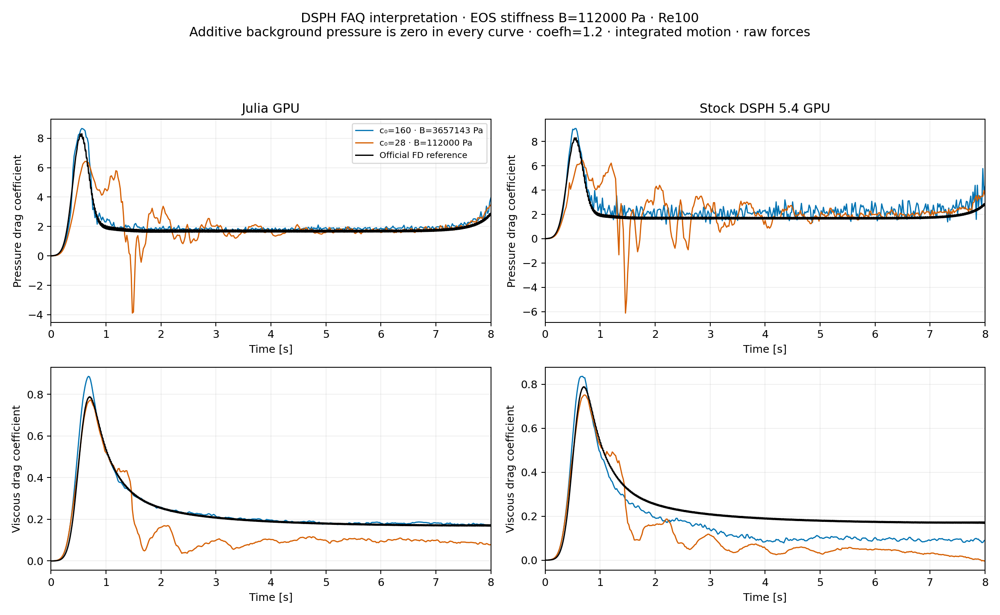

# Re100: 112000 Pa background offset versus EOS stiffness

Three fresh full 8 s runs distinguish the literal requested background
pressure from the number in the DSPH moving-square example. Two existing
c0=160, zero-offset controls are reused from the preceding studies.
No solver kernels, constants defaults or DSPH binaries were changed.

## Meaning of 112000 Pa

The [official DSPH FAQ](https://dual.sphysics.org/faq/), questions 18-19,
specifies b=1.1200e5 for its zero-gravity moving-square example. This is the
EOS stiffness coefficient, not an additive pressure offset. The installed
DSPH 5.4 GPU source in FunSphEos_iker.h evaluates

```
p = B * [(rho/rho0)^gamma - 1]
B = rho0*c0^2/gamma
```

There is no additive 112000 Pa term in this single-phase pressure function.
At rho0=1000, gamma=7, B=112000 gives c0=28 m/s; c0=160 instead requires
B=3657142.857 Pa. Julia has a separate BackgroundPressure parameter, with
p=B*[(rho/rho0)^7-1]+BackgroundPressure. Its older precompile moving-square
example also pairs c0=28 with Cb=112000, independently confirming the
distinction in the local repository.

Thus the literal high-offset control holds c0=160 and B=3657142.857 fixed
and adds 112000 Pa. The FAQ controls use B=112000, c0=28, and zero offset
in both Julia and stock DSPH. Setting B=112000 and claiming the unchanged
sound speed c0=160 would be an inconsistent physical comparison.

## Results

All cases are Re100, nu=0.01 m2/s, original 10 by 5 m tank, dp=0.025 m,
coefh=1.2, five wall layers, integrated motion, CFL=0.2, delta=0.1, DBC,
no sponge, shifting or divergence cleaning. Physical viscosity is unchanged.

| Solver and interpretation | c0 | Additive background | Pressure error | Viscous error |
|---|---:|---:|---:|---:|
| Julia good baseline | 160 m/s | 0 Pa | 12.87% | 8.67% |
| Julia literal offset | 160 m/s | 112000 Pa | 103.96% | 128.85% |
| Julia FAQ stiffness B=112000 | 28 m/s | 0 Pa | 46.18% | 35.84% |
| DSPH baseline | 160 m/s | 0 Pa | 27.48% | 27.41% |
| DSPH FAQ stiffness B=112000 | 28 m/s | 0 Pa | 58.98% | 46.63% |

Errors are relative L2 norms against the official FD data, integrating the
piecewise-linear squared residual over 0.1-8 s. Plots are raw, without
smoothing, scaling or time shifts. Neither interpretation improves the
validated force comparison for these settings; the c0=160, zero-offset
Julia baseline remains preferable among these cases.

The large offset removes the measured transient penetration (minimum fluid
clearance +2.02 mm) and reduces maximum density departure to 0.0322%, yet
badly biases both drag components. Good density and clearance diagnostics
alone do not validate forces. Its initial fluid pressure mean was checked
to be 112000 Pa, so it is a genuine additive-offset experiment.

The Julia c0=28 case has maximum density departure 1.70%, maximum fluid
Mach number 0.107 and maximum penetration 9.39 mm. These diagnostics also
show why lowering stiffness is not automatically an improvement. The
associated pressure oscillations and startup undershoots remain substantial.

## Why the literal offset changes drag

An independent same-state force decomposition verifies the actual saved
pressure reaction and separates the EOS gauge-pressure part from the
constant-offset part:

| Time | Actual pressure Cd | Gauge-pressure part on same state | Constant-offset part |
|---|---:|---:|---:|
| 0 s | approximately 0 | 0 | approximately 0 |
| 4 s | 3.97825 | 0.36361 | 3.61464 |
| 8 s | 5.60829 | 1.67824 | 3.93004 |

The discrete particle-gradient force does not cancel a uniform offset on
the later irregular particle distributions. This directly demonstrates a
large offset contribution to the wall reaction in this case. The offset
also changes fluid trajectories and viscosity forces. The gauge-only part
is a diagnostic on an already altered state, not a corrected physical force
curve; no subtraction is applied to the reported results.

## Validity, limitations and reproduction

All three fresh cases completed 401 frames with 86,100 particles. Julia had
no losses or frozen particles and all saved state diagnostics are finite.
DSPH reports zero particles out. GenCase lattice matching was verified for
fixed walls, moving square and fluid; every ComputeForces frame selects
the 1600-particle square. Actual DSPH Case.xml and Run.csv are archived.
The stock single-phase binary does not expose the same additive background
parameter, so the literal-offset experiment is explicitly Julia-only; its
stock DSPH test addresses B=112000 instead.

Cross-solver implementation differences from the all-Re study remain:
eta2=(0.01h)^2 in Julia versus (0.1h)^2 in DSPH, different timestep/operator
implementations, and a dense 0.1 ms linear position file in DSPH versus
direct trajectory evaluation in Julia. This is not exact operator isolation.
Changing B also changes sound speed, timestep and the delta*h*c0 diffusion
scale; its effect cannot be assigned solely to a pressure-reference choice.

All ten force errors were independently verified using two-point Gauss
quadrature in Python against the shared Julia integration. Reconstructed
pressure reactions at t=0,4,8 s agree with the saved offset run to 1e-9.
Plot generation, Python syntax and visual checks passed. Solver source is
unchanged, so the full CUDA suite was not repeated. Residual timestep and
spatial convergence questions from previous studies remain unresolved.
Saved output interval is 0.02 s, limiting frequency diagnosis to 25 Hz.

```sh
julia --project=. -t 2,0 "validation cases/spheric_test_06/background_112000.jl"
python "validation cases/spheric_test_06/plot_background_112000.py"
```

Large histories and dense motion inputs remain in ignored runs directories.
Existing good-case histories are read but not rewritten. B and the additive
offset are recorded separately in summary.csv to prevent future ambiguity.




