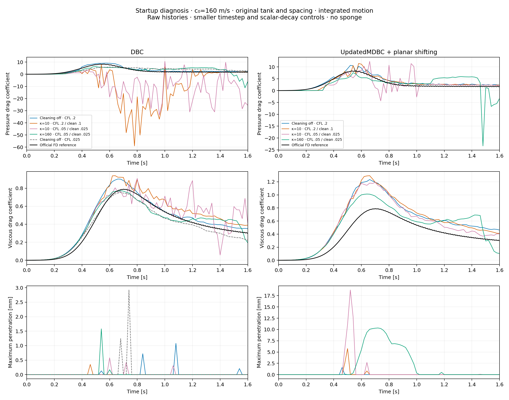
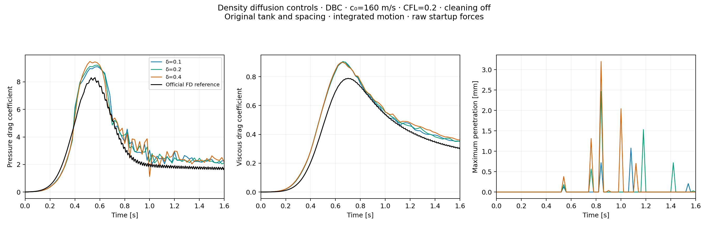
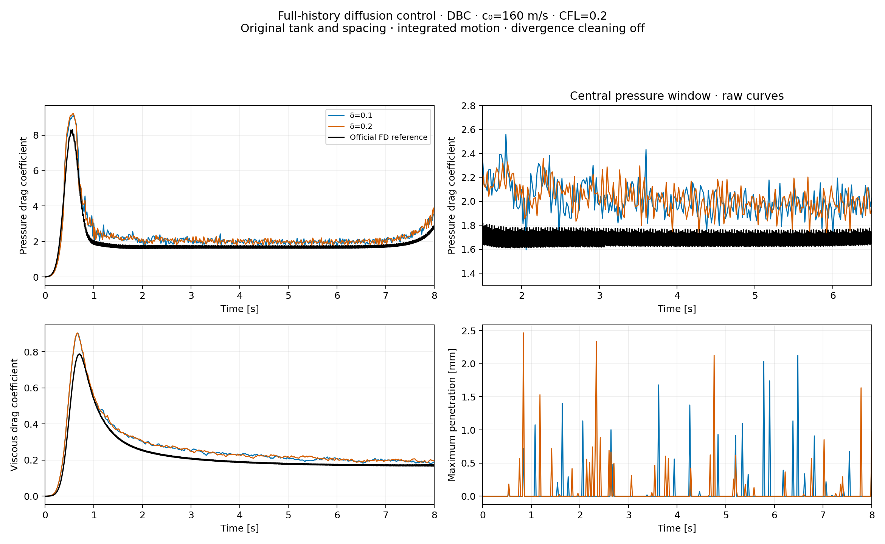

# Startup diagnosis at 160 m/s

Eight fresh 1.6 s controls and one full 8 s diffusion run retain the original
10 by 5 m tank, dp=0.025 m, integrated motion, Re100 and legacy timestepping.
No sponge is used. The UpdatedMDBC wall-continuity correction remains active.
Solver operators and defaults are unchanged.

The [cleaning formulation](https://arxiv.org/abs/2410.06038) couples a scalar
to velocity, rather than applying a pressure-only filter. These experiments
test the existing implementation, not a newly verified reproduction of every
published boundary treatment. No new implementation defect is established.

## Startup results

Errors below cover only 0.1-1.6 s, not the earlier 0.1-8 s interval. Original
controls reuse the matching first 1.6 s of existing full histories.

| DBC setting | Physical CFL / cleaning Courant | Startup pressure error | Minimum Cd,p |
|---|---:|---:|---:|
| Cleaning off, original | 0.2 / disabled | 19.69% | 0 |
| Cleaning off, smaller step | 0.05 / disabled | 48.94% | -1.56 |
| Cleaning off, smallest step | 0.025 / disabled | 50.92% | 0 |
| Cleaning kappa=10, original | 0.2 / 0.1 | 487.69% | -58.99 |
| Cleaning kappa=10, smaller step | 0.05 / 0.025 | 385.81% | -33.66 |
| Cleaning kappa=160, smaller step | 0.05 / 0.025 | 72.11% | -11.15 |
| Cleaning off, delta=0.2 | 0.2 / disabled | 19.61% | 0 |
| Cleaning off, delta=0.4 | 0.2 / disabled | 21.82% | 0 |

Cleaning uses sigma=1 and absolute-pressure decay. Kappa increases scalar
decay, without changing the c0 propagation speed. The tiny off case matches
the nominal h/c0 timestep ceiling of the small cleaning controls. Local
decay speed can impose still smaller steps, so actual timesteps are not
identical. Startup steps range from 36,240 to 791,251; these desktop runs
are not performance benchmarks. Complete tables are in startup_metrics.csv.

For UpdatedMDBC + PlanarShifting, startup pressure error is 24.56% without
cleaning and 26.73% with original kappa=10 cleaning. Smaller-step kappa=10
raises it to 58.22%, with 18.75 mm penetration. Smaller-step kappa=160 raises
it to 92.00%, with 10.33 mm penetration and minimum Cd,p=-23.36. Stronger
decay does not consistently fix this boundary case.

The cleaning-off CFL sweep is itself concerning: the DBC startup peak changes
from 9.10 at CFL=0.2 to 9.86 at 0.05 and 5.89 at 0.025. The pressure history
is not temporally converged. This warrants numerical consistency, precision
and moving-wall verification; it does not identify a particular bug or prove
an acoustic-resonance explanation. Timestep reduction alone does not remove
the additional cleaning failure.

## Full diffusion check

The delta=0.2 DBC candidate was extended to 8 s with cleaning off and CFL=0.2.
Only the diffusion coefficient changes relative to the original control.

| Quantity | delta=0.1 | delta=0.2 |
|---|---:|---:|
| Pressure L2 error, 0.1-8 s | 20.34% | 20.61% |
| Viscous L2 error, 0.1-8 s | 15.92% | 16.58% |
| Central pressure-noise RMS | 0.12150 | 0.11389 |

The 6.3% noise reduction does not improve force agreement. None of the tested
settings is adopted as a default. Pressure bias and startup errors remain.

## Reproduction and validation

```sh
julia --project=. -t 2,0 "validation cases/spheric_test_06/cleaning_startup_control.jl" --full
python "validation cases/spheric_test_06/plot_cleaning_startup_control.py"
```

The builder accepts density_diffusion with unchanged default 0.1 and records
the actual coefficient in new metadata. Saved configurations are checked
before reuse. Large particle histories stay in ignored runs/cleaning_startup_c160.
Earlier records are not rewritten.

All nine fresh runs completed with 84,864 particles, no losses or frozen
particles and finite histories. Short runs contain 81 frames, the full run
401. Independent two-point Gauss quadrature verified all 12 startup L2
comparisons and both full-run L2 errors against exact piecewise-linear
residual integration. Python syntax, plot generation and visual checks passed.
Solver source is unchanged; the full CUDA suite was not repeated.

Noise is the reference residual RMS after a centered 0.5 s mean subtraction
over 1.5-6.5 s. Force plots are raw, without filtering, scaling or time shifts.
Output interval is 0.02 s (25 Hz Nyquist); generic dominant-frequency metrics
do not establish a solver acoustic mode.






