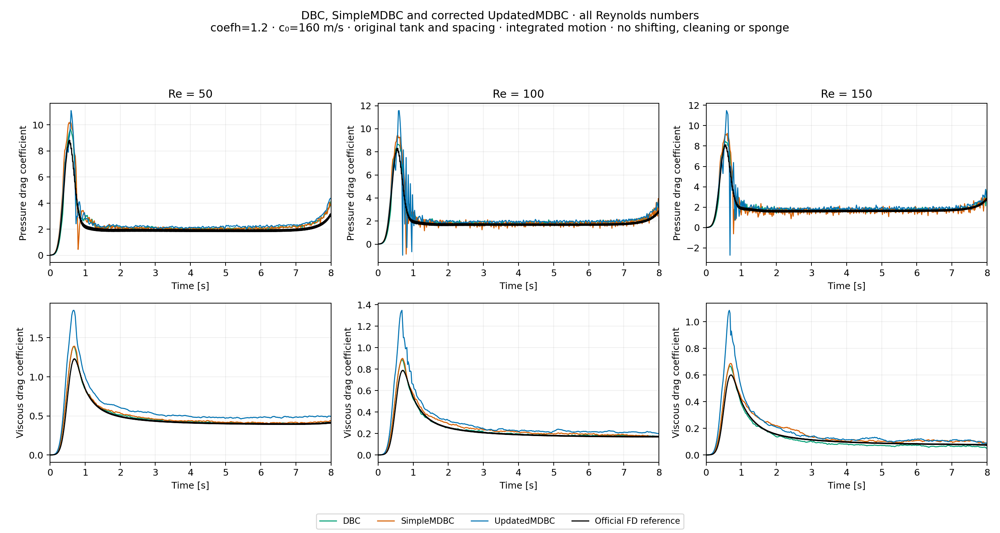
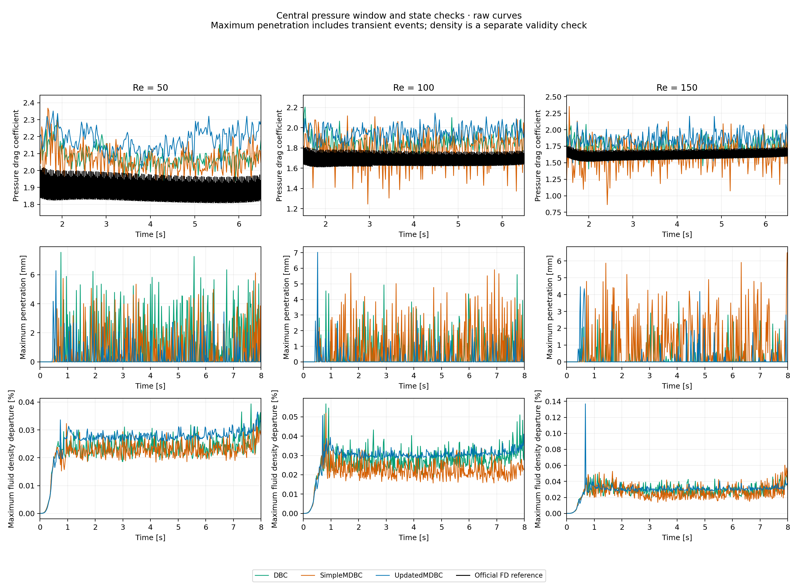
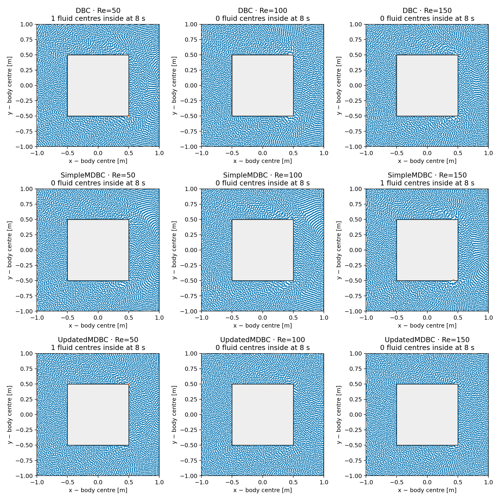

# SimpleMDBC and corrected UpdatedMDBC with coefh=1.2

Six fresh 8 s boundary runs cover SimpleMDBC and UpdatedMDBC at Re=50,100,150.
A seventh fresh DBC Re100 control verifies the analysis against the user's
supplied history. Existing DBC histories from ../coefh_reynolds are reused
for the three-Re comparison. This study concerns the Julia package's modes;
it does not run new DSPH mDBC cases or establish equivalence to every option
of the published formulations. Solver kernels are unchanged.

## Matched settings and forces

Original 10 by 5 m tank, square side 1 m, dp=0.025 m, coefh=1.2,
h=0.042426407 m, c0=160 m/s, CFL=0.2, delta=0.1, rho0=1000, gravity=0,
nu=1/Re, laminar viscosity, integrated motion and legacy timestepping.
All runs use five exterior wall layers, 78,400 fluid particles, 1,600 moving
square particles and 6,100 fixed particles (86,100 total). No shifting,
divergence cleaning, sponge or additive background pressure is enabled.
Initial particle lattices match DBC exactly for every mode and Re.

The study uses the corrected UpdatedMDBC continuity field (physical wall
velocity), with its mirrored tangential viscous construction and acceleration
pressure cloning retained. SimpleMDBC uses its existing ghost-density
interpolation and physical wall velocity. The square and tank ghost
geometry follows the same reflection construction as the earlier audit.

Boundary-aware force reconstruction is essential: UpdatedMDBC pressure,
activity and viscous wall velocity are reconstructed from accepted-frame
fluid neighbours. Applying the generic DBC reaction formula to these
histories would not represent the selected boundary operator. The fresh
DBC control through this reconstruction reproduces every supplied pressure,
viscous and lateral force sample exactly. Full force CSVs retain lateral
components even though the figures focus on drag.

## Full-history outcome

Each entry is pressure / viscous relative L2 error against the official FD
history, using exact piecewise-linear residual integration over 0.1-8 s.

| Re | DBC | SimpleMDBC | UpdatedMDBC |
|---|---:|---:|---:|
| 50 | 14.23% / 7.56% | 20.79% / 8.68% | 20.72% / 29.66% |
| 100 | 12.87% / 8.67% | 19.66% / 12.14% | 27.92% / 39.23% |
| 150 | 11.30% / 12.31% | 18.95% / 20.10% | 26.94% / 49.41% |

DBC gives lower full-history errors in both force components at every Re.
SimpleMDBC has startup pressure undershoots and more central pressure noise.
UpdatedMDBC strongly overpredicts the viscous startup peak and retains a
positive pressure bias. Some later means are closer for an mDBC variant,
but choosing only those windows would hide its full-transient discrepancy.
These implemented modes are not demonstrated improvements for this case.
No new solver implementation defect is established by this parameter study.

| Re | DBC pressure-noise proxy | SimpleMDBC | UpdatedMDBC |
|---|---:|---:|---:|
| 50 | 0.06482 | 0.08302 | 0.06520 |
| 100 | 0.07740 | 0.16650 | 0.08204 |
| 150 | 0.11642 | 0.22299 | 0.12281 |

UpdatedMDBC's central pressure-noise proxy is close to DBC, but that does
not remove the startup and mean-force errors. None of the curves is
filtered, scaled, shifted in time or fitted to the reference.

## State diagnostics

| Re | Maximum penetration DBC / Simple / Updated | Final body-interior fluid centres DBC / Simple / Updated |
|---|---:|---:|
| 50 | 7.54 / 6.13 / 6.28 mm | 1 / 0 / 1 |
| 100 | 5.60 / 5.91 / 7.02 mm | 0 / 0 / 0 |
| 150 | 3.75 / 6.52 / 4.47 mm | 0 / 1 / 0 |

Maximum penetration is measured against the nominal square and tank solids
over every saved frame; final occupancy counts refer only to the nominal
square at 8 s. They are distinct diagnostics. The modes avoid catastrophic
leakage in these runs but do not enforce exact impermeability. The largest
new fluid density departure is 0.137% (UpdatedMDBC Re150); finite, small
density variation alone does not validate the forces.

All seven fresh runs completed 151,200 steps and 401 finite-state frames,
with no losses or frozen particles. Historical DBC histories were not
rewritten. Existing pressure timestep and spatial-convergence limitations
remain. The result supports retaining DBC as the comparison baseline,
without claiming that either mDBC formulation cannot perform better under
other discretizations, geometries or boundary settings.

## Reproduction and verification

```sh
julia --project=. -t 2,0 "validation cases/spheric_test_06/coefh_mdbc_study.jl"
python "validation cases/spheric_test_06/plot_coefh_mdbc.py"
julia --project=. -t 2,0 "test/updated_mdbc.jl"
```

The focused boundary suite passed 1,367 assertions: numerical cloning,
compact/dense ghost correction, cache/reordering behavior, inactive walls,
both simulation stages, CUDA graph replay, moving walls and Galilean
invariance. The full CUDA suite was not run. Independent Python two-point
Gauss quadrature verifies all 18 plotted force errors against the shared
Julia analysis within 1e-10. Initial lattice equality, metadata, all finite
force/state histories and final HDF counts are checked by the plot script.
PNG/PDF rendering, Python syntax and visual checks passed.

The mDBC builder now accepts kernel_h_factor and wall_layers, forwarding
them to the common builder; old defaults remain sqrt(2) and automatic
layers. New metadata records actual h, wall layers and background pressure.
The study verifies saved configurations before reuse and never overwrites
existing particle histories. No dependency files or solver operators changed.

Noise is the reference residual RMS after subtracting a centered 0.5 s mean
over 1.5-6.5 s. Output every 0.02 s limits frequency diagnosis to 25 Hz;
this proxy does not isolate a physical acoustic mode. Central pressure
panels explicitly zoom their axes while retaining unfiltered histories.
Recorded timings are not performance benchmarks; regressions overlapped
some study runs. Large histories and the test log remain under ignored
runs/coefh_mdbc; compact data and plots are tracked here.






