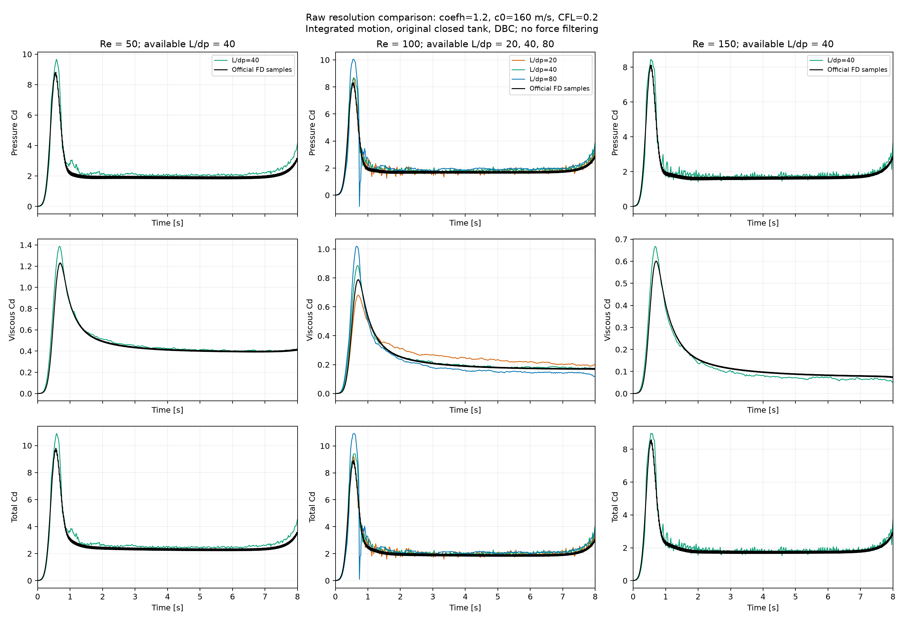
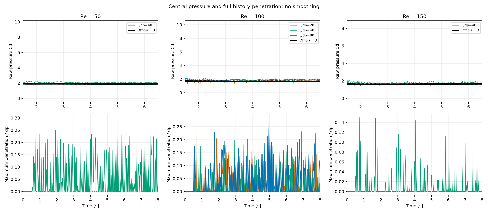
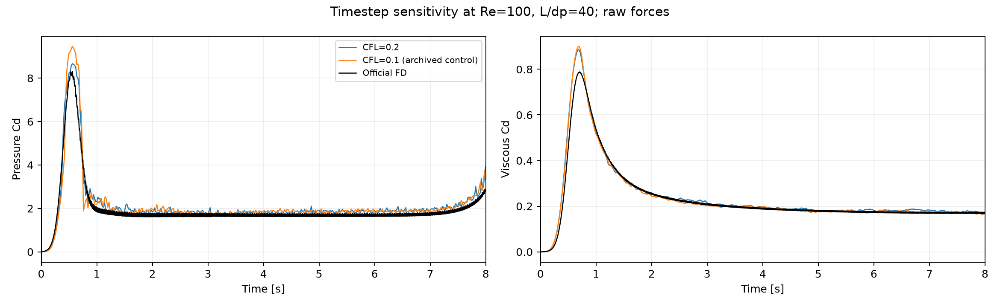

# Raw coefh=1.2 refinement results

Status: partial study; pending runs are not plotted.

Original 10 by 5 m closed tank, c0=160 m/s, coefh=1.2, integrated motion,
DBC, CFL=0.2, delta=0.1, five wall layers; no background pressure,
cleaning, sponge, shifting or hold. All forces and supplied reference
samples are plotted without acoustic filtering, scaling or time shifts.
The reference authors' pre-publication processing is not established.

## Completed resolution histories

| Re | L/dp | Pressure raw error | Viscous raw error | Total raw error | Penetration [mm] | Penetration / dp |
|---:|---:|---:|---:|---:|---:|---:|
| 50 | 20 | pending | pending | pending | - | - |
| 50 | 40 | 14.23% | 7.56% | 12.73% | 7.541 | 0.302 |
| 50 | 80 | pending | pending | pending | - | - |
| 100 | 20 | 7.76% | 17.90% | 7.50% | 11.997 | 0.240 |
| 100 | 40 | 12.87% | 8.67% | 12.10% | 5.596 | 0.224 |
| 100 | 80 | 25.16% | 20.48% | 23.23% | 3.566 | 0.285 |
| 150 | 20 | pending | pending | pending | - | - |
| 150 | 40 | 11.30% | 12.31% | 10.66% | 3.746 | 0.150 |
| 150 | 80 | pending | pending | pending | - | - |

## Changes between resolutions

Raw L2 differences over 0.1-8 s, normalized by the official reference L2 norm.
These are changes between simulations, not their reference errors.

| Re | Coarse -> fine | Component | Relative change |
|---:|:---|:---|---:|
| 100 | 20 -> 40 | pressure | 11.18% |
| 100 | 20 -> 40 | viscous | 21.17% |
| 100 | 20 -> 40 | total | 10.44% |
| 100 | 40 -> 80 | pressure | 18.14% |
| 100 | 40 -> 80 | viscous | 14.74% |
| 100 | 40 -> 80 | total | 16.59% |

## Timestep sensitivity

Archived Re=100, L/dp=40 control, same h and motion. Halving CFL
does not establish temporal convergence from two settings alone.

| Component | CFL=0.2 error | CFL=0.1 error | Change between histories |
|:---|---:|---:|---:|
| pressure | 12.87% | 17.81% | 10.91% |
| viscous | 8.67% | 8.67% | 2.67% |

## Re=100 assessment

The finest history has less central pressure noise, but it does not
improve the full raw force agreement. In particular, the viscous mean
crosses the reference as resolution increases. The n=40 result must
not be declared a converged optimum because it agrees best in one component.

| L/dp | Pressure mean bias, 3-7 s | Viscous mean bias, 3-7 s | Pressure noise RMS |
|---:|---:|---:|---:|
| 20 | +3.41% | +26.47% | 0.13006 |
| 40 | +9.21% | +2.84% | 0.07740 |
| 80 | +14.43% | -15.04% | 0.05540 |

Pressure changes between the two finest histories are larger than
between the two coarser histories in this dataset. Penetration decreases
in millimetres but is not monotonically decreasing as a fraction of dp.
Together with the CFL sensitivity, this does not establish an asymptotic
space/time convergence regime. Finish diagnosing the Re=100 startup,
wall traction and timestep effects before spending on the remaining
Re=50/150 fine runs. Those resolutions remain explicitly pending.

## Interpretation and provenance

Refinement changes the spatial stencil scale and the acoustic timestep together.
Agreement between resolutions does not by itself establish accuracy against
the incompressible reference. Fixed c0 and fixed h/dp do not demonstrate
the incompressible or SPH consistency limits. No Richardson order or
extrapolated solution is claimed without an asymptotic convergence regime.
Saved-frame penetration remains a separate failure of exact impermeability.

Raw errors integrate squared piecewise-linear residuals exactly over
0.1-8 s. Julia and independent NumPy integrals agree within 1e-10.
Startup peaks/times are sampled at the 0.02 s output interval, not continuous maxima.
The central-window noise proxy is for diagnosis only; it is not applied
to any displayed force curve. All completed state frames are finite and
retain their expected fluid/body counts. Per-case metadata records density,
motion, frozen-particle and Mach checks.

The n=40 and CFL=0.1 controls are reused without changing their
original metadata. `provenance.csv` records sources and force SHA-256
checksums. Hardware differs between archived and fresh runs; no timing
or speedup claim is made. Original user results are not overwritten.

Load the generated Python states under
`../../runs/coefh_refinement/re<Re>/paraview_force_plot/` in ParaView
to see all completed raw resolutions alongside the reference and the
completed fresh particle history (where available), with animated markers.

