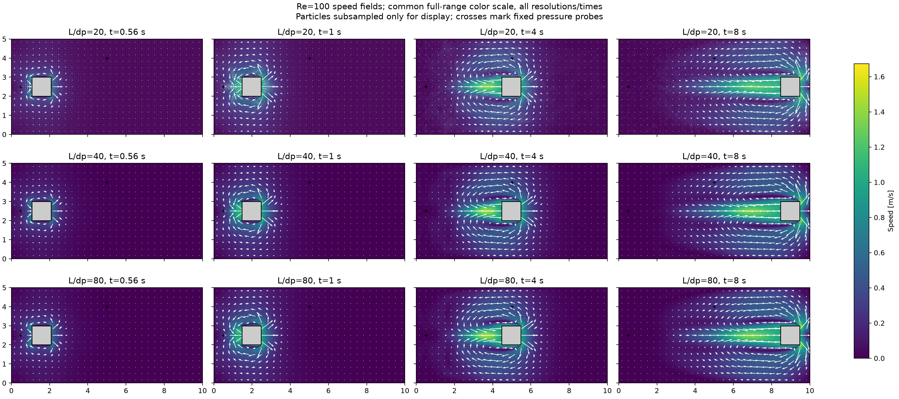
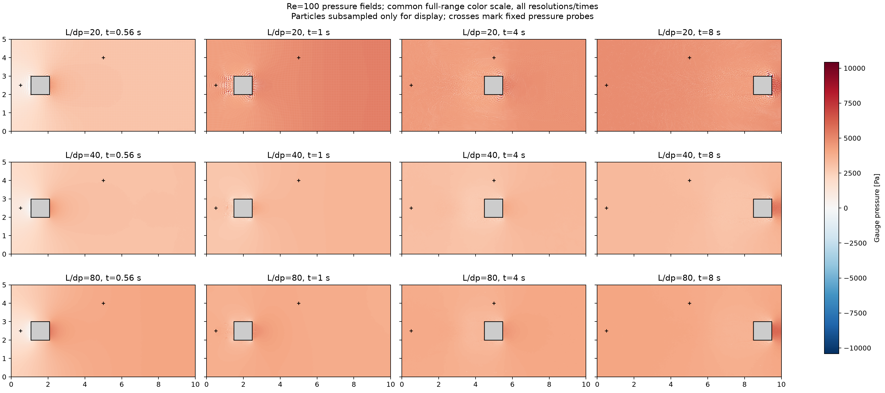
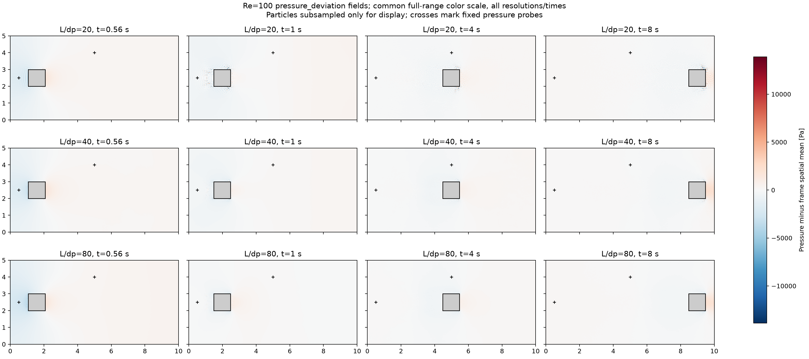
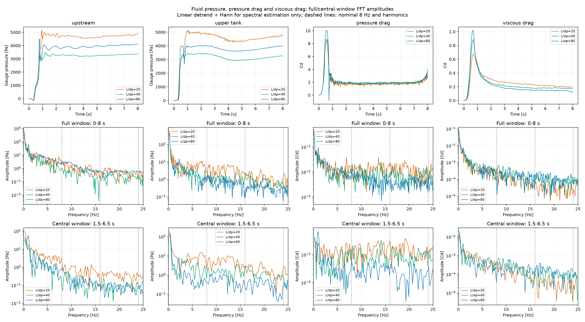
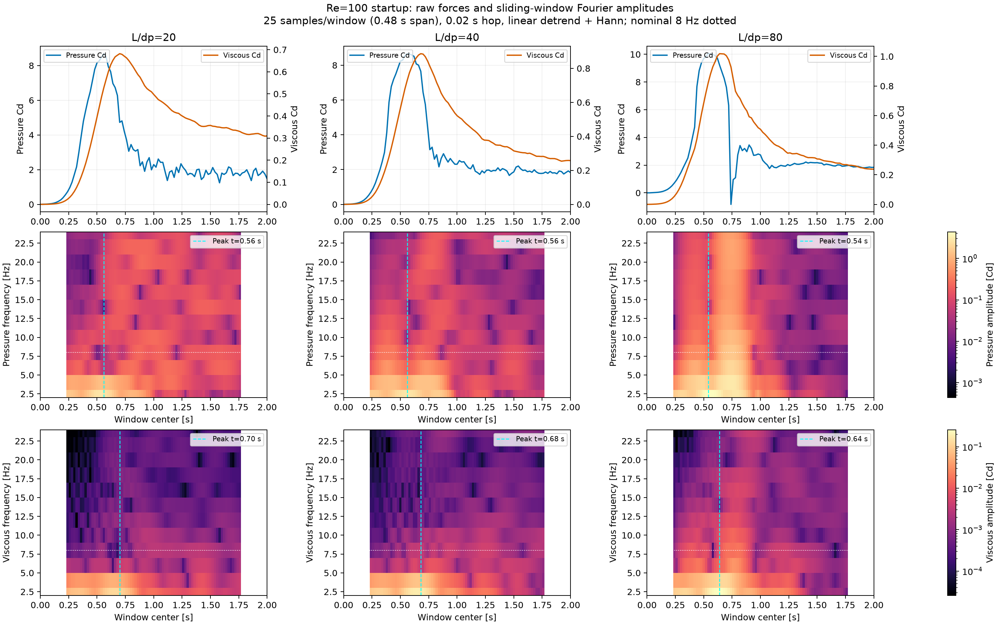

# Re=100 flow fields and pressure Fourier spectra

Saved full histories at L/dp=20/40/80; no new simulation. Speed and gauge-pressure
images use identical full-range color limits across resolutions and snapshots.
At most 100,000 fluid particles per panel are displayed; numerical extrema and
pressure signals use all fluid particles. Arrows are spatial-bin mean velocities.

Pressure is reconstructed in Float64 with the run's Tait EOS, c0=160 m/s,
rho0=1000 kg/m3 and zero background offset. Crosses mark fixed pressure probes
at (0.5,2.5) and (5,4) m: volume-weighted fluid means inside radius 0.1 m.
These spatial averages are not individual material-particle histories.

FFT files include pressure drag, viscous drag, and both fluid-pressure probes,
with full 0-8 s and central 1.5-6.5 s windows. Each signal is
linearly detrended and Hann-windowed before rFFT. Amplitudes use coherent-gain
normalization and the one-sided factor (excluding DC/Nyquist). The displayed
time histories remain raw. This is amplitude, not PSD. Full-window spectra
contain the physical startup transient and must not be interpreted as pure noise.

At output dt=0.02 s, Nyquist is 25 Hz; higher-frequency content can alias.
Central-window bin spacing is about 0.199 Hz; Hann broadens spectral peaks.
Dashed 8/16/24 Hz lines are longitudinal empty-tank estimates c0/(2Lx)
and harmonics, not identified eigenmodes of the tank containing a square.
Transverse and obstacle-modified modes can also occur. Neither a spectral
peak nor its absence alone proves the origin of the startup force spike.

Pressure-deviation panels subtract each frame's fluid spatial mean for visibility;
they include physical pressure gradients and are not an acoustic decomposition.

## Startup time-frequency diagnostic

Run `python "validation cases/spheric_test_06/plot_startup_spectra.py"` from gpu_version.
Each complete window has 25 samples (0.48 s endpoint span, 0.5 s FFT duration),
advanced by 0.02 s. Thus frequency bins are 2 Hz; overlapping windows are not
independent. Colors use common logarithmic amplitude scales across resolutions,
separately for pressure and viscous drag. Dashed cyan lines mark their sampled
force peaks; dotted white lines show the nominal 8 Hz estimate. No endpoint
padding is used. Each spectral column contains data before and after its center:
a transient can therefore appear spread in time by the window. Startup ramps
produce broadband content, even after linear detrending; a bright patch is not
proof of an acoustic eigenmode or its causal role. The raw top panels use
separate labeled axes for pressure and viscous Cd.

