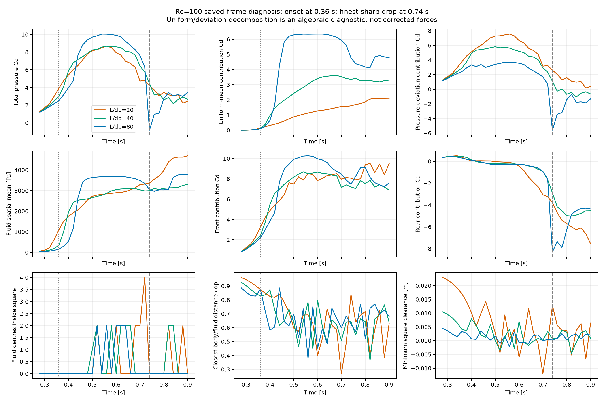
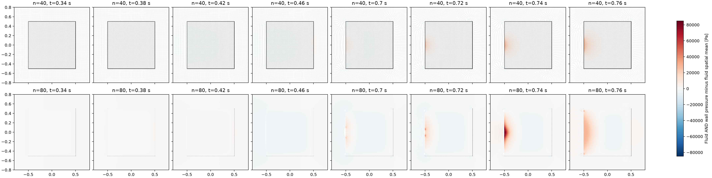

# Exact-frame Re=100 startup diagnosis

The diagnosis reconstructs all square/fluid pressure pairs at 32 saved times
from 0.28 to 0.90 s for each of L/dp=20/40/80. All 96 reconstructed reactions
agree with the original Float64 force histories within 2e-5 absolute/relative
tolerance. No simulation, forces or reference histories were modified.

## Onset is not the same as the sharp drop

Define a material separation as the absolute difference between n=40 and n=80
pressure Cd exceeding 5% of the reference peak (0.4154 Cd) for three consecutive
saved frames. The first such frame is 0.36 s. A 1% threshold gives 0.30 s;
10% gives 0.38 s. Thus there is no unique threshold-independent "first divergence."
Temporal resolution is 0.02 s, not the solver's individual timesteps.

At 0.36 s the total Cd values are 2.9871 and 2.5083, while their uniform
fluid-mean contributions are both approximately 0.0992. The initial separation
therefore lies primarily in nonuniform pressure/support interactions, not
simply in a differing uniform pressure datum. At 0.40 s the fine run has lower
front-wall/fluid pressure and delayed pressure buildup. Between 0.42 and
0.46 s its mean fluid pressure rises from 1151 to 3423 Pa while its pressure
Cd rises from 4.745 to 8.826. These are correlated changes, not a causal isolation.

## The sharp drop at 0.74 s is a rear-wall pressure reaction

| Quantity at 0.74 s | L/dp=40 | L/dp=80 |
|:--|--:|--:|
| Total pressure Cd | 4.4403 | -0.8321 |
| Front contribution Cd | 7.1976 | 7.4527 |
| Rear contribution Cd | -2.8860 | -8.2936 |
| Rear contribution from wall pressure alone | -2.4263 | -7.7548 |
| Rear contribution from fluid pressure alone | -0.4597 | -0.5388 |
| Mean participating rear-wall pressure [Pa] | 10654.9 | 38435.7 |
| Mean participating rear-fluid pressure [Pa] | 1487.7 | 2934.2 |
| Fluid particle centers inside square | 0 | 0 |

The fine run's total Cd was 6.3204 at 0.72 s, then -0.8321 at 0.74 s.
Its rear-wall mean had already risen from 7975 Pa at 0.70 s to 12334 Pa at
0.72 s, then 38436 Pa at 0.74 s. The front force remains positive and similar
between resolutions. Rear wall pressure, not neighboring fluid pressure alone,
dominates the force reversal. This is a demonstrated algebraic localization
of the saved reaction, not proof of the upstream cause of the wall-density rise.

Faces are assigned by the nearest nominal square side of each interacting
body particle (ties assigned to x sides), so corner contributions follow an
explicit partition. Listed wall/fluid pressures are unweighted means of unique
particles participating in that side's pairs; they are not surface-integrated
traction measurements. The pair-weighted reaction decomposition is exact.

## Does the uniform mean explain the drop?

At n=80, t=0.74 s:

- Uniform fluid-spatial-mean contribution: +4.7700 Cd.
- Pressure-deviation contribution: -5.6021 Cd.
- Sum: -0.8321 Cd.

The uniform component is significant, but the negative excursion cannot be
explained by subtracting a uniform offset alone. In particular, rear wall
pressure differs dramatically from adjacent fluid pressure.

## Numerical interpretation and limits

DBC evolves wall density and maps it through the EOS rather than directly
prescribing the incompressible surface pressure. The density floor at walls
also prevents negative wall gauge pressure. The measured rear-wall buildup
therefore makes boundary-density evolution and pressure consistency a stronger
target than a generic "8 Hz acoustic mode" explanation for this drop.

Pressure-wave interaction, density diffusion, the boundary density floor,
neighbor changes and integration may still contribute to the buildup. The
saved states do not retain all intermediate density RHS terms or predictor
states, so they cannot prove which mechanism initiated it. A targeted replay
recording rear-wall density-rate terms across 0.68-0.76 s would isolate that
next. Zero center penetration does not rule out deficient boundary support.

Both fluid and body pressures are shown in the close-up panels; hiding body
particles behind a grey square would conceal the important rear-wall signal.
The common color scale includes wall and fluid extrema. Pressure deviations
subtract the whole-fluid arithmetic mean, including from wall pressures;
this is an algebraic diagnostic, not corrected simulation data.

Reproduce from gpu_version:

```sh
python "validation cases/spheric_test_06/diagnose_startup.py"
```

Requires the saved particle histories, NumPy, h5py, SciPy and matplotlib.
No new dependency manifest changes are required.




