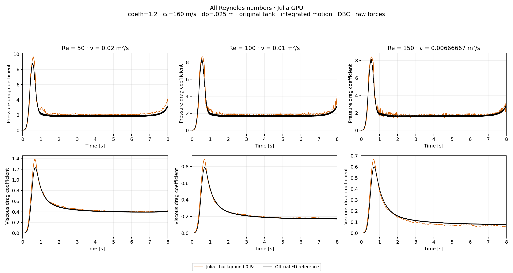
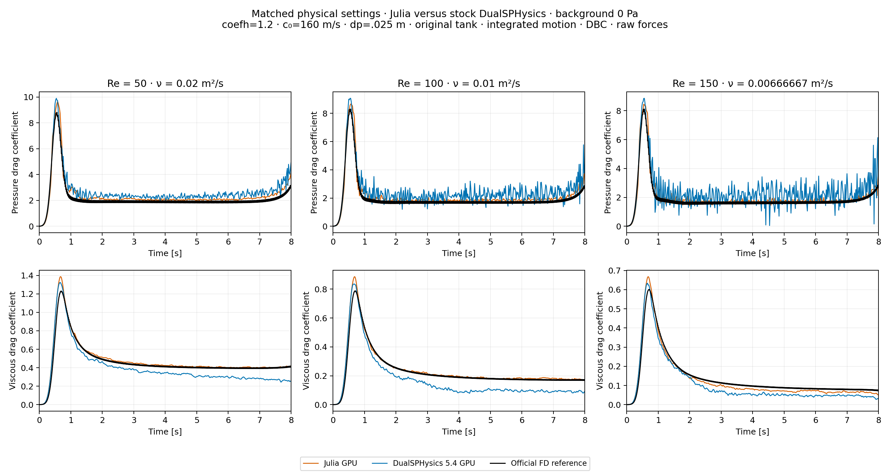
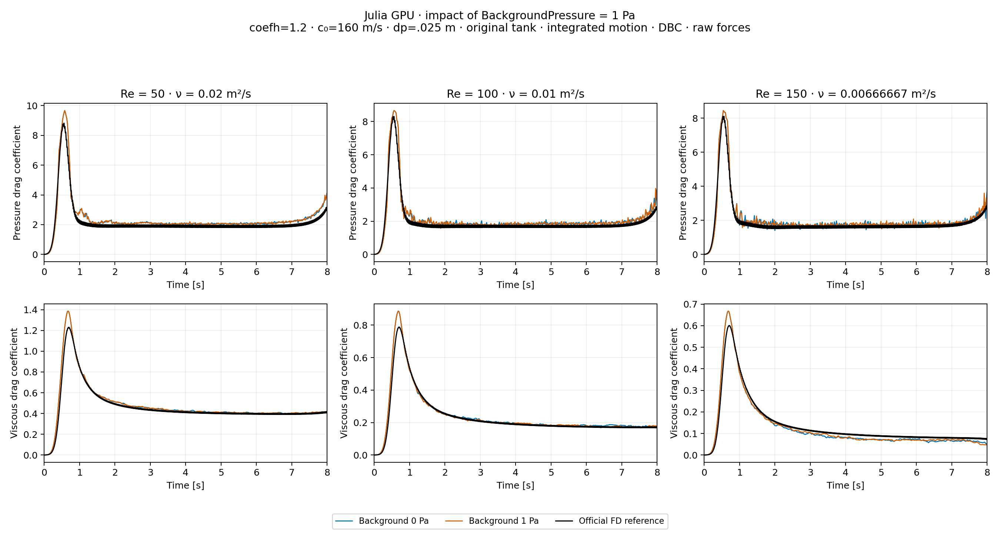
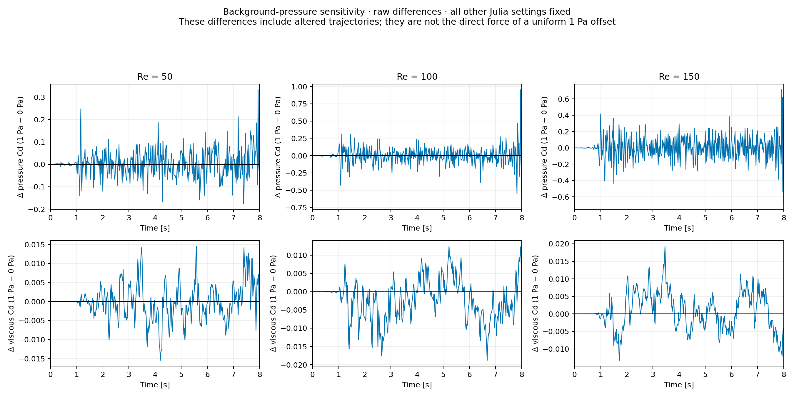
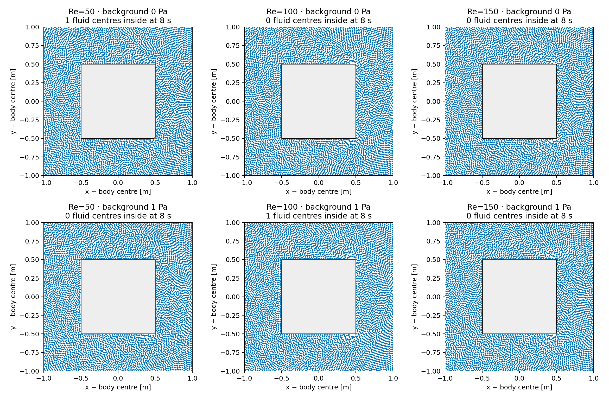

# All Reynolds numbers with coefh=1.2

Nine eight-second case histories cover Re=50,100,150: Julia at background
pressure 0 and 1 Pa, and stock DualSPHysics at 0 Pa. Five Julia cases and
three Dual cases are fresh; the Re100 Julia zero-background case reuses the
user's supplied, independently reproduced history from ../coefh. It retains
its original metadata provenance. No solver kernels or defaults changed.

## Common physical and exposed numerical settings

Original closed 10 by 5 m tank, 1 m square initially centred at (1.5,2.5),
dp=0.025 m, rho0=1000 kg/m3, Uref=1 m/s, c0=160 m/s, gravity=0,
Wendland C2 with h=1.2*sqrt(2)*dp=0.042426407 m, CFL=0.2, delta=0.1,
laminar viscosity, DBC, no shifting, no divergence cleaning and no sponge.
Kinematic viscosity is 0.02,0.01,0.006666667 m2/s for Re=50,100,150.
Five exterior wall layers give 6,100 fixed, 78,400 fluid and 1,600 moving
square particles: 86,100 total. Integrated motion uses the user's exact
trajectory construction rather than the rounded-position Hermite curve.

GenCase particle-coordinate sets were checked against the Julia lattice
for fixed walls, square and fluid separately. Dual logs confirm coefh=1.2,
c0=160 and the requested laminar viscosities. Actual generated Case.xml and
Run.csv are archived in each re*_dual directory. The installed GPU binary
identifies itself as DualSPHysics5 v5.4.355 (08-04-2025); force postprocessing
uses ComputeForces v5.4.266.02 (07-05-2025).

## Solver comparison at zero background pressure

| Re | Julia pressure error | Dual pressure error | Julia viscous error | Dual viscous error |
|---|---:|---:|---:|---:|
| 50 | 14.23% | 23.30% | 7.56% | 17.67% |
| 100 | 12.87% | 27.48% | 8.67% | 27.41% |
| 150 | 11.30% | 33.20% | 12.31% | 21.67% |

Errors are raw relative L2 norms against the official FD histories over
0.1-8 s, integrating the piecewise-linear squared residual exactly.
No force filtering, time shifts, force scaling or reference fitting is used.

| Re | Julia pressure-noise proxy | Dual pressure-noise proxy |
|---|---:|---:|
| 50 | 0.06482 | 0.13603 |
| 100 | 0.07740 | 0.36650 |
| 150 | 0.11642 | 0.57180 |

With these tested settings, stock Dual does not match the Julia result's
reference agreement or pressure-noise proxy. Both show startup overshoot;
Dual underpredicts late viscous drag more strongly. Julia also underpredicts
late viscous drag at Re150, and retains positive pressure bias. This is not
a claim that Dual cannot improve under other formulations or settings.

The common exposed settings do not make the implementations identical.
Julia retains its good-case regularization eta2=(0.01h)^2; installed Dual
uses (0.1h)^2. Timestep selection, interaction arithmetic and diffusion
implementation also differ. Dual uses a linear position file sampled from
the integrated trajectory every 0.0001 s; Julia evaluates its sampled
trajectory directly. These differences are not silently tuned away.
Julia accepted 151,200 steps per case, versus 151,547/152,007/152,387 for
Dual. This is a physical-case comparison, not operator isolation or a speed
benchmark. Timing values in metadata are not controlled performance evidence.

## BackgroundPressure=1 Pa: Julia controls

| Re | Pressure error 0 / 1 Pa | Viscous error 0 / 1 Pa | Pressure-noise proxy 0 / 1 Pa |
|---|---:|---:|---:|
| 50 | 14.23% / 14.44% | 7.56% / 7.54% | 0.06482 / 0.05735 |
| 100 | 12.87% / 12.94% | 8.67% / 8.58% | 0.07740 / 0.08485 |
| 150 | 11.30% / 11.25% | 12.31% / 12.05% | 0.11642 / 0.09992 |

All other Julia settings remain fixed. Initial saved fluid pressure means
were independently checked to be exactly 0 or 1 Pa, respectively. The
pressure offset is included in force reconstruction; no offset is subtracted
from the drag coefficients. At Uref=1, 1 Pa is 0.2% of rho*Uref^2/2=500 Pa.
It can change particle trajectories and noise phase; the raw difference
plot is not simply the direct force of a uniform pressure offset.

The offset lowers the central noise proxy by about 11.5% and 14.2% at Re50
and Re150, but raises it by 9.6% at Re100. Overall pressure errors change by
at most 0.21 percentage point and viscous errors by at most 0.26 percentage
point. Mean forces change modestly. This is not a consistent validation
improvement, so zero background pressure remains the baseline.

The background-pressure experiment is Julia-only. The stock Dual path here
does not expose the same additive EOS parameter; its comparison uses 0 Pa.
Changing reference density or EOS stiffness would be a different experiment.

## State validity and limits

All nine histories contain 401 finite force frames with no particle losses.
All Julia runs report no frozen particles, accurate prescribed motion,
and maximum relative density departure below 0.057%. Saved HDF frames retain
the expected particle counts. Maximum transient Julia penetration is:

| Re | 0 Pa | 1 Pa | Fluid centres inside at final frame, 0 / 1 Pa |
|---|---:|---:|---:|
| 50 | 7.541 mm | 7.540 mm | 1 / 0 |
| 100 | 5.596 mm | 5.190 mm | 0 / 1 |
| 150 | 3.746 mm | 3.743 mm | 0 / 0 |

Dual final frames have zero fluid centres inside the square in all three
cases. This final-frame check is not a measurement of Dual's maximum
transient penetration, and must not be compared directly with Julia's
full-history maxima. Dual output can lie a few microseconds beyond the
requested frame time; final motion error is evaluated at the actual saved
time and is below 5.1e-7 m at exported CSV precision. Nominal-time offsets
are recorded separately. Drag errors use the actual output times and the
common 0.1-8 s interval, without shifting the histories.

Residual penetration, pressure bias, the earlier observed timestep
sensitivity and cross-resolution convergence remain unresolved. These
results demonstrate improved coarse-case behavior, not full benchmark
validation across resolution and timesteps.

## Verification and reproduction

```sh
julia --project=. -t 2,0 "validation cases/spheric_test_06/coefh_reynolds_study.jl"
python "validation cases/spheric_test_06/plot_coefh_reynolds.py"
julia --project=. -t 2,0 "validation cases/spheric_test_06/verify_dual_coefh_forces.jl"
julia --project=. -t 2,0 "validation cases/spheric_test_06/comparison_tests.jl"
```

Both study and plot commands accept --native-only to inspect the completed
Julia subset. Existing run metadata is checked before reuse; particle
histories are not overwritten. The shared Dual helper now accepts explicit
coefh, wall layers and a uniquely tagged custom trajectory, retaining the
old defaults and cache names for historical studies.

The focused comparison suite passed 29 assertions. All 18 force errors
agree with independent Python two-point Gauss quadrature to 1e-10.
Dual force extraction checks every frame selects the 1,600-particle square.
The final pressure and viscous forces were also independently reconstructed
from exported Dual particle states using its regularization and parameters;
they agree with ComputeForces within 0.005% (dual_force_check.csv). Both
force components pass the 1e-4 relative verification tolerance. No binary
or stock Dual solver source was modified. The full CUDA suite was not rerun.

Noise is the residual against FD after a centered 0.5 s mean removal over
1.5-6.5 s. The proxy is not a pure acoustic amplitude. Output interval
0.02 s has a 25 Hz Nyquist limit, so fast acoustic frequencies cannot be
reliably inferred from these histories. Raw curves remain unfiltered.

Compact histories, metadata, CSV metrics, plots and generated Dual inputs
are tracked. Large HDF/BI4 histories and dense motion files remain in ignored
runs/coefh_reynolds and runs/comparison/definitions. The XML includes local
paths; regenerate it with the study script on another machine.










