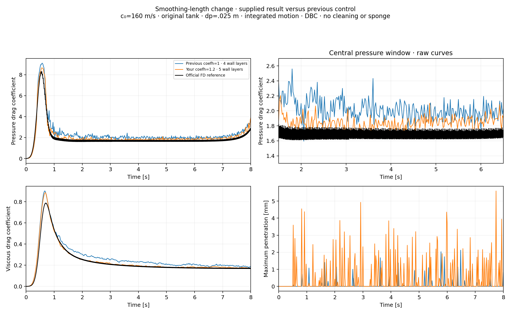
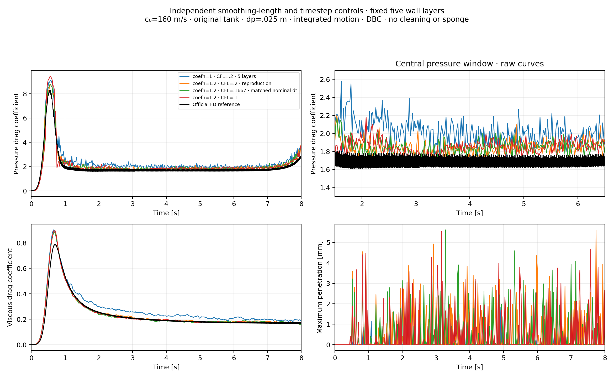
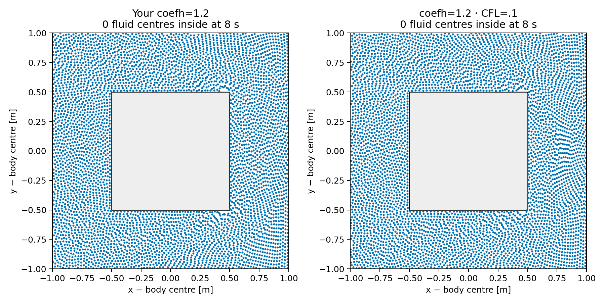

# Independent validation of the coefh=1.2 change

Reviewed user commit `57a9ad03c802e547e99a804e2bd2a4aae6326dd6` and its supplied
results in `../coefh/`. The change is a reproducible improvement in this
Re100 DBC case, but does not yet establish pressure convergence or a complete
benchmark pass. User code and supplied histories were not rewritten.

## Code and configuration review

The manual case correctly sets h=coefh*sqrt(2)*dp in 2D. The installed
DualSPHysics 5.4 `JSph.cpp` similarly reports coefh=h/(dp*sqrt(dimensions)).
The [official source](https://github.com/DualSPHysics/DualSPHysics/blob/master/src/source/JSph.cpp)
supports that convention. A value of 1.2 is a case parameter, not a universal
required default: the [official dam-break example](https://github.com/DualSPHysics/DualSPHysics/blob/master/examples/main/01_DamBreak/CaseDambreak_Def.xml)
uses 1.0. The earlier local comparison explicitly generated Dual XML with
coefh=1, so the old Julia kernel was consistent with that comparator.

At dp=0.025 m the change increases h from 0.03535534 to 0.04242641 m and
support radius 2h from 0.07071068 to 0.08485281 m. For a regular interior
square lattice and this Wendland kernel, nonzero-weight neighbours excluding
self increase from 20 to 36. This changes the numerical stencil, pressure,
viscosity, kernel regularization and density-diffusion length scale; it is
not postprocessing smoothing. Improved discrete support is a plausible
explanation, not an isolated proof of which operator caused the discrepancy.

The same user commit restores the original 10 by 5 m tank, disables the
sponge, and retains integrated motion, c0=160, CFL=0.2, delta=0.1, laminar
viscosity, DBC, no shifting and no divergence cleaning. We compare against
the original closed-tank control, not the former expanded sponge case.
Automatic wall layers increase from four to five, adding 1,236 fixed wall
particles. Fluid and square counts remain 78,400 and 1,600; total is 86,100.
The thicker exterior wall does not alter the nominal fluid tank geometry.

## Reproduction and controls

Four fresh 8 s runs use the user's exact integrated trajectory construction
and five fixed wall layers. Reproduction at coefh=1.2, CFL=0.2 matches every
supplied force and state-diagnostic sample exactly, including lateral loads.

| Five-layer configuration | Pressure raw L2 error | Viscous raw L2 error | Pressure-noise RMS | Maximum penetration |
|---|---:|---:|---:|---:|
| coefh=1, CFL=0.2 | 20.41% | 16.56% | 0.12735 | 1.84 mm |
| coefh=1.2, CFL=0.2, exact reproduction | 12.87% | 8.67% | 0.07740 | 5.60 mm |
| coefh=1.2, CFL=0.2/1.2 | 12.88% | 8.74% | 0.08338 | 5.62 mm |
| coefh=1.2, CFL=0.1 | 17.81% | 8.67% | 0.07338 | 5.54 mm |

The original four-layer historical control was 20.34% pressure error,
15.92% viscous error and noise 0.12150. Relative to it, the supplied result
reduces pressure error by 36.7%, viscous error by 45.5% and the noise proxy
by 36.3%. The fixed-five-layer control confirms this is not explained solely
by the automatic wall-layer change. Tiny trajectory construction differences
and ordering mean the historical control should not substitute for that
fresh fixed-layer comparison.

The larger h permits a larger acoustic timestep at fixed CFL. Scaling CFL
by 1/1.2 matches the nominal acoustic timestep and accepted step count of
the coefh=1 control (181,200), while preserving almost the same error improvement.
Thus the result is not merely a larger-timestep artifact. This is a nominal
timestep control, not an assertion that every floating-point step is identical.
With the same larger h, halving CFL worsens full-history pressure agreement,
despite slightly lower central noise. Temporal convergence remains unresolved.

The supplied 3-7 s means are Cd,p=1.84407 and Cd,v=0.18823. Viscous agreement
is especially improved; pressure still lies above the reference in much
of the constant-speed phase. A smoother curve alone is not the acceptance test.

## Remaining limits

Maximum transient penetration increases to about 0.224dp. Both the supplied
run and the half-CFL run have zero fluid centres inside the nominal body in
their final frames, but this does not eliminate the transient penetration.
The supplied maximum fluid density departure is 0.0567%, and motion errors
are below 5e-13 m with velocity error below 3e-8 m/s.

The repository's conservative internal acceptance checks use 0.1 s binning,
not the raw error reported above. The supplied pressure binned error is
11.59%, above its 10% threshold, while viscous error 8.54% passes. The strict
nonpenetration state guard also fails. These are local engineering criteria,
not official SPHERIC pass/fail standards. See acceptance_checks.csv. A full
convergence and cross-Re validation at the new coefh is still needed before
calling the benchmark solved.

## Verification and reproduction

```sh
julia --project=. -t 2,0 "validation cases/spheric_test_06/coefh_validation.jl"
python "validation cases/spheric_test_06/plot_coefh_validation.py"
julia --project=. -t 2,0 "validation cases/spheric_test_06/test.jl"
```

The focused suite passed 298 assertions, including force/operator agreement,
GPU/HDF output, manual-case parity, and headless ParaView rendering. The
parity fixture now explicitly requests the new manual coefficient 1.2;
otherwise it would compare different kernels. Generic builder defaults and
historical study settings remain unchanged. Solver source is unchanged.
The full CUDA suite was not repeated.

All four fresh runs complete 401 finite-state frames, with 86,100 particles,
no losses and no frozen particles. Exact piecewise-linear residual integration
over 0.1-8 s is computed independently in Python and the shared Julia routine;
both force errors and the noise proxy agree to floating-point roundoff.
Noise is the pressure residual against FD after a centered 0.5 s mean removal
over 1.5-6.5 s. All displayed force histories are raw: no filtering, scaling
or time shifts. Output is every 0.02 s, limiting frequency diagnosis to the
25 Hz Nyquist range. The residual proxy is not a pure acoustic amplitude.

Tracked artifacts include supplied-result comparisons, matched controls,
final particle checks and CSV metrics. Large histories remain in ignored
runs/coefh_validation. User histories remain in runs/coefh. Timings recorded
in metadata are not controlled performance benchmarks.






