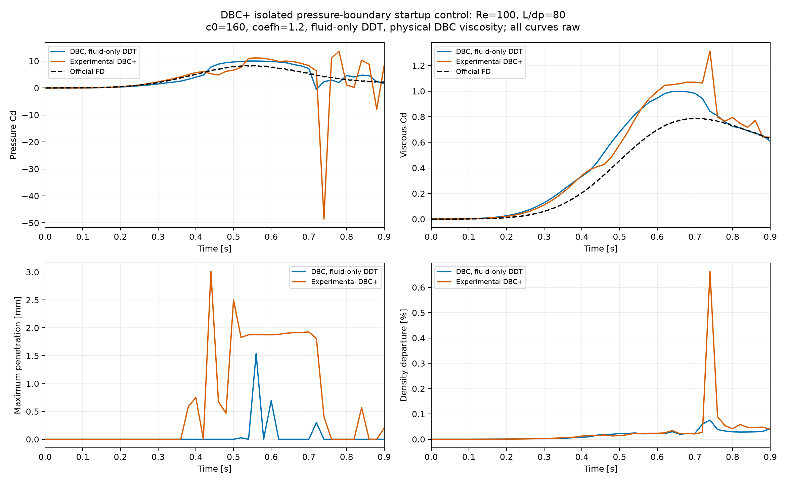
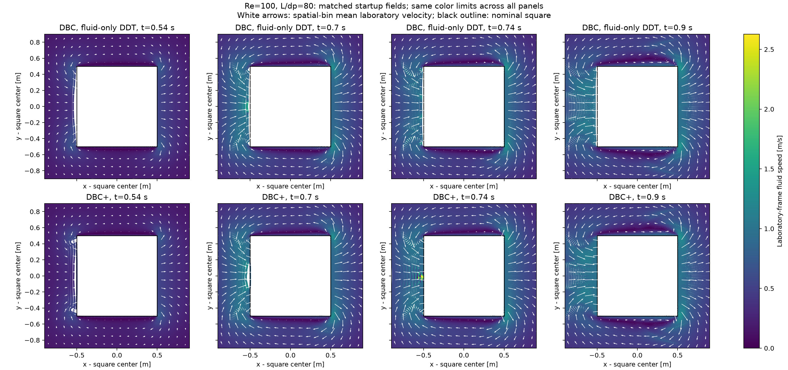
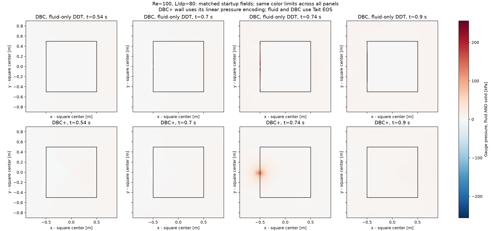
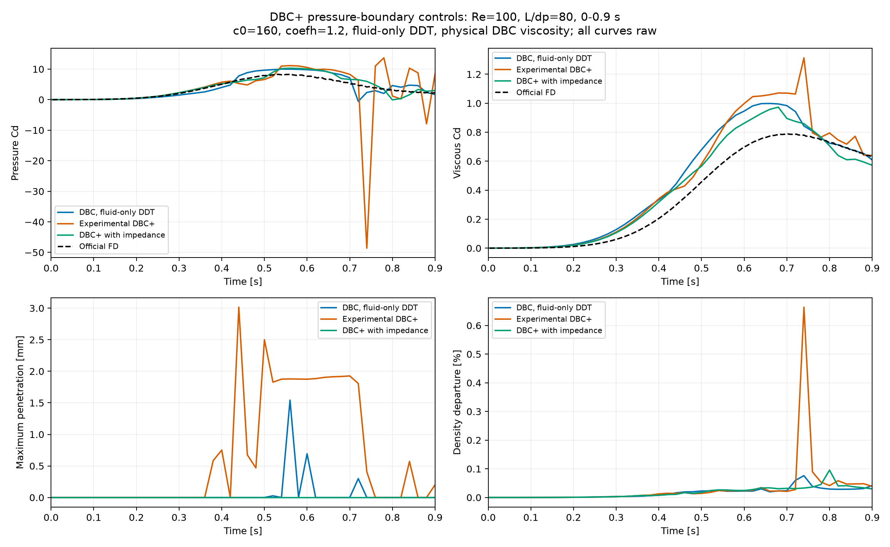
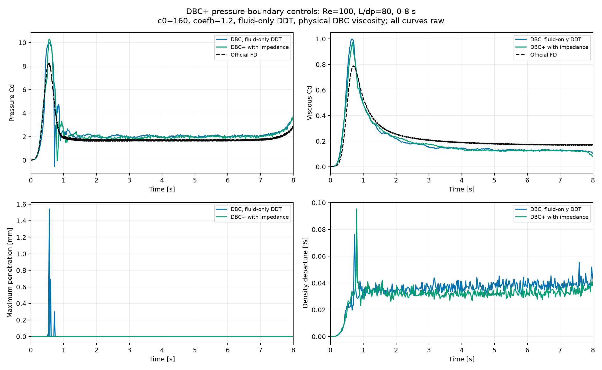

# Experimental DBC+ pressure-only boundary

The option requested as **DBC+** is selected in Julia with the boundary type
`DBCPlus`. This is a new opt-in mode; no existing boundary defaults or
diffusion formulas are changed.

## Definition

- Wall pressure uses the existing UpdatedMDBC fluid-ghost interpolation and
  support/activation checks, including gravity and exact prescribed translational
  acceleration correction along the boundary normal.
- Wall density encodes that linear wall pressure and is retained through the
  integration stages instead of independently integrating continuity/DDT.
  Negative wall pressure is permitted by the pressure construction.
- Fluid pressure still uses the Tait EOS.
- Both wall continuity velocity and viscous velocity use the physical wall
  velocity, as in DBC. UpdatedMDBC's mirrored tangential viscosity is disabled.
- Ghost points, normals, compact ownership mappings, sorting, pressure caches
  and pressure export use the shared cloned-pressure boundary infrastructure.
- Dry/unsupported wall activation follows UpdatedMDBC. Consequently this is
  not identical to DBC in which pairs remain active: although the viscosity
  formula and physical velocities are retained, pressure/density/support
  changes can change the resulting viscous force.
- The test uses fluid-fluid-only `LinearDensityDiffusion()` at g=0, preserving
  fluid regularization and excluding direct boundary diffusion.

This is not a pressure projection, exact incompressibility constraint or a
demonstrated improvement over the existing methods. It is intentionally the
pressure-only isolation proposed after the density-budget diagnosis.

## Isolated verification

The new mode's ghost pressure/density matches UpdatedMDBC while its corrected
viscous wall velocity remains physical, in 2D/3D, Float32/Float64, compact/dense
boundary storage and cached/uncached pressure configurations (88 assertions).
The full existing UpdatedMDBC regression file also passes.

The case-level tests verify:

1. Net constant-pressure cancellation for a symmetric submerged square
   (not a guarantee for arbitrary disordered particles).
2. Analytical zero-gravity accelerating-square pressure traction within 2%
   at dp=0.05 and 0.025 m, including the suction side.
3. Identical direct/graph short-run force histories and step counts.
4. Prescribed-motion accuracy and linear wall-pressure HDF export.

Physical DBC viscosity is deliberately not corrected here; its pre-existing
traction discretization errors are not claimed solved.

## n80 startup control: unfavorable result

Matched Re=100, dp=0.0125 m, c0=160 m/s, coefh=1.2, CFL=0.2, original tank,
integrated motion, laminar viscosity and fluid-only diffusion; no shifting,
cleaning, sponge or background offset. Compare to the existing fluid-only-DDT
DBC run over the same saved times.

The DBC+ run completes 33975 steps and 46 finite saved frames through 0.9 s,
retaining 313600 fluid and 6400 square particles (12100 fixed), without freezing.
However:

- Pressure Cd reaches **-48.609 at 0.74 s**, versus approximately -0.562 at
  0.72 s in the fluid-only-DDT DBC control.
- Peak pressure Cd is 13.688 and peak viscous Cd is 1.313.
- Maximum fluid density departure is 0.664%.
- Minimum nominal solid clearance is **-3.016 mm**, about **0.241 dp**.

**DBC+ in this tested form is not recommended as a remedy.** Passing simple
pressure-traction fixtures does not establish a good boundary response for
accelerating separated flow around a square. Replacing the evolved wall
pressure alone does not remove the spike and can weaken the numerical
repulsive barrier. The observed failure does not isolate a unique cause
within interpolation, support activation, pressure correction and wall
impermeability. No speculative stabilizing clamp was added to hide it.

Following the stated escalation gate, no full eight-second DBC+ run was started.
The experimental option is retained for reproducibility, not made the default.

Force histories use the boundary-aware accepted-frame reconstruction of
wall pressure/activity and physical DBC wall velocity, not the generic
DBC force postprocessor. The latter is not valid for this new pressure mode.
All plotted curves and supplied reference samples are unfiltered.

## Reproduce

From gpu_version:

```sh
julia --project=. -t 2,0 test/dbc_plus.jl
julia --project=. -t 2,0 "validation cases/spheric_test_06/dbc_plus_tests.jl"
julia --project=. -t 2,0 "validation cases/spheric_test_06/dbc_plus.jl"
python "validation cases/spheric_test_06/plot_dbc_plus.py"
```

The runner refuses overwriting completed or partial particle histories.
Large particle files/logs remain under ignored runs/dbc_plus; compact data
and plots are tracked here. No performance comparison is claimed.
The generic manual case currently supports DBC/SimpleMDBC postprocessing:
use this dedicated DBC+ runner rather than changing the manual type alone.



## Flow-field inspection

Matched, square-centered snapshots at 0.54, 0.70, 0.74 and 0.90 s compare
DBC+ against DBC with the same fluid-only DDT. Color scales are shared across
all panels of each figure. Velocity arrows are spatial-bin averages in the
laboratory frame, not velocities relative to the moving square. Pressure
panels include solid particles; DBC+ walls use their linear pressure encoding.

At 0.74 s, DBC+ has four fluid particle centers inside the nominal square.
Whole-domain fluid maximum speed is 2.627 m/s versus 1.530 m/s for DBC.
The DBC+ fluid pressure range is approximately -13.85 to +173.34 kPa,
versus -2.52 to +19.54 kPa for DBC. A concentrated disturbance appears
at the middle of the rear face (left face, since motion is to the right).

This shows a local coupled fluid/boundary failure, not merely an inaccurate
force label or a uniform pressure shift. Ghost pressure reconstruction alone
does not impose impermeability: it replaces DBC's evolved repulsive wall
pressure with an interpolated/corrected field whose quality depends on local
fluid support. Support loss, interpolation error and particle approach can
interact. The snapshots demonstrate the local disturbance and penetration,
but do not establish which starts that feedback or distinguish MLS,
acceleration correction and activation effects. Simple analytical traction
tests do not exercise that separated, time-dependent near-wall configuration.
The shared full-range pressure scale can make smaller gradients appear faint.





## Follow-up: DBC+ with normal acoustic impedance

The original DBC+ run first admits fluid centers through a side at the saved
0.38 s frame and through its rear face at 0.40 s, before the 0.74 s pressure
spike. This motivates testing the incoming normal response separately from
viscosity. It does not prove that the early entry causes the later spike.

The separate opt-in mode `DBCPlusImpedance` adds
`rho0 * c0 * max(0, dot(v_wall - v_ghost, n))` to the reconstructed pressure
when the ghost has fluid support; `n` points from the wall into the fluid.
There is no extra pressure for tangential motion or separation. The ghost
pressure reconstruction, activation rule, acceleration correction and physical
viscous wall velocity are retained. The change is a normal acoustic pressure
response, not a geometric collision or a filter applied to drag.

### Matched startup and full run

All three runs use Re=100, L/dp=80, c0=160 m/s, coefh=1.2, CFL=0.2,
integrated motion and fluid-only diffusion. Errors are raw relative L2 norms
against the unmodified official reference over 0.1-0.9 s (startup) or
0.1-8 s (full). Positive clearance denotes no penetration in the saved frames.

| Boundary | Startup pressure error | Startup viscous error | Minimum startup clearance |
|---|---:|---:|---:|
| DBC, fluid-only DDT | 31.43% | 28.11% | -1.543 mm |
| Original DBC+ | 145.76% | 33.55% | -3.016 mm |
| DBC+ with impedance | 25.61% | 19.65% | +2.658 mm |

| Boundary | Full pressure error | Full viscous error | Minimum full clearance |
|---|---:|---:|---:|
| DBC, fluid-only DDT | 26.70% | 23.21% | -1.543 mm |
| DBC+ with impedance | 22.21% | 19.72% | +2.136 mm |

The full impedance run reproduces every startup force sample through 0.9 s
exactly, then completes 302,000 steps. All 401 saved frames retain their fluid
and square counts, with no frozen particles. An independent check of the saved
positions found positive clearance from both the square and tank in every
frame, with the minimum at 3.68 s. This does not rule out crossings between
outputs. The minimum pressure Cd is -0.070 at 0.80 s; the large original DBC+
reversal does not recur. Peak pressure Cd is still 10.30, versus 8.31 in the
reference. This is an improvement for the matched case, not a validation pass
or evidence of convergence across Reynolds numbers or resolutions.

The CUDA tests exercise approach, separation, tangential motion and a common
velocity boost, and verify that the impedance pressure is correctly encoded.
Both DBC+ modes retain graph/direct parity, analytical traction and wall
pressure export; the existing UpdatedMDBC tests also pass.

```sh
julia --project=. -t 2,0 "validation cases/spheric_test_06/dbc_plus.jl" impedance
python "validation cases/spheric_test_06/plot_dbc_plus.py" --impedance
julia --project=. -t 2,0 "validation cases/spheric_test_06/dbc_plus.jl" impedance full
python "validation cases/spheric_test_06/plot_dbc_plus.py" --full
```




