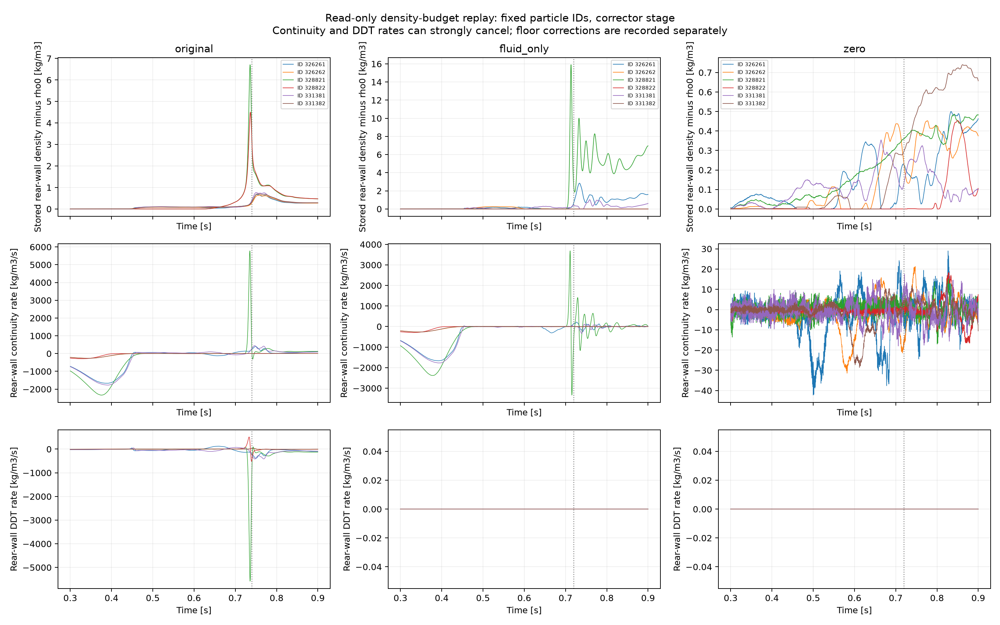

# Read-only predictor/corrector density budgets

## Review and scope

GPT-6.2 Astra reviewed the diffusion implementation and startup evidence before
this change. It found no demonstrated indexing defect justifying an operator
rewrite, and recommended measuring continuity, DDT and density-floor budgets
at both integration stages before changing the physics.

The implementation adds disabled-by-default `SimDensityObserver=nothing`.
The diagnostic script uses a separate read-only gather replay writing private
rate/acceleration/budget buffers. Production gather arithmetic, forces,
density updates and diffusion formulas remain unchanged.

An initial in-production counter prototype perturbed the fine trajectory
(maximum sampled pressure-Cd difference about 0.108). It was rejected.
Those prototype outputs are archived under ignored runs/, not included here.
The final read-only replay is validated against the original graph-enabled
histories, even though its observer runs with direct launches.

## Exact parity and stage verification

For each of original DDT, fluid-only DDT and zero DDT:

- Fresh n80 startup through 0.9 s, all 46 output frames.
- Every pressure/viscous/lateral force sample matches its archived control exactly.
- Every saved position, velocity, density and group-marker array matches exactly.
- Same 33975 accepted steps.
- Twelve fixed physical IDs: six rear wall particles in the first two layers
  and six initially adjacent fluid particles, near y=2.1/2.5/2.9 m.
- 543600 stage rows per model from simulation time 0.3 to 0.9 s, with mappings
  refreshed after each particle reorder.
- Every selected predictor and corrector stored density is reconstructed
  exactly from the actual consumed rate, dt and evaluated/base densities.
- Separated continuity + DDT rates close to the consumed rate within an
  accumulation-roundoff bound scaled by absolute pair contributions.

The small reproducible parity suite passes 17129 checks for all three models.
The three n80 runs additionally passed 1087200 / 1359000 / 1630800 checks.
This is diagnostic verification, not physical validation or a speed benchmark.

## What the rates reveal

During 0.68-0.76 s in the original-DDT run, tracked outer rear-wall particle
ID 328821 has corrector-stage rate-time integrals:

```text
continuity: +36.4729 kg/m3
DDT:        -35.6292 kg/m3
floor:       0 corrections in this window
```

Its accepted density rises from approximately 1000.16895 to 1001.137 kg/m3.
Here DDT strongly OPPOSES the continuity-driven increase; it is not directly
injecting positive density into this particle during that interval.

The adjacent inner-layer wall particle ID 328822 instead has:

```text
continuity: +0.01787 kg/m3
DDT:        +0.88168 kg/m3
floor:       0 corrections in this window
```

Thus diffusion can redistribute density into the next solid layer even though
wall-wall continuity is excluded. It does not have the same sign at every
wall particle. These six tracked walls are a selected sample, not the whole
rear-face force budget or proof of the initiating mechanism.

In the fluid-only case wall DDT is exactly zero, as required. Particle 328821
still rises from 1000 to about 1003.9743 kg/m3 through continuity with no
corrector floor activations in that window. Other sampled wall particles
experience repeated floor corrections: for example ID 326261 has a negative
continuity rate-time integral (-0.2911 kg/m3) but positive accepted density
change, with accumulated corrector floor corrections of +1.8017 kg/m3.
Predictor and corrector corrections are recorded separately and must not be
added as though both directly incremented the final state.

These observations support coupled continuity, diffusion redistribution and
one-sided limiting effects. They do NOT support simply reversing/removing
DDT, nor establish that a different coefficient fixes the boundary treatment.
The original density-pressure floor and ordered pair operator are unchanged.

## Why rate-time integrals are not exact additive density changes

Predictor density uses `rho_n + dt/2 * rate`. The corrector uses:

```text
epsi = -(rate_half / rho_half) * dt
rho_raw = rho_n * (2 - epsi) / (2 + epsi)
rho_stored = boundary_limit(rho_raw)
```

Consequently, continuity/DDT rate-time integrals in summary.csv are RHS
diagnostics, not an exact additive decomposition of the nonlinear corrector
change. Float32 storage/update rounding also matters when many small increments
are accumulated. Actual raw/stored densities and floor increments are logged
independently, and their production formulas are checked at each stage.
The divergence estimate is `-continuity_rate/evaluated_density`, excluding DDT;
it uses the solver's boundary pair exclusions, not a continuum exact divergence.

## Usage and limitations

From gpu_version:

```sh
julia --project=. -t 2,0 "validation cases/spheric_test_06/density_budget_tests.jl"
julia --project=. -t 2,0 "validation cases/spheric_test_06/density_budget.jl" original
julia --project=. -t 2,0 "validation cases/spheric_test_06/density_budget.jl" fluid_only
julia --project=. -t 2,0 "validation cases/spheric_test_06/density_budget.jl" zero
python "validation cases/spheric_test_06/analyze_density_budget.py"
```

The runner refuses overwriting particle histories. The observer deliberately
supports only direct one-lane unfused uncached reference DBC/NoShifting
symplectic stepping, the three linear/zero diffusion models, ordinary
fluid/fixed/moving particles, and no additional physics. Unsupported modes
fail explicitly. No device graph capture or observer performance claims.
The default observer path allocates no diagnostic buffers.

Full per-step traces are gzip archived under
`runs/density_budget/<model>_replay_n80/density_budget.csv.gz`, alongside the
large particle histories, and are not committed. Compact per-ID stage/window
summaries, exact-parity checks, selected IDs, settings and plots are tracked.
The plotting script can rerun using the compressed archives.


