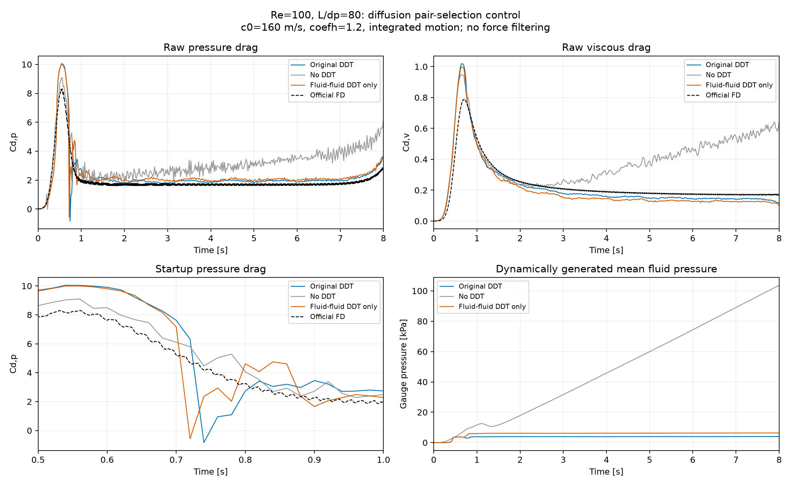

# Fluid-fluid-only density diffusion: Re=100, L/dp=80

The full eight-second matched case uses existing `LinearDensityDiffusion()`.
At g=0 its hydrostatic correction vanishes and it matches the original
zero-gravity linear pair formula for two fluid particles. It returns zero
diffusion for every pair involving fixed, moving, floating or frozen particles.
It does NOT suppress diffusion between fluid particles merely because they
have a boundary neighbor. Boundary continuity, viscosity and pressure forces
are unchanged. No solver source or default model was modified.

The 52 pair-contract tests cover Float32/Float64 and all five particle types.
Original tank, c0=160, coefh=1.2, dp=0.0125, CFL=0.2, integrated motion,
DBC, nu=0.01, delta=0.1, five wall layers and zero background pressure are retained.
No shifting, cleaning or sponge is enabled.

| Model | Raw pressure error | Raw viscous error | Final mean fluid pressure |
|:--|--:|--:|--:|
| Original DDT including boundary pairs | 25.16% | 20.48% | 3.98 kPa |
| No DDT | 63.60% | 81.12% | 103.68 kPa |
| Fluid-fluid DDT only | 26.70% | 23.21% | 6.35 kPa |

The original negative excursion is -0.8321 Cd at 0.74 s.
The fluid-only case still has a negative excursion: -0.5624 Cd at 0.72 s.
At 0.74 s it has recovered to +2.3549 Cd, illustrating why checking only
the original spike time would misleadingly suggest the issue disappeared.

**Excluding boundary pairs from DDT does not remove the spike or improve
the full-history force errors in this control.** Fluid diffusion strongly
restrains the mean-pressure drift seen without any DDT, but direct
boundary-pair diffusion is not necessary for a startup reversal to occur.
This narrows the hypothesis; it does not prove DDT has no role through fluid
pressure, continuity, wall density limiting or their coupled evolution.

All 401 saved force/state frames are finite and retain 313600 fluid and
6400 square particles (12100 fixed). No frozen particles; 302000 steps.
Maximum density departure is 0.07614%, peak Mach 0.01053.
Minimum nominal solid clearance is -1.543 mm, versus -3.566 mm in the
original DDT control; impermeability is not established.

The plotting script checks all completed frames, counts, output grids and
key common settings. Errors use exact squared piecewise-linear residual
integration against the supplied reference over 0.1-8 s. Neither raw
force histories nor reference curves are smoothed, shifted or scaled.
No timing/speedup claim is made.

```sh
# From gpu_version:
julia --project=. -t 2,0 "validation cases/spheric_test_06/fluid_only_ddt.jl" test
julia --project=. -t 2,0 "validation cases/spheric_test_06/fluid_only_ddt.jl"
python "validation cases/spheric_test_06/plot_fluid_only_ddt.py"
```

Large histories remain ignored under runs/fluid_only_ddt. The generated
ParaView entry point is in its Re100_n080/paraview_force_plot directory.


