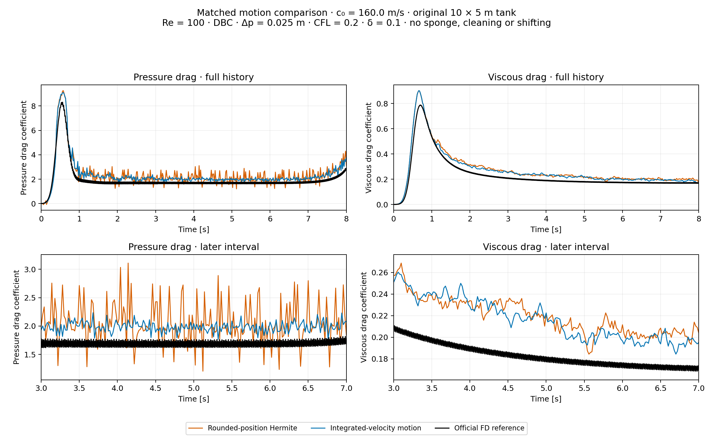

# Matched motion comparison at c0 = 160.0 m/s

Two fresh 8 s runs isolate the motion interpolant in the original 10×5 m tank.
Both use Re100, DBC (`NoMDBC`), c0=160.0 m/s, dp=0.025 m, h=sqrt(2)dp,
CFL=0.2, delta=0.1, physical laminar nu=0.01 m²/s, zero gravity/background
pressure, no sponge, no cleaning and no shifting. The legacy timestep,
Wendland C2, strict reference pair arithmetic, Float32 physics, double
positions/clocks, CUDA graphs and output every 0.02 s are identical.

`hermite` interpolates the official rounded displacement and supplied velocity
records. `integrated` reconstructs displacement by trapezoidal integration of
the supplied velocities, then uses the same Hermite implementation. This
removes the incompatibility between rounded positions and velocities; its
velocity is piecewise linear and continuous, with piecewise constant acceleration.
It is not a globally acceleration-continuous motion prescription.

| Measure | Rounded-position Hermite | Integrated velocity |
|---|---:|---:|
| Raw pressure relative L2 error, 0.1–8 s | 24.86% | 20.58% |
| Raw viscous relative L2 error, 0.1–8 s | 18.01% | 15.94% |
| Pressure-noise proxy, 1.5–6.5 s | 0.3683 | 0.1142 |
| Viscous-noise proxy, 1.5–6.5 s | 0.00614 | 0.00481 |
| Mean Cd,p, 3–7 s | 2.0559 | 1.9848 |
| Mean Cd,v, 3–7 s | 0.2194 | 0.2165 |
| Maximum saved Cd,p | 9.2570 | 9.1043 |
| Maximum saved Cd,v | 0.90184 | 0.90243 |
| Minimum Cd,p, 0.8–1.6 s | 1.6488 | 2.0470 |

Integrated motion lowers the central pressure-noise proxy by about 69% and
the full pressure error by 4.28 percentage points. The raw plot shows that it
removes many later pressure spikes. Both full-history force errors improve,
so this benefit is more than a cosmetic change to the plot.

The startup peaks remain similar and too high. Mean pressure and viscous
drag also remain above the reference: original FD means over 3–7 s are
1.6886 and 0.1830 respectively. Integrated motion therefore fixes a significant
source of continued forcing at this sound speed, but does not validate DBC
or eliminate all startup and wall-traction errors. This comparison does not
test an analytic acceleration-continuous motion or isolate the remaining cause.

Errors integrate squared piecewise-linear residuals exactly on the union of
simulation/reference time knots over 0.1–8 s. The noise proxy removes a centered
0.5 s average from reference residuals over 1.5–6.5 s. Plots show raw saved
histories; no smoothing, fitted amplitude or time shift is used. At 0.02 s
cadence, frequencies above 25 Hz are unresolved and may alias. The reference
itself contains high-frequency numerical oscillations.

Both runs completed 181,200 steps and 401 finite-state frames, each retaining
78,400 fluid, 1,600 square and 4,864 fixed particles. Metadata checks verified
matching configuration apart from motion choice and measured diagnostics.
No frozen particles occurred. Minimum solid clearance is -2.20 mm for Hermite
and -1.40 mm for integrated motion, so successful completion does not establish
impermeability. The fresh integrated pressure-coefficient history exactly
reproduces the previous `wide_sponge_c160/original_tank` history at saved
precision. Hardware/software provenance is in each TOML record. No solver
implementation changed; the repository-wide CUDA suite was not rerun.

```sh
julia --project=. -t 2,0 "validation cases/spheric_test_06/motion_c160.jl"
python "validation cases/spheric_test_06/plot_motion_c160.py"
```

The runner uses independent directories and refuses to overwrite particle
histories. Large VTKHDF files/logs remain under ignored `runs/motion_c160/`.
Timings are not used as performance evidence.


