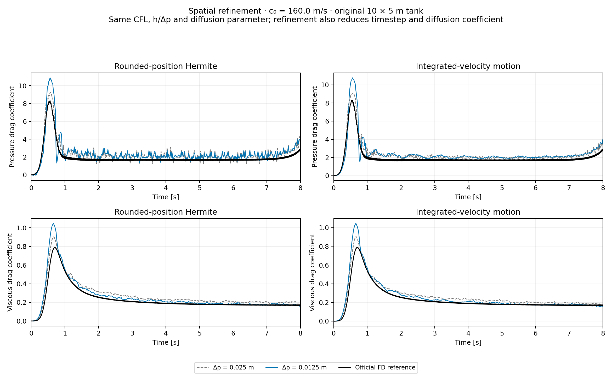
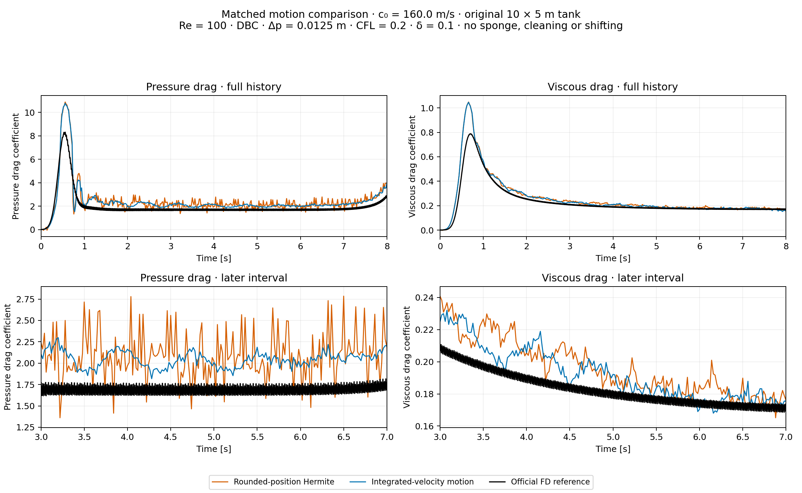

# Motion comparison with half particle spacing

This study halves particle spacing from 0.025 m to 0.0125 m, doubling L/dp
from 40 to 80. Increasing spacing would reduce particle count; halving it
produces the requested higher count. Both rounded-position Hermite and
integrated-velocity motion are run through the full 8 s in the original
10×5 m tank at c0=160.0 m/s.

The physical setup and numerical options match [the coarse motion comparison](../motion_c160/README.md):
Re100, DBC, nu=0.01 m²/s, rho0=1000 kg/m³, zero gravity/background pressure,
Wendland C2, h=sqrt(2)dp, CFL=0.2, delta=0.1, legacy timestep, strict reference
pair arithmetic, Float32 physics, double positions/clocks, CUDA graphs, and
no sponge, divergence cleaning or shifting. There are 401 saved frames at
0.02 s intervals. Particle wall layers continue to cover the kernel support.

| Storage population | dp=0.025 m | dp=0.0125 m |
|---|---:|---:|
| Fluid particles | 78,400 | 313,600 |
| Square particles | 1,600 | 6,400 |
| Fixed wall particles | 4,864 | 9,664 |
| Total | 84,864 | 329,664 |

The fluid/body counts grow fourfold because this is a 2D case. The wall count
grows approximately twofold because its thickness follows kernel support.
Halving h also reduces the nominal acoustic timestep and the macroscopic
density-diffusion coefficient delta*h*c0. This is the usual coupled spatial
refinement with fixed CFL and h/dp, not an isolated fixed-timestep experiment.

Force errors use the same time-integrated relative L2 norm over 0.1–8 s as
the coarse study, with exact integration of squared piecewise-linear residuals
on the union of saved/reference knots. The noise proxy is the RMS residual
after subtracting a centered 0.5 s mean over 1.5–6.5 s. Plots show raw forces
without smoothing, fitted scaling or time shifts. Identical output cadence
means both spatial resolutions still have the same 25 Hz output Nyquist limit.

## Results

| Motion | Spacing [m] | Full pressure error | Full viscous error | Pressure-noise proxy |
|---|---:|---:|---:|---:|
| Rounded-position Hermite | 0.025 | 24.86% | 18.01% | 0.3683 |
| Rounded-position Hermite | 0.0125 | 33.91% | 20.62% | 0.2876 |
| Integrated velocity | 0.025 | 20.58% | 15.94% | 0.1142 |
| Integrated velocity | 0.0125 | 31.14% | 20.36% | 0.0904 |

Refinement does not improve full-history agreement with the incompressible
reference. In both motion modes, the largest deterioration is at startup.
For integrated motion, the pressure peak rises from 9.104 to 10.773 and the
viscous peak rises from 0.9024 to 1.0459. Separating the comparison windows:

| Integrated motion | Coarse error | Fine error |
|---|---:|---:|
| Pressure, 0.1–1.5 s | 19.55% | 35.93% |
| Pressure, 1.5–8 s | 21.62% | 25.02% |
| Viscous, 0.1–1.5 s | 13.64% | 26.03% |
| Viscous, 1.5–8 s | 18.49% | 8.71% |

There is a real later viscous improvement despite the worse full error.
Integrated-motion mean viscous drag over 3–7 s decreases from 0.2165 to 0.1924,
versus FD 0.1830: bias falls from +18.3% to +5.1%. Mean pressure increases
slightly from 1.9848 to 2.0444, versus FD 1.6886; pressure bias remains.
Integrated motion still removes much of the rounded-motion pressure noise
on the fine grid (about 69% reduction in the central proxy).

These two resolutions do not establish spatial convergence or identify the
cause of the startup deterioration. Refining at fixed sound speed retains
finite compressibility and the same wall formulation; h, timestep and numerical
diffusion also change together. More particles therefore cannot be assumed
to improve agreement monotonically with the different incompressible reference.
The evidence supports reporting startup and later flow separately.

Both fine runs completed 362,400 steps and 401 finite-state frames without
lost or frozen particles. Metadata checks verified matching coarse/fine
physical settings and numerical choices, with h halved and fluid/body counts
quadrupled. Minimum solid clearances remain negative (-1.44 mm Hermite and
-1.54 mm integrated), so successful completion is not an impermeability pass.
Software/hardware provenance is retained in each TOML record. Solver source
was unchanged, and the repository-wide CUDA suite was not rerun.





## Reproduce

```sh
julia --project=. -t 2,0 "validation cases/spheric_test_06/motion_c160.jl" 80
python "validation cases/spheric_test_06/plot_motion_c160.py" 80
```

The argument is L/dp. Omitting it retains the original L/dp=40 study and its
output paths. The runner checks spacing when reusing completion records.
Large VTKHDF histories and console logs remain in ignored
`runs/motion_c160_n080/`; the manual example's separate configuration is unchanged.

## Analysis method

Relative L2 errors integrate squared piecewise-linear force residuals exactly
over 0.1–8 s on the union of simulation/reference knots. The central noise proxy
removes a centered 0.5 s mean from reference residuals over 1.5–6.5 s. Plots
show raw saved histories without smoothing, fitted amplitudes or time shifts.
Output cadence is unchanged, so frequencies above 25 Hz remain unresolved and
may alias. A smaller noise proxy alone does not establish improved loads.


