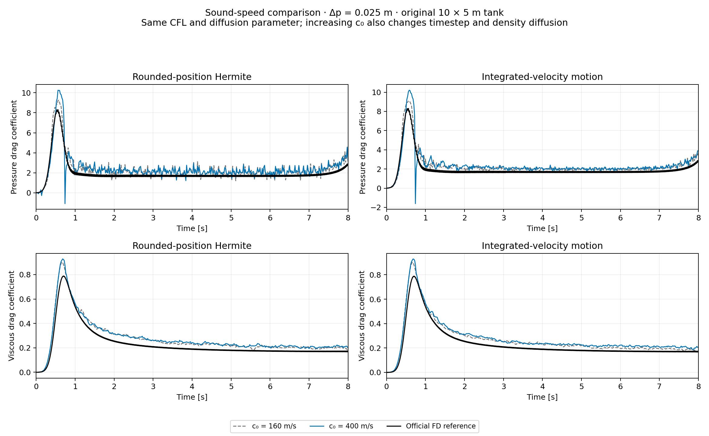
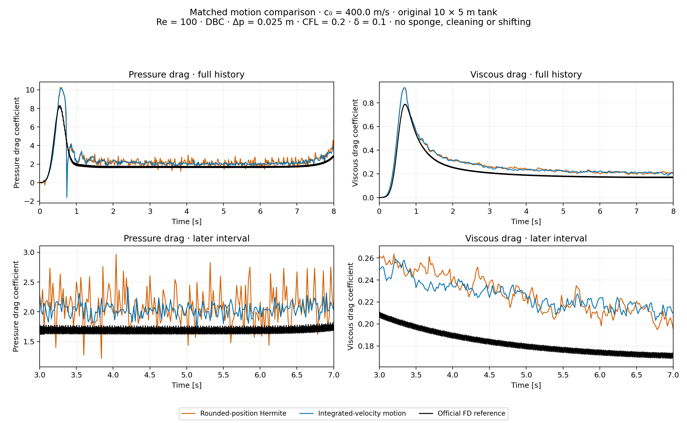

# Motion comparison at c0 = 400.0 m/s, original spacing

Two fresh 8 s Re100 runs return to dp=0.025 m and compare rounded-position
Hermite and integrated-velocity motion in the original 10×5 m closed tank.
Both use DBC, Wendland C2, h=sqrt(2)dp, CFL=0.2, delta=0.1, physical laminar
nu=0.01 m²/s, rho0=1000 kg/m³, zero gravity/background pressure, no sponge,
no divergence cleaning and no shifting. The legacy timestep, strict reference
pair arithmetic, Float32 physics, double positions/clocks and CUDA graphs are
retained. There are 84,864 particles: 78,400 fluid, 1,600 body and 4,864 walls.

The control is the [160 m/s study at the same spacing](../motion_c160/README.md),
not the later dp=0.0125 m refinement. The requested 400 m/s is ten times the
initial 40 m/s setting and 2.5 times 160 m/s. Increasing c0 from 160 to 400
increases linearized pressure stiffness c0² by 6.25, increases the macroscopic
density-diffusion coefficient delta*h*c0 by 2.5, and reduces the nominal acoustic
timestep to 40%. This compares complete configurations at fixed CFL and delta;
it does not isolate acoustic propagation from timestep and diffusion effects.

## Results

| Motion | c0 [m/s] | Raw pressure error | Raw viscous error | Saved pressure-noise proxy |
|---|---:|---:|---:|---:|
| Rounded-position Hermite | 160 | 24.86% | 18.01% | 0.3683 |
| Rounded-position Hermite | 400 | 31.77% | 19.58% | 0.2923 |
| Integrated velocity | 160 | 20.58% | 15.94% | 0.1142 |
| Integrated velocity | 400 | 30.48% | 19.24% | 0.1317 |

Both full-history errors worsen at 400 m/s. Integrated motion still reduces
the later pressure-noise proxy by about 55% relative to rounded-position
motion at 400 m/s, but its proxy is about 15% higher than at 160 m/s.
There is no monotonic improvement with increasing sound speed here.

Integrated-motion maximum saved pressure drag increases from 9.104 to 10.209;
maximum viscous drag increases from 0.9024 to 0.9295. Both 400 m/s histories
also contain a negative pressure-drag sample at t=0.74 s: -1.087 for Hermite
and -1.613 for integrated motion. The historical 0.8–1.6 s startup metric
misses this earlier dip, so the summary additionally reports a 0.1–1.6 s
minimum. Higher-cadence output is needed to resolve its true duration/extrema.

Over 3–7 s the integrated 400 m/s mean pressure coefficient is 2.0368
(160 m/s: 1.9848; FD: 1.6886), and mean viscous coefficient is 0.2263
(160 m/s: 0.2165; FD: 0.1830). The mean-load discrepancy also remains.
These results do not establish a single cause: c0, timestep and diffusion
are coupled, and the wall model and Float32 arithmetic are retained.

Relative L2 errors use exact time integration of squared piecewise-linear
residuals on the union of output/reference knots over 0.1–8 s. The noise
proxy removes a centered 0.5 s mean from reference residuals over 1.5–6.5 s.
Plots show raw saved forces without smoothing, fitted scaling or time shifts.
Pressure and viscous L2 errors were independently recomputed in Python.

## Validation and reproduction

Both new runs completed 452,800 steps and 401 finite-state frames without
lost or frozen particles. Metadata checks verified matching spacing, h,
physical parameters, geometry, motion choice and numerical controls against
the corresponding 160 m/s cases. Minimum solid clearances remain negative:
-0.97 mm Hermite and -1.68 mm integrated, so completion is not an
impermeability pass. Hardware/software provenance is in the TOML records;
these run times are not a paired performance study. No solver implementation
changed, and the repository-wide CUDA suite was not rerun.

```sh
julia --project=. -t 2,0 "validation cases/spheric_test_06/motion_c160.jl" 40 400
python "validation cases/spheric_test_06/plot_motion_c160.py" 40 400
```

The numeric arguments are L/dp and c0. The script names retain their historical
160 suffix, while output folders include the requested sound speed. Original
160 m/s and fine-spacing studies remain unchanged. Large particle histories
and console logs stay under ignored `runs/motion_c400/`. The manual example's
separate configuration is unchanged.





## Sampling and error interpretation

The output cadence remains 0.02 s for consistency with the existing studies.
The Nyquist limit is 25 Hz. Empty-box longitudinal/vertical mode estimates at
400 m/s are 20/40 Hz: the former has only 2.5 samples per cycle and the latter
is unresolved and could alias to 10 Hz. The square changes the real modes;
these estimates do not assign a particular spectral peak. Saved-force noise
statistics must not be interpreted as fully resolved solver acoustic noise.

Full-history relative L2 errors use exact squared piecewise-linear integration
on the union of reference/output knots over 0.1–8 s. The noise proxy removes a
centered 0.5 s mean from reference residuals over 1.5–6.5 s. All force plots
show raw saved values, without smoothing or fitted amplitude/time shifts.

## Reproduce

```sh
julia --project=. -t 2,0 "validation cases/spheric_test_06/motion_c160.jl" 40 400
python "validation cases/spheric_test_06/plot_motion_c160.py" 40 400
```

Arguments are L/dp and sound speed. Omitting both reproduces the original
40-particles-per-side, 160 m/s study. The legacy script filenames are retained;
results and large run histories use separate `motion_c400` directories.
