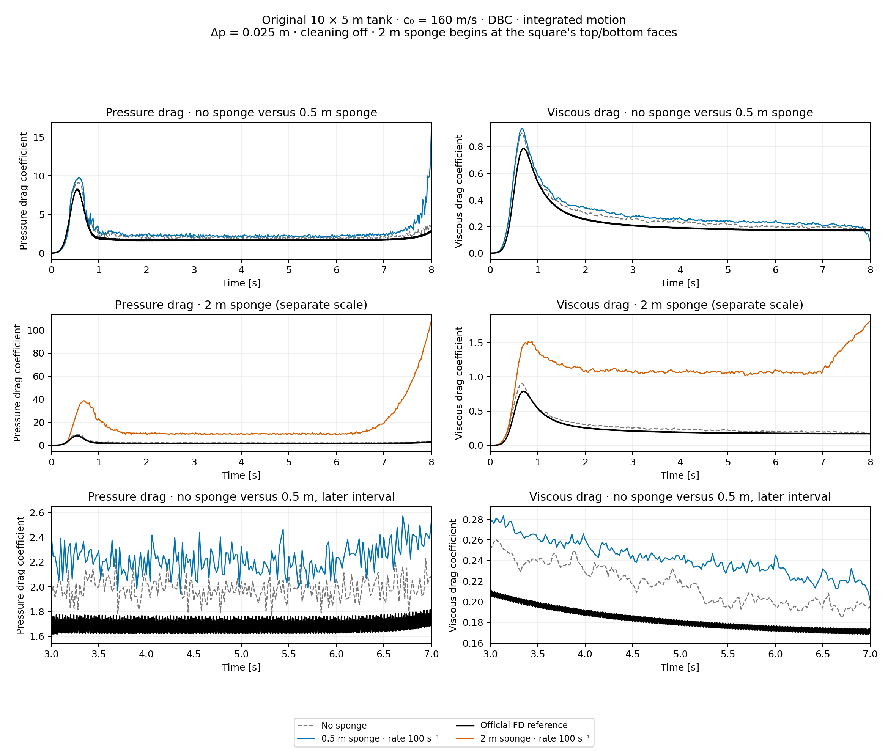
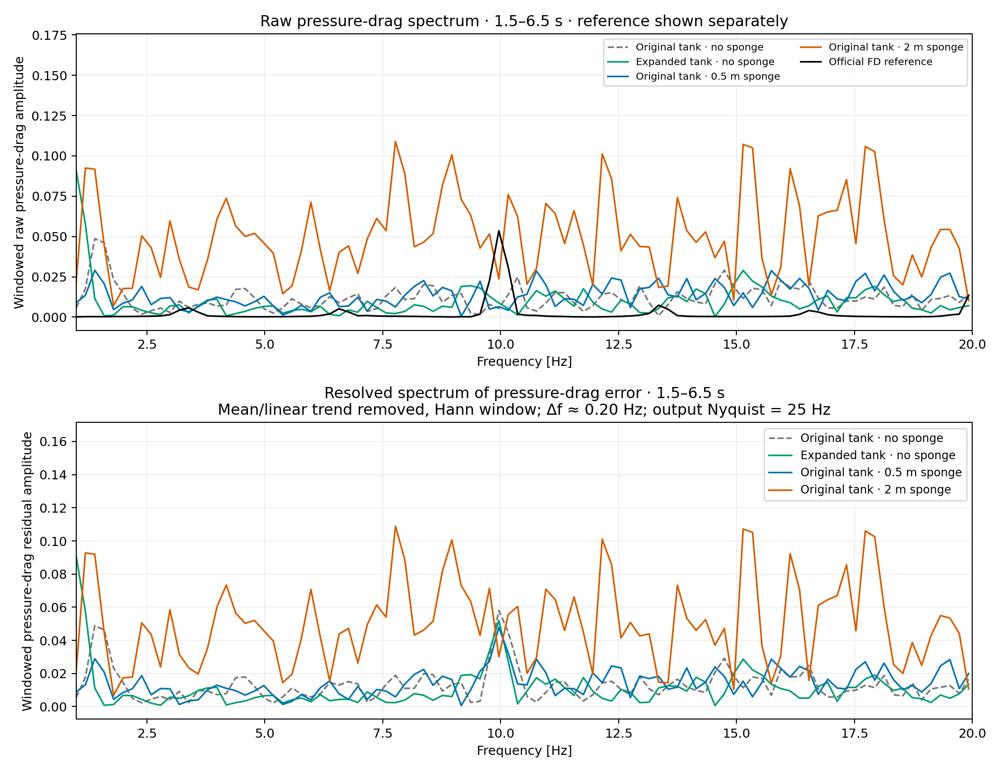

# Original-sized tank with an internal sponge

Two new 8 s simulations retain the original 10×5 m tank and test all-sided
quadratic DampingBox layers of width 2 m and 0.5 m, both at rate 100 s⁻¹.
Both use c0=160 m/s, Re100, DBC, integrated-velocity motion, dp=0.025 m,
h=sqrt(2)dp, CFL=0.2, delta=0.1, laminar nu=0.01 m²/s, no shifting,
zero background pressure, no cleaning and legacy timestepping. Physics is
Float32 with double positions/clocks. There are 84,864 particles in both runs.
The no-sponge baseline and expanded-domain comparisons reuse the archived
`wide_sponge_c160` runs, with matching settings except geometry and damping.

## Outcome

| Original tank configuration | Raw pressure error | Raw viscous error | Pressure-noise proxy | Mean Cd,p, 3–7 s | Cd,p at 8 s |
|---|---:|---:|---:|---:|---:|
| No sponge | 20.58% | 15.94% | 0.1142 | 1.9848 | about 3.6 |
| 0.5 m sponge | 56.63% | 24.56% | 0.1146 | 2.2259 | 16.11 |
| 2 m sponge | 1003.59% | 334.15% | 0.4058 | 10.5107 | 108.18 |

The full raw histories, including the large end-of-run loads, are retained.
The plots give the 2 m case its own scale. Neither internal sponge improves
the original benchmark. The 0.5 m case does not materially reduce the central
noise proxy and increases both mean loads and full-history errors.

The 2 m sponge's undamped core is [2,8]×[2,3] m. Its top/bottom ramp begins
at the square's horizontal faces (y=2 and y=3), so it directly damps physical
shear flow throughout the run. End layers also overlap fluid around the square
early and late. The 0.5 m sponge keeps the body itself in its undamped core,
but near-wall return flow and the end gap still enter damping zones.

The implementation damps absolute fluid velocity: approximately
`a_sponge = -rate * profile * velocity`, with the actual discrete velocity
multiplier documented in `DampingZones.jl`. It removes physical momentum as
well as acoustic disturbances. The large mean and end loads are consistent
with additional resistance to square-driven return flow, rather than a
selective removal of pressure waves. These runs do not prove every part of
that mechanism or establish that timestep instability causes the excess load.
All states remained finite, with no frozen or lost particles.

## Does geometry change the observed frequency?

It can: changing wall locations changes acoustic modes, confinement, return
flow and wall interaction. Therefore the expanded tank cannot be validated
against the original tank's reference. Its worse pressure history does not
establish resonance as the only explanation.

Using raw pressure drag over 1.5–6.5 s, removing mean/linear trend and applying
a Hann window, the strongest sampled bin above 1 Hz is 1.394 Hz for the
original no-sponge tank and 1.195 Hz for the expanded no-sponge tank. This is
only one frequency bin (resolution about 0.20 Hz). It is insufficient to assign
a specific tank mode. Empty-box longitudinal estimates c0/(2 Lx) are 8 and
5.71 Hz, respectively; the square changes the real modes, and the observed
low-frequency peaks cannot simply be equated with those estimates.

An important spectral check: the common approximately 9.96 Hz peak in several
**error** spectra is mainly from the official FD reference. At that bin, the
reference amplitude is about 0.0535, versus 0.00536 for original-tank raw SPH
pressure drag. A residual spectrum alone must not be interpreted as a solver
acoustic spectrum. `pressure_spectra.png` therefore plots raw histories and
the reference separately, as well as their residuals. Saved output every
0.02 s has a 25 Hz Nyquist limit and may alias higher frequencies.

## Methods and validation

Relative L2 errors integrate squared piecewise-linear residuals exactly over
0.1–8 s on the union of simulation/reference knots. The noise proxy removes
a centered 0.5 s mean from residuals over 1.5–6.5 s. No time shift, scale fit
or filtering is applied to the force plots. Adding damping still changes the
momentum equation despite preserving tank geometry.

Both new runs completed 181,200 steps and 401 frames. Matching geometry,
physical settings, particle counts, motion type and damping settings were
checked against the baseline. Maximum prescribed-motion error was 4.69e-13 m.
Minimum solid clearances were -1.77 mm (2 m) and -2.22 mm (0.5 m), so finite
completion does not establish impermeability. Hardware/software provenance is
in the TOML records. No solver implementation changed, and the repository-wide
CUDA suite was not rerun for these diagnostic scripts.

```sh
julia --project=. -t 2,0 "validation cases/spheric_test_06/original_tank_sponge.jl"
python "validation cases/spheric_test_06/plot_original_tank_sponge.py"
```

Large VTKHDF histories and console logs remain under ignored
`runs/original_tank_sponge_c160/`. The manual example's previous configuration
is unchanged; run the dedicated script above for this diagnostic.




