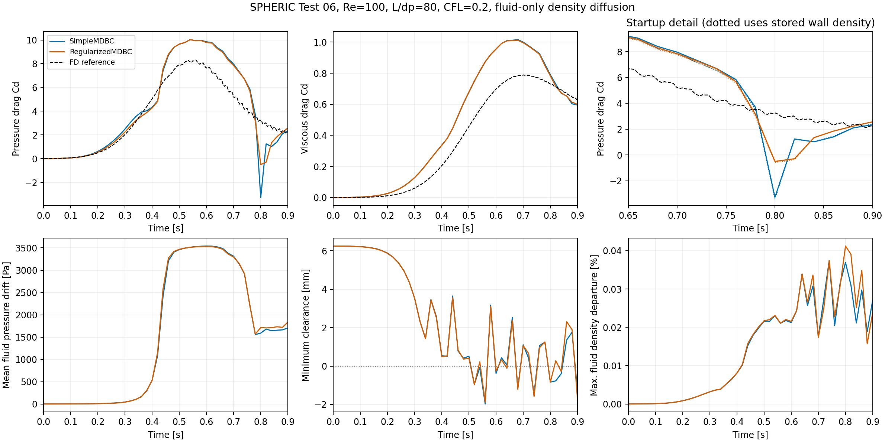

# Regularized wall reconstruction, SPHERIC Test 06

The experimental `RegularizedMDBC` mode scales only the gradient term in
the mDBC density extrapolation. It uses the same determinant check, physical
wall velocity, predictor and corrector schedule, and gamma-seven pressure law
as the SimpleMDBC control. The reconstruction code is shared by the GPU
correction and the Float64 force postprocessor.

For a supported ghost, let `r_j = ρ_j − ρ_g − ∇ρ · (x_j − x_g)` be the error
of the affine reconstruction at fluid sample `j`, and let
`w_j = (m / ρ_j) W(x_g − x_j)`. The first row of the mDBC system makes the
weighted mean residual zero. The code computes its weighted sum of squares
`R = Σ w_j r_j²` with second moments accumulated in the same neighbor pass,
using coordinates scaled by `h` and densities centered at `ρ₀`. If
`V = Σ w_j (ρ_j − mean_w(ρ))²`, the wall density is

```text
θ = clamp(1 − (R − τ) / max(V, τ), 0, 1)
ρ_wall = ρ_g + θ ∇ρ · (x_wall − x_g)
```

`τ` allows for roundoff in the moment subtraction and for input density
quantization. It uses machine precision, the energy terms in the residual
calculation, and `ρ₀`; the rule has no fit to the reference drag curve. With
adequate support, an affine field has zero residual to roundoff and keeps
its full gradient. A strongly non-affine field can lose its extrapolation
term. Density may still lie outside the sample extrema because the wall
is outside the sampled fluid. Singular systems and invalid reconstructed
densities use the positive Shepard estimate when available. A ghost with
no fluid support retains the SimpleMDBC fallback.

The startup comparison uses Re=100, L/dp=80, c0=160 m/s, coefh=1.2, CFL=0.2,
and integrated translation through 0.9 s. Both trajectories use
`LinearDensityDiffusion()`, which at zero gravity diffuses fluid–fluid pairs.
The short run checks raw pressure and viscous drag, mean fluid pressure
drift, saved clearance, and particle retention before any full-run study.
Force curves are re-evaluated at the saved state. The stored-wall force
diagnostic independently uses the accepted wall density exported by the solver.

## Analytical and frozen-state checks

The Julia tests cover constant and affine density fields in 2D and 3D in
Float32 and Float64, attenuation on a non-affine field, and sparse and dry
support. The 2D CUDA and offline forces agree for a non-affine field with
compact ghosts, four lanes per particle and cached interaction fields. The
static hydrostatic and accelerating-wall forces agree with SimpleMDBC to
1e-5 relative tolerance. The hydrostatic force retains the existing
approximately 4.2% spatial discretization error.

The RTX 5080 runs use Julia 1.12.7, CUDA.jl 6.4.2, Float32 physics and
Float64 positions. The SimpleMDBC control reproduced the archived raw
force CSV exactly. Five saved states at 0.76–0.86 s were re-evaluated with the two
wall formulas. At 0.80 s the reconstructed pressure Cd changes from −3.275
to −3.005 while the fluid state is held fixed. The median rear-wall
sensitivity to signed 0.001 kg/m³ density perturbations drops from 3.63 to
1.24. Maximum rear-wall overshoot beyond the local sample range changes
from 0.217 to 0.214 kg/m³. The perturbation holds particle volumes fixed
and probes both signs of the direction that maximizes the SimpleMDBC
response. These are local directional gains.
[Force table](frozen_forces.csv) · [Neighborhood table](frozen_neighborhoods.csv)

## Matched n80 startup

Both trajectories completed 33,975 accepted steps and saved all 46 frames
through 0.90 s. Each saved frame contained 313,600 fluid, 6,400 square and
12,100 tank particles. Exported gamma-seven pressures exactly match the
stored densities in both histories. Errors are raw relative L2 norms against
the official finite-difference reference over 0.10–0.90 s.

| Measure | SimpleMDBC | RegularizedMDBC |
| --- | ---: | ---: |
| Minimum pressure Cd, 0.70–0.90 s | −3.275 at 0.80 s | −0.495 at 0.80 s |
| Minimum pressure Cd using stored wall density | −3.406 | −0.573 |
| Pressure drag error | 34.37% | 31.70% |
| Viscous drag error | 30.09% | 29.97% |
| Minimum saved clearance | −1.98 mm | −1.88 mm |
| Maximum mean fluid pressure drift | 3.54 kPa | 3.53 kPa |
| Mean fluid pressure drift at 0.90 s | 1.70 kPa | 1.84 kPa |

On the evolved trajectory the sampled negative spike is about 85% shallower,
compared with an 8% reduction when changing the wall formula on the frozen
control. A negative pressure-drag sample and penetration remain. This
startup improvement passes the initial comparison for an eight-second
run and a half-timestep check.



## Matched eight-second histories

Both n80 runs completed 302,000 steps and 401 frames. The 46 startup force
samples and saved positions, velocities, densities and pressures match the
separate short run exactly for each mode. All saved frames retain each
particle group.

| Measure through 8 s | SimpleMDBC | RegularizedMDBC |
| --- | ---: | ---: |
| Pressure drag error, 0.10–8 s | 25.49% | 24.09% |
| Viscous drag error, 0.10–8 s | 19.74% | 19.90% |
| Minimum pressure Cd after 0.90 s | +1.540 | +1.521 |
| Minimum saved clearance | −3.27 mm | −3.38 mm |
| Mean fluid pressure drift at 8 s | 2.47 kPa | 2.61 kPa |

The smaller startup spike is retained over the full run. The saved pressure
drag stays positive after 0.90 s in both trajectories. Full-run viscous
error, pressure drift and penetration are slightly larger with regularization.
[Full-run plot](full/force_comparison.png) · [Metrics](full/metrics.csv)

## Timestep and resolution checks

Each row compares matched 0.90 s trajectories at its own resolution and CFL.
The minimum pressure Cd is for the 0.70–0.90 s window.

| Setup | Minimum pressure Cd, Simple → Regularized | Pressure error | Viscous error | Minimum saved clearance |
| --- | ---: | ---: | ---: | ---: |
| n80, CFL 0.10 | −1.49 → −6.91 at 0.88 s | 44.76% → 50.00% | 30.82% → 30.91% | −1.33 → −1.45 mm |
| n40, CFL 0.20 | −0.75 → +0.31 at 0.80 s | 25.83% → 23.96% | 14.61% → 14.22% | −2.82 → −2.99 mm |

The half-timestep n80 runs each completed 67,905 steps. The larger reversal
with regularization also appears in the force computed from stored wall
densities, where Cd changes from −1.72 to −7.44 at 0.88 s. The nominal-CFL
improvement depends on the timestep. The n40 pair uses the same CFL as
the nominal n80 test, so its smaller pressure error does not isolate
the effect of resolution from the change in timestep.
[Half-timestep plot](half-step/force_comparison.png) · [n40 plot](coarse/force_comparison.png)

Using the existing `DBCPlusImpedance` mode in the same n80 half-timestep
setup gives a minimum pressure Cd of +2.81 during 0.70–0.90 s. The pressure
and viscous drag errors are 33.27% and 13.65%. Minimum saved clearance is
−1.99 mm, so penetration remains at that timestep. The
[earlier CFL 0.20 impedance run](../dbc_plus/README.md#matched-startup-and-full-run)
had a minimum pressure Cd of −0.07 at startup and +2.14 mm minimum saved
clearance through 8 s. Across these checks the impedance mode is the better
candidate for suppressing the large pressure reversal. The regularized
extrapolation remains an experiment with timestep-dependent results.
[Half-timestep metrics](half-step/metrics.csv)

At 0.88 s the saved fluid particles show the velocity and pressure fields
around the moving square. Each image uses one color scale across DBC
(`NoMDBC`), SimpleMDBC, RegularizedMDBC and DBCPlusImpedance. The velocity
arrows use the simulation frame.
[Fluid speed and direction](half-step/speed_at_088.png) · [Fluid pressure](half-step/pressure_at_088.png)

The [rear-wall contact audit](rear_wall_contact/README.md) traces the gap,
return of fluid support and pressure reversal, and compares the same
RegularizedMDBC startup with PlanarShifting enabled.
The [impedance and shifting comparison](impedance_shifting/README.md) tests
PlanarShifting on DBCPlusImpedance at the same half timestep.

## Reproduction

Run these commands from `gpu_version`.

```sh
julia --project=. -t 2,0 test/regularized_mdbc.jl
julia --project=. -t 2,0 "validation cases/spheric_test_06/mdbc_validation_tests.jl"
julia --project=. -t 2,0 "validation cases/spheric_test_06/regularized_mdbc_experiment.jl" simple
julia --project=. -t 2,0 "validation cases/spheric_test_06/regularized_mdbc_experiment.jl" frozen
julia --project=. -t 2,0 "validation cases/spheric_test_06/regularized_mdbc_experiment.jl" regularized
python "validation cases/spheric_test_06/plot_regularized_mdbc.py"
```

For each matched follow-up, append `full`, `half-step`, or `coarse` to both
Julia solver commands and pass the same argument to the plotting script.
The optional impedance and DBC comparisons use the `impedance half-step`
and `dbc half-step` arguments. Run `plot_regularized_mdbc_fields.py` with Python
after all four half-timestep runs to render the saved velocity and pressure fields.

The runner keeps particle histories under the ignored
`runs/regularized_mdbc_experiment` directory and refuses to overwrite them.
