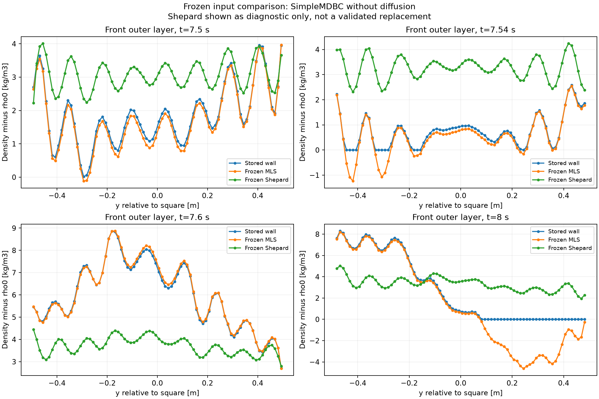

# Frozen SimpleMDBC reconstruction audit

This audit holds each saved particle state fixed. It changes no simulation
or production boundary formula. The examined cases are the matched no-DDT
SimpleMDBC run at nine startup/late times and the fluid-only-DDT SimpleMDBC
startup at five times.

## Result: late MLS matrices are not ill conditioned

At 7.50, 7.54, 7.60 and 8.00 s the front-face dimensionless matrix condition
numbers are at most 5.44, 5.55, 5.41 and 5.76 respectively. All interacting
front-wall reconstructions use the MLS branch in all four frames.

Therefore neither an ill-conditioned solve nor a determinant-branch switch
explains the late front-force reversal in the examined frames. This rules
out that earlier hypothesis; it does not establish that all mDBC neighborhoods
are always well conditioned.

The dimensionless condition estimate rescales derivative rows by h and
gradient columns by 1/h before applying the 2-norm condition calculation.
The production determinant check itself is evaluated on the original matrix.

## The extrapolation contributes substantially to the force swings

| Frozen no-DDT state | Original stored wall-state net Cd | Re-evaluated MLS net Cd | Ghost MLS value without wall extrapolation | Positive-weight Shepard value |
|---|---:|---:|---:|---:|
| 7.54 s | -81.79 | -88.09 | -29.61 | -12.88 |
| 7.60 s | +84.84 | +85.99 | +30.69 | +15.83 |
| 8.00 s | -38.38 | -72.80 | -33.38 | -22.32 |

These are frozen-input force evaluations, NOT simulated trajectories under
the alternative formulas. The entire wall density is replaced in each
diagnostic, including its reciprocal-density force weight. Shepard is not
proposed as a validated replacement: it reduces these swings but retains
large errors and does not preserve first-order wall-gradient accuracy.

At 7.60 s, the largest front-wall extrapolation term is 8.31 kg/m3. The
largest reconstructed wall density is 1011.17 kg/m3 while the largest
Shepard value on the same front owners is 1004.45 kg/m3.
At 8.00 s the largest absolute extrapolation term is 11.84 kg/m3.
This shows amplification of nonuniform density structure through the wall
gradient term, not proof that the mathematical sign of that term is wrong.
SimpleMDBC extrapolates outside the fluid sample locations, so it need not
obey the fluid density min/max principle even for an exact linear field.

## Sensitivity checks

For each fixed neighborhood, the audit forms the exact linear map from
fluid densities to reconstructed wall density, holding particle volumes
fixed. It tests a signed perturbation of at most 0.001 kg/m3 at every fluid
neighbor and verifies that wall-density change equals the sum of absolute
reconstruction weights times that perturbation.

For the four late front faces, the largest amplification factors are
6.40, 4.68, 6.19 and 4.66. Good matrix conditioning does not imply positive
extrapolation weights or absence of overshoot.
This is a fixed-volume sensitivity calculation, not the full nonlinear
Jacobian: in the real operator volumes also depend on density.

In the fluid-only-DDT startup, some rear-wall systems have condition
numbers above 16000, but the worst cases use Shepard fallback, not the MLS
solve. This is a separate neighborhood regime from the late front event.
One cannot attribute both events to the same conditioning defect.

## Verification and interpretation

The Float64 frozen MLS reactions match the boundary-aware saved force
reconstruction at all 14 frames within 2e-4 absolute / 2e-5 relative
tolerance. Reactions using the stored wall density need not match that
postprocessor, which corrects the accepted wall state anew; both values
are explicitly retained rather than conflated.

Unit tests reproduce constant and linear density fields exactly to
Float64 roundoff, check bounded Shepard interpolation, its fallback branch,
and verify the signed-perturbation sensitivity. Thus the audit does not
demonstrate a simple sign/indexing error in MLS.

The useful next candidate is an explicitly controlled reconstruction
regularization experiment that retains known traction behavior, not an
arbitrary DDT coefficient or treating the frozen Shepard numbers as a fix.
Pressure-datum drift, continuity and actual particle evolution still need
validation under any replacement reconstruction.

Run from gpu_version:

```sh
python "validation cases/spheric_test_06/test_audit_simple_mdbc.py"
python "validation cases/spheric_test_06/audit_simple_mdbc.py"
```

Requires the saved histories, SciPy, NumPy, h5py and matplotlib. No dependencies
or solver defaults were changed. Compact per-wall audit and force tables
are tracked; large input particle histories remain ignored.


