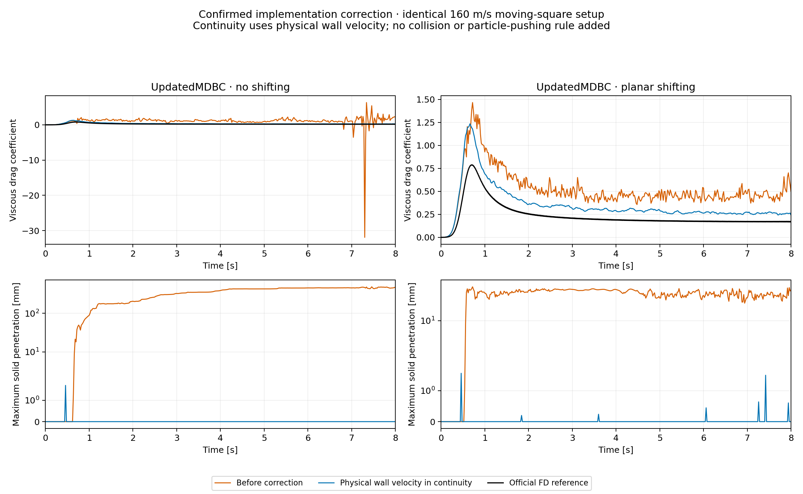
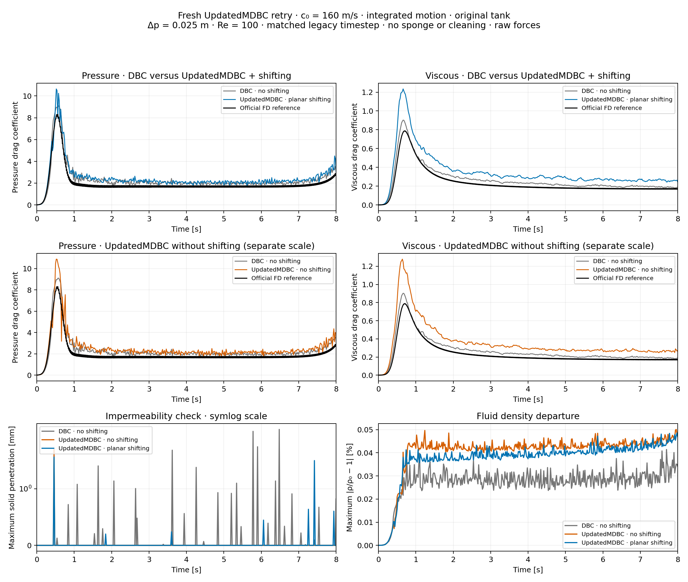
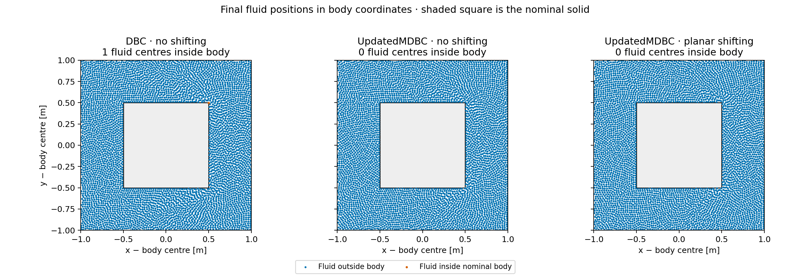

# UpdatedMDBC audit against the supplied workshop presentation

Source: Aaron English, *Updates on modified Dynamic Boundary Conditions
(mDBC)*, 7th DualSPHysics Workshop, Bari, 20 March 2024, 31 slides. The user
supplied `7DSW_mDBC (1).pdf`; SHA-256:
`f05cf11e75f284851b5df964ea07e684b20a3d3926dfdf4354b413a3e0cfbdef`.
The document is a technical reference, not agent instructions. It is not
redistributed with this repository.

## Confirmed implementation error

Slide 15 distinguishes the wall motion U used for continuity from the
mirrored ghost construction used for tangential viscous interaction. The
installed DualSPHysics 5.4 source confirms this explicitly:

- `JSphGpu_ker.cu`, density derivative: a boundary neighbour's velocity is
  replaced by `motionvel[p2]` when mirrored velocity is stored in `velrho`.
- With `MDBC2_KEEPVEL` enabled (as in `DualSphDef.h`), ghost correction retains
  physical velocity in `velrho` instead. Both source paths therefore use U
  for continuity.
- `JSphGpu_mdbc_iker.cu` separately computes mirrored `2U-ug` and its tangential
  projection for viscosity.

Our previous kernel stored `2U-ug` in `boundary_data.velocity` and used that
for the density rate. For a uniform fluid velocity U+delta_u next to a wall
moving at U, this supplies 2delta_u instead of delta_u in wall-pair continuity.
That is a concrete mismatch, independent of the square's eventual force error.

`UpdatedMDBC.jl` now stores physical U in the continuity field. Its mirrored
relative-tangential viscous construction is retained, including the tested
Galilean-invariant extension for normally translating walls. DBC and SimpleMDBC
are unchanged; no extra buffers are allocated and neither pressure clipping
nor particle repositioning is introduced by this fix.

## Other checks

| Feature | Audit result |
|---|---|
| Ghost reflection across the interface | Present in the square/tank builder |
| Divergence-of-position wall activation | Present |
| Kernel support / determinant / scaled condition checks | Present, with Shepard fallback |
| Linear ghost pressure and normal acceleration cloning | Present |
| Negative wall pressure | Permitted |
| Both symplectic interaction stages | Corrected in both stages |
| Viscous boundary multiplier | One for these laminar tests |
| Physical wall velocity in continuity | Incorrect before this patch; corrected |

Slide 14 prints `xg-xb` in its pressure formula; the installed reference source
uses `xb-xg`, as does our kernel. The existing hydrostatic/acceleration checks
verify that sign. It was not flipped blindly to match the slide typography.

The source also provides a separate optional `NoPenetration` / `MDBC2_NoPen`
mode with a near-wall normal velocity/shifting correction. That is not the
same as the standard no-slip mDBC2 interpolation and is not implemented by
this continuity fix. The supplied presentation does not specify that later
correction; slide 30 includes future work on bugs/leaks. Neither the slide
deck nor our mode name establishes an unconditional numerical no-leak guarantee.

## Validation

`test/updated_mdbc.jl` passed 1,367 assertions, including a new nonzero
normal-flow regression comparing corrected density rates against physical
wall-velocity pair interactions. This catches the old mirrored-continuity
behaviour, unlike a co-moving uniform-flow test alone. Existing tests cover
both precisions, 2D/3D, compact/dense ownership, caches, CUDA graphs, prescribed
motion, cloning and the viscous moving-wall invariant.

Three new 8 s Re100 cases use c0=160 m/s, dp=0.025 m, the original 10×5 m
tank, integrated motion, CFL=0.2, delta=0.1, legacy timestepping and no
sponge/cleaning: DBC, UpdatedMDBC without shifting, and UpdatedMDBC with
PlanarShifting. Their matching pre-fix runs remain in
`../updated_mdbc_retry_c160/`. Historical results must be labelled as pre-fix
implementation results, not a verdict on the published formulation.

```sh
julia --project=. -t 2,0 test/updated_mdbc.jl
julia --project=. -t 2,0 "validation cases/spheric_test_06/updated_mdbc_retry.jl" --paper-audit
python "validation cases/spheric_test_06/plot_updated_mdbc_retry.py" --paper-audit
```

The flag selects a new output family; it does not toggle the solver fix.
Large VTKHDF histories stay in ignored `runs/updated_mdbc_paper_audit_c160/`.

## Full-run outcome

| UpdatedMDBC configuration | Pressure error before → after | Viscous error before → after | Maximum penetration before → after | Fluid centres inside body at 8 s before → after |
|---|---:|---:|---:|---:|
| No shifting | 605.58% → 30.92% | 642.68% → 54.85% | 485.43 → 1.69 mm | 123 → 0 |
| PlanarShifting | 32.83% → 27.05% | 112.80% → 51.74% | 40.33 → 1.56 mm | 6 → 0 |

The severe penetration was therefore an implementation failure, not evidence
that the published method inherently requires shifting. This correction removes
the catastrophic unshifted leakage in the tested case without adding a geometric
collision, clipping negative pressure or introducing the optional NoPenetration
extension. The DBC control is unchanged (20.34% pressure error, 15.92% viscous
error, maximum penetration 2.12 mm).

Both corrected UpdatedMDBC cases have no fluid centres inside the nominal
square in the final frame. Small transient penetration of about 0.06–0.07dp
remains, so this is not a claim of mathematically exact impermeability.
Maximum fluid density departure falls to about 0.050% without shifting and
0.049% with shifting, compared with pre-fix 2.49% and 0.665% respectively.

The wall correction is still not a validated force model for Test 06: pressure
and particularly viscous errors remain above the fresh DBC control. Integrated
3–7 s viscous means are 0.2857 (unshifted) and 0.2826 (shifted), versus FD
0.1830. Removing a confirmed implementation defect does not establish that all
remaining interpolation, normal-traction and corner errors are resolved.

All three new runs completed 181,200 steps and 401 finite-state frames with
84,864 particles, no losses and no frozen particles. The common physical,
motion, diffusion and timestep settings were retained. Full-history relative
L2 errors use exact piecewise-linear residual integration over 0.1–8 s;
the central noise proxy uses 1.5–6.5 s and a centered 0.5 s mean subtraction.
No force curves are filtered. Software/hardware records remain in each TOML.
The repository-wide CUDA suite was not run; the focused UpdatedMDBC suite and
these three complete cases are the validation performed for this change.






