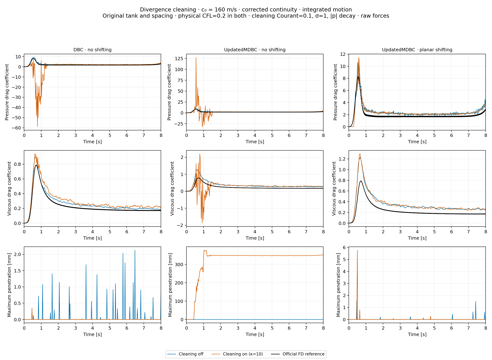
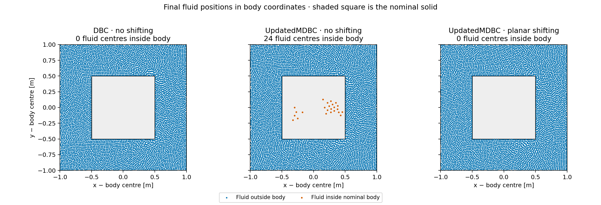

# Divergence cleaning at c0 = 160 m/s

Three fresh 8 s runs enable the existing cleaning implementation with
kappa=10, sigma=1, cleaning Courant=0.1 and absolute-pressure decay.
Re100, original 10 by 5 m tank, dp=0.025 m, integrated motion, delta=0.1,
physical CFL=0.2 and legacy timestepping match the corrected off controls
in `../updated_mdbc_paper_audit_c160/`. No sponge is used. The wall-continuity
fix remains active. Cleaning parameters match the preceding 40 m/s study;
kappa is not rescaled with sound speed.

| Boundary | Pressure L2 error off / on | Viscous L2 error off / on | Pressure-noise RMS off / on | Maximum penetration off / on |
|---|---:|---:|---:|---:|
| DBC | 20.34% / 353.90% | 15.92% / 25.59% | 0.122 / 0.124 | 2.12 / 0.35 mm |
| UpdatedMDBC | 30.92% / 323.39% | 54.85% / 117.65% | 0.151 / 0.442 | 1.69 / 377.57 mm |
| UpdatedMDBC + PlanarShifting | 27.05% / 27.59% | 51.74% / 53.64% | 0.128 / 0.086 | 1.56 / 5.76 mm |

Relative L2 errors use exact piecewise-linear squared-residual integration
against the official FD history over 0.1-8 s. Noise is the pressure residual
RMS after subtracting a centered 0.5 s mean in 1.5-6.5 s. Force plots are raw,
without smoothing, scaling or time shifts. DBC reaches Cd,p=-58.995 at
0.78 s. The large startup excursions make the DBC and unshifted UpdatedMDBC
cleaning configurations unacceptable for validation.

Shifting reduces the central pressure-noise proxy by 32.5%, but slightly
worsens both full-history force errors. It avoids the catastrophic penetration
of the unshifted cleaning run, while retaining 5.76 mm transient penetration.
Final fluid-centre counts inside the square are 0, 24 and 0, respectively.
The unshifted run completes numerically but fails impermeability; its load
metrics must be interpreted with that failure. Density departures reach
1.226%, 4.572% and 0.367%, respectively. These outcomes do not establish a
general failure of the published boundary formulation or identify a new
solver implementation defect.

Enabling cleaning changes fluid acceleration through the scalar gradient;
it is not a pressure-only smoothing operation. Its timestep limit is active:
step counts are 362,649, 367,261 and 362,400 versus 181,200 without cleaning.
The physical CFL is unchanged, but this is an operational on/off comparison,
not an isolation of the operator at identical timesteps. Smaller-step off
controls and timestep refinement would be needed to separate these effects.
Output is every 0.02 s (25 Hz Nyquist), so fast acoustic behavior is not
fully resolved in the saved histories. No precise acoustic frequency is
inferred from these plots.

All cases completed with 401 finite-state frames and 84,864 particles,
without particle losses or frozen particles. Configuration records explicitly
verify c0=160 and cleaning enabled with the specified parameters. Independent
Python integration reproduced all six L2 errors. Plots were generated and
visually checked. No solver source changed; the full CUDA suite was not
repeated for this parameter study. These concurrent desktop runs are not
performance benchmarks.

```sh
julia --project=. -t 2,0 "validation cases/spheric_test_06/updated_mdbc_retry.jl" --paper-audit --cleaning 160
python "validation cases/spheric_test_06/plot_updated_mdbc_retry.py" --paper-audit --cleaning 160
```

Large particle histories remain in ignored `runs/updated_mdbc_paper_audit_c160_cleaning/`.




