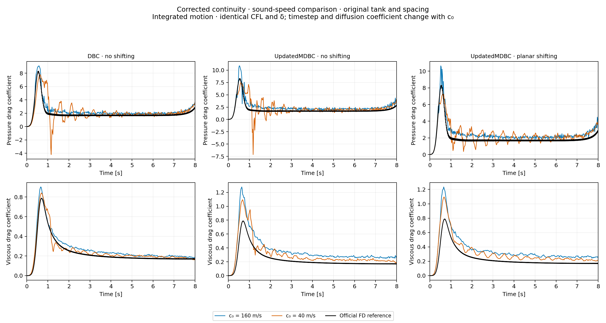
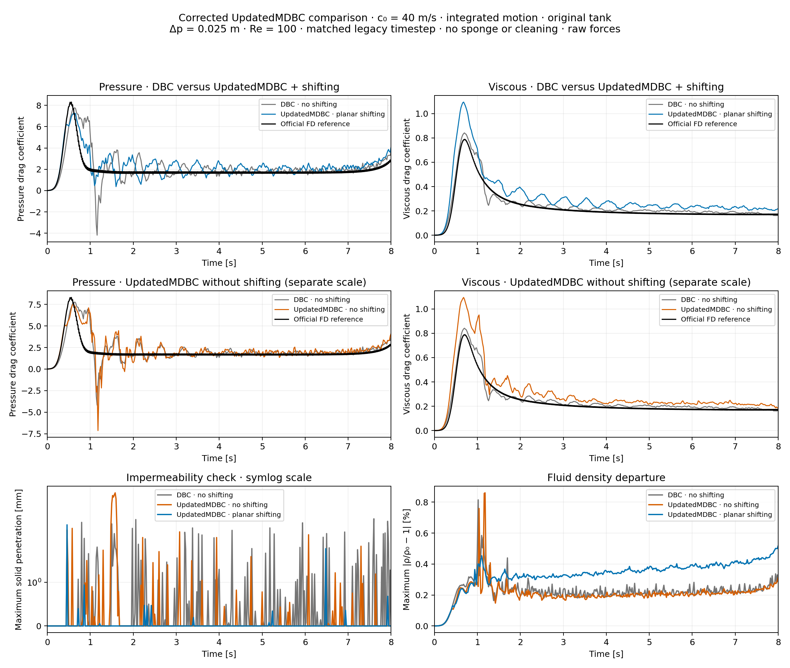
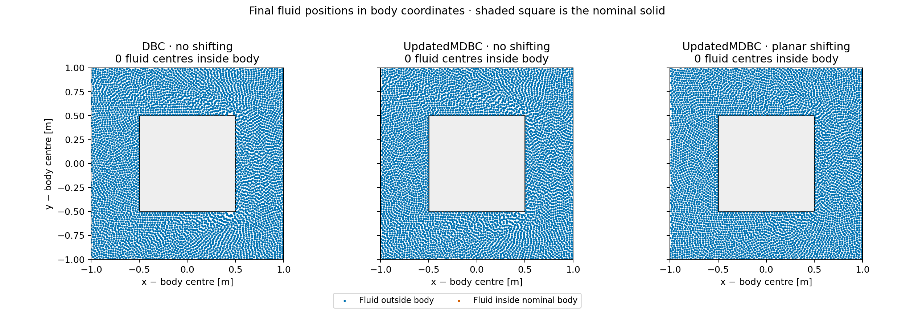

# Corrected UpdatedMDBC at c0 = 40 m/s

Three fresh 8 s runs use the corrected physical-wall-velocity continuity
implementation, original 10 by 5 m tank, dp=0.025 m, integrated motion,
Re100, CFL=0.2, delta=0.1 and legacy timestepping. No sponge or cleaning.
The comparison baseline is `../updated_mdbc_paper_audit_c160/`.

| Boundary | Pressure L2 error, 40 / 160 m/s | Viscous L2 error, 40 / 160 m/s | Maximum penetration at 40 m/s |
|---|---:|---:|---:|
| DBC | 47.01% / 20.34% | 12.51% / 15.92% | 3.61 mm |
| UpdatedMDBC | 48.21% / 30.92% | 38.84% / 54.85% | 7.74 mm |
| UpdatedMDBC + PlanarShifting | 30.98% / 27.05% | 36.53% / 51.74% | 3.02 mm |

Errors are relative L2 norms against the official FD history, using exact
piecewise-linear squared-residual integration over 0.1-8 s. Curves are raw:
no smoothing, scaling or time shift. The pressure residual high-pass RMS
(centered 0.5 s mean removed, 1.5-6.5 s) is respectively 0.459, 0.586 and
0.484 at 40 m/s, versus 0.122, 0.151 and 0.128 at 160 m/s.

Lower sound speed improves viscous force agreement in all three variants,
but worsens pressure error and this pressure-noise proxy. Shifting reduces
the severe startup undershoot in UpdatedMDBC at 40 m/s, without making the
pressure history smooth. The viscous UpdatedMDBC force remains biased high.

The continuity fix still prevents the previous catastrophic leakage in
these cases: all three final frames have zero fluid centres inside the
nominal square. Transient penetration remains, particularly for unshifted
UpdatedMDBC (0.31dp); zero final occupancy is not exact impermeability.
Maximum fluid density departures are 0.815%, 0.860% and 0.517%, respectively.

This comparison does not isolate compressibility alone. At fixed CFL and
delta, changing c0 also changes timestep and the density-diffusion scale
proportional to delta*h*c0. Thus the improved pressure at 160 m/s cannot be
attributed uniquely to stiffness or an isolated acoustic frequency. Saved
frames are 0.02 s apart (25 Hz Nyquist); unresolved fast oscillations cannot
be diagnosed from these output histories.

Each run completed 45,600 steps, 401 finite-state frames and 84,864 particles,
without losses or frozen particles. The 160 m/s cases used 181,200 steps.
Configuration, hardware and timings are recorded in each native.toml.
No solver source changed for this study; validation comprises the three full
runs, plot generation and independent checks of saved force metrics.

```sh
julia --project=. -t 2,0 "validation cases/spheric_test_06/updated_mdbc_retry.jl" --paper-audit 40
python "validation cases/spheric_test_06/plot_updated_mdbc_retry.py" --paper-audit 40
```

Large particle histories remain in ignored `runs/updated_mdbc_paper_audit_c40/`.






