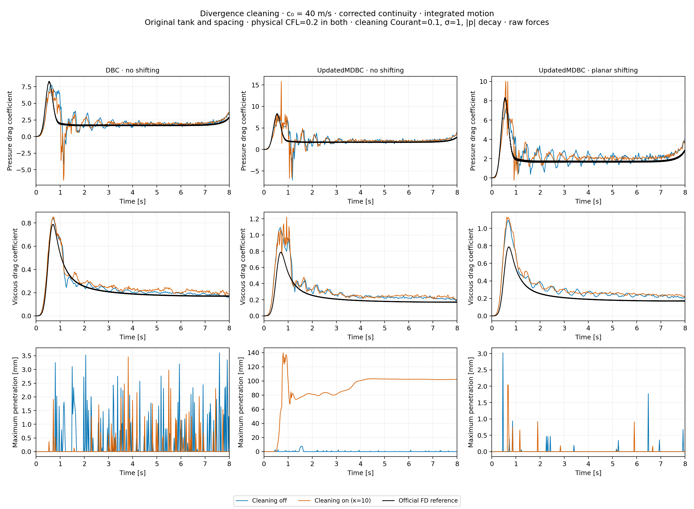
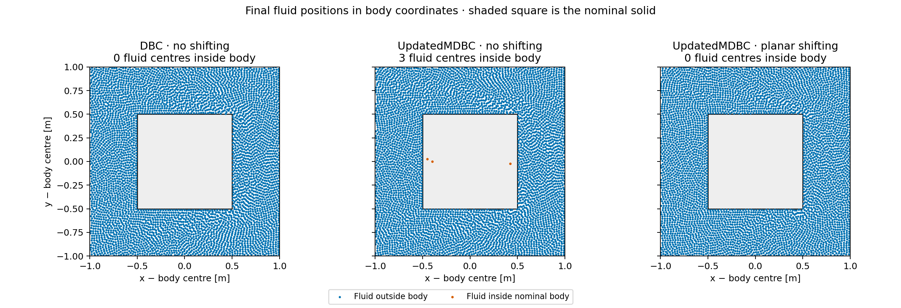

# Divergence cleaning at 40 m/s with corrected UpdatedMDBC

Three fresh 8 s Re100 runs enable `DivergenceCleaning(kappa=10, sigma=1,
courant=0.1, pressure_mode=:absolute)`. Original 10 by 5 m tank, dp=0.025 m,
integrated motion, delta=0.1, physical CFL=0.2 and legacy timestepping match
the off controls in `../updated_mdbc_paper_audit_c40/`. No sponge is used.
The correction to physical wall velocity in continuity remains active.

| Boundary | Pressure L2 error off / on | Viscous L2 error off / on | Pressure-noise RMS off / on | Maximum penetration off / on |
|---|---:|---:|---:|---:|
| DBC | 47.01% / 43.54% | 12.51% / 16.07% | 0.459 / 0.354 | 3.61 / 3.46 mm |
| UpdatedMDBC | 48.21% / 53.41% | 38.84% / 42.79% | 0.586 / 0.527 | 7.74 / 139.89 mm |
| UpdatedMDBC + PlanarShifting | 30.98% / 31.10% | 36.53% / 42.02% | 0.484 / 0.263 | 3.02 / 2.04 mm |

The L2 errors use exact piecewise-linear squared-residual integration against
the official FD history over 0.1-8 s. Noise is the pressure residual RMS after
subtracting a centered 0.5 s mean in 1.5-6.5 s. All plotted force traces are raw.
The shifted variant cuts this noise proxy by about 46%, yet does not improve
full-history pressure agreement and worsens viscous agreement. DBC improves
pressure error modestly but retains a severe startup undershoot. Cleaning is
therefore not a demonstrated validation fix in this study.

Unshifted UpdatedMDBC with cleaning develops significant penetration, with
three fluid centres still inside the nominal square at 8 s. The other two
final frames have zero inside. Maximum fluid density departure is 2.439%
(DBC), 19.957% (UpdatedMDBC), and 2.117% (UpdatedMDBC + shifting). The unshifted
cleaning run is numerically completed but physically unacceptable; its force
metrics must be interpreted together with this failed impermeability check.
This does not identify a new implementation defect or establish a general
failure of the published boundary formulation.

Cleaning adds a scalar-gradient acceleration, rather than only filtering
pressure. Its additional timestep restriction was active: accepted steps
were 91,388, 93,146 and 91,016, versus 45,600 without cleaning. These are
operational on/off comparisons at equal physical CFL, not timestep-matched
operator isolation. A smaller-step off control and timestep refinement would
be needed to attribute the observed changes uniquely to the cleaning operator.
Saved output spacing is 0.02 s (25 Hz Nyquist), limiting acoustic diagnosis.

All runs completed with 401 finite-state frames, 84,864 particles, no losses
and no frozen particles. Saved metadata explicitly records cleaning on and
its parameters. Independent Python integration verifies all six L2 errors;
plot generation and Python syntax checks passed. Solver source is unchanged;
the full CUDA regression suite was not repeated for this study.

```sh
julia --project=. -t 2,0 "validation cases/spheric_test_06/updated_mdbc_retry.jl" --paper-audit --cleaning 40
python "validation cases/spheric_test_06/plot_updated_mdbc_retry.py" --paper-audit --cleaning 40
```

Large VTKHDF histories remain in ignored `runs/updated_mdbc_paper_audit_c40_cleaning/`.




