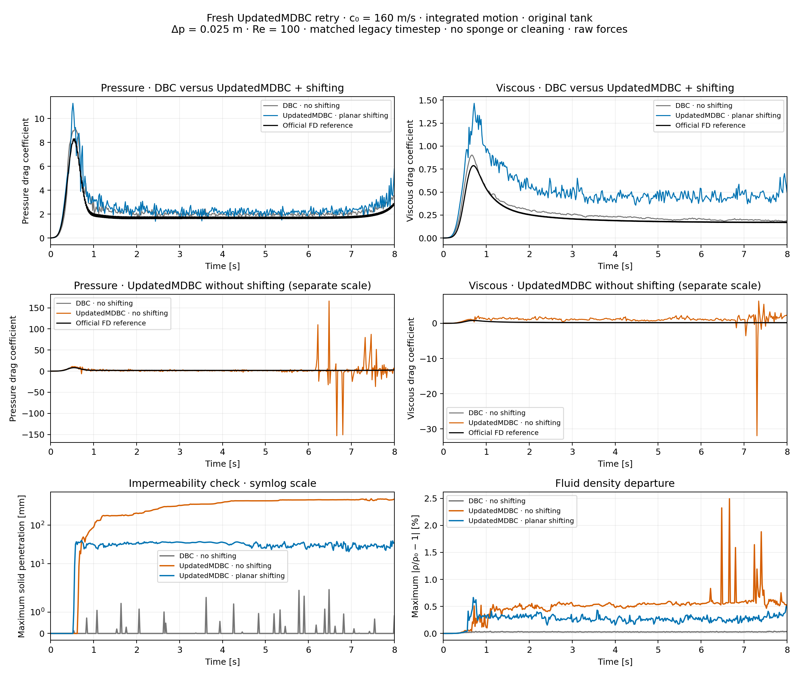
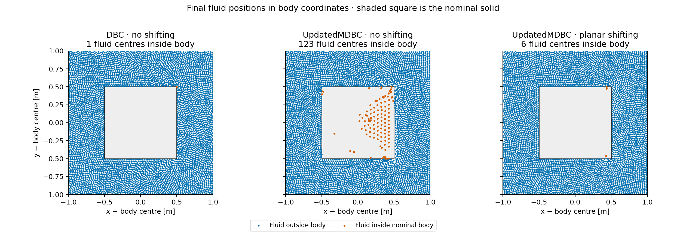

# Fresh UpdatedMDBC retry

Three new full 8 s Re100 cases compare DBC, UpdatedMDBC without shifting,
and UpdatedMDBC with PlanarShifting. All retain c0=160 m/s, dp=0.025 m,
the original 10×5 m tank, integrated-velocity motion, physical laminar
nu=0.01 m²/s, h=sqrt(2)dp, CFL=0.2, delta=0.1, zero gravity/background
pressure, and no sponge or divergence cleaning. All three explicitly use
the legacy timestep to match the recent diagnostic family. These are fresh
controls; old force histories are not substituted for the DBC case.

There are 78,400 fluid, 1,600 square and 4,864 fixed wall particles. Physics
is Float32 with double positions/clocks, CUDA graphs and strict reference
pair arithmetic. No solver implementation is changed by this study.

The existing `mdbc_validation.jl` builder supplies reflected ghost geometry
for both tank and body. Its boundary-aware force reconstruction evaluates
the UpdatedMDBC wall pressure, acceleration correction and mirrored viscous
velocity, rather than applying the ordinary DBC postprocessor to that mode.
The two UpdatedMDBC runs share the same wall treatment; their difference
isolates enabling PlanarShifting. Comparing the shifted run with unshifted
DBC describes a combination of changes, not the boundary model alone.

## Results

| Configuration | Pressure error | Viscous error | Pressure-noise proxy | Maximum solid penetration, 0–8 s | Fluid centres inside square at 8 s |
|---|---:|---:|---:|---:|---:|
| DBC, no shifting | 20.34% | 15.92% | 0.1215 | 2.12 mm | 1 |
| UpdatedMDBC, no shifting | 605.58% | 642.68% | 13.1844 | 485.43 mm | 123 |
| UpdatedMDBC, planar shifting | 32.83% | 112.80% | 0.2418 | 40.33 mm | 6 |

Unshifted UpdatedMDBC again loses impermeability severely. Fluid reaches
almost the square centre and becomes trapped; late force spikes make its
entire load history unusable for validation. Its maximum fluid density departure
is 2.49%, versus 0.041% for DBC.

PlanarShifting substantially reduces intrusion and removes the largest load
spikes, but still allows about 1.61 particle spacings of penetration. Its
pressure error, viscous error and noise proxy all remain worse than DBC.
Mean viscous coefficient over 3–7 s is 0.4518, versus DBC 0.2163 and original
FD 0.1830. Shifting therefore mitigates the catastrophic failure without
establishing an accurate moving-wall force model. Maximum density departure
is still about 0.665%.

These are observations of the current implementation, not a proof of a
single cause. Penetration and the resulting near-wall particle configurations
make viscous traction especially suspect. A different sound speed or a quieter
pressure trace cannot compensate for a permeable body. The shifted boundary
requires further impermeability/shear verification before replacing DBC here.

All three runs completed 401 finite-state frames without lost or frozen
particles. Step counts were 181,200 (DBC), 181,234 (UpdatedMDBC) and 181,200
(UpdatedMDBC + shifting). Completion does not constitute a wall-condition
validation pass. Source solver implementation was unchanged; no repository-wide
CUDA regression suite was rerun for these diagnostic scripts.

## Interpretation and checks

The load plots are raw saved histories with no fitted amplitude, time shift,
or filtering. Relative L2 errors integrate squared piecewise-linear residuals
exactly over 0.1–8 s on the union of output/reference knots. The pressure-noise
proxy removes a centered 0.5 s average from residuals over 1.5–6.5 s; it cannot
replace full-transient load error or impermeability checks.

Maximum solid penetration is `max(0,-minimum_clearance)`, using the existing
minimum over tank and nominal square boundaries. The diagnostic plot uses a
symlog axis so both millimetre-scale and deep penetration remain visible.
The separate final snapshot counts fluid centres inside the nominal square
specifically. The square is shown in body coordinates without hiding particles
inside it. Being close to a physical boundary or completing every timestep is
not an impermeability pass.

Saved output every 0.02 s has a Nyquist limit of 25 Hz. Higher-frequency
fluctuations can alias, and the reference contains numerical oscillations.
Consequently the central noise proxy is a saved-trace measure.

All three runs completed with 401 finite-state frames and 84,864 particles,
without lost or frozen particles. Step counts were 181,200 for DBC and shifted
UpdatedMDBC, and 181,234 for unshifted UpdatedMDBC. Metadata checks verified
matching physical settings, motion, diffusion and timestep criterion. Force
errors were independently recomputed in Python. Successful completion does
not override the impermeability failures. The solver implementation was unchanged,
and the repository-wide CUDA suite was not rerun for these diagnostic scripts.

## Reproduce

```sh
julia --project=. -t 2,0 "validation cases/spheric_test_06/updated_mdbc_retry.jl"
python "validation cases/spheric_test_06/plot_updated_mdbc_retry.py"
```

Small force histories, state diagnostics and run metadata are retained here.
Final particle figures require the large VTKHDF histories in ignored
`runs/updated_mdbc_retry_c160/`. Software/hardware provenance is in each TOML
record. Run times are not used as a paired performance comparison.




