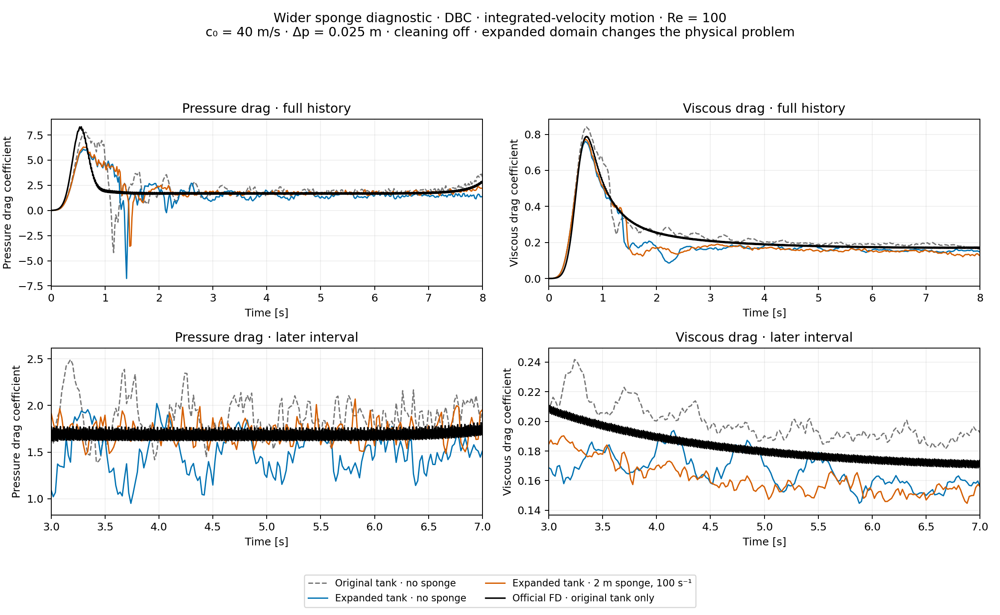

# DBC with integrated motion and a wider sponge

Three fresh, sequential full 8 s runs use Re100, dp=0.025 m, c0=40 m/s,
CFL=0.2, delta=0.1, laminar nu=0.01 m²/s, Wendland C2 with h=sqrt(2)dp,
zero background pressure, no shifting, no cleaning, DBC, integrated-velocity
motion and legacy timestepping. Physics is Float32 with double positions/clocks.
The square's position, size and prescribed path remain unchanged.

| Configuration | Tank bounds [m] | Particles | Sponge |
|---|---|---:|---|
| Original tank | (0,0)–(10,5) | 84,864 | None |
| Expanded control | (-2,-2)–(12,7) | 209,024 | None |
| Expanded sponge | (-2,-2)–(12,7) | 209,024 | Outer 2 m, quadratic velocity damping, rate 100 s⁻¹ |

The sponge is zero throughout [0,10]×[0,5] and increases quadratically toward
the expanded tank walls. The entire body path is undamped. Expanding the domain
moves the physical no-slip walls; adding a sponge damps physical return flow as
well as disturbances. The original benchmark's finite-difference solution is
therefore a comparison trace, not a validation reference for the expanded cases.

| Configuration | Pressure difference from original FD | Viscous difference from original FD | Pressure-noise proxy | Startup minimum Cd,p, 0.8–1.6 s |
|---|---:|---:|---:|---:|
| Original tank | 47.04% | 12.27% | 0.4563 | -4.19 |
| Expanded control | 43.87% | 18.00% | 0.3271 | -6.76 |
| Expanded sponge | 37.51% | 18.30% | 0.2038 | -3.57 |

Relative L2 differences integrate squared piecewise-linear residuals on the
union of output/reference time knots over 0.1–8 s. The pressure-noise proxy is
the RMS of reference residuals after removing a centered 0.5 s average over
1.5–6.5 s. Plots show raw histories without filtering or fitted scale/time shift.
Sampling every 0.02 s cannot resolve fluctuations above 25 Hz.

The sponge lowers the noise proxy by 37.7% relative to the same expanded tank
without damping, or 55.3% relative to the original tank. It also halves the
expanded control's negative startup excursion in magnitude, but does not remove
it. Relative to the expanded no-sponge control, mean pressure drag over 3–7 s
increases from 1.4937 to 1.7171; mean viscous drag decreases from 0.1667 to
0.1614. The mean changes confirm that this is not simply removal of harmless
high-frequency noise. Removing the original confinement also reduces the first
pressure peak substantially. Closer late pressure agreement with the original
FD trace does not establish correct physics in this changed domain.

All runs completed with 401 frames, finite saved state, conserved particle
counts and no frozen particles. Minimum fluid-center clearance is -3.61 mm,
-3.76 mm and -1.52 mm respectively, so small nominal-solid penetration remains.
This is an improved absorption diagnostic, not a validated incompressible fix.

Reproduce from `gpu_version`:

```sh
julia --project=. -t 2,0 "validation cases/spheric_test_06/wide_sponge.jl"
python "validation cases/spheric_test_06/plot_wide_sponge.py"
julia --project=. -t 2,0 "validation cases/spheric_test_06/manual_options_test.jl"
julia --project=. -t 2,0 "validation cases/spheric_test_06/test.jl"
```

The run script resumes completed variants, refuses to overwrite existing
particle histories through the manual driver, and writes outputs in separate
directories. Small coefficient histories, state diagnostics and metadata are
tracked here. Large VTKHDF files and console logs stay in ignored `runs/`.

Validation: all three 8 s runs completed with 401 finite-state frames and no
frozen particles. `manual_options_test.jl` passed 347 assertions (including 326
checks of sponge placement and a short GPU run); `test.jl` passed 298 assertions.
The full repository CUDA suite was not run. Julia 1.12.7 / CUDA.jl 6.4.2 on an
NVIDIA GeForce RTX 5080, driver 13.4.0; see per-run TOML records.


