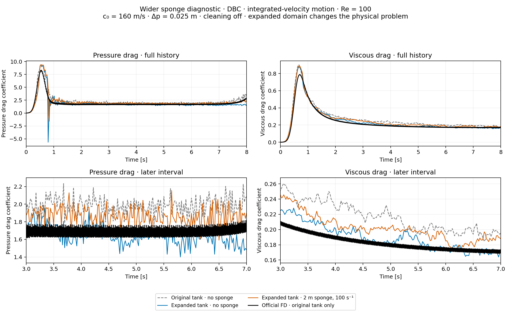
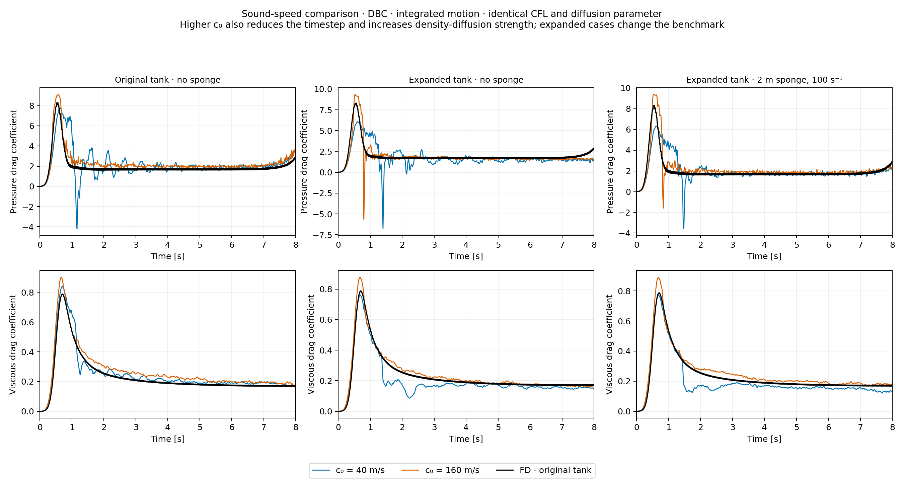

# Wider sponge at c0 = 160 m/s

Three fresh full 8 s runs repeat the [40 m/s controls](../wide_sponge/README.md)
at c0 = 160.0 m/s. DBC, integrated-velocity motion, Re100, dp=0.025 m,
h=sqrt(2)dp, CFL=0.2, delta=0.1, no shifting and no divergence cleaning are
retained. Float32 physics, double positions/clocks and legacy timestepping
remain unchanged. Each run has 401 frames at 0.02 s intervals.

The original tank is [0,10]×[0,5] m (84,864 particles). Expanded cases use
[-2,12]×[-2,7] m (209,024 particles); their physical walls and return flow
differ from the official benchmark. The sponge has a quadratic velocity-damping
profile of width 2 m and rate 100 s⁻¹. Its undamped core is the original box,
and the square's entire path stays within that core.

| Configuration | Pressure difference from original FD | Viscous difference from original FD | Pressure-noise proxy | Minimum Cd,p, 0.8–1.6 s |
|---|---:|---:|---:|---:|
| Original tank | 20.58% | 15.94% | 0.1142 | +2.05 |
| Expanded control | 29.08% | 8.95% | 0.0886 | -5.64 |
| Expanded sponge | 25.99% | 11.30% | 0.1152 | -1.59 |

The full-history differences are relative L2 norms over 0.1–8 s, using exact
squared piecewise-linear integration on the union of saved/reference knots.
The noise proxy removes a centered 0.5 s mean from reference residuals over
1.5–6.5 s. Neither metric fits a scale or time shift. All plotted histories are
raw. Expanded-case differences from the original FD solution are not validation
errors for the changed domain. Output cadence limits spectral interpretation
above 25 Hz.

## Comparison with 40 m/s

For the expanded sponge, increasing c0 changes pressure difference from
37.51% to 25.99%, viscous difference from 18.30% to 11.30%, and the pressure
noise proxy from 0.2038 to 0.1152 (43.5% lower). The startup reversal shrinks
from -3.57 to -1.59 but remains. Over 3–7 s its mean pressure coefficient is
1.8625 versus original FD 1.6886 (+10.3%); its mean viscous coefficient is
0.2015 versus FD 0.1830 (+10.1%).

In the expanded tank at 160 m/s, adding the sponge reduces the startup reversal
from -5.64 to -1.59, but raises the central noise proxy from 0.0886 to 0.1152
(30.0%) and changes mean loads. The original-tank 160 m/s run has the lowest
pressure difference from its applicable reference. Sponge damping is therefore
not a uniformly improving pressure treatment, even when startup looks better.

Changing c0 also changes the adaptive timestep and density-diffusion coefficient
delta*h*c0. A fixed damping rate provides less damping exposure over an acoustic
transit as c0 rises. These controls compare complete configurations; they do not
isolate sound propagation from timestep or diffusion, nor identify an exact tank
mode. Their different startup responses reinforce the need to keep domain and
boundary effects separate from sound-speed sensitivity.

## Reproduce

```sh
julia --project=. -t 2,0 "validation cases/spheric_test_06/wide_sponge.jl" 160
python "validation cases/spheric_test_06/plot_wide_sponge.py" 160
```

The runner verifies requested sound speed before reusing completion records.
The manual example now uses c0=160.0 and the separate `manual_wide_sponge_c160`
output tag. Previous 40 m/s histories remain intact. Large particle histories
and console logs stay in ignored `runs/wide_sponge_c160/`.

All three runs completed with 401 finite-state frames, no frozen particles,
and checked particle counts and prescribed motion. Step counts are
181,200 / 181,269 / 181,220 for original / expanded / sponge respectively.
Small negative solid clearance remains (-1.40 / -1.80 / -2.42 mm), so successful
completion does not establish impermeability. Hardware/software provenance is
in each TOML record; run times are not presented as a performance comparison.

Validation passed 348 assertions in `manual_options_test.jl` (including the new
160 m/s default check and short GPU run), plus 298 in the existing `test.jl`.
The full repository CUDA suite was not run. The plots were rendered and visually
checked; saved metadata was checked against all three 40 m/s cases for matching
geometry, particles, physical settings, damping, motion and output cadence.




