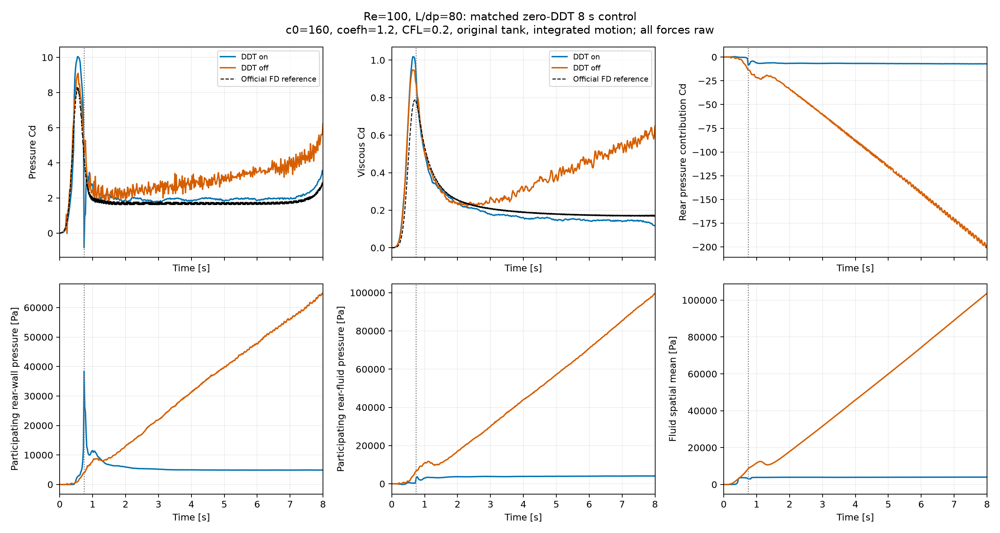

# Full Re=100 n80 ZeroDensityDiffusion control

All 401 saved frames through 8 s completed. The separate 0.9 s startup run is preserved.
Matched original tank, dp=0.0125 m, c0=160 m/s, coefh=1.2, CFL=0.2,
integrated motion, DBC, no shifting, cleaning, sponge or background offset.
Only the density-diffusion model changes. The stored delta=0.1 is inactive
under ZeroDensityDiffusion. No force/reference smoothing or fitted scaling.

| DDT | Component | Raw reference error | Mean Cd, 3-7 s | Peak Cd |
|:--|:--|--:|--:|--:|
| on | pressure | 25.16% | 1.93231 | 10.04344 |
| on | viscous | 20.48% | 0.15550 | 1.01847 |
| on | total | 23.23% | 2.08781 | 10.91868 |
| off | pressure | 63.60% | 3.15901 | 9.09703 |
| off | viscous | 81.12% | 0.38724 | 0.94800 |
| off | total | 65.64% | 3.54625 | 9.96238 |

## Outcome

The original 0.74 s negative excursion is absent, but sustained
pressure and viscous forces drift upward and full-history errors
are substantially larger without DDT. Removing DDT is not a
validated replacement for this boundary treatment. The intervention
supports DDT involvement in the early event, not the claim that
DDT alone is the underlying defect or that disabling it fixes the solver.

Whole-fluid mean pressures at 8 s:

- DDT on: 3976.16 Pa.
- DDT off: 103678.33 Pa.

These means develop dynamically with zero configured background
pressure. Large opposing face reactions can nearly cancel, so
a plausible net drag does not validate the pressure datum or local
wall traction. Continuity, wall density limiting and DDT must be
examined together before assigning the underlying cause.


## State checks

Zero-DDT maximum density departure: 0.80236%.
Minimum nominal solid clearance: 0.24832 mm.
Frozen particles: 0.
Steps: 302000.

All output frames retain 313600 fluid and 6400 square particles;
the fixed-wall count is 12100. Every saved pressure reaction was
independently reconstructed within 2e-5 absolute/relative tolerance.
Initial positions, velocities, densities and markers match the DDT-on
control exactly. Output times and shared settings are checked.

The complete run tests whether removing the early negative excursion
also improves sustained loads; do not infer this from startup alone.
Mean rear-wall pressure and rear reaction need not scale together:
pair weights and fluid pressure change as well. This experiment
does not isolate continuity, DDT and density-floor RHS terms.

Reproduce from gpu_version:

```sh
julia --project=. -t 2,0 "validation cases/spheric_test_06/zero_ddt_startup.jl" full
python "validation cases/spheric_test_06/plot_zero_ddt_startup.py" full
```


