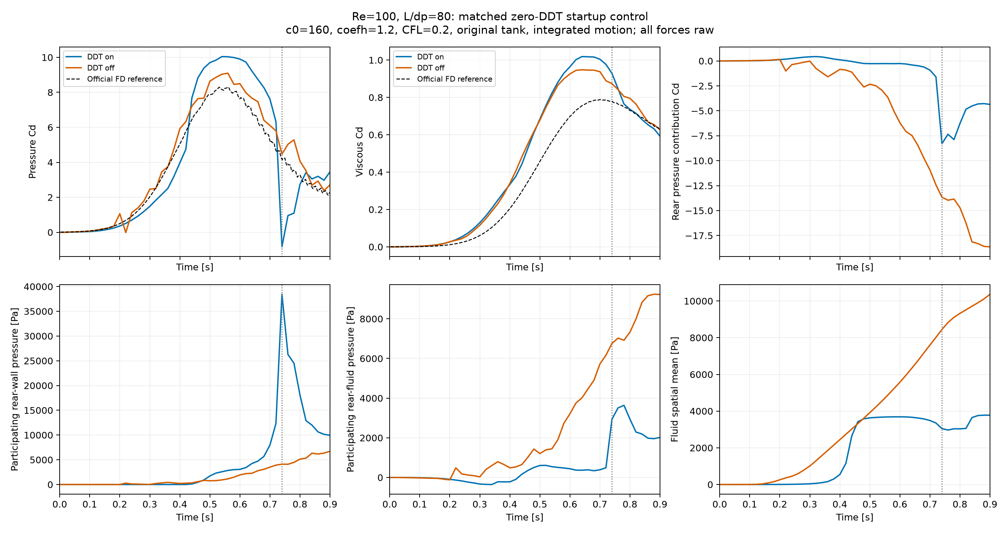

# L/dp=80 zero-density-diffusion startup control

The requested Re=100 case was run to 0.9 s (46 saved frames), past the
original 0.74 s force collapse. Only the diffusion model changes to
`ZeroDensityDiffusion()`. Original tank, dp=0.0125 m, c0=160 m/s,
coefh=1.2, CFL=0.2, DBC, integrated motion, viscosity nu=0.01,
five wall layers, zero background pressure, no shifting, cleaning or sponge
are retained. The stored delta coefficient remains 0.1 but is inactive
under ZeroDensityDiffusion; this is not merely a renamed model.

The DDT-on control is the existing full n80 refinement history, restricted
to the same 0-0.9 s output times. No controls or user data were overwritten.

## Result at the original collapse time

| At t=0.74 s | DDT on | ZeroDensityDiffusion |
|:--|--:|--:|
| Pressure Cd | -0.8321 | +4.4648 |
| Official FD pressure Cd | 4.1797 | 4.1797 |
| Participating rear-wall mean pressure [Pa] | 38435.7 | 4108.7 |
| Participating rear-fluid mean pressure [Pa] | 2934.2 | 6758.6 |
| Whole-fluid mean pressure [Pa] | 3047.5 | 8447.4 |
| Rear pressure reaction Cd | -8.2936 | -13.6607 |
| Rear wall-pressure term Cd | -7.7548 | -7.4491 |
| Rear fluid-pressure term Cd | -0.5388 | -6.2116 |
| Fluid centers inside square | 0 | 0 |

The sharp negative pressure-drag excursion at 0.74 s is absent in this short
zero-DDT control. Peak pressure Cd over 0-0.9 s decreases from 10.0434 to
9.0970. This supports a causal role for enabling this DDT model in the
observed startup response, but does not yet isolate the sign or location of
its density-rate contribution or its coupling to continuity and the wall floor.

Importantly, lower mean rear-wall pressure does not imply a proportionally
smaller wall reaction: interaction weights, fluid pressures and distributions
change too. The rear reaction is actually more negative without DDT; the
positive reactions elsewhere are also larger. The global fluid pressure rises
to about 10 kPa by the end of the short run. Therefore removing DDT has not
established a pressure-consistent boundary solution or full-history drag accuracy.
A delayed excursion beyond 0.9 s is not ruled out.

The zero-DDT run completed 33,975 steps, retained 313,600 fluid and 6,400
square particles, with 12,100 fixed particles, no frozen particles and finite
states. Maximum fluid density departure is 0.2175%; minimum nominal solid
clearance over the short history is +0.248 mm. These checks do not establish
long-term stability or validation. Timings are not controlled speed comparisons.

## Verification and reproduction

All 92 reconstructed square/fluid reactions (46 frames, two cases) match
their saved Float64 force histories within 2e-5 absolute/relative tolerance.
Shared physical settings and output times are checked before comparison.
Face membership, unique participating-particle means and force decomposition
follow the prior startup diagnosis. Raw force curves and supplied FD samples
are not smoothed, shifted or scaled.

Run from gpu_version:

```sh
julia --project=. -t 2,0 "validation cases/spheric_test_06/zero_ddt_startup.jl"
python "validation cases/spheric_test_06/plot_zero_ddt_startup.py"
```

The Julia runner refuses partial-history overwrite and checks a completed
record before reuse. Large particle output is ignored under runs/zero_ddt_startup;
compact histories, metadata, diagnostics and the plot are tracked here.


