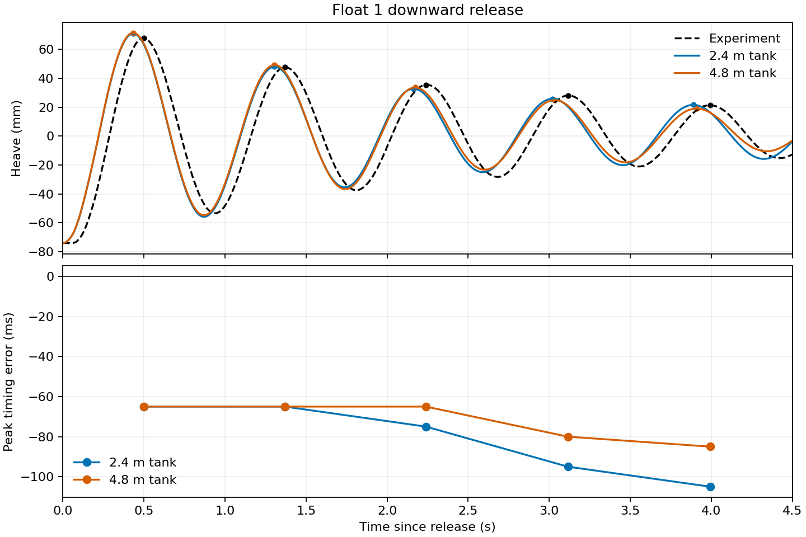
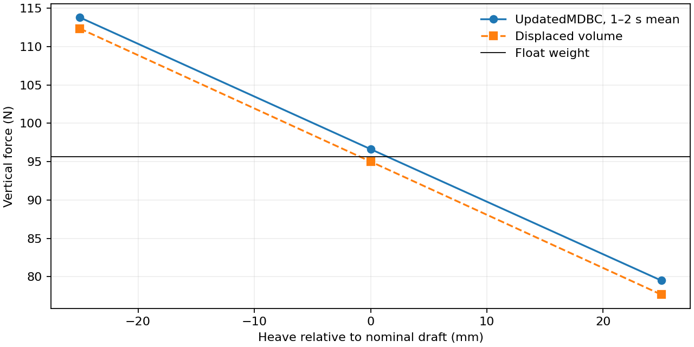

# Float 1 release timing and restoring force

The downward release in the 2.4 m and 4.8 m tanks starts moving about 60 ms
earlier than the measured trace. Both simulations have the same first
crest-to-crest interval as the experiment at the 5 ms output spacing.

| Trace | First 1 mm rise | First crest | First crest interval | Mean of four crest intervals |
| --- | ---: | ---: | ---: | ---: |
| Experiment | 0.0835 s | 0.500 s | 0.870 s | 0.87375 s |
| 2.4 m tank | 0.0229 s | 0.435 s | 0.870 s | 0.86375 s |
| 4.8 m tank | 0.0229 s | 0.435 s | 0.870 s | 0.86875 s |



The wider tank retains the same initial phase lead and reduces the later
period discrepancy. For the wider tank, the 1, 5, and 10 mm rise times are
about 61, 59, and 60 ms earlier than measured. Aligning just the 1 mm rise
for diagnosis reduces the wider tank's RMSE from 14.38 to 2.91 mm over the
same sample window. The comparison plot uses the original times. The
measured pre-motion interval motivates checking the release trigger and
the initial fluid state. The [test specification](https://www.spheric-sph.org/tests/test-14)
describes the release from rest, and [Gu et al.](https://doi.org/10.1016/j.jfluidstructs.2018.06.012)
describe manual release and camera tracking.

The held-body study measures the vertical fluid force at −25, 0 and +25 mm
relative to the nominal draft. All three offsets put the hydrostatic waterline
on the cylindrical side, so displaced-volume buoyancy has a constant
restoring slope of `rho*g*pi*R^2`, about 693.4 N/m. The one-spacing offsets
preserve the nominal lattice phase of the translated body. The 25 mm
UpdatedMDBC runs use the 2.4 m tank and a two-second hold. Force means use
1–2 s, with separate half-window means to show their sensitivity to residual
transients.

All three cases completed with the body held at its target and zero frozen
particles. The measured loads were 113.79, 96.62, and 79.50 N, respectively,
against a body weight of 95.65 N. The secant stiffness is **685.81 N/m**,
1.10% below the displaced-volume value. At fixed effective inertia that
stiffness would lengthen the period by roughly 0.55%. The small force excess
at the nominal draft corresponds to about +1.4 mm of equilibrium heave
under this measured slope.



The held-load results support keeping the physical mass and geometry as
specified. The next dynamic control is to let the water settle with the float
held at the original −74 mm offset, then compare the immediate and settled
releases using elapsed time from solver release. A separate release-trigger
check on the experimental side would establish whether an onset correction
is appropriate. A remaining repeatable crest-interval difference after those
checks would motivate a resolution sweep and a forced-heave added-mass test.

From `gpu_version`:

```powershell
julia --project=. -t 2,0 "validation cases/spheric_test_14/float1_restoring_study.jl"
python "validation cases/spheric_test_14/plot_float1_period.py"
```

The timing script reads the two existing manual runs. Raw timing and the
onset-aligned diagnostic are saved separately in the same CSV.
