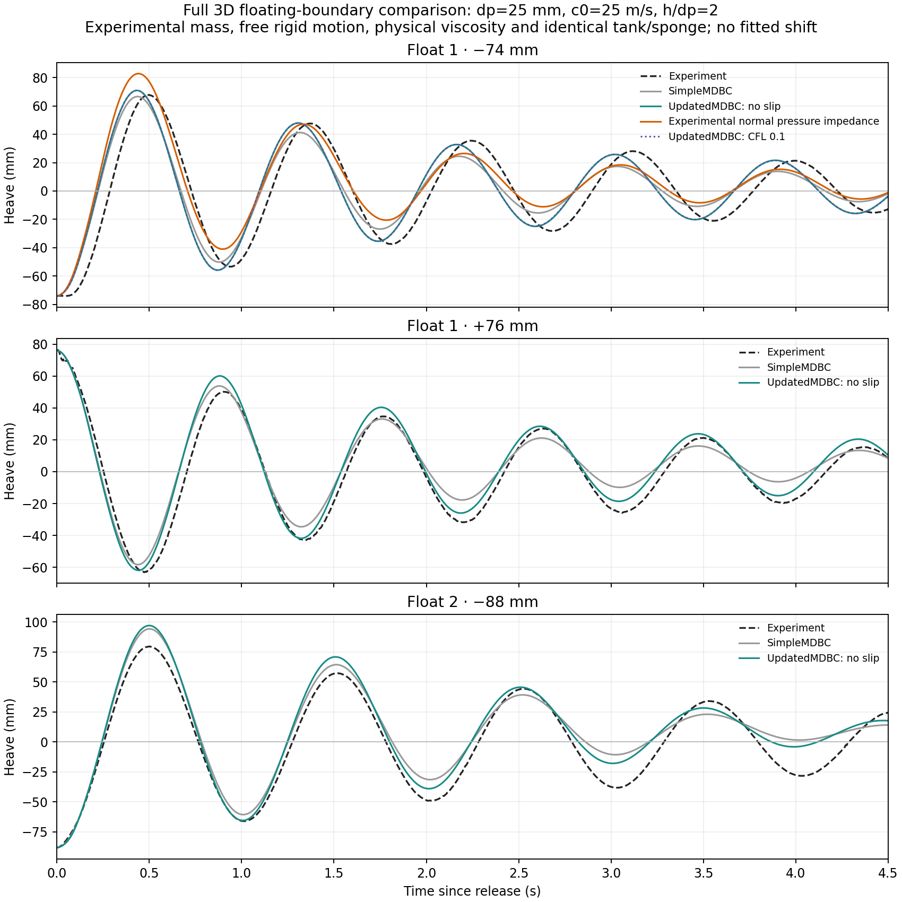
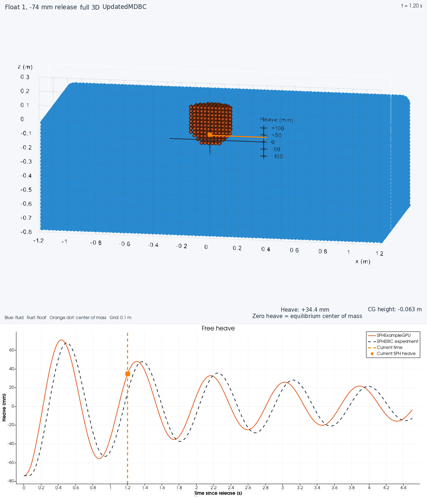

# Floating UpdatedMDBC: implementation and matched heave controls

Floating `UpdatedMDBC` is now an optional experimental mode in the uniform GPU
solver. It improves two of the three heave releases and worsens one, so the
manual and automated full-case defaults remain `SimpleMDBC`.



## Boundary treatment and floating coupling

The extension applies cloned-pressure state to floating particles consistently
in interpolation, fluid/body interactions, pressure caching, density integration
and host pressure export. Floating boundary density encodes pressure; it is not
advanced through continuity or clamped to reference density. Both compact and
full boundary storage retain stable ownership through sorting.

Ghost positions and normals follow the rigid pose at each evaluated stage.
Cloning uses the local rigid acceleration:

```text
a_boundary = a_center + alpha cross r + omega cross (omega cross r)
```

This includes gravity through the body's physical center acceleration. The
initial hold sets boundary acceleration to zero, consistently with the rigid
integrator. The predictor optionally caches its force-derived acceleration for
the subsequent boundary correction. At an accepted-state evaluation, the last
corrector acceleration is used; at startup it is zero. This is explicit stage
coupling, not an implicitly converged pressure/body solve. The usual floating
cache behavior is retained for other boundary modes.

For rotating bodies, the mirrored viscous velocity uses the velocity of the
physical surface halfway between a boundary point and its reflected ghost.
That distinction makes a co-rotating affine fluid produce no spurious shear.
Continuity retains physical boundary-particle velocity, and the viscous
construction retains its physical normal component. Dry ghosts deactivate the
boundary contribution. SPH solid/solid pairs involving these floating particles
are excluded; this path does not introduce a solid-contact solver. Fluid/body
pair forces remain equal and opposite, including the mirrored viscous term.

Supported: uniform-resolution, nonperiodic free 2D/3D rigid bodies and initial
holds, either ordinary stepping scheme, CUDA graphs, pressure caches and compact
or full ghost storage. Constraints, periodic floating bodies, native multibody
dynamics, and variable-resolution floating UpdatedMDBC remain unsupported.
Other experimental cloned-pressure modes are not enabled for floating bodies.

## No slip and no penetration are separate options

The [2026 official workshop presentation](https://dual.sphysics.org/8thworkshop/user/pages/03.workshop/07.programme/8DSW_mDBC_English.pdf),
slide 10, describes an additional near-wall correction with distance and approach
tests. Inspection of the current official
[DualSPHysics CUDA source](https://github.com/DualSPHysics/DualSPHysics/blob/master/src/source/JSphGpu_ker.cu)
shows that its separate no-penetration branch explicitly excludes floating
neighbors (`!ftp2`). It is not simply another pressure-cloning formula.

That geometric correction has **not** been added to this solver. Applying an
independent fluid velocity correction against a free body would require a
consistent reaction impulse and energy assessment. Mirrored no-slip velocity
does not by itself guarantee that fluid particle centers cannot cross a surface.

`UpdatedMDBCWithImpedance` is separately tested as an existing **experimental
pressure response**, adding `rho0*c0*max(0,(u_wall-u_ghost) dot n)` on approach.
It is not the DualSPHysics geometric no-penetration algorithm and is not labelled
as such in the plots or API. The modes here are not claimed numerically
equivalent to the latest DualSPHysics floating implementation.

Reference copies inspected on 21 November 2026 are retained only in local
ignored scratch. SHA-256 of the downloaded CUDA source:
`37a28cf2b19e55bc3c6784a0824319af09be9f7933a15ee7ec601b0b2d6aeb0e`.
Workshop PDF SHA-256:
`14536978f38067970806e1772a1dc4bc021ed5cead742af004f2c1b8d2f9b38c`.

## Complete 3D runs

Three UpdatedMDBC releases, a Float 1 downward impedance control, and a reduced
CFL control completed to 4.5 s. Every history contains 901 finite heave samples
at 200 Hz with no frozen particles. Full body histories retain forces, torque,
orientation and velocities. Reference time, initial offset and heave datum are
unchanged; no filtering or fitted shift is applied.

The matched SimpleMDBC baseline is the previous full 3D study. Both use 25 mm
spacing, Wendland C2 with `h/dp=2`, `c0=25 m/s`, physical Laminar viscosity
`nu=1e-6 m^2/s`, linear density diffusion with coefficient 0.1, double positions,
free rigid motion, and the same 2.4 m tank, 0.8 m water depth and radial sponge.
The experimental masses and centers of gravity are unchanged. Main runs use
CFL 0.2. GPU: RTX 5080; Julia 1.12.7 and CUDA.jl 6.4.2.

| Release | SimpleMDBC RMSE (mm) | UpdatedMDBC RMSE (mm) | Late mean, Simple → Updated (mm) |
| --- | ---: | ---: | ---: |
| Float 1, −74 mm | 13.49 | 15.07 | +1.49 → +0.37 |
| Float 1, +76 mm | 8.32 | 6.78 | +5.07 → +5.17 |
| Float 2, −88 mm | 13.30 | 11.59 | +10.27 → +9.73 |

RMSE is evaluated at the experimental sample times; late means use 3.5–4.5 s.
The boundary switch changes pressure reconstruction, wet/dry treatment and
viscous boundary velocity together; these runs do not isolate no-slip viscosity
alone. The Float 1 down impedance control gives 14.01 mm RMSE and +3.14 mm late
mean, and overshoots the first positive peak more strongly. It does not establish
an across-the-board improvement over SimpleMDBC.

Reducing CFL from 0.2 to 0.1 for UpdatedMDBC Float 1 down increases step count
from 12,350 to 24,073. RMSE changes from 15.0659 to 15.0601 mm. The two raw heave
histories differ by at most 0.240 mm, with 0.075 mm RMS difference. This control
does not indicate that timestep size explains the remaining roughly 15 mm heave
error. It is not a general stability guarantee or a full timestep-convergence
study. Spatial resolution, finite-tank effects, and residual drift/decay remain
unresolved. Wall times include JIT, output and concurrent diagnostic work and
are not used as a solver speed comparison.



## Reproduce and review

In [manual_case.jl](manual_case.jl), select:

```julia
boundary_mode = UpdatedMDBC
```

The manual file retains its inline setup and the user's 12.5 mm spacing. The
committed SimpleMDBC baseline and the new matched studies use 25 mm; do not
confuse those resolutions when comparing a manual run with this table.
The optional CLI uses the same supported modes:

```powershell
julia --compiled-modules=existing --project=. -t 2,0 "validation cases/spheric_test_14/run.jl" 0.025 1.2 4.5 all UpdatedMDBC --no-paraview
julia --compiled-modules=existing --project=. -t 2,0 "validation cases/spheric_test_14/updated_floating_study.jl"
python "validation cases/spheric_test_14/plot_floating_updated.py"
pvpython --force-offscreen-rendering --disable-registry "validation cases/spheric_test_14/render_floating_updated.py"
```

Completed cases resume without overwriting particle histories. Results and
metrics are in [results/floating_updated_study](results/floating_updated_study);
large particle histories and generated ParaView launchers stay in ignored runs.
The geometric no-penetration operator remains separate future work.

## Verification

- Existing wall UpdatedMDBC checks: 1,367 assertions passed, including caches,
  ghost activation, cloned pressure, Galilean invariance and graph/stage tests.
- Manufactured floating boundary checks: 288 assertions across dimensions,
  precisions, compact/full storage, stage poses and cache modes. These cover
  rotating no-slip consistency, rigid acceleration, pressure encoding,
  equal/opposite fluid-body momentum, graph replay and held-body pressure.
- Uniform translation through the complete solver: 44 assertions across both
  dimensions, both ordinary stepping schemes and direct/graph execution.
- Eight opt-in predictor acceleration-cache assertions passed across both dimensions.
- Existing SimpleMDBC floating-ghost checks, body-load/output regressions and
  122,295 full-case geometry/mass checks passed.
- Five complete 4.5 s studies and four initial short smoke runs completed.
- ParaView state-reload, fractional-time, COM/ruler and chart-cursor integration
  checks passed on the new full 3D UpdatedMDBC output.

The whole GPU suite has not been rerun. The new floating mode remains
experimental rather than a fully validated general-purpose rigid-boundary model.
