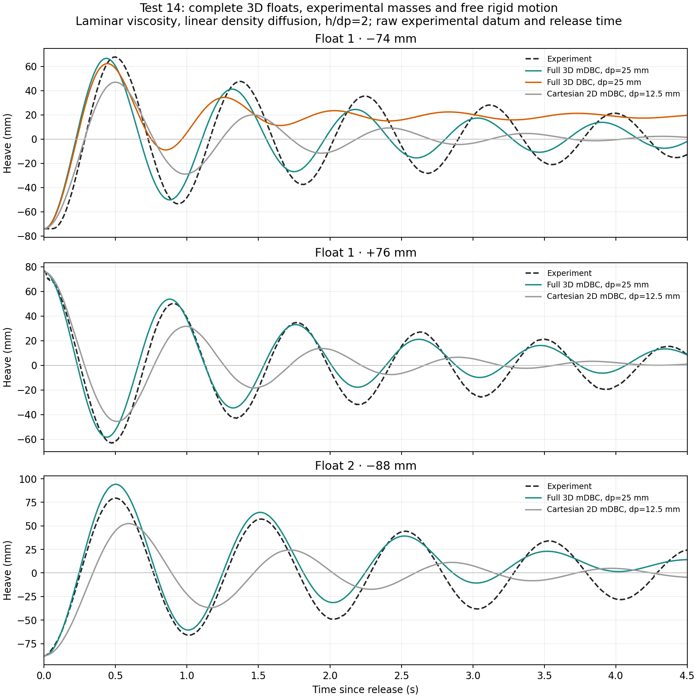
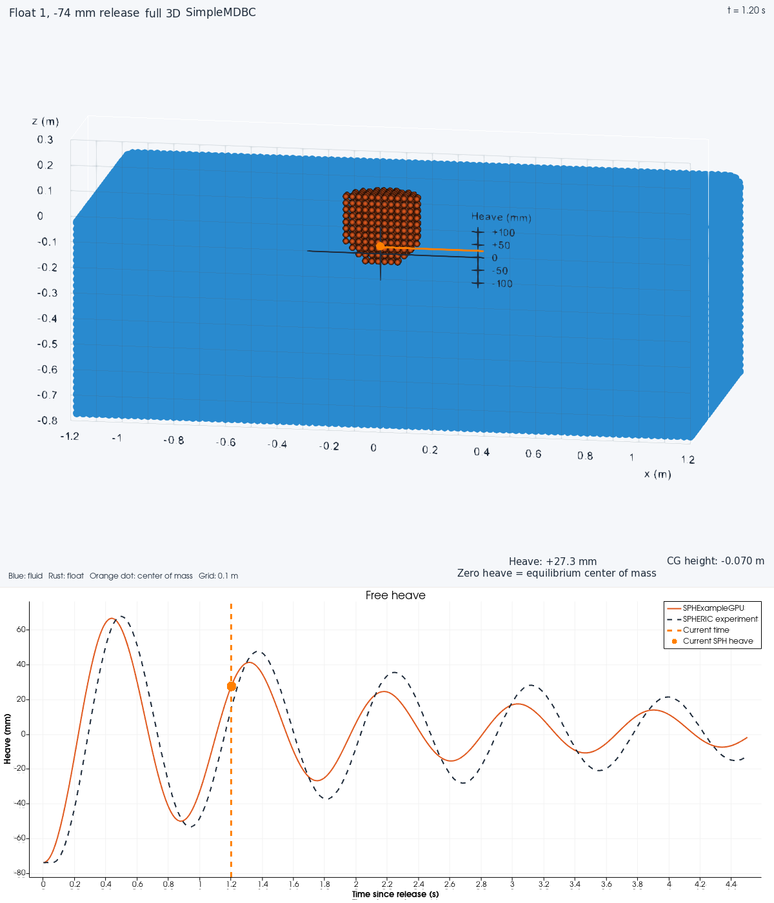

# Full 3D Test 14 with floating mDBC

The updated heave configuration now runs the complete 3D float profiles from the
[SPHERIC Test 14 specification](https://www.spheric-sph.org/tests/test-14), with
the experimental masses and centers of gravity. Surge, sway, heave, roll, pitch
and yaw are free. The planar mass-per-span approximation and heave-only locks
are not used. Inertia remains estimated from the sampled body particles.

## Settings carried into the full geometry

Both [manual_case.jl](manual_case.jl) and [run.jl](run.jl) use the common,
definitions-only [full_case.jl](full_case.jl) factory. Defaults are:

| Setting | Full 3D default |
| --- | --- |
| Boundary | `SimpleMDBC`, with `NoMDBC` available as a matched control |
| Float masses | Float 1: 9.75 kg; Float 2: 23.42 kg |
| CG above base | Float 1: 0.090 m; Float 2: 0.100 m |
| Nominal draft | Float 1: 0.187 m; Float 2: 0.230 m |
| Particle spacing / smoothing length | 0.025 m / 0.050 m, Wendland C2 |
| Water / tank | 0.8 m depth; square computational tank, 2.4 m wide |
| Absorption | Cylindrical sponge from radius 0.7 to 1.2 m, rate 12 |
| Viscosity | `Laminar()`, physical `nu=1e-6 m^2/s` |
| Density diffusion | `LinearDensityDiffusion()`, coefficient 0.1 |
| Sound speed / CFL | 25 m/s / 0.2 |
| Integration | Symplectic, current pairwise-signal timestep, CUDA graphs, double positions |
| Duration / output | 4.5 s / 0.005 s (200 Hz) |
| Initial hold | Zero, matching release at experimental t=0 |

The mDBC ghosts reflect the actual rounded 3D body surface, including the flat
part of Float 2's base and both top caps. Tank ghosts reflect the side and bottom
planes, including corners. Body ghosts follow translation and quaternion
rotation at predictor and accepted stages using the GPU fix described in
[the mDBC investigation](MDBC_HEAVE.md).

The boundary mode is the existing density-extrapolation `SimpleMDBC`, including
its existing unsupported-ghost fallback. Floating `UpdatedMDBC` pressure cloning
remains unsupported and is rejected explicitly. This is not a claim of identical
boundary treatment to current DualSPHysics.

The 16 m planar domain was **not** silently copied into 3D: at 12.5 mm spacing
it would contain approximately 105 million fluid particles before boundaries.
This first full-geometry run retains the earlier 2.4 m computational tank. Its
finite domain, sponge and resolution still require convergence checks.

## Completed comparisons

Three full 3D mDBC releases and one matched 3D DBC Float 1 downward release
completed through 4.5 s, each with 901 frames, no frozen particles, and finite
heave. The matched 3D pair has identical positions, initial GPU densities,
experimental rigid mass, kernel, physical models, damping and output schedule.
No fitted time shift, heave offset, filtering or amplitude rescaling is applied.



| Release | Planar mDBC RMSE (mm) | Full 3D mDBC RMSE (mm) | Early 3D peak period / experiment (s) | 3D late mean heave (mm) |
| --- | ---: | ---: | ---: | ---: |
| Float 1, −74 mm | 19.02 | 13.49 | 0.880 / 0.870 | +1.49 |
| Float 1, +76 mm | 19.50 | 8.32 | 0.885 / 0.870 | +5.07 |
| Float 2, −88 mm | 32.19 | 13.30 | 1.015 / 1.020 | +10.27 |

RMSE is evaluated at the experimental sample times. Early peak periods use the
opposite-side extrema in 0.2–0.8 s and 1.0–1.8 s, sampled every 5 ms. The late
mean uses 3.5–4.5 s. Zero-crossing periods are also retained in the CSV; a drifting
datum can bias them. The planar comparison uses 12.5 mm spacing, an 8 m
half-width and heave-only constraints, so this is not an isolated dimensionality
or resolution experiment.

For the matched **3D Float 1 downward** pair, switching DBC to mDBC reduces RMSE
from **26.95 to 13.49 mm**, and late mean heave from **+19.20 to +1.49 mm**.
Only that release has a new 3D DBC control; no DBC result is inferred for the
other releases. Maximum horizontal drift in the three mDBC runs is 1.20,
0.93 and 0.93 mm respectively.

The first oscillations are substantially closer to the measurement than the
planar runs. The upward mean drift and loss of oscillation amplitude remain,
especially later for Float 2. A close early period does not establish converged
added mass, radiation damping or hydrostatic force balance. The next checks
should refine the rounded interface/free surface and enlarge the undamped
region independently, while comparing body loads, heave and cycle energy.
The new saved `*_body.csv` files retain loads, torque, orientation and velocities
for this work; the benchmark provides heave rather than a force reference.

The GPU was an RTX 5080 with Julia 1.12.7 and CUDA.jl 6.4.2. Each full case has
143,040 tank particles. Fluid/body counts are 293,964/1,060 for Float 1 down,
294,636/1,060 for Float 1 up, and 292,616/2,296 for Float 2 down. The mDBC runs
took approximately 93, 64 and 64 seconds respectively, including different JIT
and output costs; these are not paired speed benchmarks. Raw particle histories
consume roughly 16 GB per release locally and remain excluded from Git.

## ParaView and reproduction

The combined view retains the rear fluid/body cutaway, physical orange COM,
orange dashed time cursor and heave marker, metre-labelled 0.1 m grid,
millimetre heave ruler, and live displacement readout. The 3D camera is widened
to include the measured grid. Geometry is complete in the simulation; the
cutaway is only a display filter.



From `gpu_version`, the editable manual case runs one release by default:

```powershell
julia --compiled-modules=existing --project=. -t 2,0 "validation cases/spheric_test_14/manual_case.jl"
```

Set `selection = "all"` for all three, or select `NoMDBC` for a control. Resolution,
domain, sound speed, kernel, physical models and sponge remain editable. Keep
`pause_time=0` for the benchmark release-time comparison; a nonzero hold changes
the release protocol and requires corresponding time alignment.

The CLI uses the same factory:

```powershell
julia --compiled-modules=existing --project=. -t 2,0 "validation cases/spheric_test_14/run.jl" 0.025 1.2 4.5 all SimpleMDBC --no-paraview
```

The committed comparison was generated with:

```powershell
julia --compiled-modules=existing --project=. -t 2,0 "validation cases/spheric_test_14/full_study.jl"
python "validation cases/spheric_test_14/plot_full_study.py"
pvpython --force-offscreen-rendering --disable-registry "validation cases/spheric_test_14/render_full_study.py"
```

New output tags keep the earlier runs intact. The study resumes completed cases
and refuses existing unfinished particle histories. Run the generated
`runs/full_mdbc_study/SimpleMDBC/<release>/FreeHeave_Comparison.py` in ParaView,
or load its rendered `.pvsm` state. Standalone heave PNGs are saved before
opening ParaView. Histories, full body-load CSVs, settings and metrics are in
[results/full_mdbc_study](results/full_mdbc_study).

Verification completed:

- Four 50 ms GPU smoke runs: all three full mDBC releases and the matched DBC release.
- Four complete 4.5 s runs, with complete/frozen flags and particle counts saved in TOML.
- `test_full_mdbc.jl`: 122,295 geometry, reflected-surface, mass, free-motion,
  physical-model and default-setting assertions; included in `test/runtests.jl`.
- Existing ParaView integration checks on the 3D smoke and complete histories:
  fluid visibility, measured grid, state reload, fractional-time seeking,
  COM/ruler synchronization and orange chart cursor.
- Offscreen visual inspection of the complete Float 1 and Float 2 fluid views
  and the three-release comparison plot.

The whole GPU test suite was not rerun. The core GPU mDBC kernel is unchanged
from the prior tested floating-ghost update.
