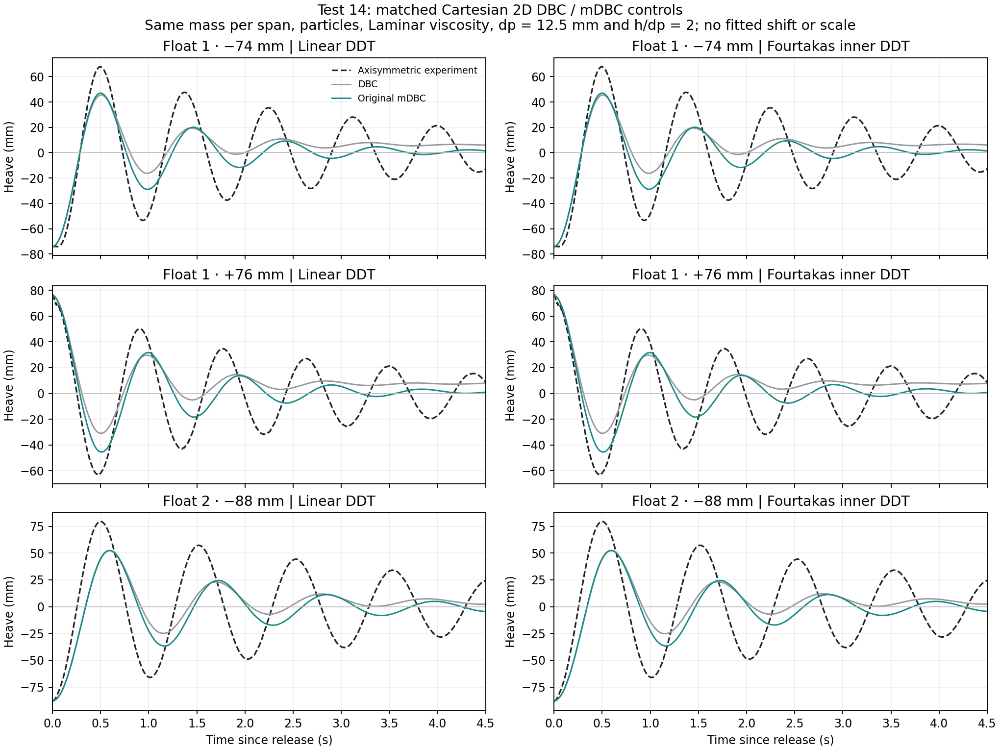
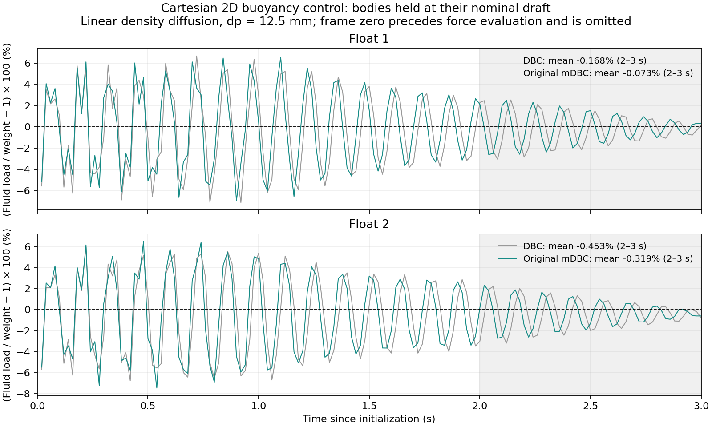
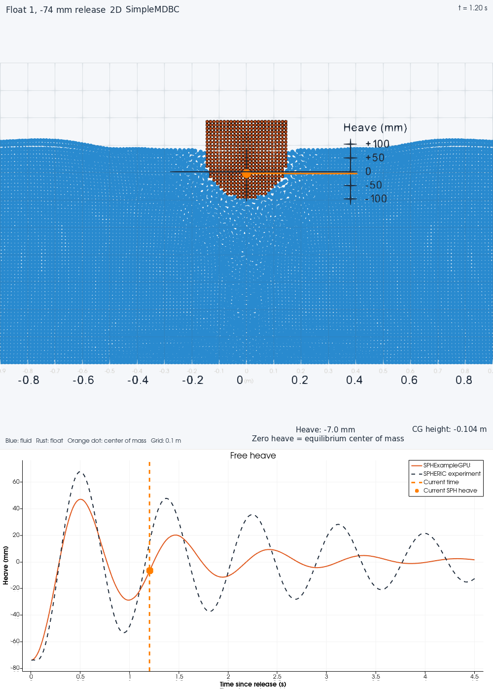

# Test 14: floating mDBC and the heave physics

Optional `SimpleMDBC` is now available in the Cartesian manual case. It improves
the late heave datum, but these runs still decay too quickly and should not be
described as a validated reproduction of the experiment.



## The physical model comes first

The [official benchmark](https://www.spheric-sph.org/tests/test-14) releases
axisymmetric aluminium floats without constraints in still water. Wave radiation
and viscous drag both damp their heave. The supplied masses are 9.75 and 23.42 kg.
The reference is [Gu et al. (2018)](https://doi.org/10.1016/j.jfluidstructs.2018.06.012).

The current manual case is a **Cartesian 2D section**, constrained to heave.
Its mass is 46.4429 kg/m for Float 1 and 82.3429 kg/m for Float 2, calculated from
the submerged section area to obtain the prescribed static draft. Those are
masses per unit span, not the experimental 3D masses.

For small heave, a useful physical description is

```text
(body mass + added mass) × heave acceleration
    + radiation-memory force + viscous drag + hydrostatic restoring force = 0.
```

The planar hydrostatic stiffness per span is `rho*g*(2R)`; the axisymmetric
stiffness is `rho*g*pi*R^2`. Matching the still-water draft matches a static
displacement condition. It cannot also make added mass, radiated-wave energy,
and viscous drag equivalent between those geometries. The large release offsets
also produce nonlinear wetted area and drag. This is why adjusting mass to fit
one period would not establish correct physics.

## What changed in the numerical code

The existing density-extrapolation kernel accepted floating ghost owners, but
their ghost positions stayed at the initial locations while the body moved.
The uniform solver now reconstructs each ghost from its evaluated boundary
position plus the rotated initial body-frame boundary-to-ghost displacement.
It uses the predictor orientation for predictor interactions and the accepted
orientation otherwise. Accepted ghosts are refreshed after final rigid placement
for output. The path runs on the GPU, supports CUDA graphs and compact/full ghost
storage, and adds no device arrays or host readbacks.

The case reflects ghosts across the physical rounded float surface, top cap,
and tank walls. Both boundary variants have identical particles, initial
densities, rigid mass, constraints and solver settings. No half-spacing shift,
mass tuning, fitted time shift, or fitted heave datum is used.

This is the existing **SimpleMDBC density extrapolation**, with its existing
determinant/Shepard and unsupported-ghost fallback. It is not a claim of complete
equivalence to DualSPHysics mDBC: the default dry-ghost fallback is retained.
`UpdatedMDBC` pressure cloning and mirrored viscous velocities still reject
floating bodies; this change does not enable them. Rotating floating ghosts in
the variable-resolution solver are outside this implementation.

## Matched results

Twelve complete 4.5 s runs compare DBC (`NoMDBC`) and `SimpleMDBC`, each with
linear or Fourtakas inner density diffusion, for all three releases. Each history
has 901 frames at 200 Hz, finite heave, and no frozen particles. Settings:
`dp=12.5 mm`, `h/dp=2`, Wendland C2, `c0=25 m/s`, CFL 0.2, Laminar viscosity
`nu=1e-6 m^2/s`, diffusion coefficient 0.1, double positions, symplectic stepping,
0.8 m water depth, 8 m half-width, and identical 1 m end sponges (rate 12).
Hardware: RTX 5080; Julia 1.12.7; CUDA.jl 6.4.2.

With linear density diffusion:

| Release | RMSE, DBC → mDBC (mm) | Late mean, DBC → mDBC (mm) | Early peak period, DBC → mDBC / experiment (s) |
| --- | ---: | ---: | ---: |
| Float 1, −74 mm | 20.16 → 19.02 | +6.10 → +0.76 | 0.935 → 0.965 / 0.870 |
| Float 1, +76 mm | 20.79 → 19.50 | +7.58 → +1.32 | 0.950 → 0.960 / 0.870 |
| Float 2, −88 mm | 31.06 → 32.19 | +4.77 → +0.03 | 1.105 → 1.130 / 1.020 |

RMSE uses the raw history interpolated at reference sample times; the late mean
uses 3.5–4.5 s. Early peak periods use the first two opposite-side excursions
in 0.2–0.8 s and 1.0–1.8 s, at the 5 ms sampling resolution. The summary also
retains the old rising-zero-crossing period. A drifting mean can make that
zero-crossing period look deceptively accurate; it is not sufficient validation.

For Float 1 down, the second/first positive excursion ratio is 0.427 with either
boundary, versus 0.702 measured. This is a descriptive amplitude ratio about
the specified datum, not an identified damping coefficient. Float 2's RMSE
worsens under mDBC. Switching linear to Fourtakas diffusion changes RMSE by less
than 0.15 mm across these controls. Thus neither boundary correction nor this
diffusion switch resolves the dominant decay discrepancy.

The fresh DBC Float 1 down history differs from the existing manually generated
archive by at most 0.279 mm. The new controls use the common factory; the earlier
user-run archive is preserved separately. Wall times include differing JIT and
output costs and are not paired solver speed benchmarks.

## Held-body buoyancy control

Four additional runs hold each float at its nominal draft for 3 s. The body
center is checked at every output. Mean upward fluid load over 2–3 s:

| Body | Weight (N/m) | DBC load (N/m) | mDBC load (N/m) |
| --- | ---: | ---: | ---: |
| Float 1 | 455.605 | 454.838 (−0.168%) | 455.274 (−0.073%) |
| Float 2 | 807.784 | 804.124 (−0.453%) | 805.210 (−0.319%) |



These small mean deficits cannot by themselves explain the large positive late
offset of the freely moving DBC bodies. Load fluctuations remain: the 2–3 s
standard deviation is 6.41/6.08 N/m for Float 1 and 10.66/9.87 N/m for Float 2
(DBC/mDBC). This is a finite-window startup diagnostic, not proof of a perfectly
settled hydrostatic field. The moving interface and its pressure treatment
remain relevant even when the held mean buoyancy is close to weight.

## Next physical improvements, in priority order

1. Use the actual axisymmetric geometry in a converged 3D calculation, with
   experimental mass, center of gravity and free degrees of freedom. An
   axisymmetric solver would need consistent radial operators, ring masses,
   axis treatment, boundaries and body coupling; relabelling Cartesian 2D is
   insufficient. Keep this planar case as a boundary sensitivity control.
2. Establish hydrostatic-load and dynamic-force convergence together. Refine
   the free surface and rounded body with fixed kernel ratio and physical
   viscosity; compare raw heave, pressure/viscous body loads and cycle energy.
   Period alone mixes restoring stiffness and added mass, while a decay fit
   mixes radiation, drag and numerical dissipation.
3. Add a controlled held-at-the-displaced-position release to isolate startup
   pressure transients. Compare time relative to actual release, retain the
   prescribed offset, and avoid damping fluid close to the body. The present
   held controls are at equilibrium and do not yet test that release protocol.
4. For floating Updated mDBC, implement consistent wet/dry activation,
   pressure cloning with rigid-boundary acceleration, physical continuity
   velocity, mirrored viscous velocity, and conservative fluid/body forces
   together. Simply removing the current unsupported-mode guard is insufficient.
5. Repeat timestep and sound-speed convergence on that same physical case.
   Changing `c0` also changes acoustic stiffness, the CFL timestep and density
   regularization. Density diffusion is not itself the physical kinematic
   viscosity. Smoother plots or smaller timesteps alone do not prove accurate
   radiation or decay.

## Reproduce and inspect

From `gpu_version`:

```powershell
julia --compiled-modules=existing --project=. -t 2,0 "validation cases/spheric_test_14/manual_case_2d_mdbc.jl"
julia --compiled-modules=existing --project=. -t 2,0 "validation cases/spheric_test_14/mdbc_study.jl"
julia --compiled-modules=existing --project=. -t 2,0 "validation cases/spheric_test_14/held_planar_mdbc.jl"
python "validation cases/spheric_test_14/plot_mdbc_study.py"
```

The editable manual case selects `boundary_mode = SimpleMDBC`; use `NoMDBC`
for its matched DBC control. Existing output is protected against overwrite.
The study resumes completed histories. Settings and all twelve histories and
metrics are in [results/mdbc_study](results/mdbc_study); large particle files and
ParaView launchers remain in ignored `runs/mdbc_study` directories.



Focused checks passed: existing `test/updated_mdbc.jl` (1,367 assertions),
new `test/floating_mdbc.jl` (64 GPU assertions across dimensions, precisions,
compact/full storage and predictor/accepted poses with graph replay), and
`test_planar_mdbc.jl` (22,954 geometry/mass assertions). Both new tests are
included in `test/runtests.jl`. The whole GPU suite was not rerun.
The ParaView preview was rendered with ParaView 6.1 offscreen; the measurement
text also received an ambient-color fix to remain dark on the light background.
