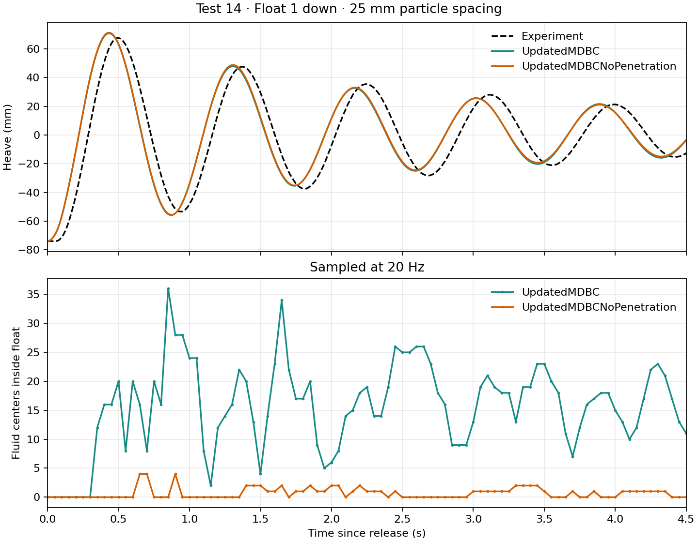

# Normal contact for the floating mDBC boundary

The full 3D Test 14 manual case and CLI default to `UpdatedMDBC`. Select
`UpdatedMDBCNoPenetration` to add normal contact while retaining its no-slip
viscous treatment. The option supports uniform, nonperiodic symplectic runs
without shifting. Floating bodies support free rigid motion and the same
planar heave-only locks as UpdatedMDBC.

The contact force uses the relative normal velocity at the reflected surface.
The force acts within 1.25 particle spacings of a wet boundary particle whose
ghost offset is shorter than 1.75 spacings. It ramps up from zero at 0.75 of
the ghost offset to full strength at the physical surface halfway to the
ghost. Inside that surface, a bounded overlap term pushes the fluid outward.
The force uses the kernel weight and an acoustic rate of c₀/dp. Both sides
of a fluid–float pair get equal and opposite forces through the SPH interaction
mass, and the floating force reduction also carries the contact torque.

This is a finite-strength contact model for the coupled fluid and float.
The DualSPHysics velocity correction discussed in the
[previous study](FLOATING_UPDATED_MDBC.md) excludes floating neighbors.



Both runs use Float 1's −74 mm release, 25 mm spacing, a 2.4 m wide tank,
sound speed 25 m/s, CFL 0.2 and 200 Hz heave output through 4.5 s.
The control is the saved UpdatedMDBC run from the previous study.
The intrusion check transforms saved fluid centers into the moving body's
frame and tests the analytical Float 1 surface at 20 Hz.

| Mode | Heave RMSE | Maximum centers inside | Deepest sampled inset |
| --- | ---: | ---: | ---: |
| UpdatedMDBC | 15.07 mm | 36 | 15.84 mm |
| UpdatedMDBCNoPenetration | 14.91 mm | 4 | 17.42 mm |

The contact run substantially reduces the maximum intrusion count and makes
a small change to heave error. The deepest sampled inset increases, so isolated
crossings still occur. The run completed without frozen particles. The GPU
pair checks cover fixed and floating walls in both compact and full storage.

From `gpu_version`, reproduce the contact run and compare it with the saved
UpdatedMDBC particle history from `updated_floating_study.jl`:

```powershell
julia --project=. -t 2,0 "validation cases/spheric_test_14/no_penetration_study.jl"
python "validation cases/spheric_test_14/plot_no_penetration.py"
```

The contact run writes a synchronized ParaView launcher in
`runs/no_penetration_study/float1_down` and saves its comparison and summary
beside the heave and body histories in `results/no_penetration_study`.
