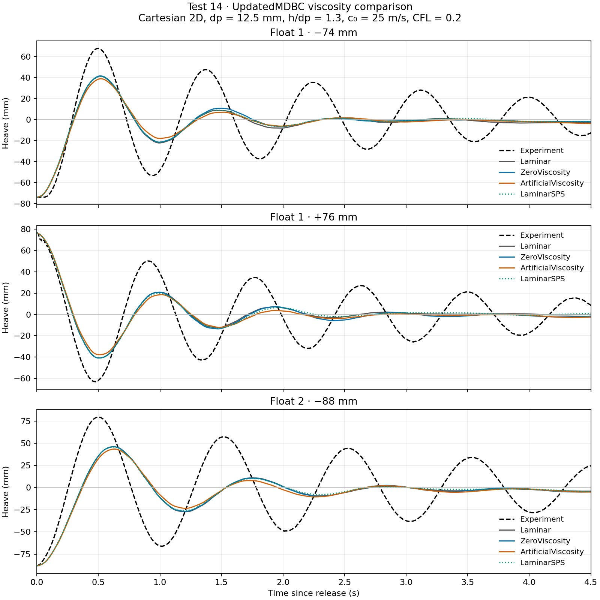

# Planar viscosity comparison with UpdatedMDBC

Each of the three Test 14 releases runs with Laminar, ZeroViscosity,
ArtificialViscosity and LaminarSPS. The study uses the manual planar settings
of 12.5 mm spacing, Wendland C2 with h/dp = 1.3, sound speed 25 m/s, CFL 0.2,
linear density diffusion, and immediate release. The tank is 16 m wide,
with 0.8 m water depth and a 1 m sponge at each end. The body can move
vertically and uses the draft-matched mass per unit span. Artificial
viscosity uses α = 0.01 and boundary factor 1. Laminar and LaminarSPS use
a kinematic viscosity of 1e-6 m²/s.

These are Cartesian 2D controls compared with the SPHERIC experimental heave.
The [3D study](VISCOSITY_STUDY.md) provides a comparison in the actual
axisymmetric geometry. The planar comparison uses raw heave at the recorded
release time. The analysis checks that the recorded simulation inputs match
across models and that each history contains 901 finite samples at 200 Hz.

From `gpu_version`:

```powershell
julia --project=. -t 2,0 "validation cases/spheric_test_14/planar_viscosity_study.jl"
python "validation cases/spheric_test_14/plot_viscosity_study.py" --planar
```

The study saves heave and body histories under
`results/planar_updated_viscosity`. Particle positions and type are saved
with an editable ParaView launcher in the corresponding ignored `runs` folder.

## Results

All twelve runs completed to 4.5 s with zero frozen particles. Heave RMSE
against the experimental trace is reported in millimetres.

| Release | Laminar | ZeroViscosity | ArtificialViscosity | LaminarSPS |
| --- | ---: | ---: | ---: | ---: |
| Float 1 down | **20.91** | 21.00 | 21.92 | 21.10 |
| Float 1 up | **19.51** | 19.65 | 20.42 | 19.86 |
| Float 2 down | 33.14 | 33.09 | 33.35 | **32.93** |



Laminar gives the lowest mean error across the three releases. ZeroViscosity
changes each release's RMSE by at most 0.14 mm, and LaminarSPS improves Float 2
by 0.21 mm while increasing error for the two Float 1 releases. Artificial
viscosity increases the error on all three and reduces the first opposite-side
excursion in each.

For Float 1 down, every model predicts an initial upward excursion of
39–42 mm versus 68 mm in the experiment. Even ZeroViscosity gives a
second-to-first excursion ratio of 0.26 versus 0.70 measured. Changing the
viscous term at these settings leaves most of the amplitude and decay
discrepancy in place. The [summary CSV](results/planar_updated_viscosity/summary.csv)
includes zero-crossing periods for inspection. Those periods are sensitive
to small late oscillations and mean offsets once the amplitude has decayed.
