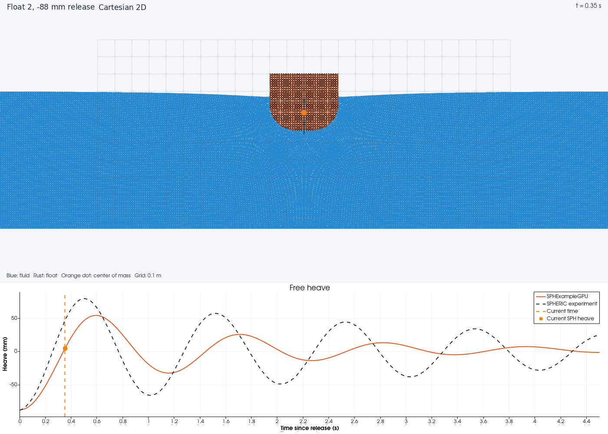

# SPHERIC Test 14 · Free heave of rounded floats

The [mDBC heave investigation](MDBC_HEAVE.md) adds an optional floating-body
`SimpleMDBC` mode, twelve matched Cartesian controls, held-body buoyancy checks,
and a physics assessment. mDBC reduces the late heave offset but does not resolve
the excessive decay or the Cartesian/axisymmetric modelling difference.

The [full 3D update](FULL_3D_MDBC.md) carries those settings into the complete
axisymmetric float geometry. Both `manual_case.jl` and `run.jl` now default to
`UpdatedMDBC`, laminar viscosity, linear density diffusion, `h/dp=2`, and 200 Hz
output. `NoMDBC` remains available as a matched control. The prior DBC/artificial
viscosity results below are historical runs, not the current defaults.

The [floating UpdatedMDBC follow-up](FLOATING_UPDATED_MDBC.md) adds optional
free-body pressure cloning and no-slip boundary treatment. Select
`UpdatedMDBCNoPenetration` to add the [normal contact option](NO_PENETRATION.md).
The `SimpleMDBC` and impedance variants remain available for comparisons.

The GPU case simulates three unconstrained releases from rest and compares
vertical center-of-mass displacement with the measured mean. The datum is
the specified still-water float position. Both histories retain the original
release time and vertical offset.

| Release | Mass (kg) | Draft (m) | Center of gravity above base (m) | Initial heave (mm) |
| --- | ---: | ---: | ---: | ---: |
| Float 1, down | 9.75 | 0.187 | 0.090 | −74 |
| Float 1, up | 9.75 | 0.187 | 0.090 | +76 |
| Float 2, down | 23.42 | 0.230 | 0.100 | −88 |

The solid particles use axisymmetric profiles from the specification and
top heights checked against the supplied STL meshes. Float 1 has a
hemispherical base. Float 2 has a rounded base with a 50 mm flat radius.
The GPU estimates inertia from the sampled particles about the specified
center of gravity. The benchmark supplies the masses and centers of gravity.

## Reproduce

Download the [official Test 14 archive](https://www.spheric-sph.org/tests/test-14)
and extract it into `validation cases/spheric_test_14/reference`.
The tested ZIP has SHA-256
`03d264db42797da73011e20418b5ffc1a2e763aa7a338c68abe4dbd997b0f8cf`.
The archive names the positive Float 1 history `Fl1+0p76.txt`.

From `gpu_version`, run:

```powershell
julia --project=. -t 2,0 "validation cases/spheric_test_14/run.jl"
python "validation cases/spheric_test_14/plot.py"
```

The Julia arguments are particle spacing, tank half-width, duration, an
optional release name (`float1_down`, `float1_up`, `float2_down`, or `all`), and
an optional boundary mode (`UpdatedMDBC` by default).
The defaults are 0.025 m, 1.2 m, and 4.5 s. The plotter accepts the resulting
directory tag, for example `full_UpdatedMDBC_dp0.025_half1.2_h2.0_t4.5`. It compares raw heave and
reports displacement RMSE, mean period across rising zero crossings, mean
heave in the last second, and maximum horizontal drift. The reported
period is relative to the prescribed still-water datum.

## ParaView

Every completed release saves a standalone `<release>_heave_comparison.png`
next to its CSV in `results/<tag>`, before ParaView starts. This requires
Python 3.11 or newer with NumPy and Matplotlib. To regenerate the plot for
one existing release, run `plot.py <tag> --release float1_down`.

For an editable single run, use [manual_case.jl](manual_case.jl). Running
the file or including it starts the simulation immediately. Edit the release,
tank, damping, and solver settings at the top of `run_manual_case()`.
Set `kernel_family` to `WendlandC2()` or `CubicSpline{FloatType}()` and
`kernel_h_factor` to the desired ratio `h / dx`. The run record saves the
kernel and actual smoothing length. Run it from `gpu_version`:

```powershell
julia --project=. -t 2,0 "validation cases/spheric_test_14/manual_case.jl"
```

The manual case writes `FreeHeave_Comparison.py`. ParaView runs this
launcher and saves `FreeHeave_Comparison.pvsm` and a PNG preview.
The ParaView layout stacks the fluid cutaway above the synchronized heave
chart, as in the Test 06 particle-and-force view. The layout follows the
available space in the ParaView window, and the PNG captures that layout
at its rendered size. Edit
`visualize_in_paraview` to control whether ParaView opens automatically.

The batch runner writes a `FreeHeave_Comparison.py` launcher in every
completed release directory under
`runs/<tag>/<release>`. It opens the first release after the invocation.
Pass a release name to run and open that release only. The view places
the animated fluid and float next to the measured and simulated heave curves.
Fluid particles are blue and the float is rust colored. The 3D view cuts away
the front half of the fluid and float to expose their interaction; the Cartesian
2D view shows the complete fluid section. A fixed 0.1 m grid and vertical motion
guide give the scene a distance reference. The orange scene point follows the
physical center of mass from `FreeHeave_Floating.csv`, rather than the average
position of the sampled body particles. Its display is offset slightly toward
the camera to keep it visible; its underlying coordinates remain physical.

Press **Play** to animate the particles, center point, clock, orange chart dot
and dashed orange time line together. The chart dot follows the simulated heave
curve. Both markers interpolate between saved samples when seeking to an
intermediate time, and retain their behavior after saving and reopening the
`.pvsm`. State generation checks that the center and heave histories agree.
The chart includes a small time-axis margin so the vertical line and dot stay
inside the plot at the first and last frames. Data columns are initialized
before applying chart-series and particle-selection settings in the GUI.
The scene grid has numbered x/z coordinates in metres. A separate ruler next
to the body measures heave in millimetres, with zero at the equilibrium center
of mass. Its orange pointer follows the current center height. A live readout
reports signed heave and absolute center height using the saved motion data.



Use **File → Load State** to open the `.py` launcher or a previously
generated `.pvsm`. The saved state reads the VTKHDF and two chart CSVs
from the release directory. You can also open the launcher directly:

```powershell
paraview --state="validation cases/spheric_test_14/runs/manual_dp0.025_half1.2_t4.5/float1_down/FreeHeave_Comparison.py"
```

Use `--no-paraview` with `run.jl` for batch runs that only save simulation
output. ParaView state generation and GUI launch are both skipped.

To regenerate and check an existing view without rerunning the solver, use the
installed ParaView Python executable and that release's launcher:

```powershell
pvpython --force-offscreen-rendering "validation cases/spheric_test_14/test_paraview_heave.py" "validation cases/spheric_test_14/runs/<tag>/<release>/FreeHeave_Comparison.py"
```

This verifies visible fluid/grid and numerical marker/clock synchronization at
the start, end, fractional times and after reverse seeking, following a state
reload. It saves a readable `<state>_Motion.png` preview at 0.35 s and updates the
`.pvsm`. The normal GUI launcher continues to use the available window layout.

## Pilot settings and limitations

The water depth is 0.8 m. The compact square tank and a cylindrical damping
zone spanning radii 0.7–1.2 m are numerical choices. The published CFD used
an 8 m radial domain with a 1 m outer damping region. The pilot uses hydrostatic
initial density, three layers of DBC walls, Wendland C2 with `h = 1.3 dp`,
`c₀ = 25 m/s`, CFL 0.2, artificial viscosity coefficient 0.01, Fourtakas
inner diffusion coefficient 0.1, and standard symplectic stepping. Particle
shifting is disabled for this free-surface baseline. Julia saves output every
10 ms. The experimental histories are sampled every 5 ms.

The setup establishes a reproducible starting point for particle-spacing,
boundary formulation, and tank-size studies. Such studies are needed to
attribute differences in the period or decay envelope.

## Sensitivity checks

```powershell
julia --project=. -t 2,0 "validation cases/spheric_test_14/run.jl" 0.02 1.2 4.5
python "validation cases/spheric_test_14/plot.py" dp0.02_half1.2_t4.5
julia --project=. -t 2,0 "validation cases/spheric_test_14/run.jl" 0.025 1.6 4.5 float1_down
python "validation cases/spheric_test_14/plot.py" --compare dp0.02_half1.2_t4.5 --compare dp0.025_half1.6_t4.5
```

The spacing check holds the tank and release setup fixed. The larger-tank
check keeps the 25 mm spacing and moves the half-metre-wide damping zone
outward with the wall. It tests the combined effect of tank extent and
damping-zone placement for the downward Float 1 release.

## Measured pilot results

All seven GPU runs reached 4.5 s with 451 saved frames each and zero
frozen particles. The heave RMSE used the experimental sample times and
linear interpolation of the simulated trace.

| Release | 25 mm RMSE (mm) | 20 mm RMSE (mm) | 20 mm period (s) | Measured period (s) |
| --- | ---: | ---: | ---: | ---: |
| Float 1, down | 22.16 | 20.07 | 0.807 | 0.871 |
| Float 1, up | 22.03 | 19.34 | 0.818 | 0.865 |
| Float 2, down | 27.16 | 23.94 | 0.942 | 1.008 |

At 20 mm spacing, the late mean heave bias fell in every release. The
oscillations still decayed faster than the measured traces. Widening the tank
from 2.4 to 3.2 m changed the downward Float 1 RMSE from 22.16 to 21.99 mm.
That control leaves the main decay discrepancy open.

[Pilot heave histories](results/dp0.025_half1.2_t4.5/heave_comparison.png)
· [Spacing and tank-width comparison](results/dp0.025_half1.2_t4.5/heave_sensitivity.png)

## Held-float buoyancy check

Hold Float 1 at its prescribed draft of 0.187 m for 3 s and compare the
vertical fluid load to its 95.65 N weight. This control uses two spacings
with the same `h/dx = 1.3`, laminar viscosity, linear density diffusion,
and the 2.4 m tank with its original damping zone. The float position is
checked at every saved time. The initial frame precedes the first force
evaluation and is omitted from the plot.

```powershell
julia --project=. -t 2,0 "validation cases/spheric_test_14/held_float.jl"
python "validation cases/spheric_test_14/plot_held_float.py"
```

Over 2–3 s, the mean vertical fluid forces were 93.12 N at 25 mm and
93.79 N at 12.5 mm, respectively 2.52 N and 1.86 N below the weight. The
static load deficit has the opposite sign to the upward drift observed
in the free-heave runs. [Held-float force history](results/held_float_t3.0/buoyancy_comparison.png)

[SPHERIC benchmark specification](https://www.spheric-sph.org/tests/test-14)
· [Gu et al., 2018](https://doi.org/10.1016/j.jfluidstructs.2018.06.012)

## Cartesian 2D section

[Gu et al., §3](https://doi.org/10.1016/j.jfluidstructs.2018.06.012) reduce
the heave CFD to an axisymmetric wedge with azimuthal periodicity. The
Cartesian SPH solver uses a constant-width section. The two models have
different displaced-volume, added-mass and wave-spreading behavior.

```powershell
julia --project=. -t 2,0 "validation cases/spheric_test_14/manual_case_2d.jl"
```

The [2D manual case](manual_case_2d.jl) uses the same float profile, release
offset and 0.8 m water depth, with 8 m of water to either side and a 1 m
damping zone at each end. Translation and rotation are locked except for
heave. The rigid-body mass per metre of span is calculated from the
submerged section area at the specified draft. The case compares heave
with the experiment as a Cartesian sensitivity check. It saves the heave
PNG before opening the synchronized ParaView view.

The manual 2D case defaults to `UpdatedMDBC` with heave-only locks. Select
`UpdatedMDBCNoPenetration` for normal contact or `UpdatedMDBCWithImpedance` for
the experimental pressure response. `SimpleMDBC` and `NoMDBC` are available
for controls. The editable settings include all four viscosity schemes,
sound speed, CFL, density diffusion and the end sponges. The older
`manual_case_2d_mdbc.jl` entry point uses the same settings.

Set `pause_time = 0.5` to compare an initial hold with immediate release.
The hold must land on a saved frame. The standalone plot and benchmark text
use time since release, while the raw CSV and ParaView preserve solver time.
In ParaView the experiment starts at the configured release time, so the
cursor remains synchronized with particles during the hold.

In a historical DBC run, the Float 1 downward release at 12.5 mm spacing completed through 4.5 s.
The simulated period was 0.866 s versus 0.871 s measured, while the full
heave RMSE was 20.89 mm. [Cartesian heave comparison](results/planar_dp0.0125_half8.0_t4.5/float1_down_heave_comparison.png)

### 200 Hz benchmark-format output

By default the 2D manual case runs all three releases. Set `selection` to a
release name for one run. The solver saves a frame every 0.005 s and writes
headerless, tab-separated time (s) and simulated vertical displacement (mm)
files in the selected `results/planar_…` run folder. The files below are from an earlier run.

| Release | Simulated file |
| --- | --- |
| Float 1, −74 mm | [Fl1-0p074.txt](results/planar_dp0.0125_half8.0_t4.5_200Hz/Fl1-0p074.txt) |
| Float 1, +76 mm | [Fl2+0p076.txt](results/planar_dp0.0125_half8.0_t4.5_200Hz/Fl2+0p076.txt) |
| Float 2, −88 mm | [Fl2-0p088.txt](results/planar_dp0.0125_half8.0_t4.5_200Hz/Fl2-0p088.txt) |

The upward release follows the filename on the benchmark page. The downloaded
experiment for that release is `Fl1+0p76.txt`. The plots use the experimental
means from the archive. The text files do not include the ranges shown on the
benchmark page.

[All three heave comparisons](results/planar_dp0.0125_half8.0_t4.5_200Hz/heave_comparison.png)

## 3D benchmark with experimental onset timing

The benchmark reruns all three releases at 25 mm spacing in the 2.4 m tank
with UpdatedMDBC and laminar viscosity. It saves the 200 Hz heave, rigid-body
history and settings for each release. The timing diagnostic takes the median
of the experimental minus simulated times to move 1, 5 and 10 mm from the
initial height in the release direction. Positive delay means the experiment
moves later. The aligned and raw errors are also reported over identical
samples in the overlap window. Negative alignment values are diagnostic.
The separate 60 ms held Float 1 control uses solver time so the held interval
appears in the comparison with the experiment.

From the GPU package directory, run the following commands.

```powershell
julia --project=. -t 2,0 "validation cases/spheric_test_14/benchmark_3d.jl"
julia --project=. -t 2,0 "validation cases/spheric_test_14/benchmark_3d.jl" --hold
python "validation cases/spheric_test_14/benchmark_onset.py"
```

[Benchmark plots](results/benchmark_3d_25mm/onset_comparison.png)
and [onset and error metrics](results/benchmark_3d_25mm/onset_metrics.csv).

For Float 2, the held-load draft improved RMSE from 11.59 to 9.44 mm in the
2.4 m tank. Keeping that draft and moving the wall and sponge outward in the
3.6 m tank reduced RMSE to 6.34 mm and increased the fourth-cycle swing from
27.60 to 52.77 mm. The measured swing is 62.36 mm. The larger tank with the
continuous-hull hydrostatic draft gave 8.63 mm RMSE and a 57.99 mm fourth-cycle
swing. [Float 2 comparison](results/float2_equilibrium_half1.2/comparison.png)

Next, repeat the Float 1 downward release with the experimental release
trigger if the original tracking metadata are available. Compare that timing
with the 60 ms held-body result and the clock-shift diagnostic. For Float 2,
widen the domain again at fixed spacing, then refine the particle spacing
at the widest practical tank size. Repeat the held-force balance at each
spacing before comparing crest-to-trough amplitude, turning-point timing
and the late heave offset. Moving the sponge separately from the outer
wall would distinguish absorption near the float from wall reflections.

## Float 1 with a 0.725 s hold

Run the optional hold for the downward release at 25 mm spacing.

```powershell
julia --project=. -t 2,0 "validation cases/spheric_test_14/benchmark_3d.jl" 0.725
python "validation cases/spheric_test_14/float1_hold_physics.py"
```

The solver saves 0.725 s held plus 4.5 s free motion. The heave plot uses
elapsed time from release. A separate onset comparison accounts for the
remaining roughly 62 ms difference between the simulated motion and the
experimental clock. The first crest is 68.74 mm versus 67.79 mm measured,
and the first crest interval is 0.880 s versus 0.870 s. The fourth-cycle
swing is 43.56 mm versus 49.15 mm, indicating excess late decay even
though the early restoring response is close.

The vertical fluid load at release was 147.21 N after the 0.725 s hold
and 154.46 N after the 0.060 s hold. The continuous hull, immersed to
0.261 m in water of density 1,000 kg/m3, displaces
`2*pi*R^3/3 + pi*R^2*(0.261-R)` with `R = 0.150 m`. This gives 146.31 N
of buoyancy. The longer hold brings the load at release closer to
hydrostatic balance. One particle spacing establishes agreement of the
early response with the experiment. A spacing sweep with the same
initialization would establish numerical convergence.

[Release comparison metrics](results/benchmark_3d_25mm_hold_725ms/release_physics.csv)

## 4.8 m tank with separate fluid and force output

This 3D benchmark uses the 25 mm spacing, 0.8 m depth and UpdatedMDBC
setup. The sponge spans radii 1.9 to 2.4 m. Float 1 down uses the 0.725 s
hold. Float 1 up and Float 2 down release immediately. Float 2 uses the
219.89 mm draft inferred from held loads on the 25 mm grid in the 2.4 m
tank. The 4.8 m runs retain that draft for comparison with the 3.6 m run.

Fluid VTKHDF snapshots are written every 0.1 s of solver time, including
the initial and final states. The held case ends at 5.225 s. The GPU
records body motion and loads independently every 0.005 s. The plotted
forces are SPH fluid loads in world coordinates, with body weight drawn as
a separate reference. Negative time in the Float 1 down force graph is
the hold interval.

```powershell
julia --project=. -t 2,0 "validation cases/spheric_test_14/benchmark_wide_tank.jl"
python "validation cases/spheric_test_14/plot_wide_tank_forces.py"
```

[Float 1 down force](results/benchmark_3d_48m/float1_down_forces.png),
[Float 1 up force](results/benchmark_3d_48m/float1_up_forces.png),
[Float 2 down force](results/benchmark_3d_48m/float2_down_forces.png).
The same directory contains the sampled body CSVs, heave comparisons and
run configurations. The particle histories are under
`runs/benchmark_3d_48m`.

All three releases completed without frozen particles. The VTKHDF files
contain 54, 46 and 46 fluid frames for Float 1 down, Float 1 up and Float 2
down. The corresponding body histories contain 1,046, 901 and 901 samples.
Heave RMSE on the release clock was 13.27, 5.98 and 7.05 mm respectively.

For Float 2 at the held-load draft, the fourth-cycle swing was 37.83 mm in
the 4.8 m tank, compared with 52.77 mm at 3.6 m and 62.36 mm measured.
The mean heave over the final second moved closer to the experiment.
The decay does not improve monotonically as the wall and sponge move outward
together. [Float 2 tank-width comparison](results/benchmark_3d_48m/comparison.png)

[Stacked benchmark for all three releases](results/benchmark_3d_48m/heave_comparison.png)
and [benchmark metrics](results/benchmark_3d_48m/metrics.csv). These are the
uniform 25 mm GPU baselines. The original run wall times were recorded on
an NVIDIA GeForce RTX 5080.

| Release | GPU steps | Run wall time (s) |
| --- | ---: | ---: |
| Float 1 down | 14,367 | 471.31 |
| Float 1 up | 12,167 | 388.22 |
| Float 2 down | 12,517 | 398.47 |

The refinement geometry supports construction of a 3D box and sampling
its six faces. The solver still requires 2D variable resolution. A 3D
refinement benchmark requires GPU interface coupling and UpdatedMDBC force
validation.
