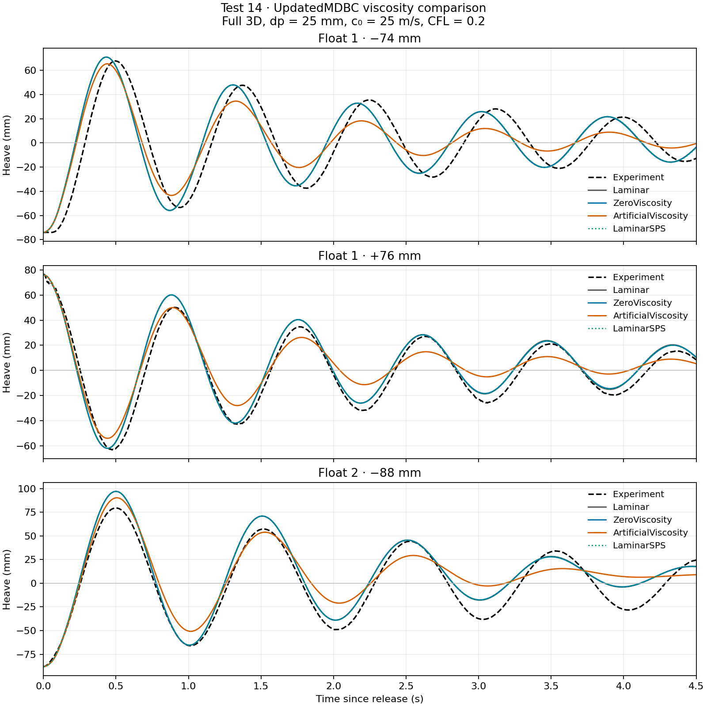

# Viscosity comparison with UpdatedMDBC

The comparison uses the three full 3D Test 14 releases at 25 mm particle spacing,
with Wendland C2, `h/dp = 2`, `c₀ = 25 m/s`, CFL 0.2, and linear density
diffusion. All runs use the same free rigid bodies, 2.4 m tank, and damping zone
as the [floating UpdatedMDBC study](FLOATING_UPDATED_MDBC.md).

The archived Laminar runs provide the control. The three new model settings are
`ZeroViscosity()`, `ArtificialViscosity()` with α = 0.01 and boundary factor 1,
and `LaminarSPS()`. Laminar and LaminarSPS both use `ν₀ = 1e-6 m²/s`.
Switching viscosity also changes how the solver uses the mirrored wall
velocity. ZeroViscosity keeps pressure cloning and the physical wall velocity
for continuity and removes the viscous term. Density diffusion remains active
in all four configurations.

The analysis checks recorded solver inputs against the archived Laminar
control and requires 901 finite samples at 200 Hz, with each run marked
complete and zero frozen particles. Heave RMSE uses the experimental sampling
times and the original datum. The peak ratio uses the first two excursions to
the side opposite the release, taken from 0.2–0.8 s and 1.0–1.8 s. The late mean
uses 3.5–4.5 s. This is a comparison at one resolution and one artificial
viscosity coefficient.

From `gpu_version`:

```powershell
julia --project=. -t 2,0 "validation cases/spheric_test_14/viscosity_study.jl"
python "validation cases/spheric_test_14/plot_viscosity_study.py"
```

The Julia study accepts a single release name to run one set of comparisons.
It writes heave and body histories under `results/updated_viscosity_study`.
Particle positions and type are saved under the ignored `runs` folder for
ParaView. The study saves the same frame times as the archived control.

## Results

All nine new GPU runs reached 4.5 s and passed the input and output checks.
Each table entry is heave RMSE in millimetres.

| Release | Laminar | ZeroViscosity | ArtificialViscosity | LaminarSPS |
| --- | ---: | ---: | ---: | ---: |
| Float 1 down | 15.07 | 15.13 | **13.90** | 15.03 |
| Float 1 up | 6.78 | **6.76** | 10.42 | 6.81 |
| Float 2 down | **11.59** | 11.67 | 16.82 | 11.64 |
| Mean across releases | **11.15** | 11.18 | 13.72 | 11.16 |



ZeroViscosity and LaminarSPS change the Laminar heave traces by at most
0.25 mm RMS across these releases. Artificial viscosity at α = 0.01 reduces
the second-to-first excursion ratio on every release. For Float 1 down the
ratio falls from 0.676 to 0.528, while the measured value is 0.702.
The lower full-history error in that release comes with excess amplitude
decay. The Float 2 late mean stays between +9.69 and +9.74 mm across all four
schemes, so this viscosity sweep leaves the buoyancy or drift discrepancy
largely unexplained.

Laminar remains the best common choice among these settings. Its mean error
is effectively tied with LaminarSPS and ZeroViscosity at this spacing.
The [summary CSV](results/updated_viscosity_study/summary.csv) records the
periods, excursions, late means, and step counts. The generated ParaView state
for the Float 1 down artificial-viscosity run passed the fluid display, grid,
and heave synchronization checks.
