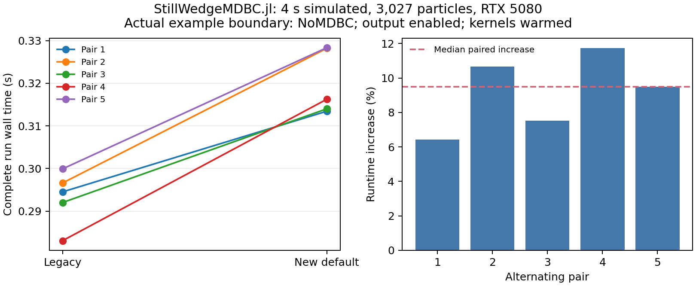

# Neighbor-based default timestep: StillWedge comparison

Ordinary GPU symplectic and single-neighbor stepping now defaults to a
neighbor-relative acoustic criterion. Translating a case should not change its
timestep simply because it is farther from the coordinate origin. The old
expression failed that requirement. `GPULegacyTimestep=true` retains it for
reproducing older runs; it is explicitly enabled in the historical SPHERIC scripts.

## Numerical change

The new criterion is

```math
\Delta t = \mathrm{CFL}\min\left(\sqrt{h/a_{\max}},
\frac{h}{\max(c_0,10v_{\max})+hR}\right),\qquad
R=\max_{ij}\frac{|\mathbf v_{ij}\cdot\mathbf r_{ij}|}{r_{ij}^2+\eta^2}.
```

Pairs follow the solver's actual accepted-neighbor and boundary-velocity rules.
The initial force and neighbor signal are evaluated before choosing the first
step. Subsequent ordinary steps use the last corrector's pair signal and the
accepted-state maximum speed. Existing output clipping, cleaning and rigid-body
timestep policies remain in place.

This follows the acoustic/force structure in
[DualSPHysics](https://github.com/DualSPHysics/DualSPHysics/wiki/3.-SPH-formulation).
It deliberately uses an absolute strain rate, conservative for compression and
expansion; the installed DualSPHysics 5.4 interaction source accumulates a
one-sided signed maximum instead. It is therefore not an exact DualSPHysics
trajectory reproduction. The pressure, diffusion and viscosity operators and
the selected ordinary integrator remain unchanged. In particular, passing the
new signal does not enable the reference integrator's force arithmetic.

This is an explicit timestep estimate. It does not re-evaluate and reject every
trial against both current stages, add a physical-viscosity cap to the ordinary
integrator, or establish that the moving-square force noise has disappeared.
The separate `DualSPHysicsSymplectic(respect_stability_limits=true)` retry mode
still has its documented restrictions. The ordinary provenance recorder
`GPUTimestepDiagnosticsEvery` requires the legacy criterion for now and rejects
the new criterion explicitly.

The uniform solver collects the new maximum only in the corrector and initial
derivative. A warp/block reduction publishes one atomic maximum per block. One
scalar stays on the GPU (4/8 bytes of live payload; CUDA allocator reservations
are larger). No per-step host readback or per-particle signal buffer is added.
Inactive graph nodes preserve the completed signal. Two-level and nested
variable-resolution stepping also receive the new criterion.

## Workload and method

The exact linked `example/StillWedgeMDBC.jl` uses **NoMDBC**, despite its name.
This benchmark preserves that choice. Separate focused regressions cover mDBC.
The workload is 2D, 3,027 particles, `dx=0.02 m`, `c0=42.4857625 m/s`, CFL 0.5,
4 simulated seconds and output every 0.01 s (401 frames). It retains Float32
physics, Float64 positions, Wendland C2, symplectic integration, artificial
viscosity, linear density diffusion, radial interactions, cached interaction
fields, x subdivision 4, CUDA graphs and grid/particle output. PDF generation
and opening external applications are disabled in both variants.

Hardware/software: NVIDIA GeForce RTX 5080, Julia 1.12.7 with `-t 2,0`, CUDA.jl
6.4.2, CUDA driver 13.4.0. The benchmark warms each variant for the full duration,
then runs five alternating, unprofiled pairs. Complete wall time includes
particle generation, setup and output; solver time comes from the result's
whole-solver wall timer. Every run has a unique workspace temporary output
folder. The example's startup footer is removed with a checked match before
including its definitions, so its external default output path is never used.

## Results

See [raw timings](results/timings.csv), [settings](results/settings.toml) and
[final-state differences](results/state_difference.toml).

| Measurement | Legacy | New default |
|---|---:|---:|
| Median complete run | 0.294507 s | 0.316248 s |
| Median solver wall time | 0.290991 s | 0.312209 s |
| Steps | 8,499 | 8,502 |
| Output frames | 401 | 401 |
| Cell-list rebuilds | 3 | 3 |
| Step-state readbacks | 404 | 403 |

The median **paired** runtime ratio is 1.09484: **9.48% longer**, ranging from
6.43% to 11.73% across the five pairs. This is the median of individual paired
ratios, which differs from the ratio of the two median times in the table.
Only 0.0353% more steps were taken. The change adds pair-signal arithmetic,
block reduction and a conditional reset; these measurements do not isolate
which of those costs dominates.



All runs must complete with finite states and no frozen particles. Stable-ID
sorted position, velocity and density arrays must repeat exactly within each
variant; the benchmark stops on a mismatch. These state checks distinguish
repeatability from agreement between the two timestep criteria.

The new trajectory differs from the legacy trajectory, as expected after
changing adaptive timesteps. Maximum final differences are 1.418 mm in a
position component, 0.000888 m/s in a velocity component and 0.05823 kg/m³ in
density. The fluid RMS residual velocity is approximately 0.000834 m/s legacy
and 0.000830 m/s new. Relative density departure from 1,000 kg/m³ is about
0.0014483 RMS for both; this includes the hydrostatic density profile and is
**not** a pressure-noise or hydrostatic-error metric.

This is a very small, subsecond case with output enabled. Its timing variation
does not establish a general performance penalty, memory-bandwidth bottleneck,
or a speed change for larger cases. Earlier three-pair measurements before
removing redundant predictor-stage signal collection are retained in
`results/timings_initial.csv`; they are development evidence, not an isolated
estimate of that optimization's speedup.

## Validation and reproduction

Focused regressions cover an independent dense neighbor oracle, selected GPU
timestep, force/density-rate preservation, Float32/Float64 in 2D/3D, gather lanes
1/4, signal reduction/reset including inactive graph nodes, graph/direct final
state equality, diagnostic rejection, two-level resolution, mDBC and nested
resolution. The full package suite and CPU package suite were not rerun for
this GPU-only change. CPU trajectory comparison fixtures explicitly retain the
legacy criterion because the CPU package still uses that expression.
All 70 new focused assertions passed. Existing focused checks also passed:
1,303 mDBC assertions, 42 nested-resolution assertions and 470 legacy diagnostic
assertions (1,885 assertions in total). `git diff --check` passed.

From `gpu_version`:

```powershell
julia --compiled-modules=existing --project=. -t 2,0 test/pairwise_timestep.jl
julia --compiled-modules=existing --project=. -t 2,0 -e 'using Test, SPHExampleGPU, CUDA, StaticArrays; include("test/updated_mdbc.jl"); include("test/nested_resolution.jl"); include("test/timestep_diagnostics.jl")'
julia --compiled-modules=existing --project=. -t 2,0 benchmark/still_wedge_timestep.jl
python benchmark/plot_still_wedge_timestep.py
```

On shells that alter quotes passed to native programs, put the Julia `using` /
`include` commands in a temporary `.jl` script and run that script instead.
